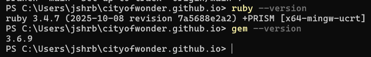
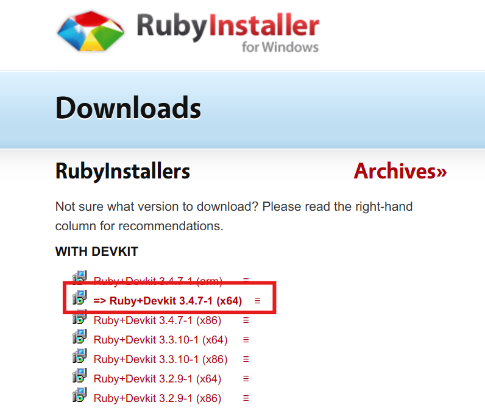

## 📍 개요

github 블로그를 시작하게 되었다. 기존에 tistory 블로그를 운영했는데, 사용할 수 있는 스킨이 제한적이라 자꾸 커스텀 욕구가 올라와서 github으로 이관하게 되었다. 

🧷 [tistory blog][https://0nehundred4ndt3n.tistory.com/](https://0nehundred4ndt3n.tistory.com/)

막상 쓰려고 github blog를 이것저것 만져본지 한달 정도 되어가는 시점에, 한편으론 매번 md 작성하고 push하는 과정이 귀찮기도 해서 아마 tistory와 github 둘 다 적절히 사용하지 않을까 싶다.
ㄴ

## 📍 How to start Github blog in Window

### 1. ruby, gem 설치 / Jekyll, Bundler 설치

이미 설치된 경우 아래와 같이 확인 가능하다.

```bash
> ruby --version
> gem --version
```



그렇지 않은 경우 아래 사이트에서 설치마법사를 받아 진행한다. 이 때 중요한 것은, **"Add Ruby executables to your PATH"** 옵션을 체크해야만 한다. windows 외의 Host PC에서 진행하는 경우, 하기 사이트를 참고한다.

🧷 [ruby 설치마법사] [https://rubyinstaller.org/downloads/](https://rubyinstaller.org/downloads/)

🧷 [ruby 설치 가이드 in Windows, mac, Linux] [https://wikidocs.net/275696](https://wikidocs.net/275696)



64bit 윈도우의 경우 위 파일 설치

다음을 실행해 Jekyll과 Bundler 를 설치한다. 각각 테마 관리(설치), 의존성(플러그인) 관리+로컬테스트 목적이다.

```bash
> gem install jekyll bundler
```

### 2. git repository ({site이름}.gihub.io)생성 / 원하는 테마 선택 + git copy / git push

public 옵션을 체크하여 `*{site이름}.gihub.io`* repository를 생성한다. 그 외 옵션은 크게 중요치 않다.(맘대로)

다음을 실행해 로컬에 git clone을 해준다. clone한 디렉터리(로컬)에서 수정 후→ bundler로 체크한 다음→ 수정사항을 push하면 배포가 되는 식이다.

```bash
> git clone https://github.com/...github.io
```

이제 jekyll theme을 고른다. theme 마다 적용 방법이 대동소이 할 수 있으므로, Readme를 적극적으로 참고할 필요가 있다. 해당 블로그는 아래 첨부된 jeffreytse의 테마를 적용했다.

🧷 [jekyll theme] [https://github.com/topics/jekyll-theme](https://github.com/topics/jekyll-theme)

🧷 [jeffereytse’s theme] [https://github.com/jeffreytse/jekyll-theme-yat](https://github.com/jeffreytse/jekyll-theme-yat)

로컬 테스트 단계는 생략하고 바로 copy로 넘어가도록 하겠다. (Powershell 기준)

```bash
> git clone https://github.com/jeffreytse/jekyll-theme-yat.git yat-full
> cd yat-full
yat-full> Copy-Item -Recurse -Force * ..\cityofwonder.github.io\
yat-full> cd ..\cityofwonder.github.io
..github.io> Remove-Item -Recurse -Force ..\yat-full
..github.io> Remove-Item -Recurse -Force backup
```

덧붙여 해당 테마의 경우 about.markdown, about.html이 모두 있어 일부 정리해주었다. (다 마치고 나니 안하는게 나았을 것 같기도 하다)

```bash
..github.io> Remove-Item about.markdown
..github.io> Remove-Item index.markdown
..github.io> Remove-Item .jekyll-cache -Recurse -Force
..github.io> Remove-Item _site -Recurse -Force
```

이렇게 clone한 디렉터리에 변경사항이 쌓이면, git도 알 수 있도록 push해주어야한다.

```bash
git add .
git commit -m "{원하는 커밋 메시지}"
git push origin main
```

### 2-1. (error) remote 불일치 / branch 불일치

이 때, main, branch, 변경사항 불일치 등의 여러 이유로 에러가 발생할 수 있다. 에러 메시지를 잘 읽고 해결해야한다. 각각 다음과 같다.

⇒ remote 불일치

`*PS C:\Users\jshrb\[cityofwonder.github.io](http://cityofwonder.github.io/)> git push origin main
remote: Permission to jeffreytse/jekyll-theme-yat.git denied to cityofwonder.*`

```bash
> git remote -v
> git remote set-url origin https://github.com/cityofwonder/cityofwonder.github.io.git
> git push origin main
```

⇒ branch 불일치

`*PS C:\Users\jshrb\[cityofwonder.github.io](http://cityofwonder.github.io/)> git commit -m "Import yat theme and configure blog"
On branch master
Your branch is ahead of 'origin/master' by 1 commit.
(use "git push" to publish your local commits)
nothing to commit, working tree clean*`

```bash
> git branch -M main
> git push -u origin main --force
```

### 3. Live Demo 확인 / 커스텀

성공적으로 push를 하고나면 다음 링크에서 제공하는 Live Demo와 같은 화면을 볼 수 있다.

여기서부터는 각 컴포넌트가 어디에 위치했는지 확인하고 수정하는게 전부이다.

🧷 [Live Demo] [https://jeffreytse.github.io/jekyll-theme-yat/](https://jeffreytse.github.io/jekyll-theme-yat/)

다음은 내가 수행한 몇가지 커스텀이다.

1. en, kr, jp 폰트 프리텐다드로 통일 / 각 post의 헤드라이너만 Pretendard Extrabold로 수정

    `_includes/head.html` 파일 수정:

    ```diff
-<link rel="stylesheet" href="https://cdn.jsdelivr.net/npm/typeface-noto-sans@0.0.72/index.min.css">
+<link rel="stylesheet" as="style" crossorigin href="https://cdn.jsdelivr.net/gh/orioncactus/pretendard@v1.3.9/dist/web/static/pretendard.min.css" />
    ```

    `_sass/yat.scss` 파일 수정:

    ```diff
-$base-font-family: Helvetica Neue, Helvetica, Arial, sans-serif, !default;
+$base-font-family: "Pretendard", -apple-system, BlinkMacSystemFont, system-ui, Roboto, "Helvetica Neue", "Segoe UI", "Apple SD Gothic Neo", "Noto Sans KR", "Malgun Gothic", "Apple Color Emoji", "Segoe UI Emoji", "Segoe UI Symbol", sans-serif !default;
    ```
    
    /home/user/cityofwonder.github.io/_config.yml, 172 line~
    
    주석 풀고 heading_style, subheading_style을 주면 된다.
    
    ```html
    banner:
      video: null             # Video banner source
      loop: true              # Video loop
      volume: 0               # Video volume (100% is 1.0)
      start_at: 0             # Video start time
      image: null             # Image banner source
      opacity: 1.0            # Banner opacity (100% is 1.0)
      background: "rgba(0, 0, 0, 0.8)"  # Banner background (Could be a image)
      height: "640px"         # Banner default height
      min_height: null        # Banner minimum height
      heading_style: 'font-family: "Pretendard", sans-serif; font-weight: 800'     # Pretendard ExtraBold for heading
      subheading_style: 'font-family: "Pretendard", sans-serif; font-weight: 800'  # Pretendard ExtraBold for subheading
    ```
    
2. 기존 포스팅 삭제 및 첫번째 포스팅 작성
    
    로컬에서 아래 실행 후 push 수행 혹은 repo 상에서 직접 지울 수도 있다.
    
    ```bash
    ..github.io> rm -f _posts/*.md _posts/*.markdown
    ```
    
    첫번째 포스팅을 위한 개괄적인 layout은 다음과 같다.
    
    ```bash
    ---
    layout: post
    title: "🚩깃허브 블로그를 시작하며"
    subtitle: "준비된 사람에게 기회가 온다"
    categories: ["📂/etc"]
    tags: [일상]
    banner:
      image: /assets/images/banners/2025-11-16-1.jpg
      opacity: 0.8
      background: "rgba(0, 0, 0, 0.7)"
    ---
    
    {본문}
    
    ---
    
    **작성일**: 2025년 11월 16일
    ```
    
3. index 페이지 heading, subheading, banner 수정
    
    /home/user/cityofwonder.github.io/index.html, line 7
    
    하이라이트 된 부분을 추가해주면 된다.
    
    ```bash
    ---
    # Feel free to add content and custom Front Matter to this file.
    # To modify the layout, see https://jekyllrb.com/docs/themes/#overriding-theme-defaults
    
    layout: home
    title: Home
    heading: "🚩 CityofWonder's blog"
    subheading: "Computer Science | Pwnable | Reversing | WEB3 | AI"
    banner: "/assets/images/banners/home.jpg"
    ---
    ```
