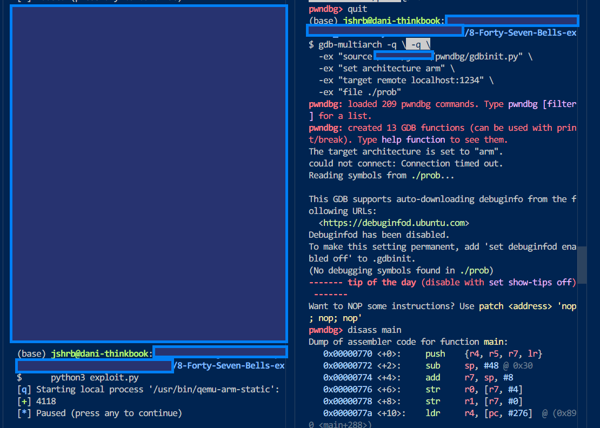

## 0. 📍 개요

기존의 docker 내부 process에 대해, WSL root 계정으로 <code>gdb-pwndbg -p PID </code>로 attach하는 방식이 <span class="text-red text-bold"><span class="highlight-yellow">더 이상 유효하지 않아</span> 새로운 방법</span>을 찾아보았다.
<details>
<summary>근데 왜 안 되는거지?</summary>
<div class="toggle-content" markdown="1">

기존에 내가 썼던 방법은 🧷 [로되리안의 해결방법 1][ https://0nehundred4ndt3n.tistory.com/7](https://0nehundred4ndt3n.tistory.com/7) 이었다.


</div>
</details>

---

## 1. Docker, gdbserver - CykorCTF2025-pwn-2-dbfs

1. <span class="highlight-blue">**dockerfile setting + run, exec**</span><br>
  보통 로컬에서 p.remote가 가능하게 하기 위해, 제공되는 dockerfile은 EXPOSE nnnn 포트를 하나 열어둔다.
  여기서 **PORT 하나 더 추가 + apt intsll -y gdbserver**을 하도록 <span class="highlight-yellow">docker-compose-debug.yaml을 커스텀</span>해준다.
  ```Dockerfile
    services:
    dbfs-debug:
      image: ubuntu:24.04@sha256:4fdf0125919d24aec972544669dcd7d6a26a8ad7e6561c73d5549bd6db258ac2
      ports:
        - "22222:22222"
        - "1234:1234"
      volumes:
        - ./client:/app/client
        - ./flag:/flag
      privileged: true
      stdin_open: true
      tty: true
      command: bash -c "
        apt update && 
        apt install -y gdbserver &&
        chmod +x /app/client &&
        mkdir -p /tmp/dbfs-test &&
        gdbserver :1234 /app/client /tmp/dbfs-test
  ```
  완료되었다면 아래를 실행한다.
  ```bash
  docker-compose -f docker-compose-debug.yaml up
  ```
  .yaml이 아닌 Dockerfile인 경우 아래를 참고한다.
    <details>
    <summary>Dockerfile 기준</summary>
    <div class="toggle-content" markdown="1">
      
      ```bash
        docker build -f Dockerfile.debug -t cydf_debug .
        docker run -it --rm -p 7183:7183 -p 1234:1234 --cap-add=SYS_PTRACE //opt1
        docker run -d -p 7183:7183 --cap-add=SYS_PTRACE --name cydf cydf_debug sleep infinity //opt2
      ```
      이렇게 하면 터미널이 열리지 않은 것 처럼 보여도, **socat이 이미 듣고 있으므로** pwntools를 통해 **p.remote(localhost, 7183)**을 해주면 바이너리가 열린다.<br>
      추가로 docker 터미널을 열어주자.
      ```bash
        docker exec -d cydf bash -c 'socat -T 300 TCP-LISTEN:7183,reuseaddr,fork EXEC:./CYDF_Average'
      ```
    </div>
    </details>
  이렇게 docker 터미널을 열었다면 socat으로 listening 상태를 만들어주어야한다. 열어두기로 정한 포트로 통신이 들어오면 바이너리를 실행하는식.
  ```bash
  socat TCP-LISTEN:22222,reuseaddr,fork EXEC:'/app/client /tmp/dbfs-test' &
  ```
2. <span class="highlight-yellow">**localhost에 pwntools로 remote 걸기**</span><br>
   ```python
    from pwn import *

    p = remote('localhost', 22222)
    pause()  # 여기서 멈춤 - gdb attach 할 시간
    p.sendlineafter(b'dbfs> ', b'SET AAA set')
    # ...
  ```
  익스 코드 최상단에 위와 같이 작성한다. 이 때 유의하여야할 점은, 1-1 단계에서 docker를 만들면서 <span class="highlight-yellow">**EXPOSE한 두 개 포트 가운데 하나에 해당하는 포트번호**</span>를 적어주어야 한단 것이다.<br>
  그리고 pause()를 필수로 걸어줘야 한다. python 스크립트 실행 이후에 디버거를 붙이기 때문에, pause없이 이후 익스플로잇을 실행하게 되면 디버거에서 적절한 관찰이 어려울 수 있다.

3. <span class="highlight-blue">**docker에서 gdbserver 열고 local에서 gdb-pwndbg로 target remote**</span>
  ```bash
    $docker> gdbserver :1234 --attach $(pgrep -n client)
  ```
  위 스크립트는 socat으로 파이너리가 실행중인 상태가 아니면 작동하지 않는다.
  ```bash
    $local> gdb-pwndbg ./client
    $pwndbg> target remote localhost:1234
    $pwndbg> b *handle_info + 0x20d
    $pwndbg> c
    #...
  ```
4. <span class="highlight-blue">**(opt) tmp 디렉터리 초기화**</span><br>
  socat이 예상 외의 오류를 낸다면 아래와 같이 docker 내에서 socat을 다시 시작할 수 있다.
  ```bash
    $docker> pkill socat
    $docker> rm -rf /tmp/dbfs-test
    $docker> mkdir -p /tmp/dbfs-test
    $docker> socat TCP-LISTEN:22222,reuseaddr,fork EXEC:'/app/client /tmp/dbfs-test' &
  ```

---

## 2. qemu-user-static + ARM + pwndbg/gef - 내부CTF-pwn-forty-seven-bells

<figure style="text-align: center;">
    
    <figcaption style="font-size: 0.9em; color: gray; margin-top: 5px;">고마워...</figcaption>
</figure>

동기가 만든 문제인데, 1번의 방법으론 디버깅이 되지 않기 때문에 들고왔다.

출처로 출제자의 깃헙을 첨부한다.
<div style="border: 1px solid #ddd; border-radius: 8px; padding: 15px; margin: 10px 0;">
  <a href="https://github.com/amethyst0225" target="_blank">
    <strong>amethyst0225's github</strong><br>
    <span style="color: gray; font-size: 0.9em;">https://github.com/amethyst0225</span>
  </a>
</div>

1. <span class="highlight-blue">**qemu-user-static 설치, gdbinit.py 찾기**</span>
  ```bash
    sudo apt install qemu-user-static
    # pwndbg 경로 찾기 
    find ~ -name "gdbinit.py" 2>/dev/null | grep pwndbg
    # gef 경로 찾기
    find ~ -name "gef.py" 2>/dev/null
  ```
  pwndbg, gef 모두 가능하기 때문에 비교적 편한 것으로 진행하면 된다. pwndbg의 경우 **<span class="text-red">.../pwndbg/gdbinit.py</span>로 출력되는 경로**를 복사해둔다.
2. <span class="highlight-blue">exploit code 실행 with qemu server</span>
  ```python
    from pwn import *

    context.arch = 'arm'
    context.bits = 32

    # 로컬 디버깅용
    p = process(["qemu-arm-static", "-g", "1234", "-L", "/usr/arm-linux-gnueabihf", "./prob"])
    # pause() 대신 gdb가 붙을 시간
    sleep(1)

    # 터미널 2에서 gdb-multiarch ... target remote :1234 실행
    pause()  # gdb 붙인 후 엔터

    # 익스 진행...
  ```
  위 코드를 실행한다. 바이너리, 사용할 포트 번호에 따라 대동소이할 수 있다.

3. <span class="highlight-blue">gdb-multiarch using pwndbg를 프로세스에 attach하기</span>
  ```bash
    gdb-multiarch -q \
    -ex "source /home/jshrb/pwndbg/gdbinit.py" \
    -ex "set architecture arm" \
    -ex "target remote localhost:1234" \
    -ex "file ./prob"
  ```
    <figure style="text-align: center;">
        
        <figcaption style="font-size: 0.9em; color: gray; margin-top: 5px;">ARM attach 성공한 모습</figcaption>
    </figure>