[https://arxiv.org/abs/2605.21779](https://arxiv.org/abs/2605.21779)

[etc 05.] MDASH 

용어 정리

## 질문

#### 1. FuzzingBrain v1과 무엇이 달랐고, 이 차이점은 어떤 접근에서 만들어질 수 있었는가?

2. FuzzingBrain V2의 시스템이 어떻게 구성되어있는가?

- key contribution
  - <strong>supicious point</strong>라는 control-flow-based abstraction(제어 흐르 기반 추상화)로 취약점을 정밀하게 특정함
  - logic-driven(논리 기반) hierarchical fuction analysis라는 fuction coverage 향상의 dual layer fuzzing. (자원 제약 조건 하에서)
  - MCP 기반 정적 및 동적 분석 도구 — 복잡한 취약점 추론을 강화하는 컨텍스트 엔지니어링 기능을 갖춤
- 기존의 LLM-based vulnerability detection의 GAP
  - cannot be verified without executable proof-of-concept inputs
    - leaving security teams unable to distinguish true vulnerabilities from hallucinations
  - 현재 접근 방식은 suboptimal granularities를 가짐(너무 복잡)
  - cross-fuction data flow, indirect calls, stateful operations가 타겟에 존재함으로써 LLM 취약점을 이해하기가 optimal 하지 않음
- system operating 단계
  - Static Analysis: extracts function metadata and call graphs via Fuzz Introspector, storing results in a database
  - Agent Pipeline: employs specialized LLM agents to discover and verify <strong>Suspicious Points</strong> through hierarchical search
  - PoC Generation: combines PoC Generator reasoning with dual-layer fuzzing to generate reproducible crash-triggering inputs.

피규어

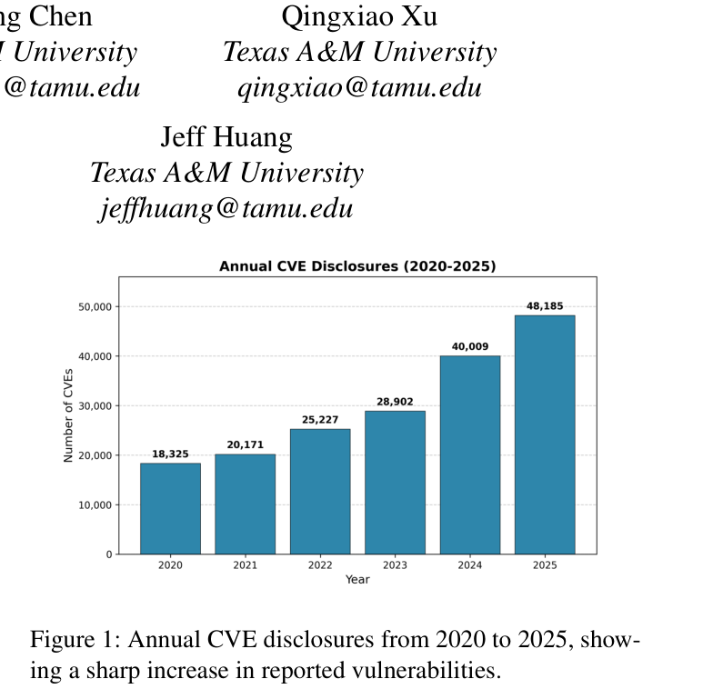

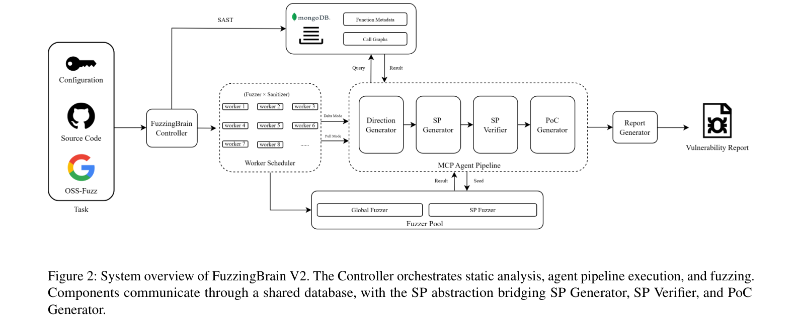

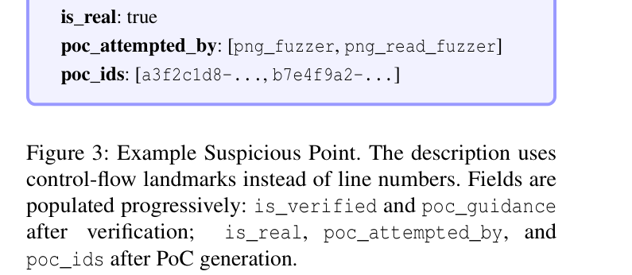

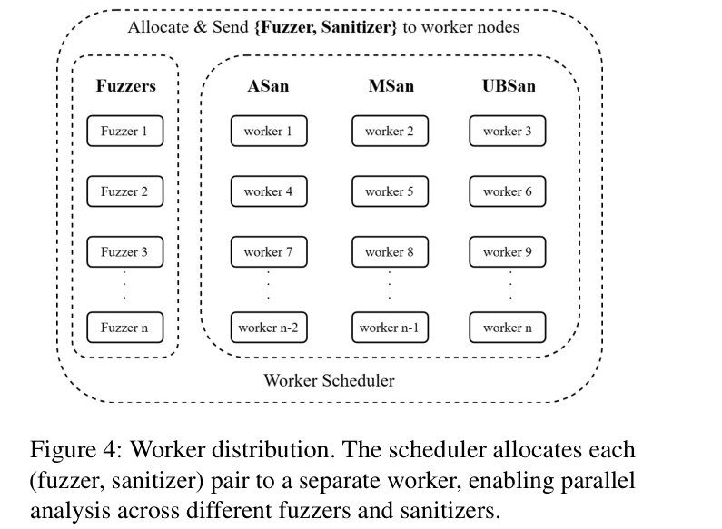

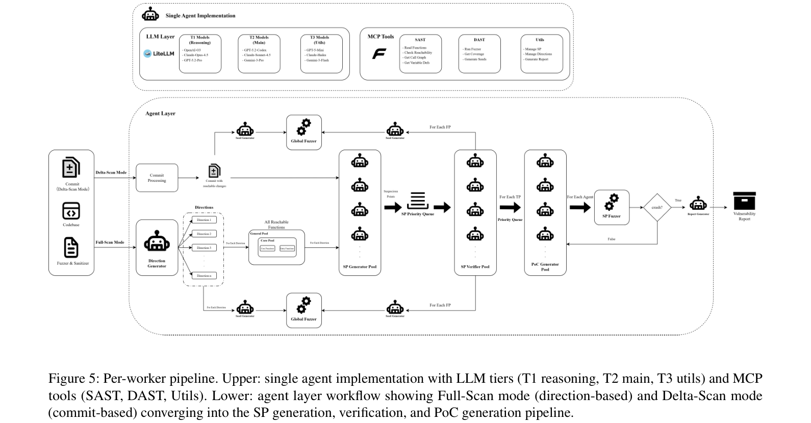

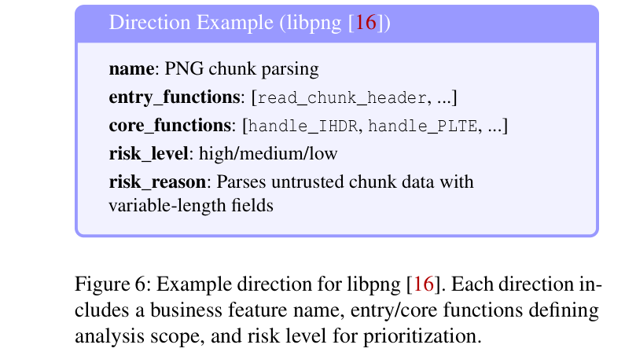

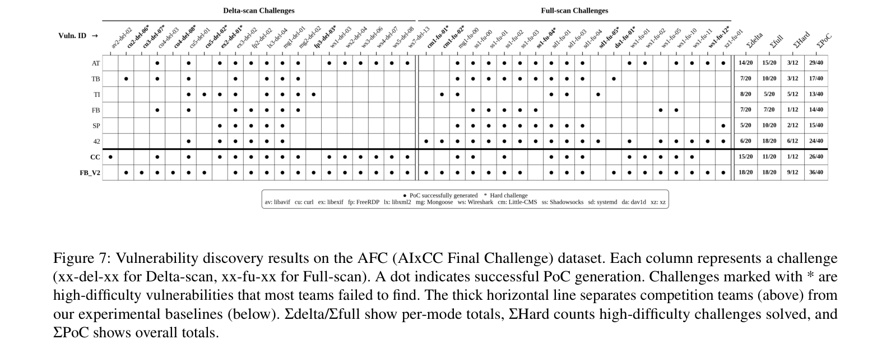

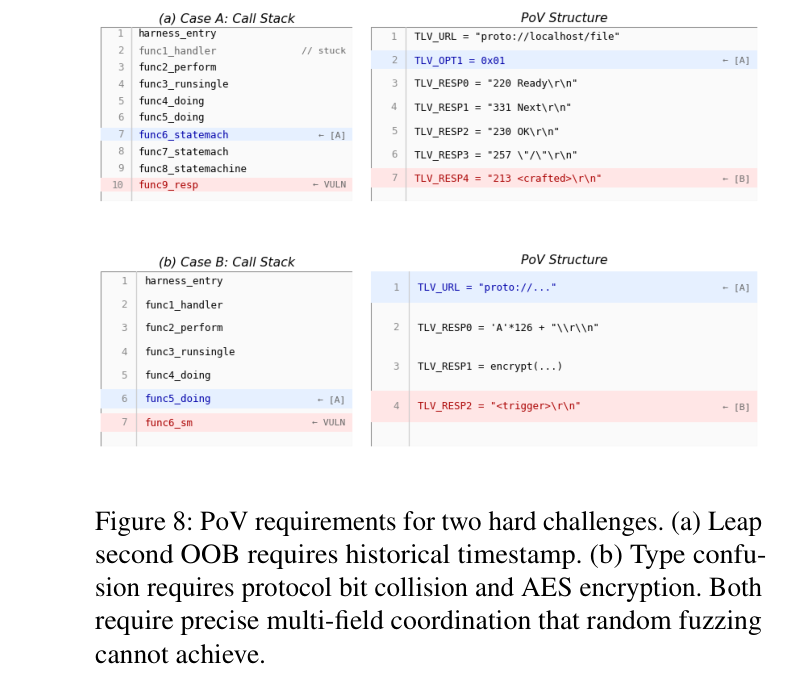

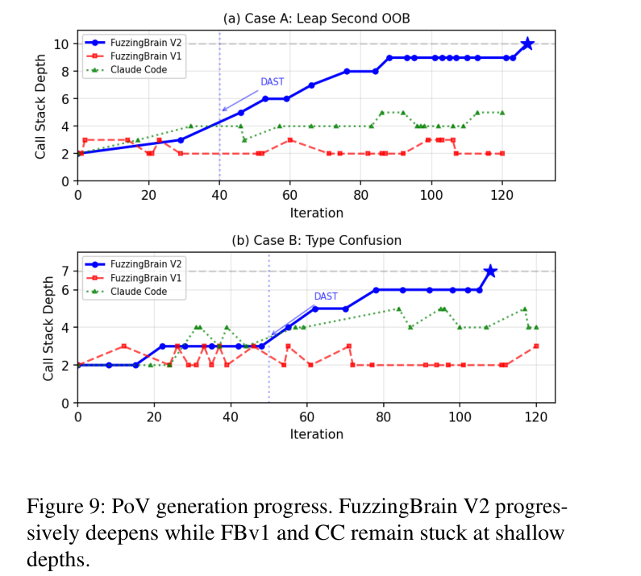

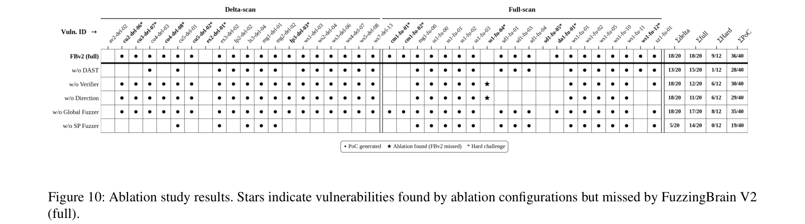

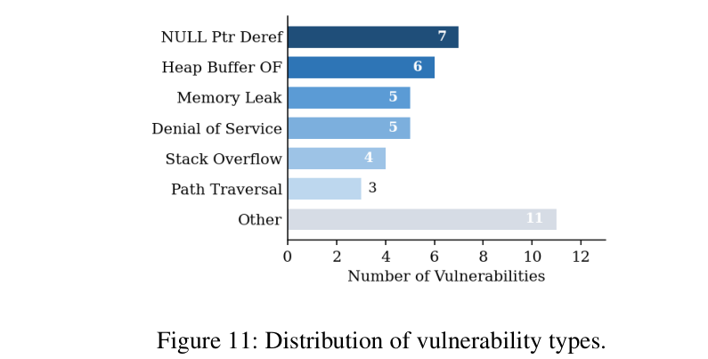

테이블

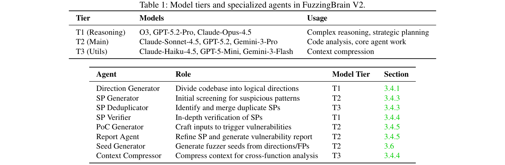

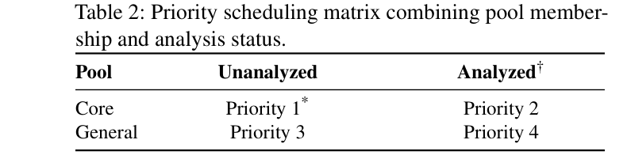

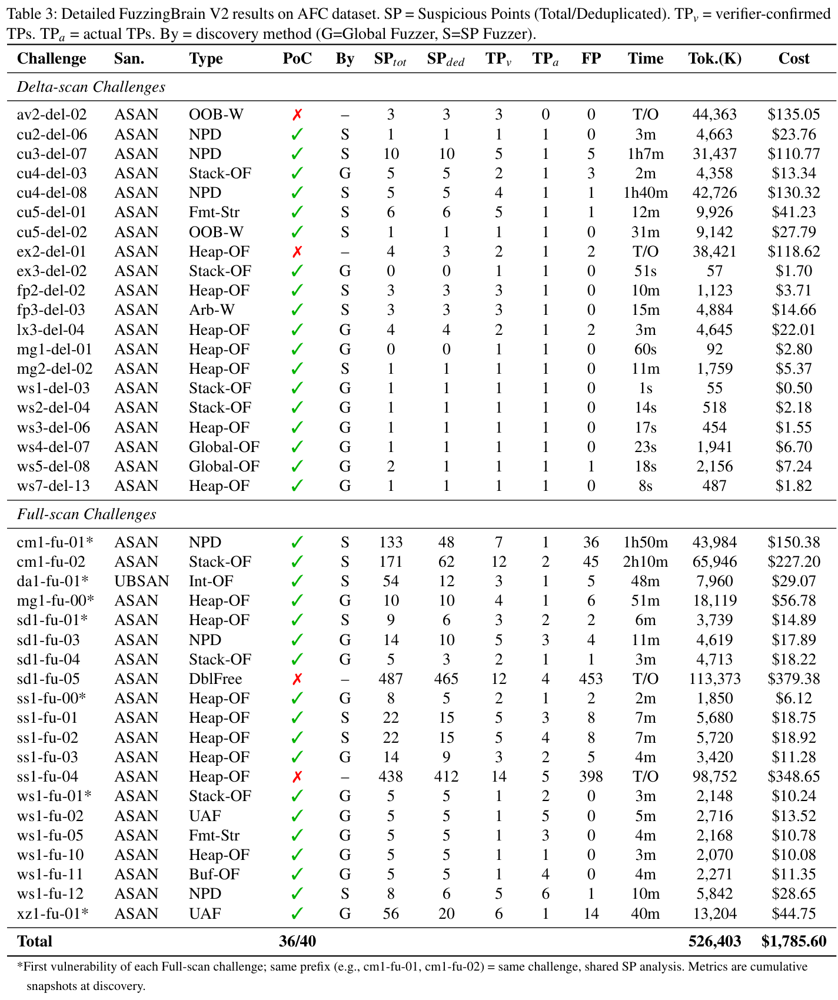

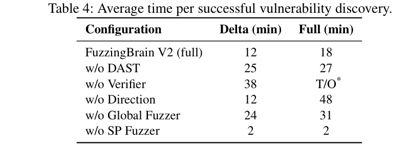

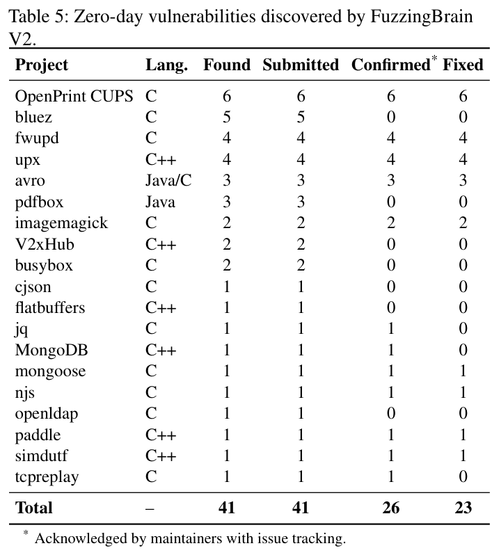

## todo

- 재현성이 있는지 확인
- corpus 만 개선할 수 있도록 하면 이후에 합치는게
- 이게 optimal한지를 어케 알앗음? 그 approach가 궁금하다?
