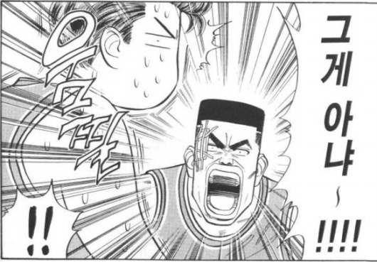
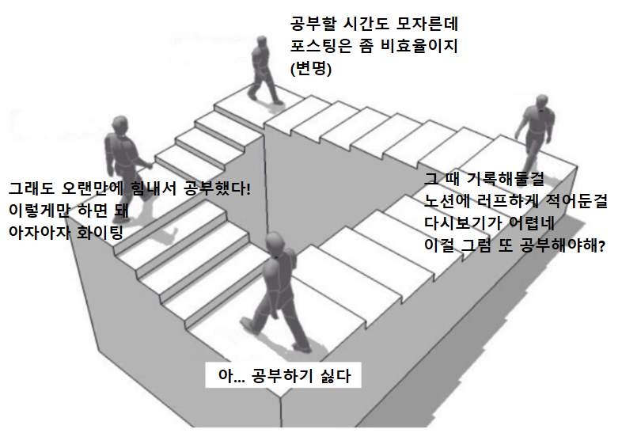
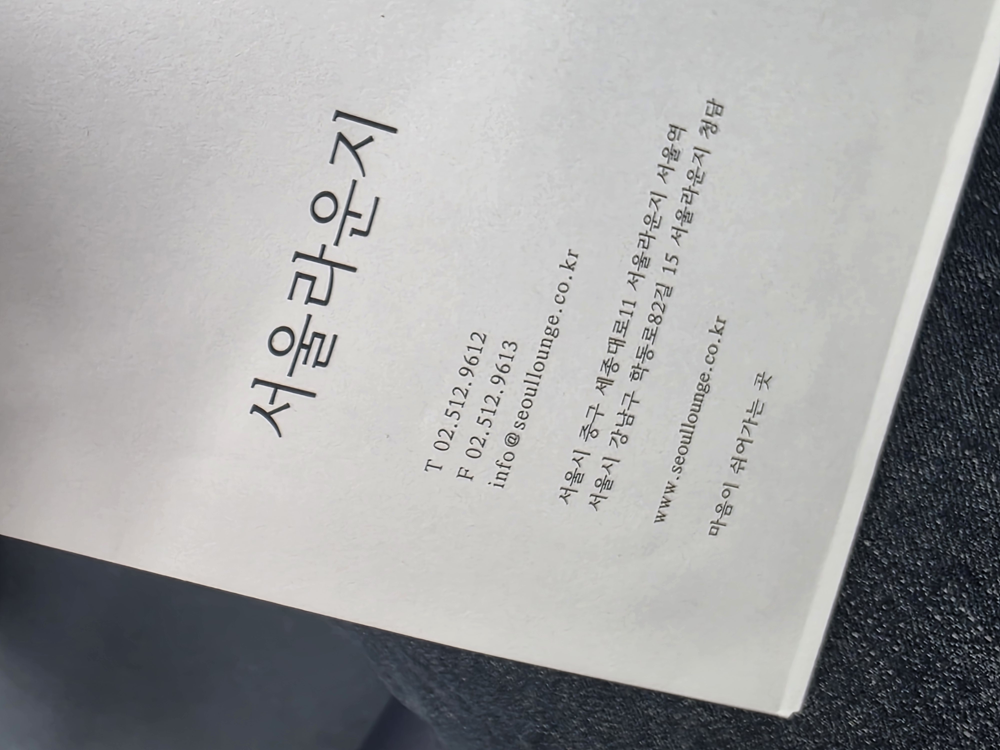
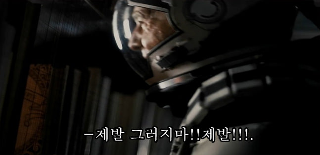
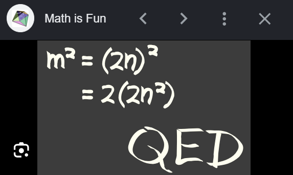
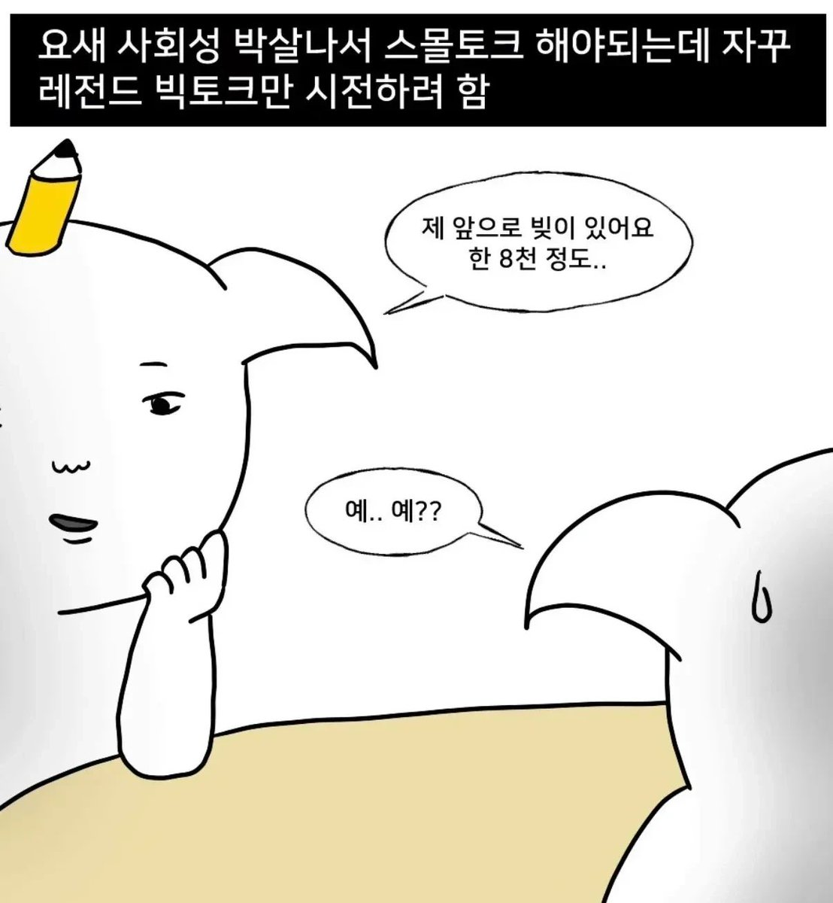
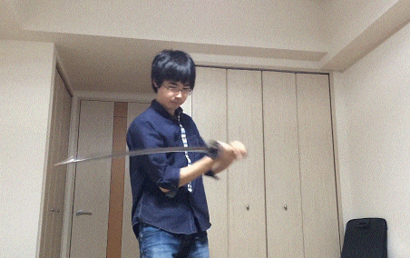
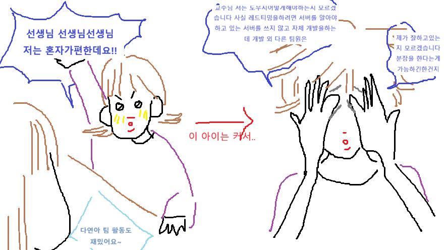
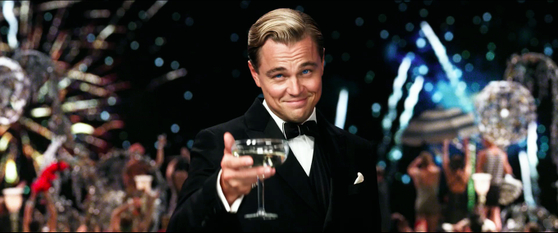

## #1. 사람들 잘 지내십니까
안녕하세요, 오랜만입니다. [지난 포스팅](/_posts/2025-12-09-3pwn-Forty-seven-bells.md)으로부터 딱 반년째에 찾아뵙습니다.
사실 포스팅 자체는 간간히 했었고, 블로그에 기능도 추가해왔었는데요.. 
<figure style="text-align: center;">
    
    <figcaption style="font-size: 0.9em; color: gray; margin-top: 5px;">이게 아냐!</figcaption>
</figure>
어렸을 때 부터 다섯장 쓴 노트는 안중에 없고 새 노트를 찾던 그 습성이 또 발동해버렸습니다.

처음 이 블로그를 만들 때는 정기 발간지 처럼 아무리 현생이 바쁘더라도 스스로에게 꼭 쓰게할 의무를 부여하자. 일주일에 두번은 공부한 걸 기록하자. 이게 다 피가 되고 살이 된단걸 알잖아 다연아.. 라는 마음이었는데요, 실천으로 잘 이어지지 못했습니다. 안타깝네요.

지난 과오를 반복하지 않기 위해 그 원인을 분석해보자면 이렇습니다.  
(1) 공부하지 않음  
(2)  공부한 것을 말로 설명할 정도로 납작화하지 않음  
(3)  생각의 굴레
<figure style="text-align: center;">
    
    <figcaption style="font-size: 0.9em; color: gray; margin-top: 5px;"></figcaption>
</figure>
(4) 필기 욕구 때문에 블로그 이쁘게 꾸며놓음 > 노션 to 블로그 자동 업로드화 해봤지만 추가 설정을 많이 만져놓은 탓에 한계가 있음(물론 충분히 파보지도 않음)> (3) 생각의 굴레  
(5)  그렇다고 밤티 티O토리로 돌아가자니 필기 욕구가 충족되지 않음  
잘 이해되지 않을 수 있지만, 저는 그렇게 살아지는 인간인 것입니다..

학부연구생으로 일 해보니 더욱이 문서화의 중요성은 정말 무시 못하겠더라고요. 하자니 또 (1)~(5)의 굴레의 빠져서 그닥 효율이 나지 않는, 그런 늪같은 반년을 보내고 왔습니다.

그래서 #1. 사람들 잘 지내십니까 > 저는 그닥..  이정도로 첫 챕터를 닫아볼 수 있겠습니다.

## #2. 앞으로 나아가려는 모종의 노력 (1)
일타강사 정승재T가 말했습니다. 사람은 본인의 이상과 본인의 행동이 정합하지 않을 때 가장 괴롭다고. 누군가는 괴로워서 쉬지 못하고, 누군가는 괴로워서 무기력해지는.. 우리 세상에서 아주 흔한 괴로움에 관한 얘기입니다.

저는 그런 괴로움에 무기력해지는 편인 것 같습니다. 그치만 해야할 일이 있단 건 아니까 이따금 힘을 내서 할 일을 쳐내봅니다. 그러다보면 생각이 많아지고 거기에 압도되는 기분입니다. 더이상 이대론 안된다!

<figure class="img-pair">
    

      
      
    

    <figcaption style="font-size: 0.9em; color: gray; margin-top: 5px;">노력 1. 나 ADHD인가?</figcaption>
</figure>
내가 조금씩 침몰해서 해저에서 수면을 원망하게되는 그런 미래는 싫습니다.. (마치 인터스텔라 5차원 씬)  
그래서 첫번째 노력. 병원을 다녀왔습니다. 단순히 스트레스, 우울감, 무력감, 집중력 등 뇌나 인간됨의 차원에 있는 문제일 수 있다고 생각해서 였습니다.

초진과 종합심리검사를 거쳐 이후 진료를 목전에 두고 있는 상태이지만, 현재 소견으로썬 임상적으로 문제가 있지 않다고 합니다.  
사실 진단명이 있기를 내심 기대했습니다.  
정확히는 진단명이 주는 문제의 **완결성**을 기대한 것 같습니다. 약 잘 먹고 몇 개월 혹은 몇 년 내원하다보면 해소되는?
<figure style="text-align: center;">
    
    <figcaption style="font-size: 0.9em; color: gray; margin-top: 5px;">life is not fun</figcaption>
</figure>

그래서.. #2. 앞으로 나아가려는 모종의 노력 (1) == 내원 > 잠정 실패  
이정도로 두번째 챕터를 닫아볼 수 있겠습니다.

## #3. 앞으로 나아가려는 모종의 노력 (2)

<figure class="img-pair">
    

      
      
    

    <figcaption style="font-size: 0.9em; color: gray; margin-top: 5px;">노력 2. 주변 어른의 행동을 관찰함 w/ 사회성 부족한 사람 특)</figcaption>
</figure>
이건 어쩌면 노력 1보다도 먼저 선행되었던 것인데요, 주변에서 배울만한 어른을 찾고 고민신청을 하는 것입니다.  
근데 이게 마치.. **남들은 딱히 알고싶지 않은 은밀하고 커다란 것을 휘두르고 다니는 느낌이라 그만두는게 좋겠다**고 생각했습니다.

결정적으로 이렇게 생각하게된 사건은 불과 얼마 전인데요, 그건 바로...  
비공식 프로젝트를 끌고 나가다가 막막한 마음에  교수님께 푸념을 한 사건입니다. 
<figure style="text-align: center;">
    
    <figcaption style="font-size: 0.9em; color: gray; margin-top: 5px;">교수님께 고민신청</figcaption>
</figure>
혼자 들어간 회의도 아니었기 때문에 배설💩하듯 말하고 나선 크게 후회했습니다.  
무언가 휘두르다는 게 딱 이런 것 아니겠습니까.. 그 자리에 있던 누구라도 당황스러웠을 것이란 생각에 며칠이 괴로웠던 것 같습니다.

말은 습관이고, **'내 고민에 진솔함'**이 습관이 된다면, 생각의 괄약근이 제 기능을 못해 말실금(ft. O실금)이 발생하게 되는 것 같습니다. 간수를 잘 해야겠지요..

## #4. 앞으로 나아가려는 모종의 노력ing (3)
그리하여 지금입니다. 빠른 디버깅과 트러블슈팅이 이뤄지길 간절히 바라며..

생각이 많다면(디버깅),  
(1) 빠짐없이 적고, 적으면서  
(2) 더 디테일하게 고민하고,  
(3) 구체적인 해결방안을 최소한으로 실천하자  
라고 생각했습니다.
그래서 이 글은 **최소한의 실천**입니다.  

## #5. 나는 뭘 하고 싶은가
<iframe class="embed-frame" src="https://app.xmind.com/embed/H3u0xMZR?sheet-id=a34d7a6d-c43e-4e19-ac74-b42e8dadaa63" frameborder="0" scrolling="no" allow="fullscreen"></iframe>  

이렇게 정리해봤습니다.  
앞으로는 상념이 떠오를 때면 이 마인드맵을 다시 펴보고, 어느 것 하나 지운 것이 있는지 스스로 물어보려고 합니다.  

이 중에서도 **당장에 그래서 뭘 할 것인지를 납작**하게 선언해야 이번주의 포스팅을 스스로 강제할 수 있을 것 같은데요..

이번주는(26.06.02-06.07)  
(1) MCP redteaming 문서화  
(1)-1 MITRE ATLAS, AVID PoC?(안 봐서 정확히 어떤 포맷인지 잘 모름) 수집 및 반영  
(2) KCC, ICML에서 읽어갈 분야 겹치게끔 3개 선정, 각 분야의 한 논문 씩 읽어서 기록  
을 해보도록 하겠습니다.  
다소 오버부킹한건가 걱정이 되지만,  
그건 스스로 얼마 만큼의 일을 할 수 있는지를 차차 객관화해나가는 하나의 과정이라고 생각합니다.

다음 포스팅에선 정한 목표를 달성하는 이다연으로 돌아오겠습니다..

## #6. +홈커밍 파티에 갔다와서

이대로 마무리하려다 오늘 학과 선배님들과 만나 나눈 얘기들을 잊고싶지 않아서 간략히 메모를 추가합니다.
<figure style="text-align: center;">
    
    <figcaption style="font-size: 0.9em; color: gray; margin-top: 5px;">무려 스탠딩 파티</figcaption>
</figure>

- 세상은 섹시한 일과 섹시하지 않은 일이 있다
- 섹시하지 않은 일도 누군가 해야한다
- like scratch 부터 데이터를 모으고 모델을 만드는 일이라도, 혹 누군가 내 수고와 경험을 몰라줄까 걱정되어도 진짜는 진짜를 알아보기 마련이다.
- 그렇기 때문에 하는 일이 섹시하건 그렇지 않건 그 일이 필요한지, '진짜'인지를 고찰해야한다. 반례로는 AX 해커톤
- 이시대에 필요한 것은 진짜를 고찰하는 태도와 만약 그것을 가려낼 수 있다면 실천으로 옮기는 것이다
- 적성은 전공보다도 취향이다. 개발이 좋은게 아니라 무언가를 만들고 그 결과를 보는 게 좋은 것이다.
- 이러한 관점에서 적성을 찾고, 좋아하는게 없다면 딱히 해줄 말이 없으니 그저 많이 경험해라
- 일찍 시작하는 것에 확실히 메리트는 있다.
- 이렇게 찾고 질문하는 거서부터 큰 걱정 않아도 된다.
- __와 __는 가치관의 차이이다
- 모두가 졸업과 동시에 취업을 하는 것은 일종의 세상의 사기라고 생각한다. 대학원이든, 직장이든 누군가의 노예가 되는 것은 같다.