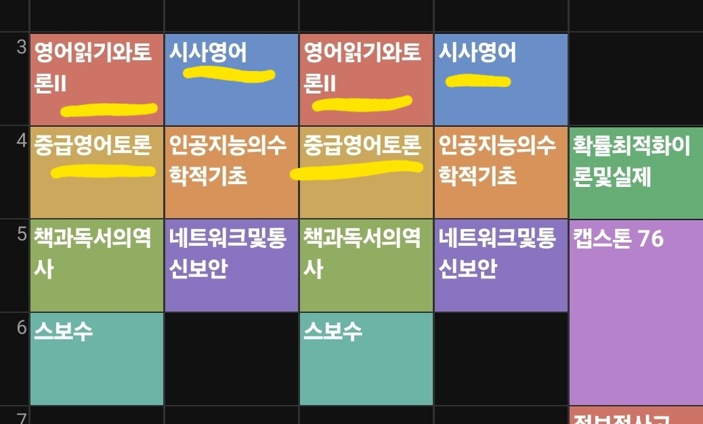

## 근황토크
지난 주 ICML 2026에 다녀왔습니다. Oral session은 리스닝이 아닌 실시간 자막 리딩을, poster session은 질문할 용기가 없어 멀찍이 사람 모여있는 부스 이름만 찍어가기를 하고 있는 스스로를 성찰하며, 이런 자리를 충분히 활용하려면 영어를 잘 해야겠구나라는 생각이 들었습니다.
<figure style="text-align: center;">
    
    <figcaption style="font-size: 0.9em; color: gray; margin-top: 5px;">위기감을 느끼고 매일 영어회화 수업을 껴넣은 2026-2 시간표</figcaption>
</figure>
사실 적당히만 영어를 할 줄 알아도 그 다음부턴 자신감의 영역인 거 같지만, 저는.. 자신감만으로는 입이 잘 떨어지지 않는 타입인 것 같습니다.

그래서 기회가 되는대로 영어공부를 하고 있습니다. 논문을 정직하게 읽기도하고, 영어 자막이 있는 유튜브 영상을 섀도잉하고도 있습니다. 해당 포스팅은 그러한 노력의 일환으로... 영어 일기를 쓰고, 문법 첨삭, 늬앙스 첨삭을 받아 완성하여 원안과 비교 / 노트테이킹하는 포스팅입니다.

해보니 시간이 좀 걸려서 자주하긴 어렵겠지만 공부하기 싫을때 한번은 시간내서 해보자는 주의입니다.

## 이번 일기에 담고 싶었던 이야기
- AI for Sec, conventional Sec을 둘 다 잘하는 사람이 드묾
- 이러한 관찰은 연구 경험에서 비롯함.
- 이유를 찾아보자면, AI for Sec 분야 자체가 설계 자체(CRS)에 많은 고민을 해야하고(최신 연구 팔로업 등), 동시에 전통적 취약점 연구의 문맥도 놓치지 않아야하는 특성이 있기 때문이라고 생각함.
- 이렇게 많은 걸 한꺼번에 알기는 어려움. 그렇지만 둘 다 잘해야함.
- 모델에게 무엇을 할지를 가르치려면 설계자가 선생님이 되어야하기 때문에 둘다 잘 해야함.
- 이런 선수지식의 방대함, 업데이트되는 속도, 그로부터 오는 막연함이 사람을 그냥 무력하게 연구만 하고, 코드 실행과 실질적 설계와 같은 것에서 멀어지게끔 함.
- 하지만 이러한 현상이 있으니 만큼 더더욱이 그저 '연구'만 해서는 안된다는 사실이 됨. 그러기 쉽지 않지만.
  
## 단락 1: AI security와 conventional security를 모두 잘하는 사람이 드물다는 관찰과 함께 근거 제시를 위한 표지어
### 원안 
- Lately, I've noticed that
- My observation lately is that
- What I've noticed recently is that

there are not that many people who can really be free from being constrained by부정적인 어감: be constrained by / 긍정적인 어감: be limited by, be bound by some skills, say, AI security and conventional security.
- The reason I came to think that way is
- What led me to think that is
- The reason behind this conclusion
- The moment/trigger that made me think so was

the experience led me to have project as PM and also member on purpose부정적인 어감이 있음 to solve problems - AI for security. -AI for sec. Actually, It's so delicate, hard. What's more, too full연구, 분야에 쓰기에는 saturated가 적합함 to research a topic having novelty.to research까지 괜찮지만 a topic with novelty/ to find novel research가 자연스러움

### 문법 첨삭 1
Lately, I've noticed that there are notaren't that many people who are truly free from being bound by some skills, say, AI security and conventional security.둘 다 잘한다: be proficient in both A and B  The reason behind this conclusion is주술일치. 원안에서 누락됨 the experience that led me to have project as a PM and also a member aimed at solvingon purpose가 부정적인 어감이 있기 때문에 aimed at solving/ with the goal of solving이 자연스러움 problems-AI for sec. Actually, It's so delicate, and hard. What's more, the field is too saturated to find novel researchresearch는 불가산명사라 관사가 붙지 않음.

### 늬앙스 첨삭 2
Lately I've noticed there aren't that many people who are truly proficient **in both AI security and conventional security at the same time.
Here's why, based onthe reason behind this conclusion을 간단하게 my own experience as a PM and researcher.

- aimed at solving problems-AI for sec, 분야의 어려움에 대한 얘기들 걷어냄
  - 그저 AI for Sec과 Conventional Sec을 모두 갖추기 어렵단 사실에만 집중하고, 분야 자체의 어려움은 방대함에만 초점을 맞추어 후술하려고 함

## 단락 2: 근거로써 내 연구 경험을 뒷받침하고, 그것이 단락 1의 관찰로 이어짐을 명시
### 원안
In this context, researchers are required to부정적인 어감 make efforts tirelessly/relentlessly노력에선 tirelessly, relentlessly / 변화에선 constantly not to miss massive loads of technical, scholastic concerns - model architecture, pipelining, previous research of CRS, benchmarking, ensemble, orchestration... etc. At the same time, the traditional one. "So how can we find payload? Is this valid? How did we know? where is the sink? Is this OOB? Or what? What's the reason?"

### 문법 첨삭 1
In this context, researchers need to work tirelessly and relentlessly so asnot to~ 가 바로오면 어색하고, so as나 in order to 가 오는게 자연스러움 not to miss massive loads of technical, scholastic concerns - model architecture, pipelining, previous research of CRS, benchmarking, ensemble, orchestration, etc. At the same time, the traditional questions - "So How can we find the관사 필요함 payload? Is this valid? How do일반론 질문이면 현재시제가 자연스러움 we know? Where is the sink? Is this OOB? or what? What's the reason?".

### 늬앙스 첨삭 2
AI security itself is delicate and the field is saturated연구에서는 full 보단 saturated를 쓰는게 자연스러움 - model architecture, pipelining, prior CRS/benchmarking research... And that's on top of이러한 것들은 ~에 기반해있다. 결국엔 ~이 필요하다. the traditional questions: how do we find the payload? Is this a valid sink? Is it OOB? Naturally, mastering both at once is hard.단락을 열 때 얘기하고 싶은 소재, 단락을 닫을 때 확실히 하고픈 얘기

## 단락 3:
### 원안
Because that is wat we have to teach our student -- that is, our models.
Unless being분사구문 축약은 보통 동작동사에서 자연스럽고 being + s.c는 다소 번역투의 느낌이 있다고 함. teacher, we cannot teach them. And teacher