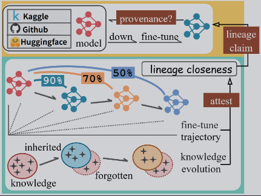

오랜만입니다. 한동안 바빠서 업로드하지 못한 논문리뷰를 써보려합니다.

<figure style="text-align: center;">
    
    <figcaption style="font-size: 0.9em; color: gray; margin-top: 5px;" markdown="span">일주일: 회의준비 → 회의 → 회의준비 → 회의 → 기절 → 미팅 → 기절</figcaption>
</figure>

<del>사실 그렇게 바쁜것도 아닌데 제가 시간관리를 못하는 쪽입니다.</del>

해당 논문은 USENIX 2026 in Baltimore을 다녀와서 인상깊었던 논문 너덧개를 정리하는 시리즈 중 첫번째 입니다. 너덧개라 함은.. 👇

더보기

- [paper #19] SoK: DARPA's AI Cyber Challenge (AIxCC): Competition Design, Architectures, and Lessons Learned 

  <em>이건 연구실 과제 땜에 일찍 읽었는데(아카이브) 이번에 발표됐습니다</em>
- [paper #26] The Art of Hide and Seek: Making Pickle-Based Model Supply Chain Poisoning Stealthy Again 
- [paper #27] Patcher: Post-Hoc Patching of Backdoored Large Language Models 
- [paper #28] Robust Watermarks Meet Backdoored Models: Evading Diffusion Semantic Watermarks via Stealthy Backdoor 
- [paper #29] InstrSem: Automatically and Generically Inferring Semantics of (Undocumented) CPU Instructions 
- [paper #30] Fuzzing Open-Source GPU Hardware with SIMT Program Generation 
- [paper #31] DRVFuzz: Data-Sensitive RISC-V CPU Fuzzing 
- [paper #22] SoK: Deep Learning-based Physical Side-channel Analysis 

이 자릴 빌어 학연생에게 미국행 기횔 주신 지도교수님께 영광을 돌립니다..

💡 <strong>note taking rules</strong>

- 같은 포맷(형광펜, 글자색, 볼드, 이탤릭 등)은 문맥 상 같은 성격 / 포스팅을 작성하는 과정(이해, 구현 등)에서 같은 역할을 한 묶음입니다.
  - 예를 들어 해당 포스팅의 <strong>이 포맷은</strong> 핵심되는 항목이 열거될 때 사용하였습니다.
  - 따라서 포스팅을 처음부터 끝까지 한 번, 같은 포맷의 묶음끼리 선을 잇듯이 한 번 읽으면 제가 이해한 흐름을 거의 그대로 느끼실 수 있을 것이라 생각합니다.
- 골자가 되는 단어는 가능한 논문에서 사용한 형태 그대로 차용하였습니다. 원문에서 위치를 알고 싶으시다면 단어 기준으로 검색하셨을때 핵심되는 부분을 찾아보실 수 있습니다.

## 0. 간략한 설명

- before to start! 대전제 ⇒ 해당 방법론은 원본 모델로부터 fine-tuning된 모델을 detection 하는 것을 넘어(우호적) attestaion 하므로 적대적 공격자(forgery 시도)로부터 강건해야한다.
- <strong>hugging face</strong>와 같은 open weight model libraries에서, [1] <strong>허용되지 않은 모델 재배포</strong>(redistribution), [2] <strong>모델의 출처</strong>(provenance)<strong>에 대한 거짓주장</strong>(false claim)들이 문제가 됨. 따라서 모델 B가 모델 A로부터 파생된 여부를 밝힐 필요가 있음.
- 위를 달성하기 위한 몇가지 시도[1][2]가 있어왔으나, 다음 <em>세 가지 문제에 해당</em>되었음.

  - [1] Fine-tuning의 데이터셋을 요구하는 <strong>비현실적인 threat model</strong>
  - [2] static model similarity에 초점을 둠으로써 <strong>궤적이 비슷하게 수렴한*💬 궤적(f_p의 파라미터로부터 f_c 파라미터까지의 경로. 추적의 개념은 아니고 양 끝단만 놓고 봤을 때를 두고 정의됨) 비슷하게 수렴할 수 있는 경우는 일반적으로 다음과 같다. </strong><strong>모델인지, 진짜로 지식이 상속되어 부모로부터 파생된 모델인지를 구분할 수 없음</strong>
    - 높은 FPR이 문제됨
    - 즉, ‘닮음'이 ‘상속'의 필요조건이 될 순 있어도 충분조건이 될 수 없다는 당연한 한계(ex. ‘우연한’ 닮음 ⇏ ‘진짜’ 상속) ⇒ attribution 성능이 suboptimal
  - [3] <strong>dynamic adversarial spoofing에 취약함</strong>

    - structure evasion attack(6.1)은 증류, pruning + fine-tuning 등의 기법을 사용함으로써 $f_p$의 IP를 침해했으나, 실제로는 그러지 않은 것 처럼 꾸며낸 것이다. 즉, $f_p$와 안 닮아보이게 가장한다.
    - False lineage claim은 임의의 모델 $f_a^c$가 본인의 모델의 파생임을 주장하기 위해 서로 독자적인 모델이지만 그럴듯하게 꾸밈으로써 $f_a^p$로서의 피해를 주장하는 것이다. 즉, $f_a^c$와 닮아보이게 가장한다.

    ⇒ static model similarity로는 $sim(f_c, f_p)$를 측정할 뿐이므로 둘 모두에게 취약함

  ⇒ dynamic evolution of knowledge(knowledge evolution, 이하 KE; fine-tuning 과정에서 파라미터가 최적화되는 양상을 일컫음. trajectory(궤적) = task vector로 이후 정의 된다.)를 이용하여 <strong>‘진짜’ 상속을 optimal 식별*</strong>해내야함. $sim(h_p, \phi(h_c, h_{\delta})$

  즉, KE는 

  - optimal한 attribution을 돕기도 하고
  - task arithmetic에 의해(혹은 model editing💬 model editing(ROME 등)과는 구분되는 분야로, task arithmetic이라는 멋진 이름이 있다) decoupling이 문맥에 들어맞기도 하고
  - task arithmetic으로 얻은 식은 상속관계가 아니면 성립하지 않으므로

  채택되는 것이다.
- 그렇다면 우리는 다음 몇 가지 질문으로 위 사항을 요약할 수 있다.
- <strong>왜 KE가 optimal attribute인가?</strong>
  - static model similarlity는 필요조건이 될 순 있어도 ‘우연히’ 닮은 모델의 경우 때문에 충분조건이 되지 못하기 때문에 suboptimal이다.
  - static model similarity는 dynamic adverarial spoofing에 취약하기 때문이다.
    - 해당 부분은 논문에서 KE를 이용함으로써 부분적으로 강건함을 보인다; structure evasion attack: distill 충실도와 강건함이 비례한다. 즉 덜 베껴갔으면 덜 효과있는 것.; false lineage attack: Appendix B.3에서 정합적 위조가 어려운 것을 보인다.(낮은 FPR)
- <strong>왜 KE가 ‘진짜’ 상속을 걸러낼 수 있을까?</strong>
  - 상속인 경우(KE 관계가 성립하는 경우) task arithmetic(이하 TA)으로 decouple된 파라미터의 덧셈분해 식을 통과하고
  - 상속이지 않은 경우(KE 관계가 성립하지 않는 경우)에 TA를 통과하지 못하기 때문에
  - TA가 sieve(체)로써 작동한다
- 

## 1. Overall Taxonomy

## n. 피규어에 대한 설명

*상→하단 순서 전개

- Figure 1: The knowledge evolution mechanism in model finetuning. The consistency between the knowledge of parent model and the total knowledge inherited and discarded during the evolution process is used to attest the lineage relationship.

  

  - open-weight model libraries에 대규모 데이터로 언어처리(문법 등)을 Upstream task로써 처리한 pre-trained model(모델 :ㄱㄷ이 있음
  - 이 pre-trained model이 사용자의 목적(downstream task)에 알맞게 fine-tuning하여 

## n. 테이블(특히 실험 결과)에 대한 설명

## n. appendix에 대한 설명

## n. 내 질문들

## n. 소감

## Etc. 참고자료

[1] (논문) [paper #33] Neural Lineage 

[2] (논문) [paper #34] NEURAL PHYLOGENY: FINE-TUNING RELATIONSHIP DETECTION AMONG NEURAL NETWORKS
