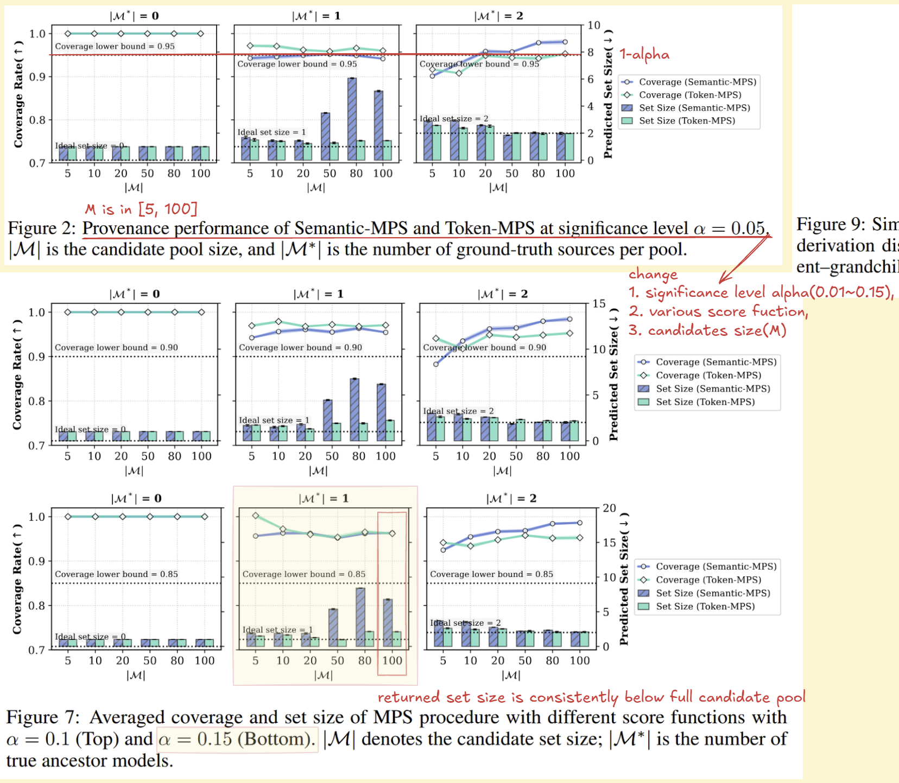
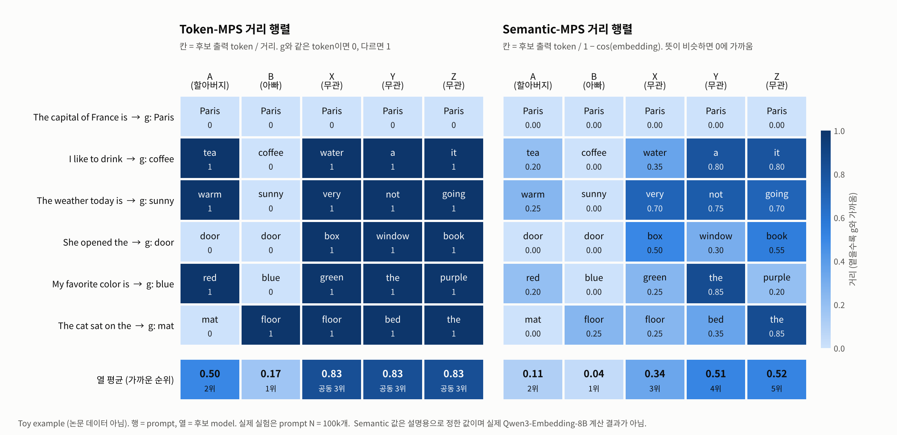
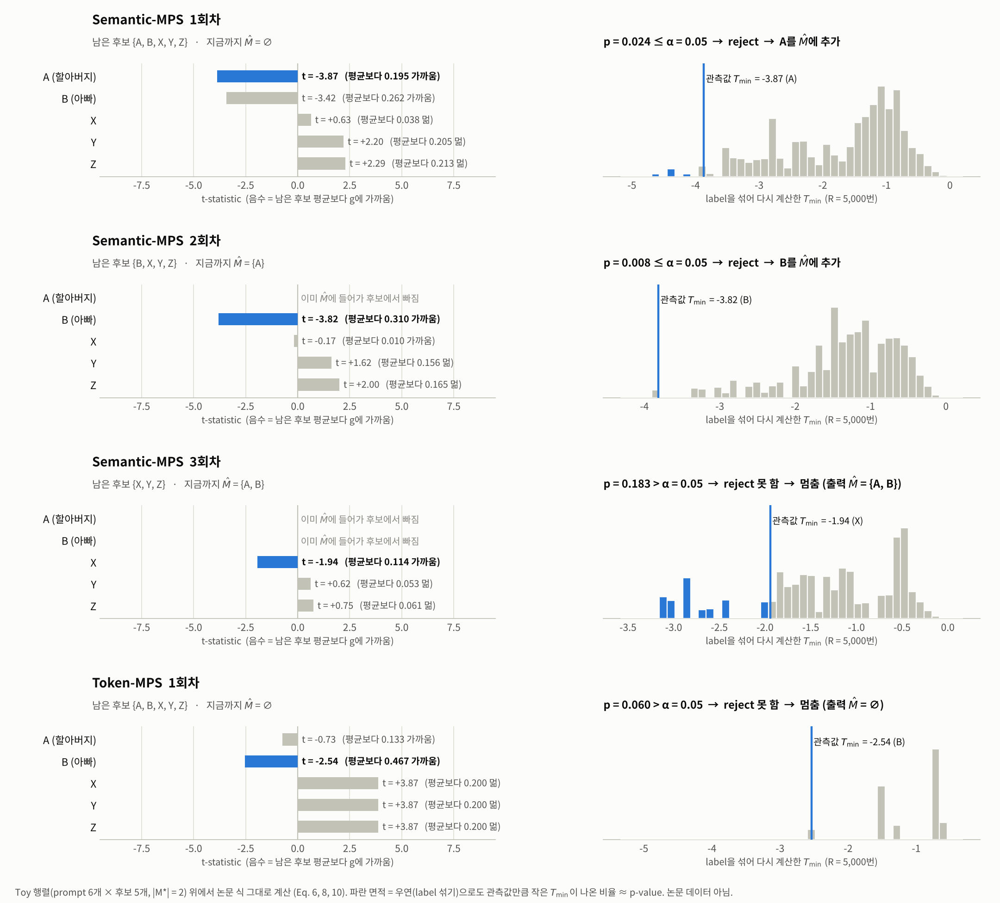

📄 <strong>Paper info</strong>

- <strong>Authors</strong>: [Xiaoqi Qiu](https://arxiv.org/search/cs?searchtype=author&query=Qiu%2C%20X), [Hao Zeng](https://arxiv.org/search/cs?searchtype=author&query=Zeng%2C%20H), [Zhiyu Hou](https://arxiv.org/search/cs?searchtype=author&query=Hou%2C%20Z), [Hongxin Wei](https://arxiv.org/search/cs?searchtype=author&query=Wei%2C%20H)
- <strong>Venue</strong>: ICLR 2027 under review, Arxiv → 1월 버전 / OpenReview 11/18(11/16 수정) 버전
- <strong>Links</strong>: [arXiv](https://arxiv.org/abs/XXXX.XXXXX) · [Code link](https://anonymous.4open.science/r/MPS-CA7D/README.md)(11/15 스냅샷) · [OpenReview](https://openreview.net/forum?id=Cg9hNQjlg1)

How to read the highlights

Each format has one job. Read the post once, then skim a single color to follow one thread.

- <strong>Blue</strong> - the paper's own argument
- Yellow - my one-line takeaway for a section
- Orange - assumptions I would check before relying on the result
- Green - my own questions and ideas, not claims from the paper
- Amber text - key terms in the paper's wording, so you can search them in the PDF
- Gray text - settings, original wording, and asides
- Dashed underline - hover for a short side note

main result(관찰 or <strong>contribute</strong>)

- MPS enables coverage of all true provenances with near-minimal sets → <strong>helps verification to be concentrated on a small number of potential provenance models.</strong>
  - empirical evidence (Fig 2, Fig 7)

    - 유의미한 $\alpha, M, M*, \text{distance score function}$을 가정했을 때* 항상  (1) a compact predicted set size $<$ the full candidate set, (2) a compact predicted set size $\approx$ ground-truth size, (3) generally close to the asymptotic target $1 − α$ across varying $|M|$, (4) $M$이 변하더라도 robustly covers all true sources at a rate of nearly 0.95(recorded with 100 cadidates). 즉 $\hat{M}  \subseteq M*  \text{(Eq. 5)}$ (5) predicted set size는 ideal value $|M*| $근처에 분포(lower false inclusions)를 만족하는 emprical coverage result를 가짐. 

    * Fig 2:

    * Fig 9: 
  - probable evidence
- MPS benefits from larger candidate pools in deep lineage settings

probability / 수식 정리

<strong>Assumption 2.1 (Provenance separability)</strong> (§2.1 line 121-140)

- 설정: $U = M \setminus M^* \neq \emptyset$, 임의의 $\emptyset \neq R \subseteq M^*$에 대해 active set $M_R = R \cup U$ (정답 일부 + unrelated 전부)
- 정의 (studentized centered distance): $\gamma_i(M_R) = \theta_i(M_R)/\sigma_i(M_R)$
  - $\theta_i(M_R) = \mu_i - \frac{1}{|M_R|}\sum_{f_j \in M_R}\mu_j$ - 기대 거리에서 active set 평균을 뺀 값
  - $\sigma_i^2(M_R) = \mathrm{Var}\big(L_{i,t} - \frac{1}{|M_R|}\sum_{f_j \in M_R} L_{j,t}\big)$ - centering한 거리의 분산
  - 반복에서 계산하는 $t_i$는 대략 $\sqrt{N}\gamma_i$ (내 정리)
- 가정: $\sqrt{N}\Delta_N \to \infty$인 $\Delta_N > 0$이 있어서, 모든 $M_R$에서 어떤 $f_R \in R$가 아래를 만족 (Eq. 3)

$$
\gamma_{f_R}(M_R) \le -\Delta_N \quad \text{and} \quad \gamma_{f_R}(M_R) \le \min_{f_u \in U}\gamma_u(M_R) - \Delta_N
$$

- 쉬운 말: 정답이 하나라도 남아 있으면, 그중 최소 하나는 (1) 남은 후보 평균보다 확실히 가깝고 (2) 모든 unrelated보다도 margin $\Delta_N$ 이상 가까워야 함
- 범위: 정답이 남아 있는 단계만 다룸. 정답을 다 뽑고 남은 $U$에는 조건 없음 (그건 Eq. 9 몫)
- $\sqrt{N}\Delta_N \to \infty$: margin이 sampling noise($\sim N^{-1/2}$)보다 커야 함 → 검출 가능한 최소 gap은 $N^{-1/2}$ order (Remark 3.1, line 341-345)
- 충분조건 (Lemma B.1, Appendix B.1 line 749-754)
  - (i) mean-gap: $\max_{f_i \in M^*}\mu_i \le \min_{f_u \in U}\mu_u - \delta$ ($\delta > 0$ 상수)
  - (ii) common-variance: 각 $M_R$ 안에서 $\sigma_i(M_R)$가 모두 같고 $\le \bar\sigma < \infty$
  - → $\Delta_N = \delta/(M\bar\sigma) = O(1)$로 Assumption 2.1 성립
- 귀결 (Eq. 4): 이 경우 $M^* = \{f_i \in M : \mu_i < \min_{f_u \in U}\mu_u\}$ - 정답 = 모든 unrelated보다 엄격히 가까운 model (Appendix B.2)
- 쓰이는 곳: Proposition 3.1 (power &amp; correct exclusion) → Theorem 3.2 (coverage), Theorem 3.3 (exact recovery)

<strong>Assumption 3.1 (Invariance under the null)</strong> (§3.2 line 246-256)

- 가정: $H_{0,\dot M}$ 아래 임의의 고정 $\dot M = \{f_1, \dots, f_m\} \subseteq M$에 대해, 모든 permutation $\pi: [m] \to [m]$에서

$$
(\dot L_{1,t}, \dots, \dot L_{m,t}) \overset{d}{=} (\dot L_{\pi(1),t}, \dots, \dot L_{\pi(m),t})
$$

- 분포는 prompt와 model 출력의 sampling law 기준
- 쉬운 말: null이 참이면 후보 label을 섞어도 거리 벡터의 분포가 같음 (label exchangeability). 후보끼리 거리가 상관(dependence)된 건 허용
- prompt 간 독립 sampling과 합치면 → 거리 행렬을 행(prompt)마다 독립적으로 섞어도 분포 불변 → row-wise permutation test의 근거
- 역할 분담 (line 243-245): equal-mean null은 "무엇을 test하나", Assumption 3.1은 "permutation p-value가 왜 맞나"(calibration)
- 쓰이는 곳: Theorem 3.1 (p-value validity) 조건 (d) → $\limsup_{N,R\to\infty}\Pr(p_M \le \alpha) \le \alpha$ (Eq. 11)
- 짝을 이루는 조건 Eq. (9) (line 257-267): 정답을 다 뽑고 남은 $U$에 대해 직접 요구

$$
(L_{u,t})_{f_u \in U} \overset{d}{=} (L_{\pi(u),t})_{f_u \in U} \quad \text{for every permutation } \pi \text{ of } U
$$

- → 모든 $f_u \in U$에 대해 $\mu_u = \mu_0$ → $E[D_{u,t}(U)] = 0$: 남은 후보가 0 중심, label-exchangeable 배경이 됨 → 마지막 단계에서 멈추는 근거. Assumption 2.1과는 별개
- Eq. (9)가 쓰이는 곳: Theorem 3.3 (exact recovery, $|U| > 1$일 때)
- 한계 (line 269-272): 문서화된 lineage가 없다고 Eq. (9)가 성립하는 건 아님. 같은 family·architecture·training data면 unrelated도 체계적으로 가까울 수 있음 → MPS가 그 후보를 뽑고, exact-recovery·false-inclusion 보장이 적용되지 않음
- § G.3: assessment( the rouexchangeability

## TL;DR

The paper shows that <strong>{core claim in one clause}</strong>. The result to remember is <strong>{number + metric}</strong> ({model, dataset, budget, HW}). Worth reading if you work on {area}.

## Why I read this

{Question from my own work.} {What I expected, and whether the paper delivered.}

## The problem

{What goes wrong today, and for whom.} Existing approaches fall short in two ways: (1) <strong>{gap 1}</strong>, and (2) <strong>{gap 2}</strong> [1].

- threshold 기준으로서 외부 참조모델이 존재하는 시나리오가 유의미하지 않

## Threat model

- <strong>Goal</strong>: The attacker wants to {...}.
- <strong>Capability</strong>: {white/gray/black-box}, {query budget}, {physical access} (§X)
- <strong>Target</strong>: {system under attack}
- <strong>Out of scope</strong>: {...}

<blockquote class="notion-quote" markdown="1">
"{One sentence from the paper, under 15 words}" (§X)
</blockquote>

## The approach

The core idea is <strong>{key idea in plain words}</strong>, built on {key term} ({original wording or symbol}).

{Main steps, 2-3, in prose.}

{The design choice that makes it work, and what the ablation shows without it (§X).} {my one-line takeaway}

- Framework (§4.1)
  - (1) next-token distance: linguistic divergence on a curated set of approximately 100k prompts, referred to as Random100k
  - (2) response semantic distance: semantic dissimilarity on general tasks.

## Results

The headline number is <strong>{number + metric}</strong> ({model, dataset, budget, HW}), compared with {baseline} at {number}. {What surprised me.} {my one-line takeaway}

## Assumptions worth a closer look

The authors assume {explicit assumption} (§X). {Why it matters.}

The evaluation setup implies that {hidden assumption} (§X). {Why it may not hold in practice.}

The one I would find hardest to meet in a real deployment is {...}. {my one-line takeaway}

## Limitations

The authors acknowledge that {...} (§X). One OpenReview reviewer pointed out that {...} ({link}).

## Open questions

{If assumption A breaks under condition T, does Y still hold?} {Why I'm asking.}

{Second question, optional} {...}

## Q&amp;A by my self

I asked {Name} whether {question}, since {why the paper alone could not answer it}. {Name} kindly clarified that {paraphrase within permission}. {Whether it changed my reading.}

- 어떻게 Fig 2 세팅에서 |M*|이 1→2로 갈 때 성능이 좋아졌다고 볼 수 있는것인가?

## How this connects to research

주장: ancestor를 찾을 최소 셋을 경험적 / 이론적으로 증명 가능하게 추릴 수 있음(원리: 집합값 찾기 문제로 귀환 시킴)

1. 후보군 구성 (§4.1 line 360-365, Appendix E line 1056-1060)
   - $|M| \in \{5, 10, 20, 50, 80, 100\}$ 6가지 (1-100 연속 아님)
   - 후보군 = 정답 ancestor $|M^*|$개 + unrelated model $(|M|-|M^*|)$개
     - $g$: 고정. 각 derivation chain의 마지막 model (chain 1개 = test instance 1개)
     - $M^*$: 고정. $g$ chain의 앞 model들 ($|M^*|$ = chain depth)
     - unrelated: 랜덤 샘플링. 단 정답과 다른 family, 서로 non-derived (Eq. 9 exchangeability 유지용)
     - $|M^*| = 0$: depth 1 chain을 쓰되 후보 $|M|$개 전부 unrelated
   - 예: $|M| = 10$, $|M^*| = 2$ → 할아버지 1 + 아빠 1 + unrelated 8
   - $|M|$을 키워도 정답 수는 고정, 늘어나는 건 unrelated(노이즈)뿐
1. 전체 LLM set (Appendix E line 1014-1053, Table 1, Table 3)

   | 단계 | 내용 |
   | --- | --- |
   | 수집 | Hugging Face download 상위 12,287개 model card 크롤링 |
   | 필터 (i) | 하드웨어에 올라가는 크기(`safetensors` field), Transformers·PyTorch 지원(`library_name` field) |
   | 필터 (ii) | `base_model:finetune:<base_model_name>` field로 derivation chain 구성 |
   | 필터 (iii) | 위 field 없는 model, 영어 미지원 model 제외 |
   | 결과 | 562개 LLM, 135M-14B |
   | 주요 source model | Qwen2.5·Qwen3, Llama-3.x, Gemma-2·3, DeepSeek-R1-Distill, Phi, GPT-2, TinyLlama, SmolLM2 (Table 3 top-20) |

   | Table 1 | Depth=1 | Depth=2 | Depth=3 |
   | --- | --- | --- | --- |
   | Base models | 130 | 64 | 40 |
   | Derived models | 456 | 132 | 28 |
   | Derivation chains | 462 | 132 | 28 |
   | Test instances | 462 | 132 | - |
   | Ground truths | 0/1 | 2 | - |

   

   
Table 1 (§4.1): Benchmark statistics grouped by model lineage depth. "-" = chain 부족으로 평가 생략

   

   - 열 : lineage depth $k$ ($f \xrightarrow{k} g$). Depth=2는 할아버지 → 아빠 → $g$
   - 행
     - Base models: 그 depth chain들에서 ancestor 자리(마지막 model 제외)에 나온 서로 다른 model 수
     - Derived models: chain 끝(target $g$) 자리에 나온 서로 다른 model 수
     - Derivation chains: 그 depth의 chain 개수
     - Test instances: $(g, M, M^*)$ 개수. chain 1개 = instance 1개라 chains와 같음
     - Ground truths: 그 열의 instance가 만드는 $|M^*|$ 값
   - Ground truths 읽기
     - Depth=1 → 0/1: 같은 chain에서 $|M^*|=1$(parent 포함)과 $|M^*|=0$(후보 전부 unrelated) 두 종류를 만듦
     - Depth=2 → 2: 할아버지·아빠 둘 다 정답
     - Depth=3 → -: chain 28개라 평가 제외
   - 숫자에서 읽히는 것 (논문에 행 정의가 없어 숫자로 역산한 해석)
     - Base = ancestor 자리 전체: Depth=3에서 base 40 &gt; chain 28이라 "chain 맨 위 root만 셈"으로는 불가능
     - 열끼리 겹침: 긴 chain을 여러 depth의 segment로 쪼개 씀 (Appendix E line 1023-1024). 예: A→B→C에서 A→B, B→C는 Depth=1, A→B→C는 Depth=2 → 열을 더해도 562와 안 맞음
     - 한 열 안에서도 겹침: Depth=1의 130 + 456 = 586 &gt; 562 → 최소 24개 model은 어떤 chain에선 base, 다른 chain에선 derived(중간 node)
     - Depth=1의 derived 456 &lt; chain 462 → 일부 $g$는 직계 parent가 2개 이상 (merge 등으로 추정)
     - Depth=1의 462가 $|M^*|=0$, $|M^*|=1$ 각각 462개인지 합쳐서 462인지는 논문에 없음

   

   

   - Depth=3은 sample 부족으로 실험에서 제외 (§4.1 line 366)
   - 걸리는 점
     - depth 2 chain 수: Appendix E line 1023은 183개, Table 1은 132개로 불일치
     - unrelated를 562개 전체에서 뽑는지 일부(예: base model)에서만 뽑는지 불분명 ("sampled from the remaining source models that are unrelated to g", line 1060)

실험 구성 - 6개 묶음과 포함관계 (§4, §5, Appendix D·G·H)

- 공통 재료: 자체 benchmark의 test instance (§4.1 line 360-365)
  - $|M^*|=1$: depth 1 chain $f \rightarrow g$ → $M = \{f\}$ + unrelated $(|M|-1)$개 (462 instance)
  - $|M^*|=2$: depth 2 chain $f_1 \rightarrow f_2 \rightarrow g$ → $M = \{f_1, f_2\}$ + unrelated $(|M|-2)$개 (132 instance)
  - $|M^*|=0$: depth 1 chain에서 $f$를 빼고 $M$ = unrelated $|M|$개
  - unrelated: 정답과 다른 family, 서로 non-derived, 랜덤 샘플링 (family = root ancestor의 label 상속, G.3 line 1205-1206)
- [A] 자체 benchmark 전체를 쓰는 실험
  - (1) 메인 - 정답을 다 잡으면서 set도 작은가 (Fig 2. $|M|$ 6가지 × $|M^*|$ 0/1/2 × Token·Semantic, α=0.05, R=1000, T=100k, 10 runs 평균)
    - (2) α 민감도 = (1)에서 α만 변경
      - 뜻: α를 바꿔도 이론대로 움직이는가? α↑ → null reject 쉬워짐 → 노이즈가 더 들어옴 → set size↑가 정상 (α·reject는 4번 참고)💬 남은 후보 중 g에 특별히 더 가까운 model은 없고, 모두 비슷하게 멂 → 데이터를 보니 그 가정으로는 설명이 안 될 만큼 유난히 가까운 후보가 있💬 그 정도로 가까운 값이 우연히 나올 확률(p-value)이 α 이하이면 reject
      - 결과: coverage는 항상 $1-\alpha$ 위, set size는 α 따라 커지지만 과팽창 없음 (Token, $|M|$=100에서도 4 미만, §4.2 line 419-426)
      - Fig 7: α=0.1, 0.15로 (1) 그리드 재실행 (Token·Semantic)
      - Fig 3(a): Token (α 0.05-0.3, $|M| \in \{20, 50, 100\}$)
      - Fig 10: Semantic (α 0.05-0.5)
    - (3) 비용 민감도 = (1)에서 R 또는 T만 변경 (Token만, $|M| \in \{20, 50, 100\}$)
      - 뜻: 계산량을 줄여도 결과가 유지되나. 이론 보장이 $N, R\to\infty$ 점근이라 실제 필요량을 확인 (계산량 ∝ R × T, Appendix C.1)
      - 결과: R=20, T=15k에서도 coverage가 $1-\alpha$ 위, R ≥ 100이고 T 15k-70k이면 안정 (§4.2 line 427-432)
      - Fig 3(b): permutation R (20-4k)
      - Fig 3(c): prompt T (1k-100k)
- [B] 자체 benchmark 일부만 쓰는 실험
  - (5-1) same-family 노이즈 - Eq. 9 가정을 깨면 버티나 (Fig 4(b), Table 4. root에 같은 family가 20개 이상인 chain만: $|M^*|$=1/0 282개, $|M^*|$=2 99개, Qwen·Google·Meta-Llama·Deepseek-ai. $|M|$=20, β 0-100%, Token만, 3 runs)
  - (6) 분석
    - Fig 9 (G.2): $|M^*|=2$ chain에서 unrelated pair·lineage pair 100개씩 샘플, similarity 분포
    - Table 2 (Appendix D): $|M^*|=0$, $|M|=20$ instance 100개로 exchangeability 진단
    - Fig 11 (G.5): 첫 단계 p-value 분포
- [C] 외부 benchmark(Bench-A, Nikolic et al. 2025)를 쓰는 실험
  - (4) baseline 비교 - 기존 pairwise 방법보다 나은가 (Fig 4(a), Fig 12, Table 6. REEF·LLMPrint·LLMDNA·FWER, Bench-A 94 pair + hold-out control 10개)
    - LLMDNA 학습과 REEF threshold 설정에만 자체 benchmark 사용 ($|M^*|$=0/1, 281 pair, Appendix H.1)
  - (5-2) sibling 노이즈 - target과 parent가 같은 형제 model을 노이즈로 (Table 5. Bench-A parent-child 100쌍, $|M|$=9, $|M^*| \in \{0, 1\}$)

null reject와 α - MPS가 set을 키우는 기준 (§2.2 line 145-148, §3.1 line 210-236, §3.2 line 274-288, §3.3 line 305-311)

- null($H_0$): 남은 후보들의 $g$까지 평균 거리가 전부 같음 = 특별히 더 가까운 model이 없음 (equal-mean null, Eq. 7)
- reject 판정
  - 후보마다 "후보 평균보다 얼마나 더 가까운가"를 표준화한 t-statistic 계산, 가장 가까운 값 $T_{\min}$을 봄 (Eq. 6, 8)
  - permutation test: prompt마다 후보 label을 무작위로 섞어 R번 다시 계산 → "우연이면 이 정도 $T_{\min}$이 얼마나 자주 나오나" = p-value (Eq. 10)
  - $p \le \alpha$ → reject: 우연으로 보기엔 너무 가까움 → "아직 조상이 남아 있다"
  - $p > \alpha$ → reject 못 함: 남은 후보끼리 구분 안 됨 → 멈춤
- 절차(test-and-exclusion): reject될 때마다 가장 가까운 후보를 $\hat{M}$에 넣고 후보군에서 뺄 → 다시 test → reject 안 될 때까지 반복 (Algorithm 1)
  - 정답 0개면 첫 test에서 reject 안 됨 → 빈 set 반환
- α(허용 오차) = 틀릴 확률의 상한
  - 논문 정의: 정답 ancestor를 하나라도 놓칠 확률 ≤ α ($\Pr(M^*\subseteq\hat{M})\ge 1-\alpha$, Eq. 5, "false negative risk")
  - 실제 역할: 노이즈만 남은 마지막 test에서 잘못 reject할 확률 ≤ α = 노이즈를 끼워 넣을 확률 ≤ α (Theorem 3.3)
  - 놓칠 확률은 점근적으로 0이라 (Theorem 3.2), 실제로 α가 주로 조절하는 건 false inclusion

1. MPS 알고리즘 (Algorithm 1 = Appendix C line 918-939, Figure 1)
   - Prompt (arXiv v1 2602.00772 Appendix E.2. 업로드한 OpenReview 버전에는 없음)
     - 형태: 지시문이 아니라 끝이 잘린 미완성 영어 문장(prefix). model은 이어 쓰고, greedy로 첫 token 1개만 받음 (Token·Semantic 공통)
     - 생성: LLM 10개에 instruction(arXiv Figure 10)을 주고 만듦 → 114,543개 → 5-20 단어만 남겨 100,400개 (OpenRouter, $22.14)
     - instruction 조건: 문법적으로 맞지만 미완성, 관용구·유명 구절 금지, the·of·and·to·in으로 끝나지 않기, 마침표·느낌표 없음, 다음 token이 뚰하지 않을 것(high-entropy)
     - 예시: 실제 생성된 prompt 예시는 논문에 없음. 피해야 할 예만 있음: "The first letter of the English alphabet is" → 다음 token이 거의 "A"로 정해짐
   - 한 줄: 후보 중 "유난히 가까운 model"을 하나씩 뽑다가 더 이상 튀는 model이 없으면 멈춤
   - 입력·출력: $g$, 후보 $M$, prompt $N$개, α, R, 거리 함수 $L$ → $\hat{M}$
   - (1) 거리 측정 (한 번만): $N \times |M|$ 거리 행렬 생성 (Eq. 2)

     - 칸 $L_{i,t}$ = prompt $x_t$를 $f_i$와 $g$에 똑같이 넣고 두 출력이 얼마나 다른지 (greedy decoding, §4.1 line 396-397)
     - Token-MPS: 다음 token이 같으면 0, 다르면 1 ($L = 1-\mathbb{1}(f(x), g(x))$, F.1 line 1070-1077)
     - Semantic-MPS: 출력을 Qwen3-Embedding-8B로 embedding해 $1-\cos$. 응답 전체가 아니라 생성 token 1개를 embedding (F.1 line 1079-1112)
       1. 같은 prompt를 $g$와 후보 $f$에 넣고 각자 출력을 생성함. 실제로는 token 1개임.
       1. 두 출력을 각각 Qwen3-Embedding-8B에 넣어 vector로 바꿈. 이 model은 문장이나 단어를 "뜻이 비슷하면 가까운 vector"로 바꿔 주는 별도 model임.
       1. 두 vector의 cosine 유사도를 구하고, 거리는 $1-\cos$로 정함. 뜻이 같으면 0에 가깝고, 다를수록 커짐.
     - 행 = prompt(Random100k, N=100k), 열 = 후보 → Token-MPS에서 열 평균 = $g$와 다음 token이 다른 비율

     <figure style="text-align: center;">
         
         <figcaption style="font-size: 0.9em; color: gray; margin-top: 5px;" markdown="span">|M∗| = 2, |M| = 5인 경우</figcaption>
     </figure>
   - (2) 반복 (후보가 2개 이상인 동안) (null·reject 상세는 1번)

     - 점수: 후보마다 "남은 후보 평균보다 얼마나 더 가까운가" t-statistic, 최소값 $T_{\min}$ (Eq. 6, 8)
       1. centering: $D_{i,t} = L_{i,t} - \frac{1}{|\mathcal{A}|}\sum_{j\in\mathcal{A}} L_{j,t}$ - prompt마다 이 후보 거리에서 남은 후보($\mathcal{A}$) 평균을 빼. 음수 = 평균보다 가까움
       1. prompt 평균: $\bar d_i = \frac{1}{N}\sum_{t=1}^{N} D_{i,t}$ - 평균적으로 얼마나 더 가까운가
       1. 흔들림: $\text{SE}_i = s_i/\sqrt{N}$, $s_i^2 = \frac{1}{N-1}\sum_{t}(D_{i,t}-\bar d_i)^2$ - prompt마다 얼마나 들쓭날쓭한가
       1. t: $t_i = \bar d_i / \text{SE}_i$, $T_{\min} = \min_i t_i$ - 평균 이점 ÷ 흔들림. 꾸준히 가까울수록 더 음수
       ^
       - 예 (toy Semantic 1회차): A는 $\bar d$ = −0.195, SE = 0.050 → t = −3.87 / B는 $\bar d$ = −0.262, SE = 0.077 → t = −3.42. 평균 이점은 B가 크지만 A가 더 꾸준해서 A가 먼저 뽑힘
       - 매 회차 $\mathcal{A}$가 바뀌므로 1부터 다시 계산. 2회차에 A가 빠지면 B의 $\bar d$가 −0.262 → −0.310
     - 우연인지 확인: prompt마다 label을 섞어 R번 재계산 → p-value
     - 판정: $p > \alpha$ → 멈춤 / $p \le \alpha$ → 가장 가까운 후보를 $\hat{M}$에 넣고 후보에서 뺀 뒤 다시 점수부터

     
   - (3) $\hat{M}$ 반환
   - 예: 후보 = {A(할아버지), B(아빠), X, Y, Z}
     - 1회차: B가 튀면 → reject → $\hat{M}$ = {B}
     - 2회차: {A, X, Y, Z} 중 A가 튀 → reject → $\hat{M}$ = {B, A}
     - 3회차: {X, Y, Z}는 다 비슷 → 멈춤 → <strong>출력 {B, A}</strong>
   - 포인트
     - 외부 기준 model 불필요: 후보들끼리의 평균(대부분 노이즈)이 기준선
     - 매 회차 평균 재계산: B를 빼야 A의 상대적 가까움이 드러남 → 깊은 조상을 순차적으로 잡음
     - 후보가 1개만 남으면 test 없이 종료, 그 1개는 set에 미포함
1. OpenReview - 증명이 약하다는 지적 (ICLR 2027 Submission33301, [forum](https://openreview.net/forum?id=Cg9hNQjlg1))
   - 요약: 증명을 직접 짚은 건 kNq9·oKeU. Ks5o는 가정이 강하다는 수준
   - kNq9 (Rating 2 Weak reject, Confidence 3)
     - W1: exact-recovery 증명은 unrelated set이 equal-distance null을 만족한다고 놓지만, 논문의 가정에서 이게 도출되지 않음 → 정답을 다 뽑은 뒤에도 unrelated를 계속 뽑을 수 있음
     - W1: coverage 정리는 점근적임 → 유한 query에서 false negative 통제를 보장하지 않음
     - W2: 실험 수치가 이론 양과 불일치 - $|M^*|=0$ coverage는 정의상 1인데 Table 4에서 1 미만, Appendix D의 0 중심 대칭 분포는 최솟값 통계량과 안 맞음, Fig 2 coverage가 목표 아래
   - oKeU (Rating 3 Weak accept, Confidence 3)
     - W3: 보장의 해석 오류 - reject = model 추가라서 α가 통제하는 건 놓친 source가 아니라 false inclusion. Fig 3(a)에서 α↑에도 coverage는 평평하고 set size만 커지는 게 증거
     - W4: 내부 모순
       - (a) 첫 단계 평균 p가 0.22-0.32면 Markov 부등식 $P(p\le\alpha) \le (1-E[p])/(1-\alpha)$로 첫 단계 reject가 0.72-0.82 이하 → coverage 0.95 불가능 (Fig 2와 모순)
       - (b) $|M^*|=0$ coverage 정의가 논문·코드·Table 4에서 제각각
       - (c) null 평균 p가 0.85-0.98 (정확한 null이면 약 0.5) → 과보수적이거나 null 불일치. 큰 p를 "비침해 증거"로 읽는 건 증거 부재와 부재의 증거를 혼동한 것
       - (d) 공개 코드가 논문과 불일치
     - W1-2: 거리가 대칭이라 ancestor와 후손·sibling 구분 불가, benchmark가 어려운 경우(sibling·same-family·후손)를 피함
     - W5: unsloth/* 34개 chain은 재업로드(바이트 동일 또는 bf16 변환) → label noise, 결론을 뒤집을 정도는 아님
   - Ks5o (Rating 2 Weak reject, Confidence 2): separability·exchangeability 가정이 강해 가까운 model에서 깨질 수 있음, unrelated가 다른 family뿐이라 same-family 상황을 대표하지 못함
   - 11/16 수정본 반영 흔적 (리뷰와 대조한 추정)
     - kNq9 W1 → Eq. (9)를 "직접 가정"으로 추가 (§3.2 line 257-272)
     - kNq9 점근 지적 → finite-sample 보장 없음 명시 (line 299-301)
     - oKeU W4(b) → Table 4·5에 FIR 추가, $|M^*|=0$ CR 1.00
     - oKeU W4(c) → null 평균 p 0.67(Table 2), G.5 0.45-0.68, "insufficient evidence"로 표현 수정. Fig 11 캡션에 "Note:update p-value" 메모가 남아 있음
     - 미반영: oKeU W3 - §2.2 line 147-148은 여전히 α를 "false negative risk"로 설명

## Key terms

- empirical coverage, asymtotic coverage - {one-line definition} - §X
- {term} - {one-line definition} - §X
- {term} - {one-line definition} - §X

## References

[1] {Lastname} et al. <em>{Title}</em>. {Venue, Year}. {link}

- Paper: [arXiv](https://arxiv.org/abs/XXXX.XXXXX) · Code: {link} · Reviews: {link}
