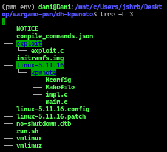
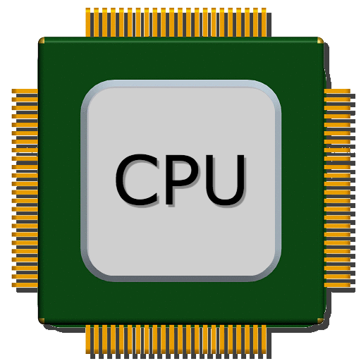
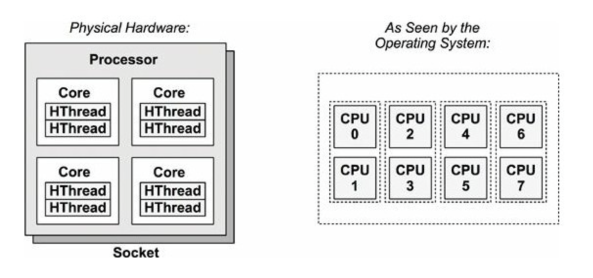
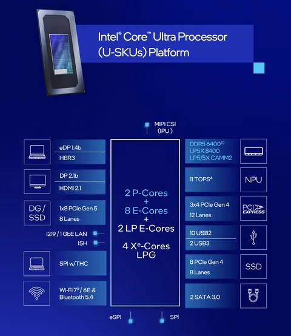

[https://dreamhack.io/wargame/challenges/147](https://dreamhack.io/wargame/challenges/147)

## before to start

<span class="highlight-purple"><strong>커널이란 뭘까?</strong></span> 난 글을 쓸 때엔 <span class="text-underline">어떤 단어</span>를 주어에 놓기로 결심했으면 그게 <strong>술어와 호응하는</strong>지 한번은 생각해보는 태도가 중요하다 여긴다. 학부 4학년이 되도록 커널의 실체를 정확히 이해하지 못했던 것은 많은 사람들이 <span class="text-underline">커널을 설명할 때 이것을 간과</span>하기 때문이다.

<span class="highlight-purple"><strong>커널은 </strong></span><span class="highlight-purple text-underline"><em><strong>공간이 아니다</strong></em></span><span class="highlight-purple"><strong>.</strong></span> <span class="text-gray">(커널과 커널 메모리, 커널 영역은 다른 개념이다) </span><span class="highlight-purple"><strong>커널은 대부분의 경우 엄밀히 </strong></span><span class="highlight-purple text-underline"><em><strong>주체가 아니다.</strong></em></span> <span class="text-gray">(entry_SYSCALL_64는 커널’이’ 작성한 코드, 커널’이’ ~동작을 거부한다) </span>

커널은<span class="text-underline"> 높은 권한을 요구하는 행위 일체</span>를 수행할 수 있는 <span class="highlight-purple"><strong>특별한 바이너리</strong></span>와 <span class="highlight-purple"><strong>로드 가능한 커널 모듈의 집합(</strong></span>vmlinux와 로드된 모듈)이다.

이때 높은 권한을 요구하는 행위 일체는 사전에 정의되어있으며, 이 커널 코드와 데이터가 위치한 주소공간이 ‘커널 메모리’이다. x86-64 Linux에서는 가상 주소 공간의 상위 절반(0xffff...)이 커널 메모리에 해당한다.

## Reccon

```markdown
dh-kpwnote/
├─ run.sh                  # qemu microvm 부팅 스크립트
├─ vmlinuz                 # (이미 빌드 됨)부팅용 압축 커널 이미지
├─ vmlinux                 # (이미 빌드 됨)심볼/디버그정보 포함 커널 ELF (분석용)
├─ initramfs.img           # 루트 파일시스템(cpio) — 부팅 시 offender 유저로 드롭
├─ no-shutdown.dtb         # 디바이스 트리
├─ linux-5.11.16.config    # 커널 빌드 설정(보호기법 확인용)
├─ linux-5.11.16.patch     # 실제 리눅스 커널 소스에 이 문제를 위해 덧붙인 패치 파일. 전체 소스가 아니라 바뀐 부분만 들어있음-> 매크로의 정의가 담긴 헤더는 여기에 부재
├─ NOTICE                  # 라이선스
└─ linux-5.11.16/kpwnote/  # 커널 모듈. 소스코드만 따로 뽑아 놓은 것이고 *.patch가 추가하는 내용과 대응
   ├─ impl.c  main.c  Makefile  Kconfig
```



```diff
diff --git a/Makefile b/Makefile
index 124d8e200..4779b5588 100644--- a/Makefile
+++ b/Makefile
@@ -1109,7 +1109,7 @@ export MODORDER := $(extmod-prefix)modules.order
 export MODULES_NSDEPS := $(extmod-prefix)modules.nsdeps
 
 ifeq ($(KBUILD_EXTMOD),)
-core-y		+= kernel/ certs/ mm/ fs/ ipc/ security/ crypto/ block/
+core-y		+= kernel/ certs/ mm/ fs/ ipc/ security/ crypto/ block/ kpwnote/
 
 vmlinux-dirs	:= $(patsubst %/,%,$(filter %/, \
 		     $(core-y) $(core-m) $(drivers-y) $(drivers-m) \
```

- `core-y`는 <strong>항상 vmlinux에 정적으로 링크되는 디렉터리 목록</strong>임. `kernel/`, `mm/`, `fs/` 같은 커널 핵심부와 동급으로 취급
- 즉 kpwnote는 `insmod`로 로드/언로드하는 LKM(Loadable Kernel Module)이 아니라, <strong>부팅하는 순간부터 항상 커널에 포함돼 있는 코드</strong>
- <span class="text-underline">exploit에서 별도로 </span><span class="text-underline">`insmod kpwnote.ko`</span><span class="text-underline"> 같은 과정이 필요 없고, </span>`/dev/kpwnote` 같은 디바이스 파일이 부팅 직후부터 바로 존재

```diff
diff --git a/Kconfig b/Kconfig
index 745bc773f..41d15200e 100644
--- a/Kconfig
+++ b/Kconfig
@@ -30,3 +30,5 @@ source "lib/Kconfig"
 source "lib/Kconfig.debug"
 
 source "Documentation/Kconfig"
+
+source "kpwnote/Kconfig"
```

#### <span class="highlight-purple">impl.c</span>: `my_write`/`my_read`/`my_lseek`의 경계검사·OOB 방향/범위

- 전역: 모두 data 영역에 있음
```c
#define INITSTR "hi\n"

static DECLARE_RWSEM(sem);
static loff_t tlen = sizeof(INITSTR) - 1; //3
static unsigned char tmp[1024] = INITSTR; //"hi\n"
```
- 지역
<details>
<summary markdown="span">my_lseek</summary>
<div class="toggle-content" markdown="1">


</div>
</details>

<details>
<summary markdown="span">my_read</summary>
<div class="toggle-content" markdown="1">


</div>
</details>

<details>
<summary markdown="span">my_write</summary>
<div class="toggle-content" markdown="1">


</div>
</details>

#### <span class="highlight-purple">main.c</span>: my_fops(proc_ops)의 저장소(.data vs .rodata) 및 함수포인터

#### <span class="highlight-purple">.config</span> : 보호기법 (KASLR/SMAP/SMEP/KPTI/STACKLEAK/USERCOPY/USERMODEHELPER)

#### <span class="highlight-purple">vmlinux 심볼 레이아웃 (nm -n)</span>: tmp/tlen/sem 인접 심볼, 전방(forward) 도달 가능 타깃

#### <span class="highlight-purple">함수포인터 정적주소·proc_ops 필드 오프셋</span>: KASLR 누출식 + 제어흐름 탈취 프리미티브 확정

---

## Knowledge



<figure style="text-align: center;">
    
    <figcaption style="font-size: 0.9em; color: gray; margin-top: 5px;" markdown="span">[https://etloveguitar.tistory.com/62](https://etloveguitar.tistory.com/62)</figcaption>
</figure>

<span class="highlight-purple"><strong>왼쪽 그림이 우리가 CPU하면 흔히 떠올리는 것</strong></span>이다. 하지만 이는 <span class="text-underline">오른쪽 그림의 Processor에 해당</span>하며, 이 안에 Core, 즉 <span class="text-underline"><em>physical CPU</em></span> 가 Hyperthreading(<span class="text-underline"><em>HT</em></span>)을 enable하면 <span class="highlight-purple"><strong>동시에 다수의 작업을 할 수 있다.</strong></span> 

전체 프로세서에서 동시에 할 수 있는 작업의 개수가 곧 <span class="text-underline"><em>logical CPU의 개수</em></span>이다.

- 예를 들어 내가 사용 중인 Intel(R) Core(TM) Ultra 7 155U는 아래와 같이 <span class="text-underline"><em>2 P-Cores + 8 E-Cores + 2 LP E-Cores</em></span>로 총 12개의 <span class="text-underline"><em>physical CPU</em></span>를 가진다.
  - 그리고 P-Cores만 HT를 지원하므로 <span class="text-underline"><em>4“ + 8” + 2”</em></span>, 총 16개의 <span class="text-underline"><em>logical CPU</em></span>를 가진다. 이는 아래와 같이 확인할 수 있다.
```powershell
$p = Get-CimInstance Win32_Processor; $p | Select-Object Name, NumberOfCores, NumberOfLogicalProcessors | Format-List; echo "---CPU name via env---"; echo $env:PROCESSOR_IDENTIFIER
```

<figure style="text-align: center;">
    
    <figcaption style="font-size: 0.9em; color: gray; margin-top: 5px;" markdown="span">[https://www.notebookcheck.net/Core-Ultra-7-255U-vs-Core-Ultra-155U-Early-benchmarks-show-good-multi-thread-performance-improvements.1078886.0.html](https://www.notebookcheck.net/Core-Ultra-7-255U-vs-Core-Ultra-155U-Early-benchmarks-show-good-multi-thread-performance-improvements.1078886.0.html)
4 Xᵉ-Cores LPG는 내장 GPU 그래픽 코어</figcaption>
</figure>

x86 CPU는 지금 실행중인 코드의 <span class="text-underline"><em>privilege 등급</em></span>을 logical CPU 당 하나씩 있는 CS 레지스터의 하위 2비트 <span class="text-underline"><em>CPL(Current Privilege Level)에 저장</em></span>한다. 이는 <span class="text-underline"><em>Ring이</em></span>라고도 한다.

CPU가 저장하는 privilege 등급 = CPL = Ring은 0~3으로 나뉘지만<span class="text-underline"><em> Ring 0 는 커널, Ring 3은 유저권한</em></span>으로 이 둘만 쓰인다.

- Ring 0으로 할 수 있는 것들
  - `CR0/CR3/CR4` 같은 제어 레지스터 수정 (메모리 보호·페이지 테이블 전환)
  - `hlt`(CPU 정지), `in/out`(I/O 포트), 인터럽트 끄기/켜기
  - 임의의 물리/커널 메모리 접근

  ⇒ <span class="text-red"><strong>Ring 3으로 위 작업을 실행</strong></span>하려고 할 경우에, <span class="text-underline"><em>CPU가 General Protection Fault를 발생 시킴</em></span>

이 값이 동작하는 방식은 아래와 같다.

- 커널은 사전에 정의된 방식으로만 진입할 수 있음
  - syscall: CPU가 MSR `IA32_LSTAR`에 커널이 미리 써둔 주소(`entry_SYSCALL_64`)로만 점프(RIP를 변경). 유저는 이 주소를 바꿀 수 없으며, 바꾸려면 Ring 0 권한이 필요함. 
`entry_SYSCALL_64`는 커널이 작성한 어셈 코드로, 유저 레지스터를 `pt_regs`로 저장*하고 커널 스택으로 전환함.
그 뒤 `rax`의 syscall 번호를 보고 `sys_call_table[rax]` 항목을 <strong>call</strong>해서 실제 핸들러(`__x64_sys_read` 등)를 호출함.
핸들러가 끝나면 반환값을 `rax`에 넣고 `sysret`으로 ring 3 복귀
  - 인터럽트, 예외: IDT(Interrupt Descriptor Table)에 커널이 등록한 핸들러로만 진입함. 페이지 폴트면 항상 `page_fault` 핸들러로 감.

  ⇒ syscall 번호, 어떤 인자를 넘길지는 유저가 고를 수 있지만, 진입주소, 핸들러 매핑, 핸들러 안에서 실행되는 코드 일체는 <span class="text-underline"><em>유저가 바꿀 수 가 없음</em></span>
- logical CPU 0번에서 프로세스 A가 실행 중이면 CS는 A의 코드 세그먼트 값(유저면 CPL=3)이고, 커널로 진입하면 CPL=0으로 바뀜.
- 스케줄러가 logical CPU의 점유를 A에서 B로 전환할 때, A의 레지스터(CS, RIP, RSP, RFLAGS 등)는 커널 메모리의 A의 task 구조체(Linux는 `task_struct`, 커널 스택의 `pt_regs`)에 저장됨.
- *실행 중이 아닌 프로세스의 CS는 커널이 저장해 둔 `pt_regs->cs` 에 있음

root 유저가 되는 것(ring 3의 uid=0)과 ring 0를 쥐는 것은 다른 층위로, <span class="text-underline"><em>kernel hacking(LPE)는 유저(ring 3)이 커널 메모리를 읽거나 쓰게 만드는 것</em></span>이다.

<strong>vmlinux</strong>

- 커널 소스를 컴파일/링크해서 나온 <strong>ELF 실행 파일</strong>임. `.text`, `.data`, `.symtab`, `.debug_info`(디버그 심볼 포함 빌드 시) 등 일반 ELF 섹션 구조를 그대로 가짐.
  디버그 심볼이란 컴파일된 기계어 코드와 그걸 만든 소스 코드 상의 이름 위치 타입 정보를 연결해주는 데이터를 말함. CPU 실행에는 전혀 필요 없고, 오직 사람(또는 디버거)이 바이너리를 읽기 위해 존재함. CPU는 함수 정의를 리졸브하는게 아니라 링크 시점에 적힌 상대 주소로 점프하는 것이 전부이기 때문임.

  - 소스 코드의 `add(1, 2)` 같은 함수 호출은 컴파일/링크 단계에서 `call 0x401230` 같은 <strong>절대/상대 주소</strong>로 변환됨.
  - 이 변환(이름 → 주소 확정)은 링커(linker)가 하는 일이고, 바이너리가 완성되는 순간 끝남. 
  - 그래서 `strip`으로 `.symtab`, `.debug_*`를 통째로 지워도 바이너리는 정상작동함.
- 심볼 테이블이 있어서 `nm vmlinux`, `objdump -d vmlinux`, gdb로 함수/전역변수 이름과 주소를 바로 볼 수 있음. 크기가 커서(수백 MB급) 부팅용으로는 안 씀.
- 이게 디버깅/분석의 기준점임. kernel exploit, QEMU+gdb 디버깅 때 `vmlinux`를 심볼 소스로 로드함.

<strong>vmlinuz</strong>

- `vmlinux`를 그대로 압축한 게 아니라, 아래 과정을 거쳐 만들어짐.
  1. `vmlinux`에서 디버그 심볼 등을 제거하고 `objcopy`로 <strong>raw binary</strong>(`vmlinux.bin`)로 변환함. ELF 헤더/섹션 구조가 대부분 사라짐.
  1. 이 바이너리를 gzip/xz/zstd 등으로 압축함.
  1. 앞에 <strong>압축 해제용 부트스트랩 코드</strong>(decompressor, piggy.o 등)와 `bzImage`/`zImage` 헤더(부트 프로토콜 정보)를 붙여서 하나의 파일로 만듦.
    디스크의 압축 파일이 메모리에 그대로 올라간다는 뉘앙스에서 image(상)이라는 표현을 씀. 
일반 실행 파일(ELF)처럼 OS가 동적으로 링크/로드하는 게 아니라, <strong>부트로더가 정해진 규칙대로 메모리에 적재만 하면 되는 self-contained 덩어리</strong>라는 의미

    → 디스크 이미지(`.img`), 컨테이너 이미지(Docker), VM 디스크 이미지 등도 같은 맥락임. "복잡한 로딩 과정 없이, 정해진 규칙에 따라 그대로 적재/실행 가능한 바이트 덩어리"라는 뜻으로 공통적으로 쓰임.
- 즉 `vmlinuz`는 "vmlinux를 압축한 파일"이 아니라 "압축된 커널 본체 + 이걸 풀어서 실행하는 자체 내장 로더"가 합쳐진 부트 이미지임.

## Insight

## fuzzer로 풀기
