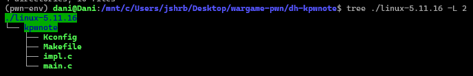

busybox를 쓰는 유형의 문제

```c
(pwn-env) dani@Dani:/mnt/c/Users/jshrb/Desktop/wargame-pwn/dh-kpwnote/ramfs$ file ./early/busybox-1.33.0/busybox
./early/busybox-1.33.0/busybox: ELF 64-bit LSB executable, x86-64, version 1 (SYSV), statically linked, BuildID[sha1]=b3cdf002d9601a846aa7ac82d120d3784a4bffc3, stripped
```

```c
(pwn-env) dani@Dani:/mnt/c/Users/jshrb/Desktop/wargame-pwn/dh-kpwnote/ramfs$ head early/uclibc-ng-1.0.38/uClibc-ng.patch
Notice for this patch to uClibc-ng version 1.0.38:

    Copyright (C) 2021  Theori Inc.
```

[https://elixir.bootlin.com/uclibc-ng/v1.0.38/source](https://elixir.bootlin.com/uclibc-ng/v1.0.38/source)

```c
/*
 * lseek() for uClibc
 *
 * Copyright (C) 2000-2006 Erik Andersen <andersen@uclibc.org>
 *
 * Licensed under the LGPL v2.1, see the file COPYING.LIB in this tarball.
 */

#include <sys/syscall.h>
#include <unistd.h>
#include <cancel.h>

#ifdef __NR_lseek
# define __NR___lseek_nocancel __NR_lseek
_syscall3(off_t, __NC(lseek), int, fd, off_t, offset, int, whence)
#elif !defined __NR_lseek && defined __NR_llseek
...
```

user land → kernel로 넘어가고 나서는 아래와 같이 동작함

```c
[문턱 넘음] syscall 명령 → CPU가 entry_SYSCALL_64로 점프 (CPL=0)
   ↓ ①
entry_SYSCALL_64 (어셈 진입점)
   ↓ ②  rax=8로 테이블 조회
__x64_sys_lseek  →  ksys_lseek(fd, offset, whence)
   ↓ ③  fd(정수) → struct file 복원
vfs_llseek(file, offset, whence)
   ↓ ④  file->f_op에서 콜백 꺼냄
file->f_op->proc_lseek(file, offset, whence)  ==  my_lseek   ← 도착
```



```c
// SPDX-License-Identifier: GPL-2.0

#define pr_fmt(fmt) KBUILD_MODNAME ": " fmt

#include <linux/kernel.h>
#include <linux/rwsem.h>
#include <linux/fs.h>
#include <linux/uaccess.h>


#define INITSTR "hi\n"

static DECLARE_RWSEM(sem);
static loff_t tlen = sizeof(INITSTR) - 1;
static unsigned char tmp[1024] = INITSTR;


loff_t my_lseek(struct file *file, loff_t offset, int whence)
{
	loff_t res, eof;

	res = down_read_interruptible(&sem); //읽기 잠금을 획득하고 대기 중 시그널이오면 포기
	if (res)
		return res; //lock을 못가져왔을 경우
	eof = tlen; //전체 노트의 일이(파일 끝의 위치)
	up_read(&sem); 

	return generic_file_llseek_size(file, offset, whence, OFFSET_MAX, eof);
}
```

<details>
<summary markdown="span">down_read_interruptible / __down_read_interruptible<span class="text-gray">(언더스코어가 붙을 수록 저수준)</span>이랑은 구분되는 함수임. 후자는 큐에 줄 서서 sleep</summary>
<div class="toggle-content" markdown="1">

```c
int __sched down_read_interruptible(struct rw_semaphore *sem)
{
	might_sleep();
	rwsem_acquire_read(&sem->dep_map, 0, 0, _RET_IP_);

	if (LOCK_CONTENDED_RETURN(sem, __down_read_trylock, __down_read_interruptible)) {
		rwsem_release(&sem->dep_map, _RET_IP_);
		return -EINTR;
	}

	return 0;
}
```

<details>
<summary markdown="span"><strong>__down_read_trylock</strong>(잠금이 비어있으면 즉시 획득하고 끝) &amp; __down_read_interruptible 재귀 호출로 대기(잠금이 풀릴 때 까지)</summary>
<div class="toggle-content" markdown="1">

`cmpxchg`(compare-and-swap)로 <strong>락이 비어있으면 reader 카운트를 올려 즉시 획득함</strong>

```c
static inline int __down_read_trylock(struct rw_semaphore *sem)
{
	long tmp;

	DEBUG_RWSEMS_WARN_ON(sem->magic != sem, sem);

	/*
	 * Optimize for the case when the rwsem is not locked at all.
	 */
	tmp = RWSEM_UNLOCKED_VALUE;
	do {
		if (atomic_long_try_cmpxchg_acquire(&sem->count, &tmp,
					tmp + RWSEM_READER_BIAS)) {
			rwsem_set_reader_owned(sem);
			return 1;
		}
	} while (!(tmp & RWSEM_READ_FAILED_MASK));
	return 0;
}
```

```c
struct rw_semaphore {
	atomic_long_t count;
	/*
	 * Write owner or one of the read owners as well flags regarding
	 * the current state of the rwsem. Can be used as a speculative
	 * check to see if the write owner is running on the cpu.
	 */
	atomic_long_t owner;
#ifdef CONFIG_RWSEM_SPIN_ON_OWNER
	struct optimistic_spin_queue osq; /* spinner MCS lock */
#endif
	raw_spinlock_t wait_lock;
	struct list_head wait_list;
#ifdef CONFIG_DEBUG_RWSEMS
	void *magic;
#endif
#ifdef CONFIG_DEBUG_LOCK_ALLOC
	struct lockdep_map	dep_map;
#endif
};
```

</div>
</details>

</div>
</details>

<details>
<summary markdown="span">up_read/ __up_read</summary>
<div class="toggle-content" markdown="1">

down_read_*로 잡은 읽기 잠금을 푸는 함수

eader 카운트를 원자적으로 하나 줄이고, 내가 마지막 reader면서 대기 중인 writer가 있으면 깨워줌

|  | down (획득) | up (해제) |
| --- | --- | --- |
| count 조작 | `+RWSEM_READER_BIAS` (CAS) | `-RWSEM_READER_BIAS` (atomic add) |
| 소유권 | `set_reader_owned` | `clear_reader_owned` |
| 배리어 | `_acquire` | `_release` |
| 추가 동작 | 경합 시 sleep | 마지막이면 대기자 wake |

```c
void up_read(struct rw_semaphore *sem)
{
    rwsem_release(&sem->dep_map, _RET_IP_);
    __up_read(sem);
}
EXPORT_SYMBOL(up_read);
static inline void __up_read(struct rw_semaphore *sem)
{
    long tmp;

    DEBUG_RWSEMS_WARN_ON(sem->magic != sem, sem);
    DEBUG_RWSEMS_WARN_ON(!is_rwsem_reader_owned(sem), sem);

    rwsem_clear_reader_owned(sem);
    tmp = atomic_long_add_return_release(-RWSEM_READER_BIAS, &sem->count);
    DEBUG_RWSEMS_WARN_ON(tmp < 0, sem);
    if (unlikely((tmp & (RWSEM_LOCK_MASK|RWSEM_FLAG_WAITERS)) ==
              RWSEM_FLAG_WAITERS)) {
        clear_nonspinnable(sem);
        rwsem_wake(sem, tmp);
    }
}
```

</div>
</details>

<strong>writer는 모든 reader가 up_read로 빠져나가야(카운트 0) 비로소 깨워짐</strong>. 즉 reader를 하나라도 계속 쥐고 있으면 writer를 <strong>무한정 막을 수 있음</strong>.
⇒ `my_read`처럼 read 잠금을 잡는 경로를 <strong>여러 스레드로 오래 점유</strong>하면, write 잠금을 기다리는 `my_write`를 지연시킬 수 있음. 반대로 앞서 본 `my_lseek`의 “tlen 읽자마자 up_read” 패턴은 잠금을 <strong>너무 빨리 놔버려서</strong> 그 후 계산이 보호를 못 받는 TOCTOU 창을 엶

```c
ssize_t my_read(struct file *file, char __user *buf, size_t count, loff_t *ppos)
{
	int res;

	if (!count)
		return 0;

	res = down_read_interruptible(&sem);
	if (res)
		return res;

	if (tlen > *ppos) {
		size_t n;
		loff_t maxlen = tlen - *ppos;

		if (maxlen <= SIZE_MAX && count > (size_t)maxlen)
			count = maxlen;

		n = copy_to_user(buf, tmp + *ppos, count);
		if (count == n)
			res = -EFAULT;

		count -= n;
	} else {
		count = 0;
	}
	up_read(&sem);

	if (res)
		return res;

	*ppos += count;

	return count;
}
```

<details>
<summary markdown="span">copy_to_user</summary>
<div class="toggle-content" markdown="1">


</div>
</details>

```c
ssize_t my_write(struct file *file, const char __user *buf, size_t count, loff_t *ppos)
{
	int res;
	size_t n;

	if (!count)
		return 0;

	if (count > OFFSET_MAX || *ppos > OFFSET_MAX - count)
		return -ENOSPC;

	res = down_write_killable(&sem);
	if (res)
		return res;

	n = copy_from_user(tmp + *ppos, buf, count);
	tlen = max(tlen, *ppos + (loff_t)(count - n));
	up_write(&sem);

	if (count == n)
		return -EFAULT;

	count -= n;
	*ppos += count;

	return count;
}

```

<div class="box-note" markdown="1">
💬 **페이지 댓글**

- 뭐지
- extern 없이 그냥 프로토타입만 써도 암묵적으로 붙음
- CONFIg_KPWNOTE라는 이름의 옵션이 존재함을 커널 빌드 시스템에 선언함
- 이 옵션이 y/n 둘 중 하나만 가능한 타입(불리언)이고, make menuconfig 같은 설정 UI에서 "enable kpwnote module"이라는 문구로 표시된다는 뜻임.
- CONFIG_PROC_FS(procfs 지원)가 켜져 있어야만 이 옵션을 켤 수 있다는 의존성 조건. main.c가 proc_create()를 쓰니까 당연한 제약임
- ⇒ 이런 메뉴가 있다는 선언일 뿐 아직 켜져 있는지 꺼져 있는지는 모름.
- 위 옵션을 y로 설정한다는 선택 값
- __randomize_layout: 구조체 멤버 순서를 커널 빌드마다 랜덤화하는 보안 기능(구조체 레이아웃 공격 방어용) 어노테이션
- open system call이 호출될 때 실행됨. kpwnote의 main.c에서 이것을 새로 초기화하지 않았으니 커스텀 로직 없이 성공 처리됨
- read 호출 시그니처. my_read 프로토타입의 시그니처와 완전히 일치함
- extern ssize_t my_read(struct file *file, char __user *buf, size_t count, loff_t *ppos);
- write 호출 시 실행됨
- lseek() 호출 시 실행됨
- 커널 단골 문제
- 초기화 때 한번만 쓰이고 버려짐
- proc_create가 성공하면 생성된 /proc 엔트리의 핸들을 돌려받는 변수
- 커널 부팅이 끝나고 나면 메모리를 free해서 아끼는 식
- static: main.c 밖에서는 보이지 않는 내부 함수
디스어셈블리 자체는 vmlinux에 존재하지만, 심볼 테이블에 LOCAL(그 외 GLOBAL)으로 기록됨으로써 링커가 외부 참조에는 사용할 수 없게 됨
- 
- procfs 안에 proc_dir_entry라는 구조체 하나를 새로 할당(kmalloc)함. 이게 “/proc/kpwnote라는 파일이 존재한다”는 커널 측 기록
- 그 구조체에 이름("kpwnote"), 권한(0666), 그리고 my_fops 포인터를 저장
- 이 엔트리를 procfs의 내부 트리(/proc 디렉터리 밑)에 **연결(링크)**함.

성공하면 그 proc_dir_entry *를 반환, 실패(메모리 부족 등)하면 NULL 반환.
- 호출 이후부터 유저가 ls /proc하면 kpwnote가 보이고, open("/proc/kpwnote")가 가능해짐. 즉 "파일처럼 보이는 가짜 노드"를 커널 메모리 안에 만들어서 VFS에 등록하는 작업임. 디스크에 실제 파일이 생기는 게 아니라 메모리 상의 가상 파일
</div>
