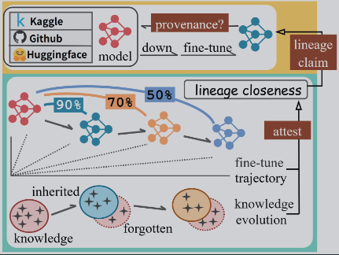
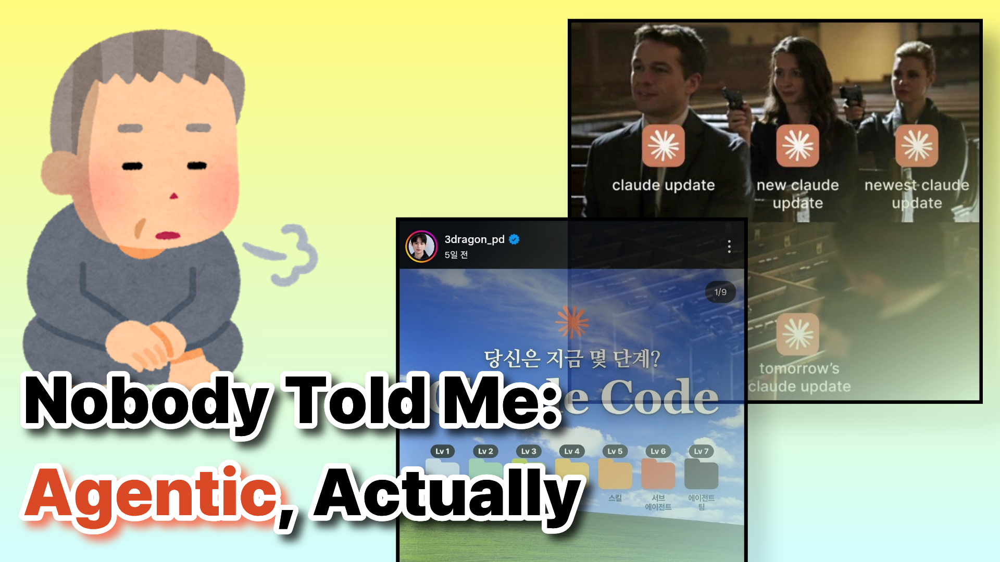
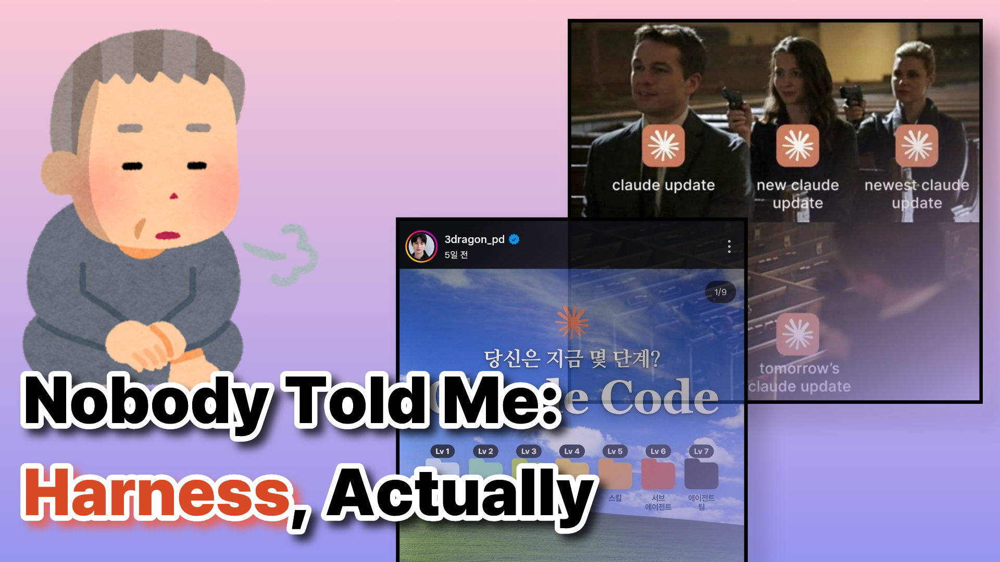
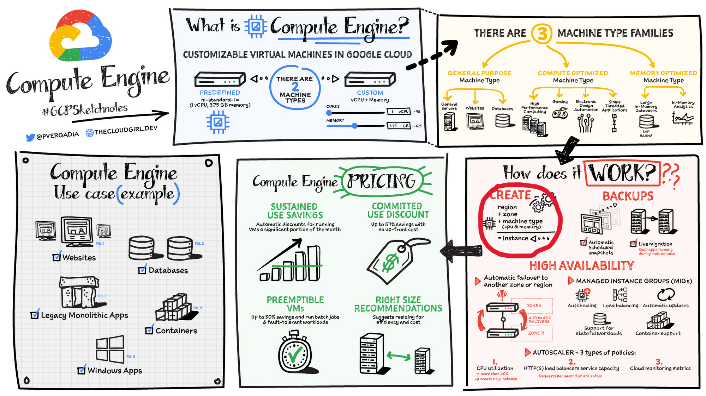
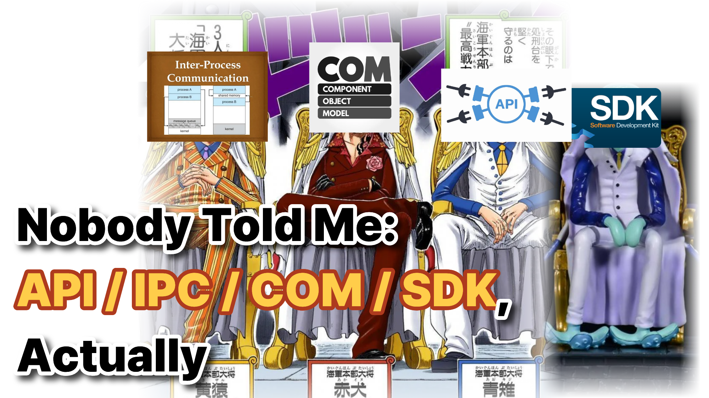

<div class="box-note" markdown="1">
📄 <strong>이 글은 레이아웃 확인용 더미입니다</strong>

- <strong>목적</strong>: Notion sync가 만드는 마크업(토글, 댓글 말풍선, img-pair, 들여쓴 코드 블록)을 한 페이지에서 확인
- <strong>섹션</strong>: 1. 긴 문단 + 하이라이트 + 댓글 · 2. 그냥 항목 · 3. nested 항목 · 4. 토글 + 사진 · 5. nested + 코드 + 토글 · 6. 그 밖의 블록
- <strong>링크</strong>: [arXiv](https://arxiv.org/) · [Code link](https://github.com/)
</div>

<details>
<summary markdown="span">How to read the highlights</summary>
<div class="toggle-content" markdown="1">

Each format has one job. Read the post once, then skim a single color to follow one thread.

- <span class="highlight-blue"><strong>Blue</strong></span> - the paper's own argument
- <span class="highlight-yellow">Yellow</span> - my one-line takeaway for a section
- <span class="highlight-orange">Orange</span> - assumptions I would check before relying on the result
- <span class="highlight-green">Green</span> - my own questions and ideas, not claims from the paper
- <span class="text-yellow">Amber text</span> - key terms in the paper's wording, so you can search them in the PDF
- <span class="text-gray">Gray text</span> - settings, original wording, and asides
- Dashed underline - hover for a short side note

</div>
</details>

## 1. 긴 문단 + 하이라이트 + 댓글

Side-channel 공격은 연산의 결과가 아니라 연산이 남기는 <span class="text-yellow">부수 효과</span>를 관찰한다. 캐시 접근 패턴, 전력 소모, 전자기 방출, 실행 시간 같은 것들이다. 딥러닝 모델은 이런 부수 효과가 특히 규칙적으로 나타나는 워크로드인데, <span class="highlight-blue"><strong>layer 하나하나가 고정된 크기의 행렬 곱으로 이루어져 있어서 그 크기와 순서가 곧 아키텍처를 드러내기 때문이다</strong></span>. 공격자가 같은 물리 머신에서 프로세스를 하나 띄울 수만 있다면, <span class="notion-comment">Flush+Reload나 Prime+Probe 같은 고전적인 캐시 공격으로<span class="comment-bubble"><span class="comment-item">💬 여기서 말하는 '같은 머신'은 VM co-location까지 포함하는지 확인 필요</span></span></span> GEMM 호출의 반복 횟수를 세고, 거기서 layer의 차원을 역산할 수 있다. 이 문단은 일부러 길게 써서 본문 폭, 줄 간격, 한글과 영문이 섞였을 때의 줄바꿈, 그리고 <code>inline code</code>와 <a href="https://example.com">링크</a>가 문장 안에서 어떻게 보이는지 확인하려는 것이다. 수식도 하나 섞어 보면 $\mathrm{Var}(L_{i,t}) = \sigma_i^2$ 처럼 inline으로 들어간다.

두 번째 문단은 하이라이트 색을 전부 늘어놓는다: <span class="highlight-yellow">yellow</span>, <span class="highlight-green">green</span>, <span class="highlight-blue">blue</span>, <span class="highlight-pink">pink</span>, <span class="highlight-orange">orange</span>, <span class="highlight-purple">purple</span>, <span class="highlight-red">red</span>, <span class="highlight-gray">gray</span>, <span class="highlight-brown">brown</span>. 글자색도 마찬가지로 <span class="text-red">red</span>, <span class="text-blue">blue</span>, <span class="text-green">green</span>, <span class="text-orange">orange</span>, <span class="text-purple">purple</span>, <span class="text-pink">pink</span>, <span class="text-gray">gray</span>, <span class="text-yellow">yellow</span>, <span class="text-brown">brown</span>. 강조 계열은 <strong>bold</strong>, <em>italic</em>, <del>strikethrough</del>, <span class="text-underline">underline</span>, 그리고 겹친 것 <strong><em>bold italic</em></strong>, <span class="text-red highlight-yellow"><strong>글자색 + 배경색 + bold</strong></span>. <span class="highlight-yellow">한 문장 전체가 노란 하이라이트인 경우에는 줄이 바뀌어도 띠가 끊기지 않고 자연스럽게 이어지는지, 줄 끝과 줄 시작의 padding이 어색하지 않은지 확인해야 한다. 그래서 이 문장은 최소 두 줄 이상이 되도록 일부러 길게 늘여 쓴다.</span>

<span class="notion-comment">세 번째 문단은 블록 전체에 댓글이 달린 경우다. 댓글 앵커를 정확히 찾지 못하면 converter는 문단 전체를 댓글 span으로 감싼다. 이때 점선 밑줄이 여러 줄에 걸쳐 보이는지, 말풍선이 문단 어디에 붙는지, 모바일 폭에서 말풍선이 화면 밖으로 나가지 않는지 봐야 한다. 댓글이 두 개 이상이면 말풍선 안에 항목이 쌓인다.<span class="comment-bubble"><span class="comment-item">💬 첫 번째 댓글: 문단 전체 앵커</span><span class="comment-item">💬 두 번째 댓글은 조금 더 길게 써서<br>줄바꿈이 들어간 경우를 확인한다</span><span class="comment-item">💬 세 번째</span></span></span>

네 번째 문단은 한 문단 안에 댓글이 여러 개 따로 달린 경우다. <span class="notion-comment">첫 번째 앵커<span class="comment-bubble"><span class="comment-item">💬 A</span></span></span>가 있고, 그 사이에 평범한 문장이 이어지다가 <span class="notion-comment"><span class="highlight-orange">하이라이트된 두 번째 앵커</span><span class="comment-bubble"><span class="comment-item">💬 하이라이트 위에 댓글이 겹친 경우</span></span></span>가 나오고, 문장 끝에 <span class="notion-comment"><code>code_span()</code><span class="comment-bubble"><span class="comment-item">💬 코드 span 위의 댓글</span></span></span>도 있다. 마지막으로 아주 긴 단어 하나: <code>very_long_identifier_without_any_spaces_that_should_not_break_the_layout_on_narrow_screens_0123456789</code> 와 긴 URL <a href="https://arxiv.org/abs/2409.00000?utm_source=layout-playground&amp;utm_medium=test&amp;utm_campaign=overflow-check">https://arxiv.org/abs/2409.00000?utm_source=layout-playground&amp;utm_medium=test&amp;utm_campaign=overflow-check</a>.

## 2. 그냥 항목

- 첫 번째 항목
- 두 번째 항목에는 <span class="highlight-yellow">하이라이트</span>와 <strong>bold</strong>
- 세 번째 항목은 두 줄 이상으로 길어지는 경우다. 목록 항목이 줄바꿈될 때 두 번째 줄이 글머리표 아래로 들어가지 않고 텍스트 시작선에 맞춰지는지 확인한다.
- <span class="notion-comment">댓글이 달린 항목<span class="comment-bubble"><span class="comment-item">💬 목록 안의 댓글</span></span></span>

1. 번호 목록 하나
1. 번호 목록 둘
1. 번호 목록 셋 — 번호가 1, 2, 3으로 다시 매겨지는지

- [ ] 할 일: 체크 안 됨
- [x] 할 일: 체크됨
- [ ] 할 일: 긴 문장으로 된 체크박스 항목이 두 줄로 넘어갈 때 체크박스와 텍스트 정렬이 깨지지 않는지 확인한다

## 3. nested 항목

- Level 1: DLSCA 공격 표면
  - Level 2: CPU cache·timing
    - Level 3: Flush+Reload
      - Level 4: shared library 페이지가 필요
      - Level 4: <span class="highlight-green">내 생각: TEE 안에서는?</span>
    - Level 3: Prime+Probe
  - Level 2: Memory·bus·DRAM
    - Level 3: bus snooping은 <span class="text-gray">(물리 접근 필요)</span>
  - Level 2: GPU microarchitectural
- Level 1: 방어
  - Level 2: masking
  - Level 2: <span class="notion-comment">obfuscation<span class="comment-bubble"><span class="comment-item">💬 nested 항목 안의 댓글</span></span></span>

1. 번호 목록 안의 nested
   - 번호 아래 글머리표
   - 두 번째 글머리표
     1. 그 아래 다시 번호
     1. 번호 둘
1. 번호 목록 둘
   - 마지막 하위 항목. 이 항목은 길게 써서 깊이 들어간 nested 항목이 줄바꿈될 때 들여쓰기와 레일(왼쪽 세로선)이 어떻게 보이는지 확인한다.

- 깊이별로 긴 문장
  - 두 번째 깊이의 긴 문장. Hermes Attack은 PCIe 버스를 스누핑해서 GPU로 가는 명령과 데이터를 가로채고, 그걸로 모델 구조와 가중치를 손실 없이 복원한다고 주장한다.
    - 세 번째 깊이의 긴 문장. <span class="highlight-orange">가정: 공격자가 PCIe 트래픽을 물리적으로 관찰할 수 있음</span> — 이 가정이 클라우드에서도 성립하는지는 따로 따져봐야 한다.

## 4. 토글 + 사진

<details>
<summary markdown="span">토글 안의 캡션 있는 사진</summary>
<div class="toggle-content" markdown="1">

토글 안에서 사진 위아래 여백과 캡션 정렬을 본다.

<figure style="text-align: center;">
    
    <figcaption style="font-size: 0.9em; color: gray; margin-top: 5px;" markdown="span">figure 캡션: <strong>모델 lineage</strong> 판별 파이프라인 <span class="text-gray">(Fig. 2)</span></figcaption>
</figure>

사진 아래 이어지는 문단.

</div>
</details>

<details class="toggle-blue">
<summary markdown="span">색 있는 토글(blue) 안의 사진 두 장 (img-pair)</summary>
<div class="toggle-content" markdown="1">

<figure class="img-pair">
    <div class="img-pair-row">
      
      
    </div>
    <figcaption style="font-size: 0.9em; color: gray; margin-top: 5px;" markdown="span">왼쪽 이미지</figcaption>
</figure>

img-pair 아래 문단: 두 장의 높이가 같게 맞춰지는지.

</div>
</details>

<details class="toggle-yellow">
<summary markdown="span">색 있는 토글(yellow) 안의 캡션 없는 사진 + <span class="highlight-blue"><strong>summary 안의 하이라이트</strong></span></summary>
<div class="toggle-content" markdown="1">


</div>
</details>

<details>
<summary markdown="span">토글 안의 토글</summary>
<div class="toggle-content" markdown="1">

바깥 토글 본문.

<details class="toggle-green">
<summary markdown="span">안쪽 토글 (green)</summary>
<div class="toggle-content" markdown="1">

안쪽 토글 본문과 큰 사진.



</div>
</details>

</div>
</details>

<details class="toggle-heading toggle-h1">
<summary markdown="span">토글 heading 1</summary>
<div class="toggle-content" markdown="1">

heading 1 크기의 토글. 안에 사진 한 장.



</div>
</details>

<details class="toggle-heading toggle-h2">
<summary markdown="span">토글 heading 2</summary>
<div class="toggle-content" markdown="1">

heading 2 크기의 토글.

</div>
</details>

<details class="toggle-heading toggle-h3">
<summary markdown="span">토글 heading 3</summary>
<div class="toggle-content" markdown="1">

heading 3 크기의 토글.

</div>
</details>

<details>
<summary markdown="span"></summary>
<div class="toggle-content" markdown="1">

제목이 빈 토글은 converter가 "더보기"로 바꾸지만, 빈 summary가 들어왔을 때 모양도 확인용으로 남겨 둔다.

</div>
</details>

## 5. nested 항목 + 코드블럭 + 토글

- 코드 블록을 품은 항목: Flush+Reload의 핵심 루프

  ```c
  for (int i = 0; i < SAMPLES; i++) {
      uint64_t t0 = rdtscp();
      maccess(target);
      uint64_t dt = rdtscp() - t0;
      if (dt < THRESHOLD) hits[i] = 1;   // cached: the victim touched the line
      clflush(target);
  }
  ```

- 두 번째 항목
  - 하위 항목 안의 코드 블록 (python)

    ```python
    def studentized_gap(theta, sigma, n):
        """t_i ~ sqrt(N) * gamma_i"""
        return (n ** 0.5) * theta / sigma
    ```

  - 하위 항목 안의 토글

    <details>
    <summary markdown="span">하위 항목 안의 토글 — 펼치면 코드</summary>
    <div class="toggle-content" markdown="1">

    토글 안의 설명 문단.

    ```bash
    python sync_notion_db.py "https://app.notion.com/p/3c8bb540e5fe80ae836fea71a7ab7ef5" --yes --this-is-a-very-long-line-to-check-horizontal-scrolling-inside-a-nested-code-block
    ```

    </div>
    </details>

- 세 번째 항목: 토글 → nested 목록 → 코드

  <details class="toggle-gray">
  <summary markdown="span">토글 (gray) 안에 nested 목록과 코드</summary>
  <div class="toggle-content" markdown="1">

  - 토글 안의 목록
    - 그 아래 항목

      ```json
      { "layout": ["post"], "categories": ["📂/", "paper-review/", "DLSCA/"] }
      ```

    - 코드 다음 항목
  - 토글 안의 두 번째 항목

  </div>
  </details>

<details>
<summary markdown="span">토글 안의 긴 코드 (줄 번호 없는 diff)</summary>
<div class="toggle-content" markdown="1">

```diff
- categories: ["📂/paper-review/ml-stealing/HW/SCA/"]
+ categories: ["📂/paper-review/DLSCA/A. CPU cache·timing·TEE/"]
```

```
plain code block without a language — the copy button and the language caption strip should still look right
```

</div>
</details>

## 6. 그 밖의 블록

<div class="box-note" markdown="1">
💡 box-note callout. 안에 <span class="highlight-blue">하이라이트</span>와 목록.

- 콜아웃 안의 항목 하나
- 콜아웃 안의 항목 둘
</div>

<div class="box-success" markdown="1">
✅ box-success callout
</div>

<div class="box-warning" markdown="1">
⚠️ box-warning callout. 안에 코드 블록:

```python
assert pub_date < post_date
```
</div>

<div class="box-danger" markdown="1">
🚨 box-danger callout
</div>

<blockquote class="notion-quote" markdown="1">
색 없는 인용. Notion처럼 왼쪽 막대만 보여야 한다.
</blockquote>

<blockquote class="notion-quote quote-blue" markdown="1">
배경색(blue) 있는 인용. 두 줄 이상이 되도록 길게 쓴다 — 인용 블록 안에서 줄바꿈과 여백이 어떻게 보이는지 확인하기 위한 문장이다.

- 인용 안의 목록
</blockquote>

<blockquote class="notion-quote text-red" markdown="1">
글자색(red)만 있는 인용.
</blockquote>

| Attack | Channel | Target | Needs physical access | Notes |
| --- | --- | --- | --- | --- |
| Cache Telepathy | CPU cache | architecture | no | <span class="highlight-blue">GEMM 호출 횟수</span> |
| Hermes | PCIe bus | weights + arch | <span class="text-red">yes</span> | lossless |
| DeepSniffer | GPU kernel trace | architecture | no | learned hints |
| BarraCUDA | EM | weights | <span class="text-red">yes</span> | edge GPU; 이 칸은 일부러 길게 써서 표가 가로로 넘칠 때 스크롤이 생기는지 본다 |

$$
\gamma_{f_R}(M_R) \le -\Delta_N \quad \text{and} \quad \gamma_{f_R}(M_R) \le \min_{f_u \in U}\gamma_u(M_R) - \Delta_N
$$

## H1 · Notion 제목 1 — 적색

H1 아래 평범한 문단.

### H2 · Notion 제목 2 — 황색

H2 아래 평범한 문단.

#### H3 · Notion 제목 3 — 녹색

H3 아래 평범한 문단.

### 아주 긴 H2 제목은 화면 폭을 넘어 두 줄로 넘어가도 하이라이트가 글자를 따라 자연스럽게 이어지는지 확인하기 위한 문장

---

<div class="box-note" markdown="1">
💬 **페이지 댓글**

- 페이지 전체에 달린 댓글 하나
- 두 번째 페이지 댓글
</div>
