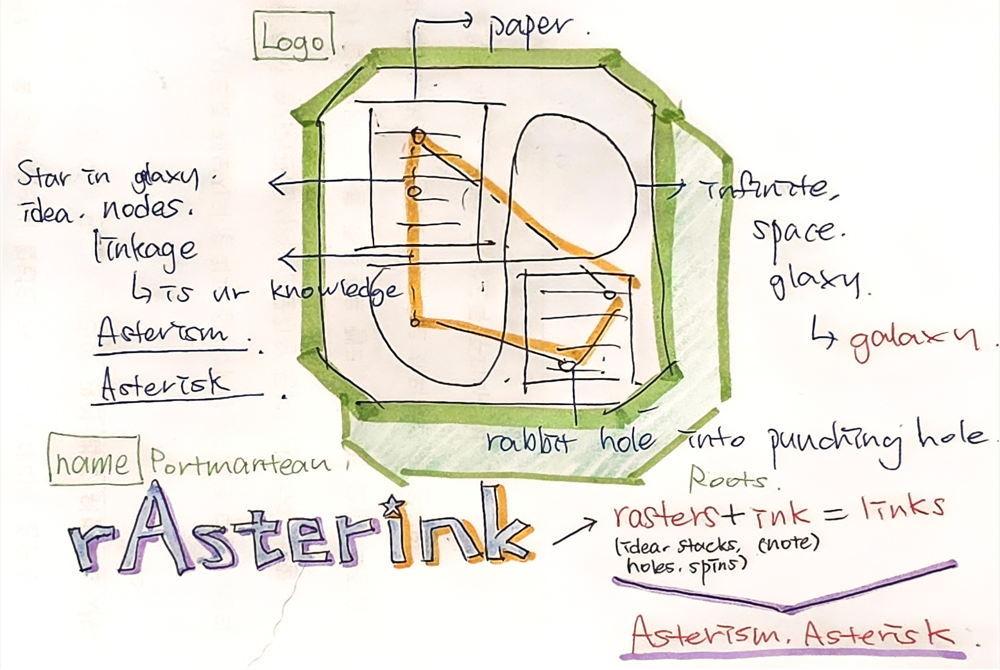
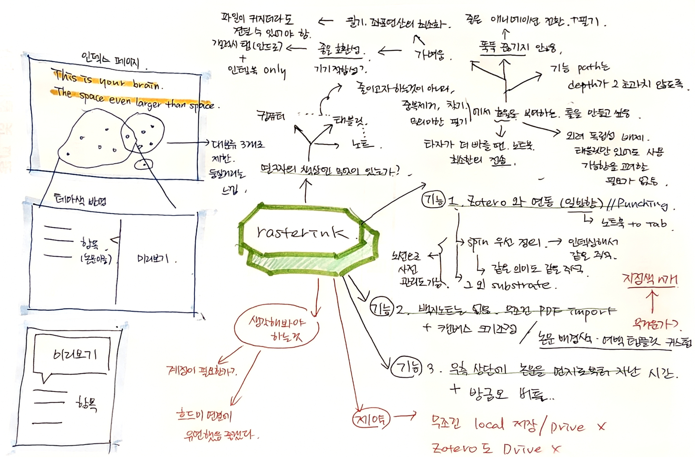

Highlighting Rules

Each format has one job. Read the post once, then skim a single color to follow one thread.

- <strong>Blue</strong> - design decisions I'm sticking with
- Yellow - the one-line takeaway of a section
- Orange - pain points the app has to fix
- Green - ideas I haven't decided on yet
- Amber text - terms I keep reusing
- Gray text - examples, numbers, and asides
- 💡 box - the one question the app is built around

TL;DR: When I queue up unfamiliar terminology in a paper and keep going, the paper ends up full of holes like Swiss cheese (punching holes), and the actual content and the relationships I need to follow get lost in the fog.

But if I dig into each one, I fall down a rabbit hole. I figured the key to fixing this was a good note-taking tool. So I started planning one: something that doesn't break my train of thought, saves me from flipping back and forth to find where I left off, and still looks nice and stays lightweight.

### 0. rAsterink overview

<strong>rAsterink</strong> - a lightweight, open-source PDF note-taking app for the Galaxy Tab S11, built around reading papers

- rasters: images made of dots, a stack of data + link: connecting those pieces of data organically
- Asterism: a pattern of stars. The links between rasters become an asterism in the universe that is your brain. It's also a nod to being the asterisk on your research.
- ink: what makes it a note-taking app

### 1. sketch

- Where it started: 
  - I need an app for annotating PDF papers on my Galaxy Tab 11. None of the existing apps felt like they were made for taking notes on papers.
    - Especially: no way to resize the canvas
    - They crash once the notes pile up, which gets old fast
  - <strong>Start with a lightweight app focused on taking notes on papers</strong>, not a general-purpose notes app.
- Requirements:

  1. On papers with an OCR text layer, mark each term listed in the config with an assigned shape = <strong>punching</strong>
  1. Sync with Zotero on my laptop, so punching can show up as a specific annotation type in Zotero
  1. Lightweight writing. A pen that feels like a ballpoint, with just the right pressure response
  1. Resize the canvas on PDF import, with whatever color and template I want

  <figure class="img-pair">
      

        
        
      

      <figcaption style="font-size: 0.9em; color: gray; margin-top: 5px;" markdown="span">Requirements</figcaption>
  </figure>

### 2. Core question and goal

💡 <strong>What's on a researcher's desk?</strong>

A computer, a tablet, and a paper notebook. All three live on the same desk.

- So the note-taking app I have in mind <strong>isn't trying to cut down on or replace the computer</strong>. (Not optimizing for convenience, portability, etc.)
- I just want to build a tool that cuts the waste that comes from juggling all three: doing things twice, hunting for stuff, and jumping back and forth between pages of a paper.
- In other words
  - When typing is faster, I use the laptop → <strong>only minimal transfer between devices</strong>
  - <strong>No standalone requirement</strong>: I'm not designing for "it should work with just the tablet"

### 3. Design principles

- <strong>Lightweight</strong>
  - → Writing: keep coordinate math to a minimum → it should hold up even as files get big
  - → Good compatibility (device fit?) → Galaxy Tab (Android) + laptop only💬 It has to actually run well on the devices it supports. GoodNotes does support the Galaxy Tab, but it crashes, lags, and has stroke delay.
- <strong>No stutter</strong> → smooth animated transitions + good pen feel
- <strong>No feature path deeper than 2</strong> (every feature is within two steps. Partly to stay light, and partly because I don't want a complicated tool)

### 4. Features

1. Zotero sync (one-way) // Punching

   <strong>Zotero sync</strong>

   - Direction: <strong>laptop → Tab (one-way)</strong>
   - Zotero is used only for spine, substrate, etc.

   <strong>Punching</strong>

   - Sort out the spine first → <strong>index it so the same word always gets the same mark</strong>
     - Same meaning gets the same mark too (synonyms included)
   - Everything else: substrate
   - Extract annotations into Notion through the Zotero-Notion link → so they can be managed like a wiki
     - Common words (e.g. "attack") show up hundreds of times in a single paper → rules need options like `max_hits` and `first_only`
1. PDF only + custom canvas
   - No blank notes. <strong>Everything starts from a PDF import</strong>

     + canvas resizing / custom templates for page background color and margins
   - Open question: is full customization too heavy? → Alternative: n preset colors
1. Focus mode
   - Show how long it's been since I opened the paper, in the top-right corner
     - What if it handed out a "read a paper today" badge, showed it on a heatmap view, and let me share it to Instagram Stories?
   - + Do Not Disturb button
1. Writing (pen)
   - Lightweight writing. Pressure response like a ballpoint pen
   - Ballpoint feel = a narrow stroke-width range (e.g. 0.85~1.15x)
   - Values to tune: pressure curve (gamma), stroke-width range, smoothing, stroke-start stability
   - Feel is subjective, so I pin it down with numbers. Tweak it with in-app sliders and save the values I like as presets
