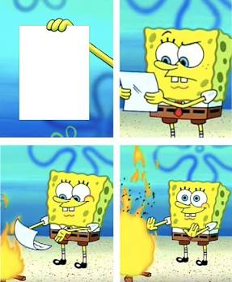
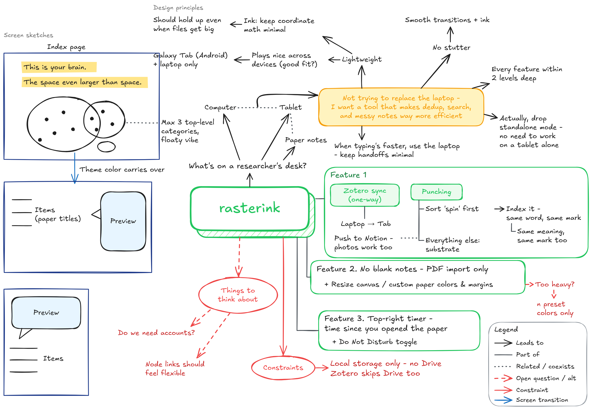

Highlighting Rules

- <strong>Blue</strong> - 확정한 설계 결정
- Yellow - 섹션별 한 줄 takeaway
- Orange - 앱이 해결해야 할 불편
- Green - 아직 결정 안 한 아이디어
- Amber text - 반복해서 쓰는 용어
- Gray text - 예시, 수치, 여담
- 💡 box - 앱이 기대는 핵심 질문

<strong>TL;DR</strong>: 논문에서 모르는 terminology를 큐잉하고 넘어가다 보면 논문에 치즈처럼 구멍이 송송(punching hole) 나고, 실질적인 내용과 파악해야 하는 관계는 오리무중이 됨.

그렇다고 하나씩 dig in 하다 보면 rabbit hole에 빠짐. 나는 이걸 해결할 핵심이 좋은 필기도구에 있다고 생각했음. 생각을 끊기게 하지 않고, 내가 어디까지 기록했는지 번복해 가며 찾는 걸 막고, 그러면서도 심미적이고 가벼운 필기도구를 만들고자 기획에 착수함.

### 0. rAsterink 개요

<strong>rAsterink</strong> - Galaxy Tab S11용, 논문 읽기에 초점을 맞춘 가벼운 PDF 필기 앱(오픈소스)

- rasters: 점이 모인 이미지, 데이터의 스택 + link: 그러한 데이터들을 유기적으로 연결
- Asterism: 별자리. rasters의 link가 곧 brain이라는 우주의 asterism이 됨. 연구의 asterisk가 된다는 의미도 담음.
- ink: 노트 필기 앱의 아이덴티티

### 1. sketch

- 출발점:
  - Galaxy Tab 11에서 PDF 논문에 필기할 앱이 필요함. 기존 앱 중에 논문 필기 목적에 맞는 앱이 체감상 없음.
    - 특히 캔버스 크기 조절 기능의 부재
    - 필기가 많아지면 튕김에서 불편
  - <strong>가벼운 앱으로 시작 - 논문 노트테이킹에 초점</strong>을 맞춤. 범용 노트 앱이 아님.
- 요구사항 정리:

  1. OCR(텍스트 레이어)이 되는 논문에서, config에 입력한 텍스트(terminology)에 정해진 도형을 부여함 = <strong>punching</strong>
  1. 노트북의 Zotero와 연동. punching을 Zotero에서 특정 주석으로 쓸 수 있음
  1. 가벼운 필기. 적절한 필압감의 볼펜 같은 펜
  1. PDF import 시 원하는 색·템플릿으로 캔버스 크기를 바꾸는 기능

  <figure class="img-pair">
      

        
        
      

      <figcaption style="font-size: 0.9em; color: gray; margin-top: 5px;" markdown="span">요구사항 정리</figcaption>
  </figure>

### 2. 핵심 질문과 목표

💡 <strong>연구자의 책상엔 무엇이 있는가?</strong>

컴퓨터·태블릿·노트(종이). 셋이 한 책상에 공존함.

- 그래서 내가 생각하는 노트 필기 앱은 <strong>컴퓨터 사용을 줄이거나 대체하려는 것이 아님</strong>. (편의성, 이동성 등 고려 x)
- 단지 이 셋을 활용하는 과정에서 중복 행동, 찾기, 논문 페이지를 오가면서 생기는 비효율을 해결하는 툴을 만들고 싶음.
- 즉
  - 타자가 더 빠를 땐 노트북을 씀 → <strong>기기 사이에는 최소한의 전송만 함</strong>
  - <strong>독립성 배제</strong>: "태블릿만 있어도 쓸 수 있어야 한다"는 조건은 고려하지 않음

### 3. 설계 원칙

- <strong>가벼움</strong>
  - → 필기: 좌표 연산의 최소화 → 파일이 커지더라도 견딜 수 있어야 함
  - → 좋은 호환성 (기기적합성?)💬 It has to actually run well on the devices it supports. GoodNotes does support the Galaxy Tab, but it crashes, lags, and has stroke delay. → Galaxy Tab(Android) + 노트북 only
- <strong>뚝뚝 끊기지 않음</strong> → 좋은 애니메이션 전환 + 필기감
- <strong>기능 path는 depth가 2를 넘지 않도록</strong> (모든 기능이 두 단계 안에 있음. 가벼워야 하기도 하고, 복잡한 툴을 원치 않음)

### 4. 기능

1. Zotero 연동 (일방향) // Punching

   <strong>Zotero 연동</strong>

   - 방향: <strong>노트북 → Tab (일방향)</strong>
   - Zotero는 spine, substrate 등 용도로만 씀

   <strong>Punching</strong>

   - spine 우선 정리 → <strong>인덱싱해서 같은 자국 (같은 단어 = 같은 표시)</strong>
     - 같은 의미도 같은 자국 (동의어도 같은 표시)
   - 그 외 substrate
   - zotero notion link로 주석을 노션으로 extract → wiki 관리 가능하게끔
     - 흔한 단어(예: "attack")는 논문 한 편에 수백 번 나옴 → rule에 `max_hits`, `first_only` 같은 옵션이 필요함
1. PDF 전용 + 캔버스 커스텀
   - 백지 노트는 없음. <strong>무조건 PDF import</strong>

     + 캔버스 크기 조절 / 논문 배경색·여백 템플릿 커스텀
   - 고민: 커스텀이 무거운가? → 대안: 지정색 n개
1. 집중 모드
   - 우측 상단에 논문을 연 지로부터 지난 시간을 표시함
     - '오늘 논문 읽음' 배지를 발급하고 히트맵 뷰에 반영 / 인스타 스토리에 공유할 수 있다면?
   - + 방해 금지 모드 버튼
1. 필기 (펜)
   - 가벼운 필기. 볼펜 같은 필압감
   - 볼펜 느낌 = 굵기 변화 범위가 좁음 (예: 0.85~1.15배)
   - 튜닝할 값: pressure curve(gamma), 굵기 변화 범위, smoothing, 획 시작부 안정성
   - 느낌은 주관적이라 숫자로 잡음. 앱 안의 slider로 조정하고 마음에 드는 값은 preset으로 저장함
