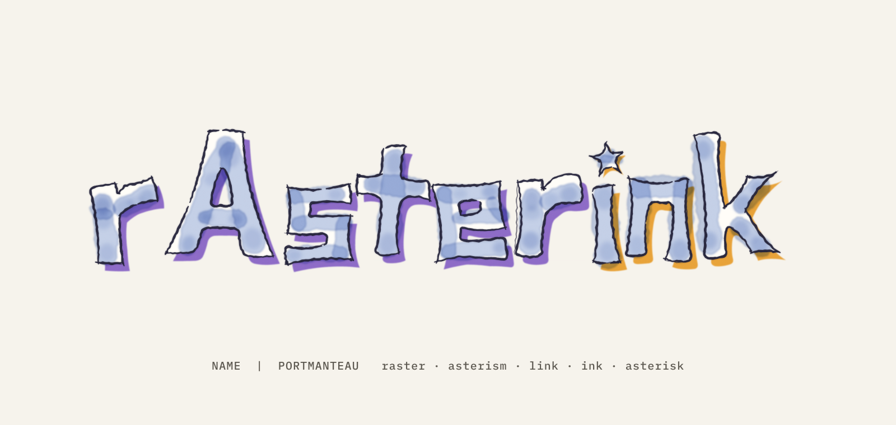
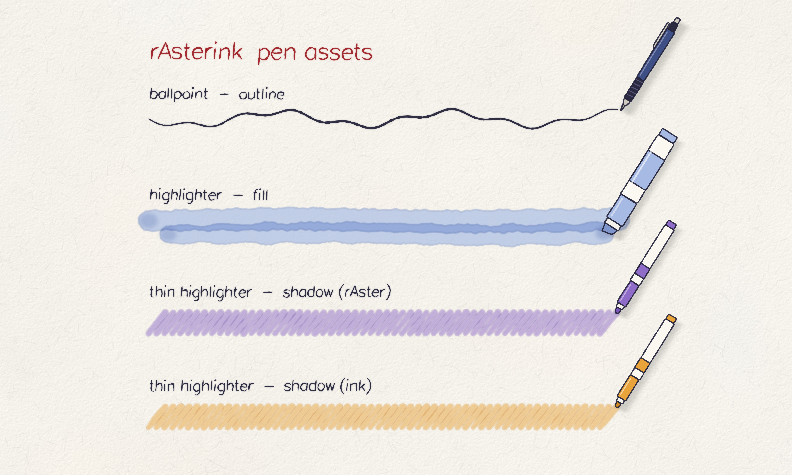
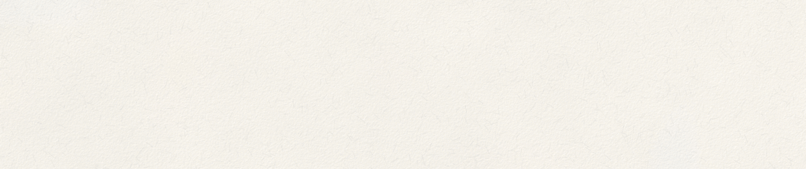

Highlighting Rules

- <strong>Blue</strong> - 확정한 결정
- Yellow - 섹션별 한 줄 takeaway
- Orange - 부딪힌 한계
- Green - 아직 결론 안 난 질문
- Amber text - 반복해서 쓰는 용어
- Gray text - 파라미터와 여담
- 💡 box - 글 전체가 기대는 아이디어 하나

<strong>TL;DR: </strong>rAsterink Devlog에 쓰는 디자인 에셋(로고, 손글씨 메모, 종이 질감, 표지, 펜 에셋, 배너 GIF)을 Claude와 만든 기록. 에셋마다 <strong>프롬프트(비슷한 요청은 합침) → 생성 방식 → 결과물·링크</strong> 순으로 정리함.

### 0. 공통 파이프라인

- 도구: Figma (MCP `use_figma`로 Plugin API 실행 - 벡터 직접 생성), Python·Node 랜덤 생성기, `rsvg-convert` 로컬 프리뷰, Pillow

💡 모든 손그림 요소는 seed 고정 생성기로 만듦 → 같은 seed면 같은 획이 나옴. Figma 로고와 배너 GIF가 같은 획을 공유하는 이유임.

생성기

- `curveFace` - 글자 외곽. 변을 펴진 C자 곡선으로 휘게 해서 획 가운데는 얇고 말단은 넓게 함. 꼭짓점 약 50%는 둥글게, 폭은 저주파 물결 1개로 살짝 불안정하게
- `makeInk2` - 볼펜. 변 하나를 한 번에 긋고, 양끝 테이퍼 + 필압 우글거림 (굵기 ±28%, 파장 9-26px). 40% 확률로 진행 방향 반대로 1.2-2.4px 휘었다 돌아오는 굴곡
- `markerStrokes` / `markerPoly` - 형광펜. 획 폭이 길이 방향으로 ±17% 출렁이고 양 가장자리가 따로 ±7% 흔들림, 끝은 둥근 cap. 꺾이는 획은 모서리에서 펜을 떼고 다시 그음
- `penFill` - 그림자. -40~-28° 사선 해칭, 3개 레이어 MULTIPLY 0.5로 겹친 곳만 진하게
- 손글씨 - Hershey `futural` 단선 폰트를 뼈대로 jitter (기울기 ±1.4°, baseline ±0.3px, 자간 0.86배) 후 볼펜 생성기로 그음

색

- 볼펜: 흑색 `#24233A`, 적색 `#9E2126`
- 채색 형광펜: `#A6BAE4` (가장자리 `#5F7AB8`, 잉크 고임 `#8199CF`)
- 그림자: rAster `#8E6CC7`, ink `#E8A33A`
- 연보라 형광펜 (메모·표지): `#BCA5E3`

공통 효과

- 형광펜: MULTIPLY 0.66, 획 방향 progressive blur (지나온 시작 쪽 12 → 끝난 쪽 1.6), 획 양끝 잉크 고임 (blur 9)
- 볼펜 번짐(halo): 회색 0.3을 COLOR_BURN으로 깔아 밑색이 어둡게 비치게 함 (blur 3)
- 볼펜 x 형광펜 겹침: 겹친 영역만 잘라 COLOR_BURN을 적용하고 더 넓게 번지게 함 (blur 4-5.5) = wet bleed (`ink bleed (wet)`)

### 1. 텍스트 로고 - rAsterink

프롬프트

비슷한 요청은 합치고, 각 요청이 이어진 iteration 기준으로 묶음.

1. <strong>종이 오린 기본형</strong> (→ iteration 1)
   - (손스케치 첨부) 이 스케치를 바탕으로, 종이를 오린 듯한 삐뚤빼뚤한 가장자리의 텍스트 로고를 만들어 주세요.
1. <strong>형광펜 채색과 볼펜 테두리</strong> (→ iteration 2)
   - 글자를 엉성하게 칠한 형광펜 질감으로 채워 주세요. 과하게 스타일링하기보다 대충 색칠한 느낌이어야 합니다.
   - 채색은 도형 폭만큼 넓은 형광펜이 한 번 지나간 것으로 생각해 주세요. 어떤 부분은 비어 있고 어떤 부분은 살짝 삐져나가지만, 획 끝은 둥글고 수채화 같아야 합니다. 잉크가 뭉친 곳은 더 진해야 합니다.
   - 테두리에는 볼펜 같은 필압 변화와 우글거리는 질감, 약간의 잉크 번짐을 넣어 주세요. 경계가 너무 선명한 곳은 블러로 뭉개 주세요.
1. <strong>곡선과 가변 폭</strong> (→ iteration 3)
   - 형광펜 폭이 너무 일정하니 변화를 주세요. 이런 그래픽 작업에 Figma로 충분한지, Blender가 더 적합한지도 알려 주세요.
   - 볼펜 선화가 자를 대고 그은 것 같습니다. 손글씨처럼 말단으로 갈수록 넓고 가운데는 좁게, 꺾임이 잦은 곳에는 곡선이 더 많도록 폭을 바꿔 주세요.
   - 적절한 custom shader effect를 적용해 주세요. → 보류: 두 plan 모두 View seat라 custom shader 생성·적용이 막힘.
1. <strong>다듬기</strong> (→ iteration 4)
   - 획: 너무 뾰족한 꼭짓점 중 절반 정도를 골라 뾰족함을 덜어 주세요. 폭은 곡선을 따르되 불안정해야 합니다. 필압의 우글거림은 유지하면서 선화의 출렁임은 줄이고, 가능하면 각 획을 한 번에 잇되 이따금 진행 방향 반대로 살짝 휘었다가 돌아오게 해 주세요. 펴진 C자 곡선(알파벳 끝으로 갈수록 넓고, 꼭짓점 근처는 뾰족하고, 획 가운데는 얇은 형태)은 유지해 주세요.
   - 잉크 상호작용: 볼펜이 형광펜과 만나는 곳은 평소보다 더 번져야 하고, 번진 테두리는 밑색에 오버레이되어야 합니다(적색 계열 베이지 배경 위에서는 어두운 적색, 청보라 형광펜 위에서는 어두운 청색). 형광펜이 겹치는 곳은 획 방향을 기준으로, 이미 지나온 곳은 경계가 안 보일 만큼 강한 블러, 끝난 곳은 경계가 남는 약한 블러를 주세요.
   - 그림자: 펜으로 칠한 느낌이 나도록 opacity를 낮춰 주세요.
   - 글자 모양과 간격: s는 숫자 5처럼 꺾이는 지점 4개 대신 꺾임 2개 + 곡선으로, n은 오른쪽 획이 바깥으로 더 비스듬히 벌어지게 해 주세요. 첫 r과 A 사이, rA와 s 사이 간격을 좁히고, 글자 안 배경은 흰색 대신 투명하게 해 주세요.

#### 생성 방식

- 글자 골격: 100-unit cap box의 블록 폴리곤(+구멍)에 글자별 기울기 (-4~4°)와 baseline shift를 줘서 종이 오린 리듬을 냄
  - s: 중심선을 새로 그려 곡선 2회전 + 양 말단 flare로 재설계
  - n: 오른쪽 다리를 깊이에 비례해 바깥으로 벌림
- 레이어 구조 (글자 frame 하나, 아래부터): `paper`(투명) → `highlighter pass` → `pooling` → `ink bleed (wet)` → `ink bleed` + `ballpoint A` → `ink bleed` + `ballpoint B` → `ballpoint retrace` → `ink blobs`
- 그림자: `Shadows` frame의 `shadow (pen)` 그룹. mask = 그림자 모양 - 글자 면이라, 글자 안이 투명해도 바깥 띠만 보임.

#### 결과물

<figure style="text-align: center;">
    
    <figcaption style="font-size: 0.9em; color: gray; margin-top: 5px;" markdown="span">iteration 1 - 종이 오린 블록 글자</figcaption>
</figure>

<figure style="text-align: center;">
    
    <figcaption style="font-size: 0.9em; color: gray; margin-top: 5px;" markdown="span">iteration 2 - 형광펜 채색 + 볼펜 테두리</figcaption>
</figure>

<figure style="text-align: center;">
    
    <figcaption style="font-size: 0.9em; color: gray; margin-top: 5px;" markdown="span">iteration 3 - 외곽을 곡선으로, 형광펜 폭 가변</figcaption>
</figure>

<figure style="text-align: center;">
    
    <figcaption style="font-size: 0.9em; color: gray; margin-top: 5px;" markdown="span">iteration 4 - 출렁임 감소 + 펴진 C자 외곽 + 펜 그림자</figcaption>
</figure>

- Figma
  - [Logo/rAsterink 컴포넌트](https://www.figma.com/design/E986G9oAkXI2OKZJ1QQgDE?node-id=1-2)
  - [쇼케이스 frame (종이 질감 + 메모)](https://www.figma.com/design/E986G9oAkXI2OKZJ1QQgDE?node-id=1-45)

### 2. 펜 에셋

로고와 배너 GIF에 쓰는 펜 4종. 모두 같은 생성기로 그림.

- <strong>볼펜</strong> - 선화. 필압 우글거림 + 획 양끝 테이퍼, 번진 테두리는 밑색이 비치게 함 (color burn)
- <strong>형광펜 (채색, 청보라)</strong> - 획 방향 기준 지나온 곳은 강한 블러, 끝난 곳은 약한 블러 + 획 끝 잉크 고임
- <strong>얇은 형광펜 (그림자, 보라)</strong> - rAster 그림자를 사선 해칭으로 칠함
- <strong>얇은 형광펜 (그림자, 노랑)</strong> - ink 그림자용

프롬프트

1. (배너 GIF 요청 중) 볼펜, 형광펜(채색, 보라색), 얇은 형광펜(그림자, 보라색), 얇은 형광펜(그림자, 노란색) 에셋을 적절히 만들어 이 노트에 추가한 뒤 GIF 작업을 시작해 주세요.

#### 생성 방식

- 펜 일러스트: 펜촉·그립·몸통·캡·클립을 파트별 폴리곤으로 만들고 외곽선은 볼펜 생성기로 그림 (SVG → PNG)
- 견본 선과 라벨: 위 공통 생성기 + Hershey 손글씨
- 로컬 SVG/PNG로만 있음 (Figma 파일 없음)

<figure style="text-align: center;">
    
    <figcaption style="font-size: 0.9em; color: gray; margin-top: 5px;" markdown="span">rAsterink 펜 에셋</figcaption>
</figure>

### 3. GitHub 배너 GIF

프롬프트

1. Figma에서 간단한 GIF를 만들 수 있나요? 가능하다면 GitHub 배너용 GIF를 만들어 주세요. rAsterink의 볼펜 선화 → 채색 → 그림자 순으로 그려지고, 다 완성되면 i 위의 별이 한 바퀴 돕니다. 애니메이션 느낌이 나도록 프레임레이트는 낮게, 크기는 배너 사이즈(width는 텍스트 엠블럼보다 살짝 여유 있게, height는 거의 fit하게)로 해 주세요. (이 요청 중 펜 에셋 부분은 2번 섹션에 정리함)

#### 생성 방식

- Figma Motion은 agent 생성·고해상도 export에 Full seat가 필요해서, <strong>로컬 렌더링으로 만듦</strong>
- `scene.js`: Figma 로고와 같은 생성기·seed로 획 geometry 추출 → `render.py`: 프레임별 SVG → `rsvg-convert` → Pillow로 GIF 조립 (공통 팔레트, dithering 없음)
- 1200×252, 8fps (125ms/frame), 87프레임, 약 14초, 무한 반복, 1.98MB
- 타임라인
  1. 볼펜 선화 32f
  1. 쉼 2f → 채색 24f
  1. 쉼 2f → 그림자 20f (보라 → 노랑)
  1. 쉼 2f → i 위 별 360° 회전 10f
  1. 마지막 장면 2.6초 정지
- 각 단계에서 해당 펜이 지금 그리는 획 끝을 따라감
- Figma 로고와 다른 점: progressive blur는 그라데이션 mask로 근사, wet bleed 없음

#### 결과물

<figure style="text-align: center;">
    
    <figcaption style="font-size: 0.9em; color: gray; margin-top: 5px;" markdown="span">rAsterink GitHub 배너 (1200×252, 8fps)</figcaption>
</figure>
