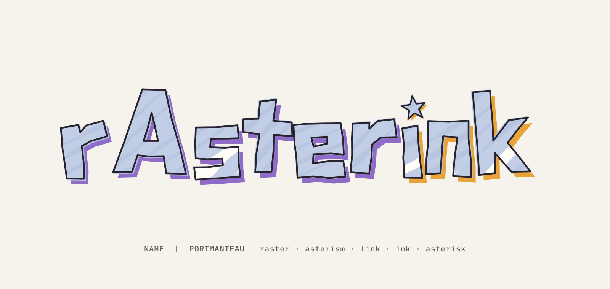
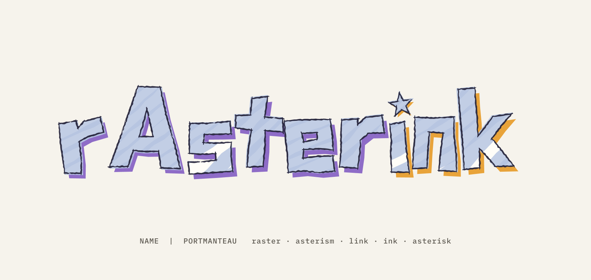
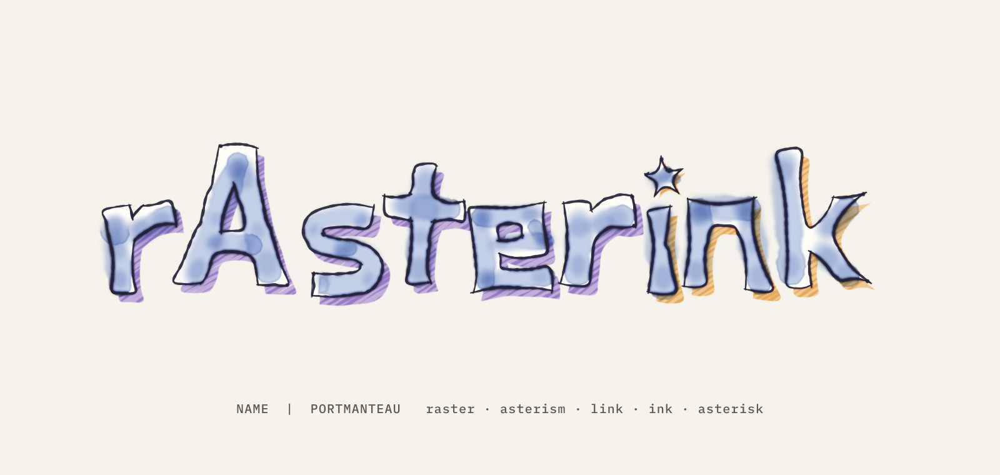

Highlighting Rules

Each format has one job. Read the post once, then skim a single color to follow one thread.

- <strong>Blue</strong> - decisions I locked in
- Yellow - the one-line takeaway of a section
- Orange - limits I ran into
- Green - questions I haven't settled
- Amber text - terms I keep reusing
- Gray text - parameters and asides
- 💡 box - the one idea the rest of the post builds on

<strong>TL;DR: </strong>This is a record of how I made the design assets for the rAsterink Devlog with Claude (logo, handwritten note, paper texture, cover, pen assets, banner GIF). For each asset, I lay it out as <strong>prompts (translated from Korean, with related requests merged) → how it was generated → results and links</strong>.

### 0. Shared pipeline

- Tools: Figma (running the Plugin API through the MCP `use_figma` tool - vectors are generated directly), Python and Node generators, `rsvg-convert` for local previews, Pillow

💡 Every hand-drawn element comes from a fixed-seed generator → the same seed gives the same strokes. That's why the Figma logo and the banner GIF share the exact same strokes.

Generators

- `curveFace` - letter outlines. Bends each edge into an opened-up C curve so strokes are thin in the middle and wide at the ends. About 50% of the corners get rounded, and the width wobbles slightly with a single low-frequency wave
- `makeInk2` - ballpoint pen. Draws each edge in one stroke, with tapered ends + pressure wobble (width ±28%, wavelength 9-26px). 40% of the time, the stroke curves back against its direction by 1.2-2.4px and then returns
- `markerStrokes` / `markerPoly` - highlighter. Stroke width swells ±17% along its length, each edge wobbles ±7% on its own, and the ends get round caps. On sharp turns, the pen lifts at the corner and starts a new stroke
- `penFill` - shadows. Diagonal hatching at -40~-28°, three layers at MULTIPLY 0.5 so only the overlaps get darker
- Handwriting - uses the Hershey `futural` single-line font as a skeleton, adds jitter (slant ±1.4°, baseline ±0.3px, letter spacing 0.86x), then draws it with the ballpoint generator

Colors

- Ballpoint: black `#24233A`, red `#9E2126`
- Fill highlighter: `#A6BAE4` (edges `#5F7AB8`, ink pooling `#8199CF`)
- Shadows: rAster `#8E6CC7`, ink `#E8A33A`
- Light purple highlighter (note and cover): `#BCA5E3`

Shared effects

- Highlighter: MULTIPLY 0.66, progressive blur along the stroke direction (12 at the start, where the pen has already passed → 1.6 at the end), ink pooling at both ends (blur 9)
- Ballpoint bleed (halo): a 0.3 gray layer in COLOR_BURN so the color underneath shows through darker (blur 3)
- Ballpoint x highlighter overlap: clip just the overlapping area, apply COLOR_BURN, and spread it wider (blur 4-5.5) = wet bleed (`ink bleed (wet)`)

### 1. Text logo - rAsterink

Prompts

Related requests are merged and grouped by the iteration they led to.

1. <strong>Cut-paper base</strong> (→ iteration 1)
   - (Hand sketch attached) Create a text logo from this sketch, with irregular edges that look as if the letters were cut out of paper.
1. <strong>Highlighter fill and ballpoint outline</strong> (→ iteration 2)
   - Fill the letters with a loosely applied highlighter texture. It should look casually colored in rather than heavily stylized.
   - Treat the fill as a single highlighter pass as wide as each shape: some areas should remain empty, some should spill slightly past the edges, and the stroke ends should be round and watercolor-like. Where the ink pools, it should be darker.
   - Give the outlines the pressure variation and texture of a ballpoint pen, with slight ink bleed. Blur any edges that look too crisp.
1. <strong>Curves and variable width</strong> (→ iteration 3)
   - The highlighter width is too uniform; please vary it. Is Figma sufficient for this kind of graphic work, or would Blender be more appropriate?
   - The ballpoint line art looks ruler-drawn. Vary the stroke width as handwriting would: wider toward the ends, thinner in the middle, and with more curves where the stroke turns often.
   - Apply a suitable custom shader effect. → On hold: both plans have only a View seat, which blocks creating and applying custom shaders.
1. <strong>Refinement</strong> (→ iteration 4)
   - Strokes: soften about half of the corners, which currently look too sharp. Keep the width curve-based but unstable. Reduce the sway of the line art while keeping the pressure variation, and draw each stroke in a single pass where possible, occasionally curving slightly against its direction before returning. Keep the opened-up C curve: wider toward the ends of each letter, sharp near the corners, and thinner in the middle.
   - Ink interaction: where the ballpoint meets the highlighter, it should bleed more than usual, and its bled edge should overlay the color underneath (dark red on a reddish beige background, dark blue over a bluish-purple highlighter). Where highlighter strokes overlap, follow the stroke direction: apply a strong blur where the pen has already passed, enough to hide the edge, and a light blur where it ends, keeping the edge visible.
   - Shadows: lower the opacity so the shadow reads as being colored in with a pen.
   - Letterforms and spacing: redraw the s with two turns and curves instead of four hard turns like a 5, and open the right stroke of the n so it slants outward. Tighten the gaps between the first r and A and between rA and s, and make the background inside the letters transparent instead of white.

#### How it was generated

- Letter skeletons: block polygons (+ holes) in a 100-unit cap box, with a per-letter tilt (-4~4°) and baseline shift for a cut-paper rhythm
  - s: redrew the centerline and rebuilt it as two curved turns + flared ends
  - n: the right leg spreads outward in proportion to depth
- Layer structure (one frame per letter, bottom to top): `paper` (transparent) → `highlighter pass` → `pooling` → `ink bleed (wet)` → `ink bleed` + `ballpoint A` → `ink bleed` + `ballpoint B` → `ballpoint retrace` → `ink blobs`
- Shadow: the `shadow (pen)` group in the `Shadows` frame. The mask is the shadow shape minus the letter face, so only the outer band shows even though the inside of the letters is transparent.
- Spacing: pulled r and A 40px total toward s. Pushed k 22px to make room for the wider n, then re-centered everything

#### Results

<figure style="text-align: center;">
    
    <figcaption style="font-size: 0.9em; color: gray; margin-top: 5px;" markdown="span">iteration 1 - cut-paper block letters</figcaption>
</figure>

<figure style="text-align: center;">
    
    <figcaption style="font-size: 0.9em; color: gray; margin-top: 5px;" markdown="span">iteration 2 - highlighter fill + ballpoint outline</figcaption>
</figure>

<figure style="text-align: center;">
    
    <figcaption style="font-size: 0.9em; color: gray; margin-top: 5px;" markdown="span">iteration 3 - curved outlines, variable highlighter width</figcaption>
</figure>

<figure style="text-align: center;">
    
    <figcaption style="font-size: 0.9em; color: gray; margin-top: 5px;" markdown="span">iteration 4 - less sway + opened-up C outlines + pen shadows</figcaption>
</figure>

- Figma
  - [Logo/rAsterink component](https://www.figma.com/design/E986G9oAkXI2OKZJ1QQgDE?node-id=1-2)
  - [Showcase frame (paper texture + note)](https://www.figma.com/design/E986G9oAkXI2OKZJ1QQgDE?node-id=1-45)

### 2. Pen assets

The four pens used in the logo and the banner GIF. All of them are drawn with the same generators.

- <strong>Ballpoint</strong> - line art. Pressure wobble + tapered ends, and the bled edge lets the color underneath show through (color burn)
- <strong>Highlighter (fill, blue-purple)</strong> - strong blur where the pen has already passed, light blur where it ends + ink pooling at the stroke ends
- <strong>Thin highlighter (shadow, purple)</strong> - fills the rAster shadow with diagonal hatching
- <strong>Thin highlighter (shadow, yellow)</strong> - for the ink shadow

Prompts

1. (During the banner GIF request) Create the ballpoint, highlighter (fill, purple), thin highlighter (shadow, purple), and thin highlighter (shadow, yellow) assets as appropriate, add them to this note, and then begin the GIF.

#### How it was generated

- Pen illustrations: the tip, grip, barrel, cap, and clip are separate polygons, with outlines drawn by the ballpoint generator (SVG → PNG)
- Sample strokes and labels: the shared generators above + Hershey handwriting
- Only exists as local SVG/PNG (no Figma file)

<figure style="text-align: center;">
    
    <figcaption style="font-size: 0.9em; color: gray; margin-top: 5px;" markdown="span">rAsterink pen assets</figcaption>
</figure>

### 3. GitHub banner GIF

Prompts

1. Can a simple GIF be made in Figma? If so, create a GIF for the GitHub banner showing rAsterink's ballpoint line art → fill → shadow, followed by the star above the i spinning once. Use a low frame rate for an animated feel, and size it as a banner: slightly wider than the text emblem, with a near-fit height. (The pen-asset part of this request is listed in section 4.)

#### How it was generated

- Figma Motion needs a Full seat for agent generation and high-res export, so <strong>I rendered it locally instead</strong>
- `scene.js`: extracts the stroke geometry with the same generators and seeds as the Figma logo → `render.py`: one SVG per frame → `rsvg-convert` → Pillow assembles the GIF (shared palette, no dithering)
- 1200×252, 8fps (125ms/frame), 87 frames, about 14 seconds, loops forever, 1.98MB
- Timeline
  1. Ballpoint line art 32f
  1. Pause 2f → fill 24f
  1. Pause 2f → shadow 20f (purple → yellow)
  1. Pause 2f → the star over the i spins 360° 10f
  1. Hold the last frame for 2.6 seconds
- In each stage, that stage's pen follows the tip of the stroke being drawn
- Differences from the Figma logo: progressive blur is approximated with a gradient mask, and there's no wet bleed

#### Results

<figure style="text-align: center;">
    
    <figcaption style="font-size: 0.9em; color: gray; margin-top: 5px;" markdown="span">rAsterink GitHub banner (1200×252, 8fps)</figcaption>
</figure>
