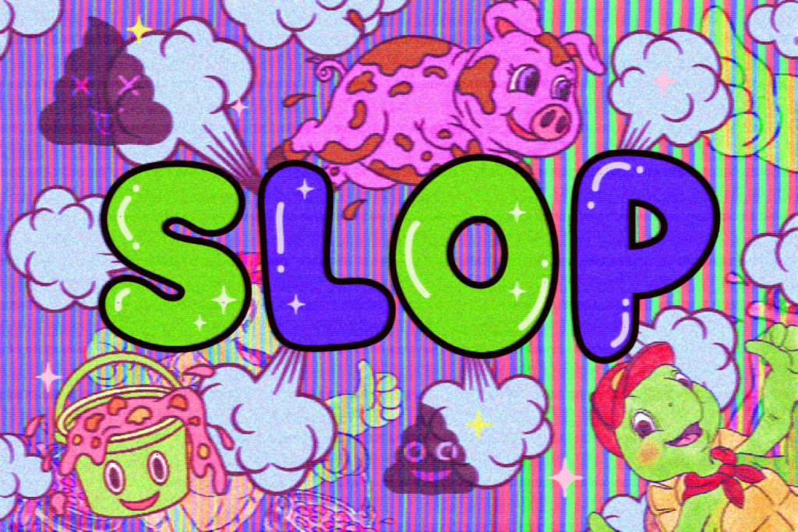
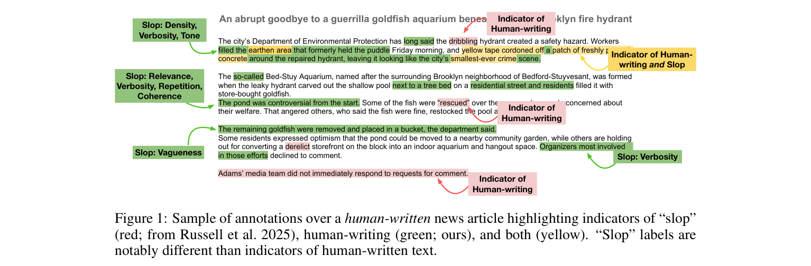
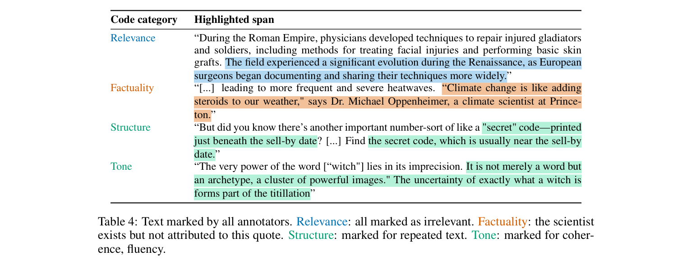
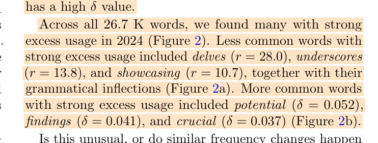
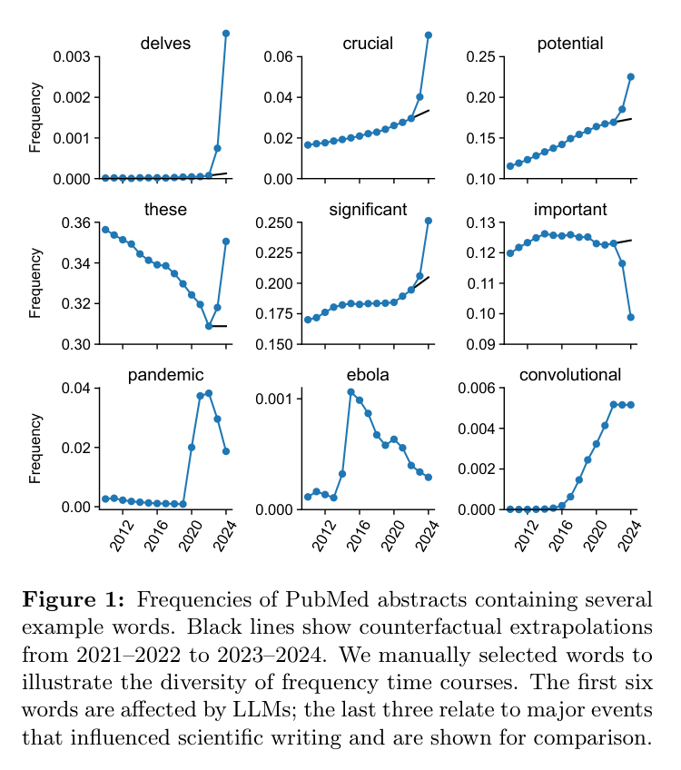
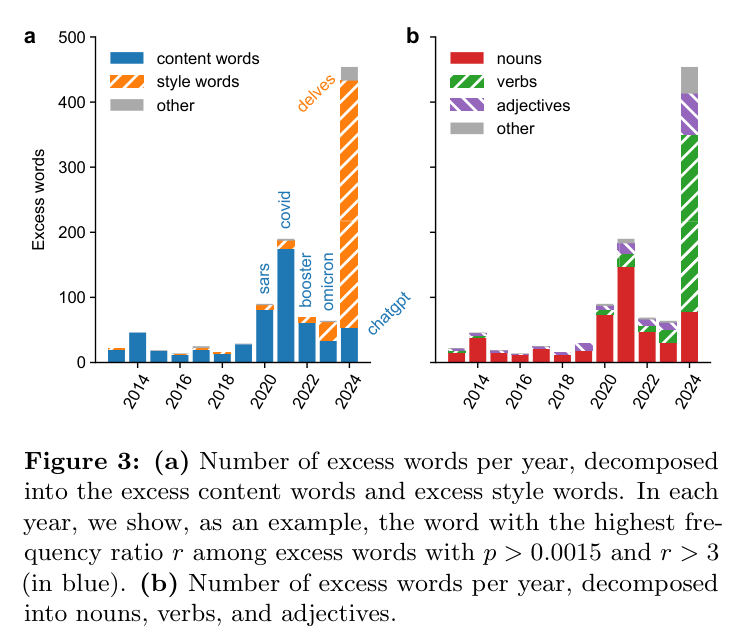
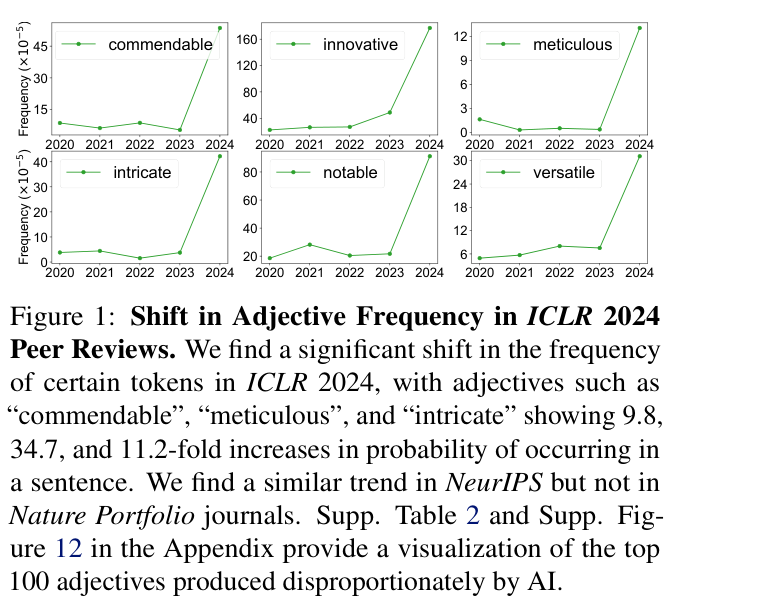
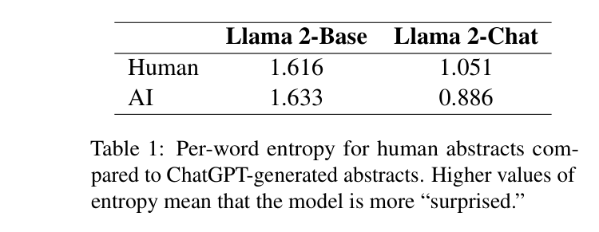

<strong>TL;DR</strong>: 오늘 ISOC fellowship 등록 과정을 블로그에 남기려고 Claude한테 초안을 맡겼다. 날짜도 맞고 링크도 맞고, 남은 할 일까지 체크리스트로 깔끔하게 빠져 있었지만 AI가 쓴 것 같은 느낌은 지울 수 없었다.

<strong>틀린 내용이 없는데 왜 안 읽힐까. 어떤게 AI같은 느낌을 주는걸까? </strong>최근 랩에서 LLM fingerprinting을 하고 있다보니 좀 더 흥미로웠다. 그래서 (내 클로드가)논문과 글을 20+편 읽었고, (내가) 정리한 내용을 세 편으로 나눠 쓴다. 1편은 slop의 정의와 LLM 이후 늘어난 단어, 2편은 AI가 쓴 글의 문체와 그 영향, 3편은 slop을 잡아낼 수 있는지와 LLM에게 다시 고치게 하면 되는지다.

## slop의 정의

Merriam-Webster는 2025년 올해의 단어로 slop을 골랐다. [AP 기사](https://www.pbs.org/newshour/nation/merriam-websters-word-of-the-year-for-2025-is-ais-slop)에 따르면 slop은 1700년대에 '질척한 진흙'이라는 뜻으로 처음 쓰였고, 이후 별 가치 없는 것을 가리키게 됐다. 지금 사전에 실린 뜻은 AI로 대량 생산한 저품질 디지털 콘텐츠다.

<figure style="text-align: center;">
    
    <figcaption style="font-size: 0.9em; color: gray; margin-top: 5px;" markdown="span">AP via PBS NewsHour (2025.12.15). [Merriam-Webster's word of the year for 2025 is AI 'slop'](https://www.pbs.org/newshour/nation/merriam-websters-word-of-the-year-for-2025-is-ais-slop)</figcaption>
</figure>

Simon Willison은 2024년 5월 [블로그 글](https://simonwillison.net/2024/May/8/slop/)에서 slop을 원치 않는 AI 생성물을 가리키는 말로 소개했다. Willison의 정의는 꽤 좁다.

<blockquote class="notion-quote" markdown="1">
"if it's mindlessly generated and thrust upon someone who didn't ask for it" (Simon Willison, 2024)
</blockquote>

생각 없이 만들어서 요청하지도 않은 사람에게 내민 생성물만 slop이고, AI가 만든 것 전부를 가리키지는 않는다는 뜻이다. 같은 글에서 그는 <strong>검토하지 않은 생성물을 남에게 공유하는 건 무례</strong>하다고도 썼다.

거꾸로 [Shaib et al.(2025)](https://arxiv.org/abs/2509.19163)은 사람이 쓴 뉴스 기사에서도 slop 신호를 찾아 아래 그림처럼 표시했다.

<figure style="text-align: center;">
    
    <figcaption style="font-size: 0.9em; color: gray; margin-top: 5px;" markdown="span">Shaib et al. (2025) Figure 1. 사람이 쓴 뉴스 기사에 표시한 예. 초록 상자는 slop 코드(Density, Relevance, Verbosity 등), 분홍 상자는 사람이 쓴 글로 보이는 특징, 노랑은 둘 다에 해당하는 구간</figcaption>
</figure>

그림의 초록 상자에 붙은 이름(Density, Relevance 등)은 저자들이 slop을 판정하려고 만든 코드다. 먼저 글쓰기, 저널리즘, 언어학, NLP, 철학 분야 19명에게 slop의 정의와 특징을 받아 Relevance(관련성), Density(정보 밀도), Tone 같은 코드로 정리했다. 그다음 Upwork에서 고용한 전문 교정자(copy-editor) 세 명💬 - 본 annotation: 그중 annotation 품질과 일정을 보고 3명을 골라, 1인당 뉴스 기사 71편 + QA 답변 41개를 맡김. 기사 45편과 답변 10개는 세 명 모두에게 줘서 일치도를 쟀음 - 절차: 글 전체를 읽고 먼저 "slop인가"를 yes/no로 답한 뒤, slop 코드(Relevance, Density, Tone 등)에 해당하는 구간을 단어 단위로 표시함. 코드 목록은 글쓰기·저널리즘·언어학·NLP·철학 분야 19명에게 받은 slop 정의를 정리해서 만들었음 즉 "전문"은 NLP 연구자가 아니라 전문 교정·편집자(copy-editor)라는 뜻이 뉴스 기사 213편과 검색 질의응답 답변 123개를 나눠 읽었다. 교정자는 글 전체가 slop인지 먼저 yes/no로 답하고, 각 코드에 해당하는 구간을 단어 단위로 표시했다.

코드마다 실제로 무엇을 표시했는지는 세 교정자가 모두 표시한 구간을 모은 아래 표에 나온다.

<figure style="text-align: center;">
    
    <figcaption style="font-size: 0.9em; color: gray; margin-top: 5px;" markdown="span">Shaib et al. (2025) Table 4. 교정자 세 명이 모두 표시한 구간. Relevance는 셋 다 주제와 무관하다고, Factuality는 실존 인물에게 하지 않은 말을 붙였다고 표시함</figcaption>
</figure>

Relevance 칸은 로마 시대 의술 이야기 뒤에 이어 붙은 르네상스 시기 문장으로, 세 명 모두 기사 주제와 상관없다고 표시했다. Tone 칸은 "witch"라는 단어를 다룬 문장으로, 흐름(coherence)과 자연스러움(fluency) 문제로 표시됐다. 표에 없는 Density는 길이에 비해 실질적인 내용이 적은 경우, 즉 장황하거나 어디에나 들어맞는 일반론이 많은 경우를 가리킨다.

이 논문 정리는 여기 있다: [paper] Measuring AI "Slop" in Text

## LLM 이후 늘어난 단어

#### PubMed abstract의 단어 빈도

[Kobak et al.(2025)](https://arxiv.org/abs/2406.07016)은 PubMed💬 [v] PubMed는 미국 국립의학도서관(NLM)이 운영하는 생의학 논문 데이터베이스. 논문의 서지 정보와 abstract를 모아둠.에 올라온 2010~2024년 영어 생의학 논문 abstract 1,510만 편으로부터, <strong>단어마다 </strong><strong>그해 abstract 중 그 단어가 한 번이라도 들어간 비율</strong>을 셌다. 한 abstract에 같은 단어가 여러 번 나와도 한 번으로 친다.

그다음 LLM의 영향을 받았을 수 있는 2023년은 빼고, 2021~2022년의 추세를 2024년까지 직선으로 늘려 2024년의 예상 비율을 구했다. 그리고 2024년의 실제 비율을 이 예상 비율로 나눴다. 이렇게 계산한 값이 delves는 28이었다. 2024년에 delves가 들어간 abstract가 추세로 예상한 수의 28배였다는 뜻이다. 또한 underscores는 13.8, showcasing은 10.7이었다. 

<figure style="text-align: center;">
    
    <figcaption style="font-size: 0.9em; color: gray; margin-top: 5px;" markdown="span">Kobak et al. (2025) §2.1. r은 2024년 실제 빈도를 예측 빈도로 나눈 값</figcaption>
</figure>

<figure style="text-align: center;">
    
    <figcaption style="font-size: 0.9em; color: gray; margin-top: 5px;" markdown="span">Kobak et al. (2025) Figure 1. 파란 점은 해마다 그 단어가 들어간 abstract의 비율, 검은 선은 2021~2022년 추세로 그은 예상치. 위 여섯 단어는 LLM의 영향을 받은 단어, 아래 세 단어(pandemic, ebola, convolutional)는 비교용</figcaption>
</figure>

나는 이 논문이 2024년 결과를 무엇과 비교했는지가 흥미로웠다. 비교 대상은 LLM이 나오기 전에 특정 단어가 갑자기 늘었던 해들이다. 저자들은 2013~2023년에도 같은 계산을 해서, 해마다 예상보다 <strong>크게 늘어난 단어(excess word)</strong>를 뽑았다. 그 결과 2015년에는 ebola(9.9배), 2017년에는 zika(40.4배)가 늘었고, 코로나 시기인 2020~2022년에는 coronavirus, covid, lockdown, pandemic이 크게 늘었다. 

저자들은 늘어난 단어를 두 종류로 나눴다. masks, convolutional처럼 글의 주제를 가리키는 단어(content word)와, intricate, notably처럼 주제와 상관없이 문장을 꾸미는 단어(style word)이다. 2024년 이전에 늘어난 단어는 거의 다 주제를 가리키는 단어였고, 이런 단어는 79%가 명사였다. 반면 2024년에 늘어난 단어는 거의 다 문장을 꾸미는 단어였고, 379개 중 66%가 동사, 14%가 형용사였다.

<figure style="text-align: center;">
    
    <figcaption style="font-size: 0.9em; color: gray; margin-top: 5px;" markdown="span">Kobak et al. (2025) Figure 3. 해마다 예상보다 크게 늘어난 단어 수. (a) 파랑은 주제를 가리키는 단어, 주황 빗금은 문장을 꾸미는 단어 (b) 같은 단어를 품사로 나눈 것. 2020~2022년은 주제 단어·명사, 2024년은 꾸미는 단어·동사가 대부분</figcaption>
</figure>

#### LLM을 거친 abstract의 비율

'2024년 abstract의 최소 13.5%가 LLM을 거쳤다'는 추정도 이 꾸미는 단어들로 계산했다. 계산은 세 단계다.

1. 2024년에 늘어난 꾸미는 단어로 두 묶음을 만듦. 하나는 드문 단어 291개, 다른 하나는 crucial, notably, insights 같은 흔한 단어 10개임.
1. 묶음마다 그중 한 단어라도 들어간 abstract의 비율을 구해, 앞에서처럼 2021~2022년 추세로 구한 예상 비율과 비교함. 두 묶음 모두 실제 비율이 예상보다 약 13.5%p 높았음.
1. 예상보다 늘어난 이 13.5%p를 LLM을 거친 abstract의 비율로 봄.

LLM을 거쳤어도 이 단어를 하나도 쓰지 않은 abstract는 세지 못하므로, 13.5%는 최솟값이다. 비교하자면 같은 방법으로 잰 2021년 코로나 단어(covid, pandemic, coronavirus, sars)의 증가폭은 6.9%p였다.

#### ICLR 리뷰의 형용사

AI 학회 리뷰에서도 비슷한 일이 있었다. [Liang et al.(2024)](https://arxiv.org/abs/2403.07183)이 2020~2024년 ICLR peer review를 비교해 보니, 2024년 리뷰에서 한 문장에 commendable이 나올 확률은 9.8배, meticulous는 34.7배 뛰었다.

<figure style="text-align: center;">
    
    <figcaption style="font-size: 0.9em; color: gray; margin-top: 5px;" markdown="span">Liang et al. (2024) Figure 1. ICLR 리뷰의 문장에 각 형용사가 나오는 빈도(×10⁻⁵). 2023년까지 평평하다가 2024년에 뜀</figcaption>
</figure>

#### delve 증가의 원인

왜 하필 delve 같은 단어들일까? [Juzek &amp; Ward(2025)](https://aclanthology.org/2025.coling-main.426)는 이 질문을 가설을 하나씩 지워 가는 방식으로 다뤘다. 먼저 분석할 단어부터 골랐다. PubMed abstract에서 2020년보다 2024년에 크게 늘었는데 세상일로는 설명되지 않는 단어 50개를 찾고, 그중 ChatGPT(GPT-3.5)가 쓴 abstract에서 사람이 쓴 abstract보다 유의하게 많이 나오는 단어 21개(delve, showcasing, underscores 등)를 남겼다. 그리고 원인 후보를 일곱 가지 들었는데, 그중 다음 세 가지를 직접 확인했다.

1. 가설 1: ChatGPT의 학습 데이터에 원래 이 단어들이 많다. 학습 데이터로 쓰였을 만한 arXiv abstract, 뉴스, Wikipedia를 세어 보니 이 단어들은 ChatGPT가 쓴 abstract보다 훨씬 드물었음. 이 단어를 즐겨 쓰는 영어 변종이 따로 있다는 증거도 없었음. → 기각
1. 가설 2: 모델 구조나 알고리즘(토크나이저 등) 때문이다. → 아래 Llama 2 비교로 기각
1. 가설 3: 사전학습 뒤에 하는 fine-tuning이나 RLHF 때문이다.💬 [v] RLHF(Reinforcement Learning from Human Feedback): 사람의 선호를 모델에 반영하는 학습 방법임. 같은 질문에 대한 모델 답변 여러 개를 사람 평가자에게 보여 주고 더 나은 쪽을 고르게 한 뒤, 그 선택을 점수로 흉내 내는 보상 모델(reward model)을 학습시킴. 그다음 언어 모델이 보상 모델에게 높은 점수를 받는 답변을 내도록 강화학습으로 조정함. 대표 논문: Ouyang et al. (2022), Training language models to follow instructions with human feedback (InstructGPT). 이 논문 Figure 2가 위 세 단계(시범 답변으로 fine-tuning → 보상 모델 학습 → 강화학습)를 그린 구조도임. Juzek &amp; Ward의 가설: 평가자들이 delve 같은 단어가 든 답변을 조금씩 더 높게 쳤고, 그 선호가 모델에 반영됐다는 것. → 같은 비교에서 원인 후보로 남았지만, 사람 평가자 실험으로는 결론이 나지 않음

가설 2와 3을 가르려면 구조와 알고리즘은 같고 학습 단계만 다른 두 모델이 필요하다. 저자들은 Meta의 Llama 2 두 버전을 골랐다. Llama 2-Base는 대량의 텍스트로 사전학습만 한 모델이고, Llama 2-Chat은 같은 모델에 대화용 fine-tuning과 RLHF를 더한 버전이다.

비교에 쓴 글은 2020년 PubMed abstract 1만 편과, 같은 논문의 abstract를 ChatGPT(GPT-3.5)로 다시 쓴 버전이다. ChatGPT에게 원래 abstract를 몇 문장으로 요약하게 한 뒤, 그 요약만 주고 abstract를 새로 쓰게 했다. 2022년부터 2024년 초까지는 ChatGPT가 논문 전체를 입력으로 받지 못해서, 연구자들이 논문의 요점만 넣고 abstract를 받았을 거라고 보고 그 방식을 흉내 낸 것이다. 두 모델에 이 글들을 넣고 per-word entropy를 계산한 결과가 아래 표다.

<figure style="text-align: center;">
    
    <figcaption style="font-size: 0.9em; color: gray; margin-top: 5px;" markdown="span">Juzek &amp; Ward (2025) Table 1. 사람 abstract와 ChatGPT abstract에 대한 per-word entropy. 낮을수록 모델이 그 글의 단어를 더 잘 예측함</figcaption>
</figure>

표의 값이 낮을수록 모델이 그 글의 단어를 높은 확률로 예측했다는 뜻이고, 논문은 이를 모델이 덜<strong> "놀랐다(surprised)"고 표현</strong>한다.

Llama 2-Base에서는 사람 abstract(1.616)와 ChatGPT abstract(1.633)의 값이 거의 같았다. Llama 2-Chat에서는 ChatGPT abstract의 값(0.886)이 사람 abstract(1.051)보다 뚜렷하게 낮았다. 구조와 알고리즘이 같은 두 모델에서 결과가 갈렸으니 가설 2는 주된 원인이 아니다. 남는 건 두 모델에서 다른 fine-tuning과 RLHF다. 저자들은 그중 RLHF에 주목해 사람 평가자 실험으로 직접 확인하려 했지만 결론을 내지 못했다. 다만 첫 문장에 delve가 들어간 abstract는 참가자들이 덜 선호했다.

delve, underscore, showcase 같은 단어들은 강조만 할 뿐, 문장이 전하는 사실에 새로운 정보를 보태지 않는다. 예를 들어 앞에서 본 underscores가 들어간 "Our results underscore the importance of data quality."를 "Our results show that data quality matters."로 바꿔도 빠지는 사실이 없는 식이다.

2편으로 이어진다: [magazine] 왜 AI가 만든 글은 읽기 어려울까?

## 참고 자료

- 원문에 하이라이트를 친 버전과 이 블로그의 논문 정리 모음: AI Slop / Stylometric LLM Fingerprints
- AP via PBS NewsHour (2025.12.15). [Merriam-Webster's word of the year for 2025 is AI 'slop'](https://www.pbs.org/newshour/nation/merriam-websters-word-of-the-year-for-2025-is-ais-slop)
- Simon Willison (2024). [Slop is the new name for unwanted AI-generated content](https://simonwillison.net/2024/May/8/slop/)
- Shaib et al. (2025). [Measuring AI "Slop" in Text](https://arxiv.org/abs/2509.19163) · 정리: [paper] Measuring AI "Slop" in Text
- Kobak et al. (2025). [Delving into LLM-assisted writing in biomedical publications through excess vocabulary](https://arxiv.org/abs/2406.07016). Science Advances
- Liang et al. (2024). [Monitoring AI-Modified Content at Scale](https://arxiv.org/abs/2403.07183). ICML 2024
- Juzek &amp; Ward (2025). [Why Does ChatGPT "Delve" So Much?](https://aclanthology.org/2025.coling-main.426). COLING 2025

💬 **페이지 댓글**

- 삭제
- 이거 figure이 있을텐데 설명이랑 함께 첨부하면 좋을듯
- 개뜬금없고 별로임 앞에서 새로생긴 단어의 경향성을 항목으로 잘 설명했으면 몰라 갑자기 드립을 써머리격으로 치니까 안와닿음
- 이거 RLHF 댓글로 옮기삼
- 아님 토글 유지할거면 처음 제시된 논문+아키텍처 피규어를 같이 주는게 나을듯
- 논문에서의 뜻 (Reinhart et al. 2025, Introduction): base model은 텍스트를 이어 쓰기(text completion)만 하는 모델이고, instruction-tuned variant는 거기서 "further trained to answer questions and complete tasks specified in prompts" 한 모델임. 즉 질문에 답하고 프롬프트로 지시한 과제를 수행하도록 추가 학습한 버전을 말함.
실험에서 쓴 쌍: Llama 3 8B / 70B(base) vs Llama 3 8B / 70B Instruct. GPT-4o, GPT-4o Mini도 instruction-tuned 쪽으로 분류됨.
- 명사화(nominalization) = 동사나 형용사를 명사로 바꿔 쓰는 것.
- 논문 Methods의 예: develop → development, robust → robustness.
논문이 든 모델 출력 예 (Llama 3 70B Instruct, 한 문장에 명사화 4개): "reduce deforestation, habitat destruction, and pollution, while also promoting sustainable consumption patterns" → deforestation, destruction, pollution, consumption.
한국어로 치면 "결정했다" 대신 "결정을 내렸다", "개선한다" 대신 "개선이 이루어진다"처럼 동작을 명사로 묶는 쪽이다
- - 본 annotation: 그중 annotation 품질과 일정을 보고 3명을 골라, 1인당 뉴스 기사 71편 + QA 답변 41개를 맡김. 기사 45편과 답변 10개는 세 명 모두에게 줘서 일치도를 쟀음
- 절차: 글 전체를 읽고 먼저 "slop인가"를 yes/no로 답한 뒤, slop 코드(Relevance, Density, Tone 등)에 해당하는 구간을 단어 단위로 표시함. 코드 목록은 글쓰기·저널리즘·언어학·NLP·철학 분야 19명에게 받은 slop 정의를 정리해서 만들었음
즉 "전문"은 NLP 연구자가 아니라 전문 교정·편집자(copy-editor)라는 뜻
- 맨 앞부터 자름. 논문 본문에는 "이어지는 두 덩어리, 문장 경계에서 나눔"까지만 있고, 어디서 자르는지는 HAP-E 데이터 카드에 있음: 글마다 맨 앞 약 1,000단어를 뽑되 그 구간이 절·장 경계를 넘지 않게 했고, dependency parse로 찾은 문장(또는 독립절) 끝에서 500단어씩 둘로 나눔.
- 피규어 하나 더 있음좋겠는데

