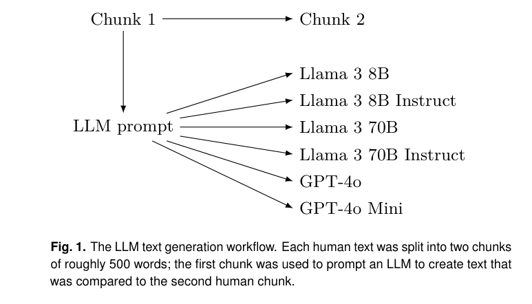
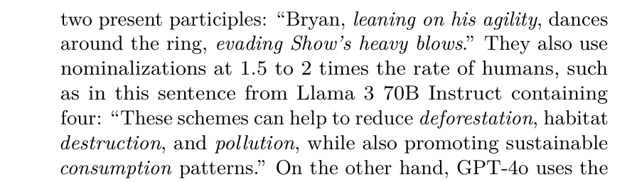
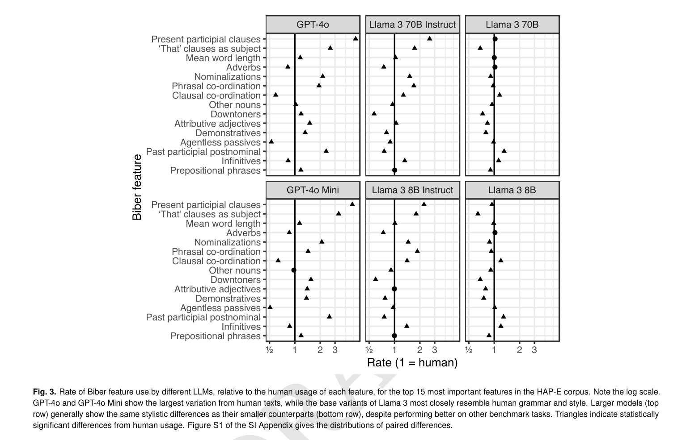
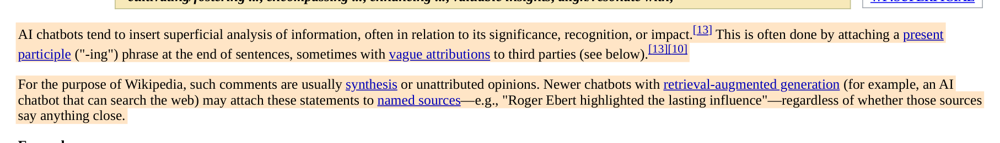
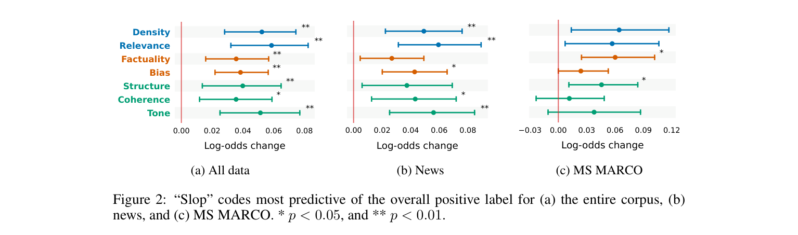
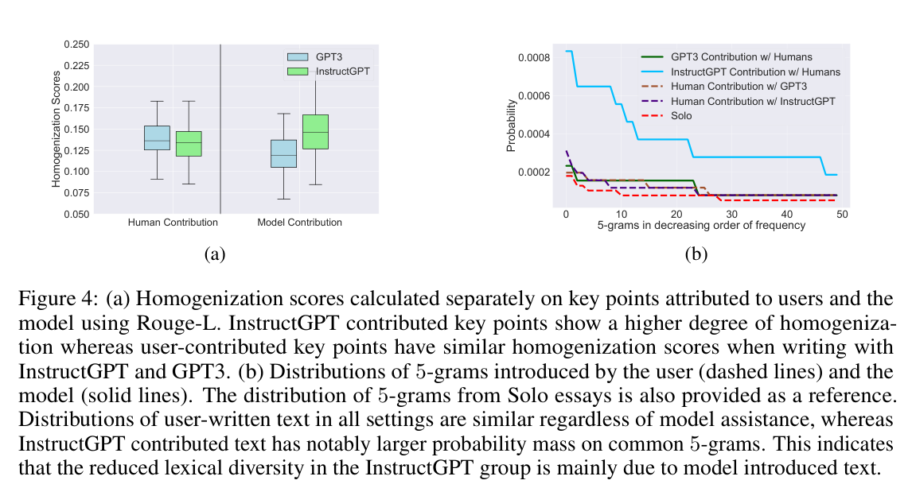
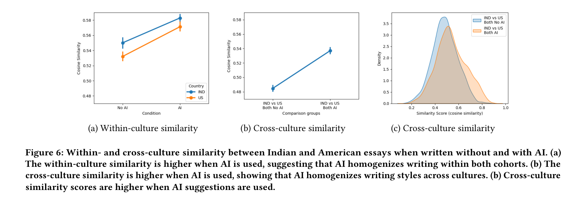
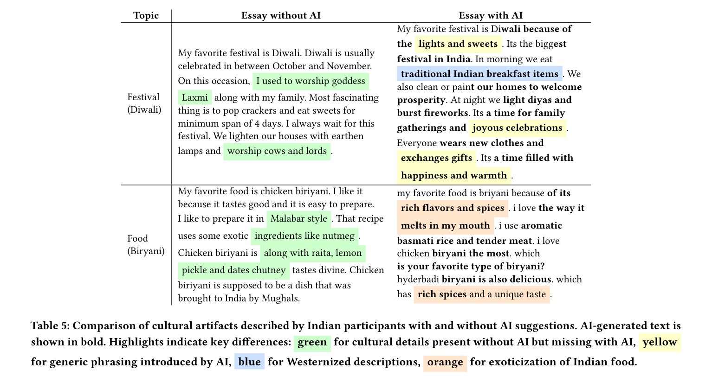
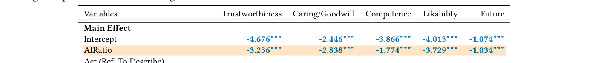

<strong>TL;DR</strong>: [magazine] 왜 AI가 만든 글은 읽기 어려울까?(1편)에서 이어진다. 1편에서는 slop의 정의와 LLM 이후 늘어난 단어를 봤다. 이번 편에서는 문체, 여러 사람의 글이 서로 비슷해지는 현상, 독자의 신뢰를 다룬다.

## 명사 위주 문체와 새 정보의 부족

#### HAP-E 말뭉치와 비교 방법

[Reinhart et al.(2025, PNAS)](https://arxiv.org/abs/2410.16107)은 사람이 쓴 글과 LLM이 쓴 글을 같은 조건에서 비교하고자 HAP-E(Human-AI Parallel English)라는 <strong>말뭉치</strong>를 만들었다. 이때 사람이 쓴 글의 소스는 다음과 같다: 학술지 논문(Elsevier 오픈 액세스), 미국 온라인 뉴스, Project Gutenberg의 소설과 단편, 팟캐스트 녹취록, [blogger.com](http://blogger.com/) 블로그, TV·영화 대본.

비교한 LLM은 여섯 개다. OpenAI의 GPT-4o와 GPT-4o Mini, Meta의 Llama 3 8B, 70B, 8B Instruct, 70B Instruct다. Llama 3 8B와 70B는 1편에서 본 Llama 2-Base처럼 사전학습만 해서 주어진 글을 이어 쓰기만 하는 base 모델이다. 나머지 넷은 Llama 2-Chat처럼 질문에 답하고 지시를 따르도록 추가 학습(instruction tuning)을 거친 instruction-tuned 모델이다. 우리가 ChatGPT 같은 챗봇에서 쓰는 LLM이 이쪽이다. GPT-4o는 base 모델이 공개되지 않아서, 같은 모델의 base와 instruction-tuned 버전을 나란히 비교할 수 있는 건 Llama 3뿐이다.

비교 방법은 아래 그림과 같다.

<figure style="text-align: center;">
    
    <figcaption style="font-size: 0.9em; color: gray; margin-top: 5px;" markdown="span">Reinhart et al. (2025) Fig. 1. 사람이 쓴 글을 약 500단어씩 두 덩어리(Chunk 1, 2)로 나누고, Chunk 1을 LLM 여섯 개에 각각 줘서 이어 쓰게 한 뒤 그 결과를 Chunk 2와 비교</figcaption>
</figure>

각 글의 맨 앞 약 1,000단어를 가져와, 문장이 끝나는 지점에서 약 500단어씩 두 덩어리로 나눴다.💬 맨 앞부터 자름. 논문 본문에는 "이어지는 두 덩어리, 문장 경계에서 나눔"까지만 있고, 어디서 자르는지는 HAP-E 데이터 카드에 있음: 글마다 맨 앞 약 1,000단어를 뽑되 그 구간이 절·장 경계를 넘지 않게 했고, dependency parse로 찾은 문장(또는 독립절) 끝에서 500단어씩 둘로 나눔. 이 1,000단어 안에서는 절(section)이나 장(chapter)이 바뀌지 않게 했다. 첫 번째 덩어리는 여섯 LLM에 각각 주고 500단어를 더 쓰게 했다. instruction-tuned 모델에는 "In the same style, tone, and diction of the following text"로 시작하는 지시를 붙였고, base 모델은 원래 주어진 글을 이어 쓰는 모델이라 지시 없이 첫 덩어리만 줬다.

그렇게 나온 500단어를 원문에서 이어지던 두 번째 덩어리와 <strong>비교</strong>한다. 같은 글의 같은 지점에서 같은 길이로 이어진 사람의 글이 있으니, 주제와 길이 차이를 빼고 문체만 비교할 수 있는 설계다.

#### Biber 특징별 사용률

이때 원문의 두 번째 덩어리와 LLM이 이어 쓴 덩어리를 비교한 기준은 Douglas Biber가 정리한 66개 언어 특징이다. 단어 평균 길이, 명사화, 행위자 없는 수동태, 분사절 같은 특징을 글마다 얼마나 자주 쓰는지 세어 사람의 사용률과 견줬다. instruction-tuned 모델 네 개는 현재분사절을💬 논문에서의 뜻 (Reinhart et al. 2025, Introduction): base model은 텍스트를 이어 쓰기(text completion)만 하는 모델이고, instruction-tuned variant는 거기서 "further trained to answer questions and complete tasks specified in prompts" 한 모델임. 즉 질문에 답하고 프롬프트로 지시한 과제를 수행하도록 추가 학습한 버전을 말함. 실험에서 쓴 쌍: Llama 3 8B / 70B(base) vs Llama 3 8B / 70B Instruct. GPT-4o, GPT-4o Mini도 instruction-tuned 쪽으로 분류됨. 사람보다 2~5배 많이 썼고, GPT-4o는 5.3배 많았다. 명사화(nominalization)💬 명사화(nominalization) = 동사나 형용사를 명사로 바꿔 쓰는 것. 논문 Methods의 예: develop → development, robust → robustness. 논문이 든 모델 출력 예 (Llama 3 70B Instruct, 한 문장에 명사화 4개): "reduce deforestation, habitat destruction, and pollution, while also promoting sustainable consumption patterns" → deforestation, destruction, pollution, consumption. 한국어로 치면 "결정했다" 대신 "결정을 내렸다", "개선한다" 대신 "개선이 이루어진다"처럼 동작을 명사로 묶는 쪽이다도 1.5~2.1배였다. 논문이 든 예문은 아래와 같다.

<figure style="text-align: center;">
    
    <figcaption style="font-size: 0.9em; color: gray; margin-top: 5px;" markdown="span">Reinhart et al. (2025) 본문 예시. GPT-4o 문장의 현재분사절 두 개와 Llama 3 70B Instruct 문장의 명사화 네 개(기울임체)</figcaption>
</figure>

Biber 특징의 사용률이 사람과 가장 비슷했던 건 instruction tuning을 거치지 않은 base 모델이었다. 아래 그림은 중요도 상위 15개 특징을 LLM이 사람보다 몇 배 쓰는지 모델별로 보여 준다. 가로축은 사람의 사용률을 1로 놓은 배율(로그 축)이라, 점이 세로선(1)에서 멀수록 사람과 다르게 썼다는 뜻이다. 삼각형은 사람과의 차이가 통계적으로 유의한 특징, 동그라미는 유의하지 않은 특징이다.

패널은 모델마다 하나다. 열은 왼쪽부터 GPT-4o 계열, Llama 3 Instruct, Llama 3 base이고, 위 줄은 큰 모델(GPT-4o, 70B Instruct, 70B), 아래 줄은 같은 계열의 작은 모델(GPT-4o Mini, 8B Instruct, 8B)이다. 그래서 같은 열의 위아래를 비교하면 모델이 클수록 사람에 가까워지는지 볼 수 있다.

<figure style="text-align: center;">
    
    <figcaption style="font-size: 0.9em; color: gray; margin-top: 5px;" markdown="span">Reinhart et al. (2025) Fig. 3. 중요도 상위 15개 Biber 특징을 모델이 사람 대비 몇 배 쓰는지(로그 축, 세로선 1 = 사람). 위 줄은 큰 모델, 아래 줄은 작은 모델, 오른쪽 열이 base 모델</figcaption>
</figure>

오른쪽 열의 base 모델은 점이 대부분 세로선 근처에 모여 있고, 왼쪽 두 열의 GPT-4o와 Instruct 모델은 넓게 흩어져 있다. 위 줄과 아래 줄은 열마다 거의 같은 모양이라, 모델이 커져도 사람과의 차이는 줄지 않았다. 논문은 큰 모델이 다른 벤치마크에서는 더 좋은 성능을 내는데도 그렇다고 덧붙인다.

저자들은 instruction tuning을 거치면 모델이 정보가 빽빽하고 명사가 많은 문체로 쓰게 되고, 소설이든 블로그든 장르가 바뀌어도 그 문체가 유지된다고 해석한다.

#### Wikipedia 가이드의 사례

[Wikipedia의 AI 글 판별 가이드](https://en.wikipedia.org/wiki/Wikipedia:Signs_of_AI_writing)에도 같은 패턴이 나온다. 위키백과 편집자 모임인 WikiProject AI Cleanup이 실제 문서에서 모은 사례집이다. 가이드의 Superficial analyses 항목에 따르면, AI 챗봇은 정보를 전하면서 그 정보의 의의나 영향을 평가하는 얕은 분석을 끼워 넣는 경향이 있고, 문장 끝에 현재분사구("-ing" phrase)를 붙이는 경우가 많다.

여기서 -ing는 명사처럼 쓰이는 동명사가 아니라 앞 문장 전체에 덧붙는 분사구문이다. 위키백과 기준에서 이런 덧붙임은 출처의 내용을 넘어선 종합(synthesis)이거나 출처 없는 의견이라서 문제가 된다.

<figure style="text-align: center;">
    
    <figcaption style="font-size: 0.9em; color: gray; margin-top: 5px;" markdown="span">Wikipedia: Signs of AI writing, Superficial analyses 절 (CC BY-SA 4.0)</figcaption>
</figure>

가이드에 언급된 예로는 알제리 도시 Douera 문서가 있다. 2008년 인구조사 기준 인구가 약 56,998명이라는 문장 끝에 "creating a lively community within its borders"가 붙어 있다. 인구 수는 인구조사로 확인할 수 있지만, 그 도시가 활기찬 공동체라는 평가는 어느 출처도 뒷받침하지 않는다.

#### slop 판정에 작용한 코드

글에 새로운 사실이 적을수록 slop으로 읽힌다는 건 [Shaib et al.(2025)](https://arxiv.org/abs/2509.19163)의 결과에서도 보인다. 1편에서 본 것처럼 이 논문은 글쓰기, 저널리즘, 언어학, NLP, 철학 분야 19명에게 받은 slop의 정의를 Relevance(관련성), Density(정보 밀도), Tone 같은 코드로 정리했고, 전문 교정자 세 명이 글 전체가 slop인지 yes/no로 답한 뒤 코드마다 해당하는 구간을 표시했다. Density는 길이에 비해 실질적인 내용이 적은 경우를 가리킨다. 저자들은 이 코드 가운데 어느 것이 교정자들의 slop 판정을 가장 잘 설명하는지 logistic regression으로 봤다. 글마다 각 코드가 표시된 횟수와 여부를 입력으로, 그 글의 slop 판정을 출력으로 놓고 회귀한 뒤 코드별 계수(β, log-odds 변화량)를 비교한 결과가 아래 그림이다.

<figure style="text-align: center;">
    
    <figcaption style="font-size: 0.9em; color: gray; margin-top: 5px;" markdown="span">Shaib et al. (2025) Figure 2. 각 코드가 표시될 때 slop 판정의 log-odds가 얼마나 오르는지. (a) 전체 (b) 뉴스 (c) MS MARCO 질의응답</figcaption>
</figure>

일곱 코드가 모두 유의했고, 계수가 가장 큰 건 Relevance(0.06), Density(0.05), Tone(0.05)이었다. 주제와 상관없는 문장이나 밀도 낮은 문장이 많이 표시된 글일수록 slop으로 판정될 가능성이 높았다는 뜻이다. 다만 판정을 내린 사람은 교정자 세 명이고, 글 전체에 대한 yes/no 판정은 이들 사이에서도 잘 일치하지 않았다(3편에서 다룬다).

Reinhart와 Shaib의 결과를 붙여 보면 AI가 쓴 글을 읽을 때 우리가 느끼는 피로가 어디서 오는지 설명된다. 문장은 명사로 빽빽해서 읽는 데 힘이 드는데, 다 읽고 나면 새로 알게 된 게 없다.

## 글의 획일화

#### 에세이 요점의 유사도

[Padmakumar &amp; He(ICLR 2024)](https://arxiv.org/abs/2309.05196)는 Upwork에서 모집한 영어 원어민 38명에게 에세이 300편을 쓰게 했다. 참가자는 혼자 쓰는 조건, GPT-3의 제안을 받으며 쓰는 조건, InstructGPT의 제안을 받으며 쓰는 조건에 나뉘었다. 에세이가 비슷한 정도는 같은 주제의 다른 에세이들과의 평균 유사도로 쟀다. 유사도는 단어 배열이 얼마나 겹치는지 보는 Rouge-L과 임베딩 모델로 의미를 비교하는 BERTScore로 계산했고, gpt-3.5-turbo로 에세이마다 요점(key point)을 뽑아 요점끼리도 비교했다. 요점 기준 Rouge-L 유사도는 혼자 쓴 조건 0.1536, GPT-3 조건 0.1578, InstructGPT 조건 0.1660이었고, InstructGPT 조건만 나머지 두 조건보다 유의하게 높았다.

저자들은 키 입력 기록으로 요점마다 모델이 쓴 문장에서 나왔는지 사용자가 쓴 문장에서 나왔는지 가려, 두 쪽의 유사도를 따로 쟀다. 결과는 아래 그림과 같다.

<figure style="text-align: center;">
    
    <figcaption style="font-size: 0.9em; color: gray; margin-top: 5px;" markdown="span">Padmakumar &amp; He (2024) Figure 4. (a) 요점을 사용자가 쓴 쪽(Human Contribution)과 모델이 쓴 쪽(Model Contribution)으로 나눠 잰 유사도. 파랑은 GPT-3, 초록은 InstructGPT (b) 자주 쓰는 5-gram 상위 50개의 분포. 점선은 사용자가 쓴 부분, 실선은 모델이 쓴 부분, 빨간 점선은 혼자 쓴 에세이</figcaption>
</figure>

(a)에서 유사도를 끌어올린 건 InstructGPT가 제안한 문장에서 나온 요점이었다. 사용자가 직접 쓴 쪽은 GPT-3와 쓰든 InstructGPT와 쓰든 유사도에 차이가 없었다. (b)에서도 사용자가 쓴 부분의 5-gram 분포는 혼자 쓴 에세이와 같았고, InstructGPT가 쓴 부분(하늘색 실선)만 자주 쓰는 5-gram에 몰려 있었다.

#### 짧은 소설의 참신성과 다양성

[Doshi &amp; Hauser(2024)](https://arxiv.org/abs/2312.00506)에서는 작가 293명이 8문장짜리 짧은 소설을 썼다. 혼자 쓰는 조건, GPT-4 아이디어를 하나 받는 조건, 다섯 개까지 받는 조건으로 나눴다. 평가는 따로 모집한 평가자 600명이 맡았다. 평가자는 어느 조건에서 쓴 글인지 모르는 채로 무작위로 고른 이야기 6편을 읽고, 참신성(새로움, 독창성, 드묾)과 유용성(대상 독자에게 맞는지, 책으로 키울 수 있는지, 출판사가 낼 만한지)을 점수로 매겼다. 아이디어를 다섯 개까지 받은 조건은 혼자 쓴 조건보다 참신성이 8.1%, 유용성이 9.0% 높았다. 그런데 OpenAI 임베딩으로 이야기마다 같은 조건의 다른 이야기들과의 코사인 유사도를 재 보니, 아이디어를 받은 조건의 이야기들이 서로 더 비슷했다. 저자들은 이를 사회적 딜레마라고 부른다. 작가 한 명이 받는 평가 점수는 오르지만, 작가들이 쓴 이야기 전체의 다양성은 줄어든다는 것이다.

#### 인도·미국 참가자 글 비교

[Agarwal et al.(CHI 2025)](https://arxiv.org/abs/2409.11360)은 이러한 획일화를 문화 쪽에서 봤다. 인도 60명, 미국 58명이 좋아하는 음식, 명절, 유명인, 상사에게 휴가를 요청하는 이메일 같은 짧은 글을 영어로 썼고, 그중 절반 남짓은 GPT-4o 자동완성을 켜고 썼다.

글이 비슷한 정도는 OpenAI 임베딩 모델로 쟀다. 임베딩 모델은 글 한 편을 숫자 3,072개로 된 벡터로 바꾸고, 내용과 표현이 비슷한 글일수록 벡터의 방향이 가까워진다. 이 벡터들의 코사인 유사도로 인도인의 글과 미국인의 글을 짝지어 비교하니, 평균 유사도가 둘 다 AI 없이 쓴 경우 0.48, 둘 다 AI 자동완성을 켜고 쓴 경우 0.54였다.

<figure style="text-align: center;">
    
    <figcaption style="font-size: 0.9em; color: gray; margin-top: 5px;" markdown="span">Agarwal et al. (2025) Figure 6. 임베딩 코사인 유사도. (a) 같은 나라 사람끼리 (b)(c) 인도-미국 사이. (c)에서 AI 조건(주황) 분포가 유사도가 높은 오른쪽으로 치우쳐 있음</figcaption>
</figure>

같은 임베딩을 입력으로 글쓴이가 인도인인지 미국인인지 맞히는 분류기(logistic regression)도 학습시켰다. AI 없이 쓴 글에서 분류기의 정확도는 90.6%였고, AI를 켜고 쓴 글에서는 83.5%였다. 두 나라 사람의 글이 서로 비슷해져서 가려내기 어려워졌다는 뜻이다.

유사도가 오른 게 어느 쪽 글의 변화 때문인지도 따로 쟀다. 한쪽만 AI를 쓴 경우를 둘로 나눠, AI를 켠 인도인 글과 AI 없이 쓴 미국인 글의 유사도, AI를 켠 미국인 글과 AI 없이 쓴 인도인 글의 유사도를 각각 둘 다 AI 없이 쓴 경우와 비교했다. 첫 번째 경우의 증가 폭(Cohen's d 0.22)이 두 번째(0.12)보다 컸다. AI 자동완성을 켜면 인도 참가자 글의 임베딩이 미국 참가자가 AI 없이 쓴 글의 임베딩에 더 가까워졌다는 뜻이다.

임베딩 거리로는 글에서 무엇이 달라졌는지 알 수 없어서, 저자들은 인도 참가자가 같은 명절과 음식에 대해 쓴 글을 AI 유무로 나눠 직접 비교했다. AI 없이 쓴 디왈리 글에는 락슈미 여신에게 기도하고 흙 등잔으로 집을 밝힌다는 디테일이 있었다. AI와 쓴 글에는 불빛과 단 음식, 선물 교환, 가족 모임 같은 일반적인 내용이 남았다. 비리야니 글에서는 Malabar식 조리법 같은 지역 디테일 대신 "rich", "aromatic" 같은 상투어가 들어갔다.

<figure style="text-align: center;">
    
    <figcaption style="font-size: 0.9em; color: gray; margin-top: 5px;" markdown="span">Agarwal et al. (2025) Table 5. 인도 참가자가 AI 없이(왼쪽), AI 자동완성과 함께(오른쪽, 굵은 글씨가 AI 제안) 쓴 글. 초록은 AI 조건에서 빠진 문화적 디테일, 노랑은 AI가 넣은 일반적 표현</figcaption>
</figure>

나도 영어로 블로그를 쓰고, 오늘처럼 초안을 AI에게 맡기기도 한다. 이 실험은 인도 참가자가 자동완성을 쓴 경우라, 완성된 초안을 받는 내 상황과 같지는 않다. 그래도 AI가 써 준 문장을 손대지 않고 두면 내 글에서도 이런 디테일이 먼저 빠질 거라고 본다.

## 신뢰 하락

#### AI 작성 비율 공개 실험

[Nakano et al.(IUI 2026)](https://arxiv.org/abs/2510.24011)은 일본 참가자 261명에게 글을 읽고 평가하게 한 다음, "이 글의 XX%는 AI가 생성·편집했다"는 안내와 해당 문장 하이라이트를 보여 주고 같은 글을 다시 평가하게 했다. 실제로는 모든 글을 GPT-4o가 썼고, 바뀐 건 공개 라벨과 비율뿐이었다. 공개된 AI 비율이 높을수록 신뢰(trustworthiness), 배려(caring), 역량(competence), 호감(likability) 평가가 모두 유의하게 떨어졌고, 오랜만에 보내는 안부 이메일이나 감사 편지 같은 대인 관계 글에서 가장 크게 떨어졌다.

<figure style="text-align: center;">
    
    <figcaption style="font-size: 0.9em; color: gray; margin-top: 5px;" markdown="span">Nakano et al. (2026) Table 3. AIRatio 계수가 모든 지표에서 음수</figcaption>
</figure>

이유를 물었을 때 가장 많이 나온 답은 저자의 신뢰성과 전문성에 대한 의심(144개)이었고, 그다음이 기계적이고 부자연스러운 문체(132개)였다. 글은 한 글자도 안 바뀌었는데, 라벨을 보고 나서 문체가 기계적이라고 답한 사람이 이만큼 나온 것이다. 물론 응답의 38.6%는 중립이거나 긍정적이었고, 주로 AI 비율이 50% 미만일 때였다.

#### 라벨이 없는 경우

라벨 없이 문체만으로도 같은 일이 생기는지는 이 논문이 실험하지 않았다. 나는 독자가 slop 신호를 알아채는 순간 비슷한 일이 생긴다고 짐작한다. [Every](https://every.to/learning-curve/what-em-dashes-say-about-ai-writing-and-us)의 편집자 Rhea Purohit은 편집 회의에서 작가들이 em dash를 계속 써도 되는지 고민했던 일을 소개하면서, em dash 하나 때문에 독자가 자기 글을 성의 없이 쓴 글로 볼까 봐 걱정된다고 썼다.

3편으로 이어진다: [magazine] 왜 AI가 만든 글은 읽기 어려울까?

## 참고 자료

- 원문에 하이라이트를 친 버전과 이 블로그의 논문 정리 모음: AI Slop / Stylometric LLM Fingerprints
- Reinhart et al. (2025). [Do LLMs write like humans? Variation in grammatical and rhetorical styles](https://arxiv.org/abs/2410.16107). PNAS
- [Wikipedia: Signs of AI writing](https://en.wikipedia.org/wiki/Wikipedia:Signs_of_AI_writing) (WikiProject AI Cleanup)
- Shaib et al. (2025). [Measuring AI "Slop" in Text](https://arxiv.org/abs/2509.19163) · 정리: [paper] Measuring AI "Slop" in Text
- Padmakumar &amp; He (2024). [Does Writing with Language Models Reduce Content Diversity?](https://arxiv.org/abs/2309.05196). ICLR 2024
- Doshi &amp; Hauser (2024). [Generative AI enhances individual creativity but reduces the collective diversity of novel content](https://arxiv.org/abs/2312.00506)
- Agarwal, Naaman &amp; Vashistha (2025). [AI Suggestions Homogenize Writing Toward Western Styles and Diminish Cultural Nuances](https://arxiv.org/abs/2409.11360). CHI 2025
- Nakano et al. (2026). [Understanding Reader Perception Shifts upon Disclosure of AI Authorship](https://arxiv.org/abs/2510.24011). IUI 2026
- Rhea Purohit (2025). [What em dashes say about AI writing and us](https://every.to/learning-curve/what-em-dashes-say-about-ai-writing-and-us). Every
