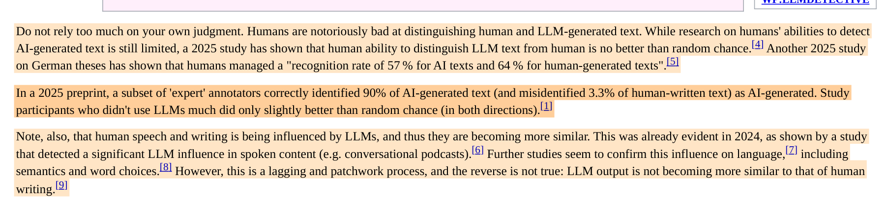
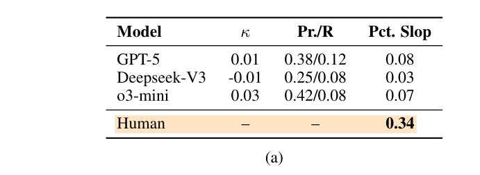
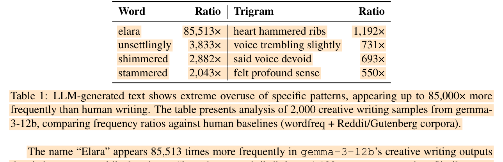
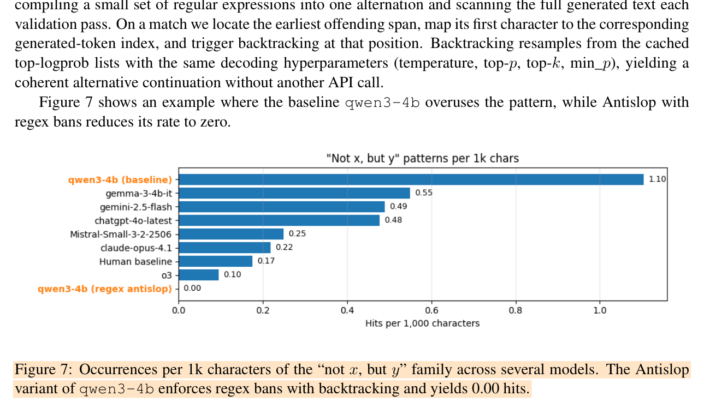
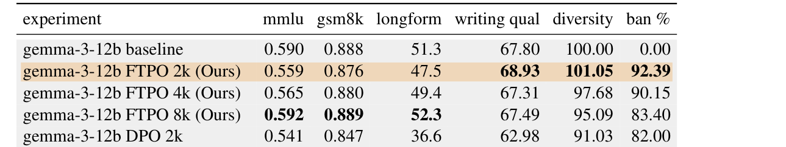
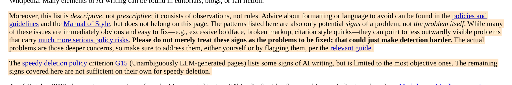

[magazine] 왜 AI가 만든 글은 읽기 어려울까?(2편)에서 이어집니다. 이번엔 손에 잡히는 질문 두 개입니다. slop을 잡아낼 수 있을까요? 잡았다면 LLM한테 고치라고 하면 될까요?

## 사람 눈은 생각보다 별로

Wikipedia의 AI 글 판별 가이드(WikiProject AI Cleanup)는 첫 경고로 자기 판단을 너무 믿지 말라고 합니다. 가이드가 인용한 2025년 독일 학위논문 연구에서 사람들은 AI 글을 57%, 사람 글을 64% 맞혔습니다. 같은 해 Russell et al.의 연구에서는 ChatGPT를 글쓰기에 자주 쓰는 'expert' annotator들이 AI 글의 90%를 맞히고 사람 글은 3.3%만 AI로 잘못 짚었습니다. LLM을 거의 안 쓰는 참가자는 우연보다 조금 나은 정도였고요.

<figure style="text-align: center;">
    
    <figcaption style="font-size: 0.9em; color: gray; margin-top: 5px;" markdown="span">Wikipedia: Signs of AI writing, Your detection ability 절 (CC BY-SA 4.0). Russell et al. 원 논문은 직접 읽지 않았습니다</figcaption>
</figure>

자주 써 본 사람이 잘 잡는다는 건 패턴을 몸으로 외웠다는 뜻일 겁니다. 곤란한 건 패턴이 계속 바뀐다는 점입니다. delve는 2023년과 2024년 초에 과용되다가 2025년에 급감했습니다. em dash는 GPT-5.1 같은 새 모델이 일부러 억제하면서, Wikipedia 가이드에서도 '과거 신호(historical indicators)' 쪽으로 자리를 옮겼습니다.

하나 짚고 가면, AI가 썼는지 가려내는 일과 slop인지 가려내는 일은 다른 문제입니다. 1편에서 봤듯이 사람이 쓴 글도 slop일 수 있으니까요.

## 집단은 잡히는데 한 편은 안 잡힌다

1편의 Kobak et al.과 Liang et al.은 단어 빈도만으로 LLM 사용을 숫자로 잡아냈습니다. 그런데 둘 다 abstract나 리뷰 한 편을 판정하지 않습니다. 말뭉치 전체에서 LLM을 거친 비율을 추정합니다(2024년 PubMed abstract의 최소 13.5%, AI 학회 리뷰의 6.5~16.9%). delve가 28배 늘었다는 건 1,500만 편 단위의 이야기이고, 제 글에 delve가 하나 들어갔다고 AI가 썼다는 뜻은 아닙니다.

## LLM한테 물어보면

Shaib et al.(2025)은 GPT-5, DeepSeek-V3, o3-mini에게 예시 없이(0-shot) 글이 slop인지 판정하게 했습니다. 모델들은 3~8%만 slop이라고 했고, 사람 annotator들은 34%를 slop으로 봤습니다. 사람 판정과의 일치도(κ)는 0 근처였습니다.

<figure style="text-align: center;">
    
    <figcaption style="font-size: 0.9em; color: gray; margin-top: 5px;" markdown="span">Shaib et al. (2025) Table 7(a). Pct. Slop 열이 slop으로 판정한 비율</figcaption>
</figure>

공정하게 말하면 사람끼리도 잘 안 맞았습니다. annotator 쌍별 Cohen's κ가 -0.15, 0.29, 0.06이었습니다. 그런데 사실 오류, 편향, 구조 같은 세부 항목으로 쪼개서 물으면 사람들 판단이 꽤 일치했습니다. "이 글 slop이야?"는 사람에게도 어려운 질문이고, "이 문장 사실이야?", "구조가 틀에 박혔어?"는 답이 나오는 질문입니다.

LLM으로 slop을 찾아서 고치는 파이프라인을 만든다면, 첫 단계인 찾기부터 약하다는 얘기입니다. 이 논문은 제가 따로 정리해 뒀습니다: [paper] Measuring AI "Slop" in Text

## 그래도 패턴은 잡힌다

Paech et al.의 Antislop(ICLR 2026)은 모델이 어떤 패턴을 사람보다 얼마나 자주 쓰는지를 잽니다. 모델마다 Reddit 글쓰기 프롬프트로 2,000편을 생성하고, 단어·bigram·trigram 빈도를 사람 baseline(wordfreq, Reddit 창작 글, Project Gutenberg)과 비교합니다.

<figure style="text-align: center;">
    
    <figcaption style="font-size: 0.9em; color: gray; margin-top: 5px;" markdown="span">Paech et al. (2026) Table 1. gemma-3-12b의 creative writing 출력 기준</figcaption>
</figure>

gemma-3-12b가 쓴 소설에서 elara라는 이름은 사람 글보다 85,513배, "heart hammered ribs"는 1,192배 자주 나옵니다. 소설 수치라서 기술 블로그에 그대로 옮기면 안 됩니다. 저자들도 전문적인 글에서는 과다 패턴이 다를 거라고 적어 뒀습니다.

문장 구조도 셉니다. "not x, but y" 계열을 regex 다섯 개로 잡아 1천 자당 빈도를 냈더니 qwen3-4b가 1.10회, chatgpt-4o-latest가 0.48회, claude-opus-4.1이 0.22회였습니다. 사람 baseline은 0.17회, o3는 0.10회였습니다.

<figure style="text-align: center;">
    
    <figcaption style="font-size: 0.9em; color: gray; margin-top: 5px;" markdown="span">Paech et al. (2026) Figure 7. 맨 아래 막대는 regex ban을 건 qwen3-4b</figcaption>
</figure>

사람도 이 구조를 쓰고, 사람보다 덜 쓰는 모델도 있습니다. 그러니 문제는 빈도입니다. 사람 baseline을 그대로 가져오면 영어 1,500단어(대략 9천 자) 글에서 한두 번이 사람 수준입니다.

## 금지어 목록은 왜 잘 안 먹히나

Antislop 논문 도입부가 재밌습니다. 프롬프트로 "이 단어 쓰지 마"라고 하면 효과가 제한적이고, 코끼리를 생각하지 말라는 말에 코끼리가 떠오르는 pink elephant 문제 때문에 역효과가 날 수도 있다고 합니다. token 단위로 막는 방법에는 부작용이 있습니다. catatonic이 cat + atonic으로 쪼개지면, catatonic 하나를 막으려다 cat으로 시작하는 단어를 전부 막게 됩니다.

Antislop Sampler는 생성하다가 금지 패턴이 완성되면 그 패턴이 시작된 첫 token으로 되돌아가 확률을 낮추고 다시 뽑습니다. 강도를 낮추면 soft ban이 됩니다. 태피스트리에 대한 글을 쓰라고 하면 tapestry를 쓰게 두는 식입니다. 대가는 속도라서, 되돌아가는 일이 잦으면 처리량이 69~96% 떨어졌습니다.

FTPO(Final Token Preference Optimization)는 이걸 학습으로 옮깁니다. sampler가 되돌아간 지점마다 문맥, 거부할 token, 대안 token들을 모아 그 위치의 logit만 조정합니다. gemma-3-12b에서 FTPO는 slop 패턴을 83~92% 억제하면서 글쓰기 품질 점수를 baseline의 1% 이내로 지켰고, 어휘 다양성은 95~102%, MMLU·GSM8K는 1~3% 이내였습니다. 같은 데이터로 DPO를 하면 억제율은 80~82%인데 품질 점수가 6~15점 떨어졌습니다. token banning은 금지 패턴 8천 개에서 품질이 100점 만점에 28점까지 무너졌고요.

<figure style="text-align: center;">
    
    <figcaption style="font-size: 0.9em; color: gray; margin-top: 5px;" markdown="span">Paech et al. (2026) Table 2 일부. ban %가 억제율</figcaption>
</figure>

단서도 있습니다. 실험은 creative writing만 다뤘고, 품질 점수는 LLM judge가 매긴 것이라 사람 평가로 재현하지 않았습니다. 저자들은 방언이나 소수 문체를 억누를 위험이 있으니 banlist를 사람이 검토하라고 권합니다. 논문 정리는 여기 있습니다: [paper] Antislop: A Comprehensive Framework for Identifying and Eliminating Repetitive Patterns in Language Models

## 그래서 edit by LLM은 되나

제가 읽은 범위에서 답은 반쯤 됩니다.

목록으로 적을 수 있는 패턴(단어, n-gram, regex)은 줄일 수 있습니다. 생성 단계에서 막으면 품질을 크게 해치지 않는다는 게 Antislop의 결과입니다. 다만 이건 모델의 sampling이나 학습에 손을 대는 방법이고, 다 쓴 글을 LLM에게 다시 쓰게 하는 것과는 다릅니다. 프롬프트로 금지하는 방식은 저자들이 효과가 제한적이라고 본 쪽입니다. humanizer나 stop-slop처럼 프롬프트에 넣는 규칙 모음도 GitHub에 있는데, 이런 방식의 효과를 따로 잰 연구는 이번에 찾지 못했습니다.

Wikipedia 가이드는 다른 각도에서 경고합니다. 이 신호들을 고칠 대상으로 다루지 말라고, 그러면 탐지만 어려워진다고 굵은 글씨로 적어 놨습니다. 진짜 문제는 근거 없는 주장이나 엉뚱한 출처처럼 더 깊은 곳에 있다는 겁니다.

<figure style="text-align: center;">
    
    <figcaption style="font-size: 0.9em; color: gray; margin-top: 5px;" markdown="span">Wikipedia: Signs of AI writing 도입부 (CC BY-SA 4.0)</figcaption>
</figure>

2편에서 slop 판정을 가장 잘 설명한 요인은 relevance와 density였습니다. 이 문장이 여기 필요한지, 새 정보가 있는지는 금지어 목록으로 잡히지 않고, LLM judge도 사람이 slop이라고 본 글을 대부분 놓쳤습니다. 이 판단은 글쓴이가 직접 해야 한다고 봅니다.

하나 더 걸리는 게 있습니다. Padmakumar &amp; He에서 에세이들이 서로 비슷해진 원인은 모델이 써 준 부분이었습니다. 고쳐 쓰기까지 모델에 맡기면 모델이 쓴 몫이 늘어나니, 글은 더 평균 쪽으로 갑니다. 실험으로 확인된 적은 없는 제 추측입니다.

## 퇴고 체크리스트

읽은 내용을 퇴고 체크리스트로 만들어 뒀습니다. 몇 개만 옮깁니다.

- [ ] 문단마다 새 정보가 하나 이상 있는가. 지워도 잃는 게 없는 문장은 지운다
- [ ] "not X, but Y"나 "단순히 ~가 아니라"를 쓴 곳마다, 실제로 그렇게 오해하는 사람이 있는가
- [ ] 문장 끝에 붙은 ", highlighting ..."이나 "~라는 점에서 의미가 있다" 같은 해석에 근거가 있는가
- [ ] "전문가들은", "많은 연구에서" 대신 이름과 링크를 댔는가
- [ ] 마지막 문단이 요약이나 의의 부풀리기로 끝나지 않는가
- [ ] 최종 판정을 LLM에게 맡기지 않았는가

## 참고한 자료

- 원문에 하이라이트를 친 버전과 이 블로그의 논문 정리 모음: AI Slop / Stylometric LLM Fingerprints
- [Wikipedia: Signs of AI writing](https://en.wikipedia.org/wiki/Wikipedia:Signs_of_AI_writing) (WikiProject AI Cleanup)
- Shaib et al. (2025). [Measuring AI "Slop" in Text](https://arxiv.org/abs/2509.19163)
- Paech et al. (2026). [Antislop: A Comprehensive Framework for Identifying and Eliminating Repetitive Patterns in Language Models](https://arxiv.org/abs/2510.15061). ICLR 2026
- Kobak et al. (2025). [Delving into LLM-assisted writing in biomedical publications through excess vocabulary](https://arxiv.org/abs/2406.07016). Science Advances
- Liang et al. (2024). [Monitoring AI-Modified Content at Scale](https://arxiv.org/abs/2403.07183). ICML 2024
- Padmakumar &amp; He (2024). [Does Writing with Language Models Reduce Content Diversity?](https://arxiv.org/abs/2309.05196). ICLR 2024
- [blader/humanizer](https://github.com/blader/humanizer), [hardikpandya/stop-slop](https://github.com/hardikpandya/stop-slop)
