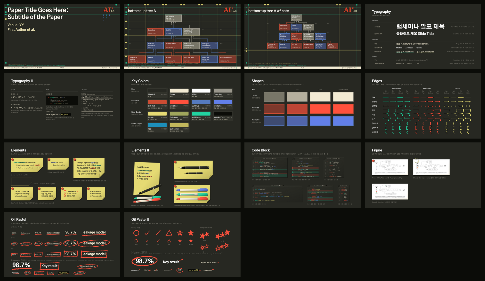
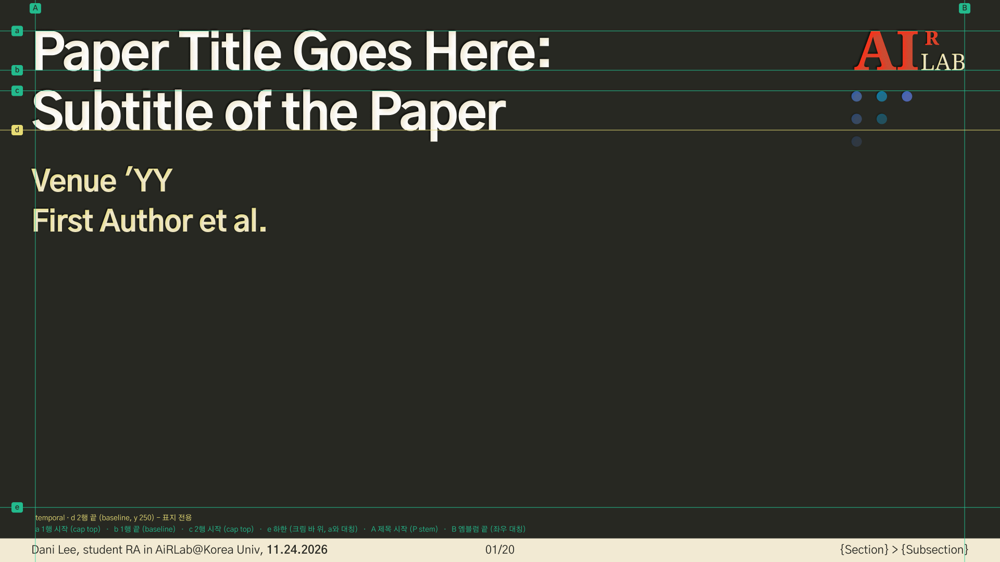

<details>
<summary markdown="span">Highlighting Rules</summary>
<div class="toggle-content" markdown="1">

형식마다 역할이 하나씩 있음. 한 번 읽은 뒤에는 색 하나만 따라가며 훑어도 흐름이 잡힘.

- <span class="highlight-blue"><strong>Blue</strong></span> - 지키기로 한 규칙
- <span class="highlight-orange">Orange</span> - 꼬였거나 꼬일 뻔한 지점
- <span class="text-gray">Gray text</span> - 날짜, 수치, 여담

</div>
</details>

<strong>TL;DR:</strong> 랩세미나 발표 템플릿을 Figma Slides에서 마우스로 그리지 않고, Claude가 Figma MCP로 Plugin API 코드를 실행하게 해서 만들고 있음. 나는 말로 요청하고, 돌아온 스크린샷을 보고 다음 요청을 하는 역할만 함. <span class="text-gray">(2026.11.24 기준 슬라이드 14장, paint style 50개, effect style 26개, text style 25개)</span>

<figure style="text-align: center;">
    
    <figcaption style="font-size: 0.9em; color: gray; margin-top: 5px;" markdown="span">지금까지 만든 슬라이드 14장</figcaption>
</figure>

1편은 작업 방식과 파이프라인을, 2-6편은 디자인 시스템과 엘리먼트를 하나씩 다룸.

## 무엇을 만들고 있나

Monokai 배경을 키컬러로 잡은 1920 × 1080 슬라이드 템플릿임. 실제 발표 슬라이드라기보다는, 발표 때 가져다 쓸 부품(색, 글꼴, 가이드, 도형, 간선, 종이·필기구 에셋, 코드 블록, 피규어 틀)을 모아 둔 시트에 가까움.

<figure style="text-align: center;">
    
    <figcaption style="font-size: 0.9em; color: gray; margin-top: 5px;" markdown="span">표지. 녹색 선과 a, b, c, e, A, B 라벨은 영구 가이드, 노란 선은 임시 가이드</figcaption>
</figure>

## 구성

- Claude는 클라우드 작업 공간에서 Python을 돌리고 MCP 도구를 호출함. 대화 하나가 작업 세션 하나임.
- Figma MCP에서 실제로 쓴 도구는 넷임.
  - `use_figma` - Figma Plugin API JavaScript를 파일 안에서 실행. 거의 모든 작업이 이걸로 돎.
  - `upload_assets` - SVG, PNG를 파일에 올림. SVG는 편집 가능한 벡터로 들어옴.
  - `download_assets` - 노드를 PNG로 내보냄. 이 글의 슬라이드 이미지는 전부 이걸로 뽑음.
  - `get_screenshot` - 확인용.
- Python으로는 Figma 안에서 하기 어려운 계산을 함.
  - `uharfbuzz` + `fontTools` - 손글씨 폰트 DaniPen의 글자 배치와 아웃라인 추출 (4편)
  - `skia-pathops` - 오일파스텔 획 합치기 (5편)
  - `cairosvg` + `PIL` - 올리기 전 미리보기
  - `matplotlib` mathtext - 디스플레이 수식 SVG (2편)
- 내 PC의 폴더를 Claude 데스크톱 앱으로 연결하면 Claude가 로컬 파일을 가져올 수 있음. 논문 피규어를 이렇게 가져옴 (5편).

## 한 번의 수정이 도는 방식

1. 내가 한두 문장으로 요청함. 예: "표지 하단 크림색 바 높이를 지금의 0.6배로 해줄래"
1. Claude가 JS를 짜서 `use_figma`로 실행함. 파일 키와 MCP 세션 ID를 매번 같이 넘김.
1. 스크립트 마지막 줄이 `slide.screenshot()`을 반환하게 해서, Claude가 결과 이미지를 먼저 확인함.
1. 세부가 안 보이면 확대 캡처를 한 번 더 함.
1. 나는 Claude의 짧은 보고와 스크린샷을 보고 다음 요청을 함.

새 슬라이드를 원하는 위치에 끼우는 코드는 아래와 같음. 지금의 슬라이드 그리드를 노드 트리에서 읽어 와서, 기준 슬라이드 바로 뒤에 새 슬라이드를 넣고 그리드를 다시 설정함.

```javascript
const slide = figma.createSlide();
const grid = figma.currentPage.children.find(c => c.type === 'SLIDE_GRID');
const rows = grid.children.map(r => r.children.filter(s => s.type === 'SLIDE' && s.id !== slide.id));
for (const row of rows) {
  const i = row.findIndex(s => s.id === '143:7');   // Code Block 다음에
  if (i >= 0) row.splice(i + 1, 0, slide);
}
figma.setSlideGrid(rows);
await slide.setFillStyleIdAsync(MONOKAI);            // 배경도 style로
```

확대 캡처는 대상 위치에 빈 frame을 잠깐 깔고 그 frame을 찍은 뒤 지움.

```javascript
const f = figma.createFrame(); slide.appendChild(f);
f.x = 787; f.y = 380; f.resize(300, 205); f.fills = [];
await f.screenshot({ scale: 3, contentsOnly: false });   // false여야 아래 레이어까지 찍힘
f.remove();
```

## 파이프라인 세 갈래

### Plugin API로 직접 그리기

사각형, 벡터, 텍스트, 그룹, 스타일은 전부 `use_figma` 안에서 만듦. 대부분의 엘리먼트가 여기에 해당함.

- 벡터는 `vectorPaths`에 SVG path 문자열을 넣음. <span class="highlight-orange">단, </span><span class="highlight-orange">`vectorPaths`</span><span class="highlight-orange">는 arc(</span><span class="highlight-orange">`A`</span><span class="highlight-orange">) 명령을 받지 않음.</span> 그래서 둥근 부분은 4분원을 cubic Bézier로 근사해서 씀 <span class="text-gray">(제어점을 끝점에서 반지름 × 0.5523만큼 떨어뜨림)</span>.
- 꼭짓점마다 다른 corner radius나 화살촉이 필요하면 `setVectorNetworkAsync`로 vertex 단위로 넣음. `strokeCap: 'ARROW_EQUILATERAL'`은 촉 끝이 path 끝점에 정확히 닿음.
- 그라데이션 방향은 `gradientTransform`으로 정함. 자주 쓴 값은 아래 셋임. 너비와 높이가 다른 노드에서 경계를 45°로 맞추는 법은 3편에 적음.

| 방향 | gradientTransform |
| --- | --- |
| 위 → 아래 | `[[0, 1, 0], [-1, 0, 1]]` |
| 아래 → 위 | `[[0, -1, 1], [1, 0, 0]]` |
| 좌상 → 우하 (종이의 dull 그라데이션) | `[[0.5, 0.5, 0], [-0.5, 0.5, 0.5]]` |

### Python에서 만든 SVG 올리기

손글씨 폰트(DaniPen), 오일파스텔 획, 디스플레이 수식처럼 계산이 많은 모양은 Python에서 SVG로 만든 뒤 올림.

1. Python에서 path마다 `id`를 붙인 SVG 생성 (`id`가 Figma 레이어 이름이 됨)
1. `upload_assets`로 받은 URL에 multipart POST
1. 페이지에 frame으로 들어온 벡터 트리를, 절대 좌표 차이만큼 옮기면서 슬라이드로 이동
1. 레이어 이름을 보고 style을 붙임 (`Highlighter-Green`이면 `Highlighter/Vivid Green`)
1. 들어온 빈 frame 삭제

```bash
curl -s -X POST -F "file=@Graphic34Note.svg;type=image/svg+xml" "$SUBMIT_URL"
# {"success":true,...,"placedOnNodeId":"153:2"}
```

### 래스터 이미지

논문 피규어는 PNG 그대로 올림. 응답의 `imageHash`로 사각형에 이미지 fill을 걸고 `scaleMode: 'FIT'`으로 비율을 지킴.

```javascript
r.fills = [{ type: 'IMAGE', imageHash: '941f5fb1…', scaleMode: 'FIT' }];
```

## Figma style 규칙

<span class="highlight-blue"><strong>색, 그림자, 글꼴은 전부 style로 만들고, 노드에는 style ID만 붙임.</strong></span> 색을 하나 바꾸면 템플릿 전체가 같이 바뀌어야 하기 때문임.

키컬러 밖의 색은 쓰지 않고, 키컬러를 섞은 색이 필요하면 이름을 붙여 style로 등록함 (2편).

| 계열 | 예시 | 용도 |
| --- | --- | --- |
| `Key/*` | Monokai, Cream, Lemon, Dull Red … | 키컬러 14개 |
| `Alpha/*` | Cream 40, Vivid Red 70 … | 투명도 변형 |
| `Paper/*` | Lemon, Monokai, White (+ Flap, Edge) | 종이 그라데이션 |
| `Pen/*`, `Marker/*`, `Metal/*` | Enamel · Monokai, Felt · Vivid Green, Dawn Grey | 필기구 · 금속 |
| `Highlighter/*`, `Ink Mix/*` | Vivid Blue, Ultramarine | 형광펜 표시, 잉크 번짐 |
| effect `Press/*` | L · White, S · Red | 음각 |
| effect `Paper/*` | Body, Flap, Edge · Thick | 종이 그림자 · 말림 · 두께 |
| text | ExtraBold/Slide Title, Code/Block … | 용도별 글꼴 |

<span class="highlight-orange">style ID를 코드에 직접 적었다가 한 글자 오타로 스크립트가 중간에 죽은 적이 있음.</span> 그 뒤로는 이름으로 찾아서 씀.

```javascript
const CB = (await figma.getLocalTextStylesAsync()).find(s => s.name === 'Code/Block');
```

## 삽질 기록

1. frame에 넣은 guide는 Plugin API로는 읽히는데 내 Slides 화면에는 안 보였음. 그래서 가이드를 잠긴 1px 사각형 레이어로 그리고 옆에 이름표를 붙임.
1. 그룹 안 노드를 `clone()`하면 복제본이 페이지 좌표에 놓임. 그래서 잉크 번짐 레이어가 엉뚱한 곳에 생겼음. 원본과 복제본의 `absoluteBoundingBox` 차이만큼 옮겨서 맞춤.
1. 노드는 `appendChild`로 부모에 먼저 넣고 나서 `x`, `y`를 잡아야 함. 순서가 바뀌면 좌표계가 달라짐.
1. 앞에 적은 style ID 오타로 스크립트가 `setSlideGrid` 직전에 죽었을 때, 슬라이드 그리드가 존재하지 않는 노드를 가리키게 됨. 그리드를 노드 트리에서 다시 읽어서 복구함.

```javascript
figma.setSlideGrid(grid.children.map(r => r.children.filter(s => s.type === 'SLIDE')));
```

1. 직접 만든 손글씨 폰트는 Figma가 글꼴로 불러오지 못함. 글자를 벡터 아웃라인으로 바꿔서 넣음 (4편).
1. 글꼴을 `loadFontAsync`로 먼저 불러오지 않으면 텍스트를 못 고침. 캡션 하나 고치다가 스크립트가 통째로 멈춘 적이 있음.
1. 15pt × 줄간격 150% = 22.5px인데, 실제 렌더는 줄마다 23px임. 코드 블록에서 줄이 내려갈수록 0.5px씩 어긋났음 (6편).
1. 스크린샷은 슬라이드 경계에서 잘림. 슬라이드 밖으로 삐져나온 걸 보려면 먼저 줄이거나 옮겨야 함.
1. 내가 Figma에서 직접 지운 노드를 Claude가 ID로 찾으면 null이 나옴. 그 뒤로는 사람이 손댔을 수 있는 노드는 이름으로 다시 찾음.

## 하면서 굳어진 규칙

- 요청 하나마다 스크립트를 한 번 실행하고 스크린샷을 한 장 확인함.
- 위치와 크기는 가이드 이름으로 말함. 예: "트리가 c–k0, I1–M0 사이에 들어오게" (2편, 3편)
- 도형과 트리 칸의 모서리는 직각으로 함. <span class="text-gray">(2026.11.24에 바꿈. Edges 슬라이드의 꺾인 화살표는 아직 둥긂, 2편)</span>
- 종이 오브젝트의 그림자는 오른쪽 아래 (3, 5), 흐림 8 하나로 통일함 (5편).
- 트리 칸 안의 글꼴은 줄여도 3pt까지만 줄임 (3편).

<details>
<summary markdown="span">발표 자동화 시리즈</summary>
<div class="toggle-content" markdown="1">

1. <span class="text-gray">[etc; 발표 자동화] Claude × Figma MCP로 랩세미나 템플릿 만들기</span> (이 글)
1. <span class="text-gray">[etc; 발표 자동화] 키컬러, 타이포그래피, 이름 붙은 가이드</span>
1. <span class="text-gray">[etc; 발표 자동화] bottom-up tree와 그라데이션 간선</span>
1. <span class="text-gray">[etc; 발표 자동화] DaniPen 손글씨와 형광펜 밴드</span>
1. <span class="text-gray">[etc; 발표 자동화] 포스트잇, 오일파스텔, 필기구, 피규어</span>
1. <span class="text-gray">[etc; 발표 자동화] 코드 블록: 머메이드지, diff, 23px</span>

</div>
</details>
