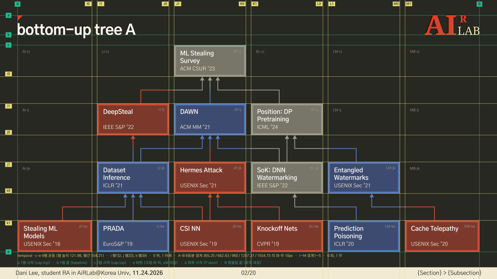
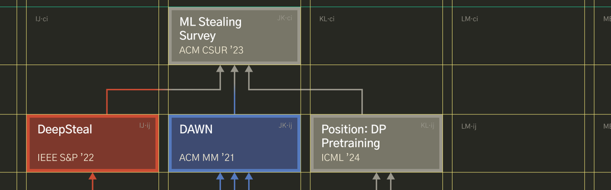
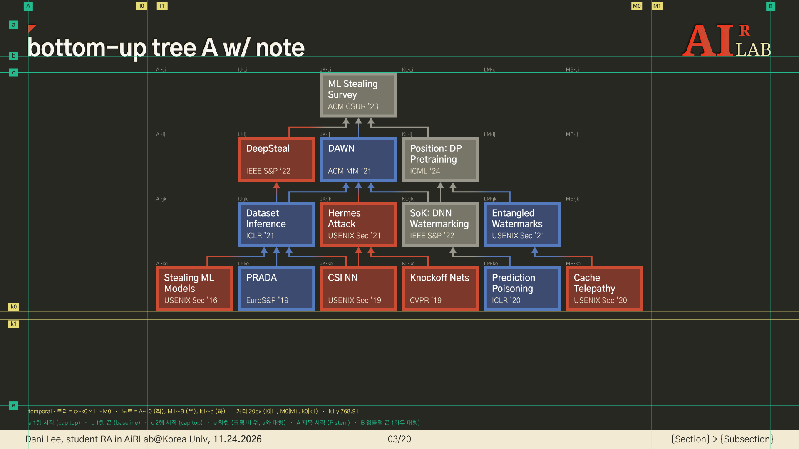

Highlighting Rules

형식마다 역할이 하나씩 있음. 한 번 읽은 뒤에는 색 하나만 따라가며 훑어도 흐름이 잡힘.

- <strong>Blue</strong> - 지키기로 한 규칙
- Orange - 꼬였거나 꼬일 뻔한 지점
- Green - 아직 정하지 않았거나 확인하지 않은 것
- Gray text - 날짜, 수치, 여담

<strong>TL;DR:</strong> 선행 논문을 아래에, 후속 논문을 위에 두는 계보 트리를 만듦. 칸은 임시 가이드의 교차점 이름으로 부르고, 간선은 출발 칸의 색에서 도착 칸의 색으로 넘어가는 그라데이션임.

<figure style="text-align: center;">
    
    <figcaption style="font-size: 0.9em; color: gray; margin-top: 5px;" markdown="span">bottom-up tree A (2번 슬라이드)</figcaption>
</figure>

## 제목 줄

- 슬라이드 제목은 영구 가이드 A에 왼쪽 정렬, cap top을 b에 맞춤.
- 제목 앞에는 적색 삼각형을 둠. 처음에는 제목을 10pt 오른쪽으로 밀고 A와 a를 10pt씩 지나는 삼각형을 두려 했는데, 크기를 2배로 키우고 제목은 그냥 A에 붙이는 걸로 정리함.
- 제목과 삼각형에는 표지와 같은 음각 효과를 줌 (제목 Press/S · White, 삼각형 Dull Red + Press/S · Red).
- 오른쪽 위 텍스트 엠블럼은 B에 오른쪽 정렬, a와 b 사이에 들어오게 둠.

## 칸을 놓을 임시 가이드

트리를 그리기 전에 레몬색 임시 가이드부터 깔았음. 가이드 이름 규칙은 2편 그대로임 (소문자 가로, 대문자 세로).

1. 가로선은 영구 가이드 c와 e 사이를 4등분한 선에서 출발함. 그 선 위아래로 5px씩 떨어진 쌍을 그은 뒤 등분선은 지우고, 쌍마다 i, j, k라고 이름 붙임. i, j, k 사이 거리는 나중에 5배로 늘렸고, 줄마다 칸 높이가 달라서 가이드를 옮겨 높이를 같게 맞춤 (행 높이 121.98, 행 간격 104.21).
1. 세로선은 A와 B 사이를 6등분한 임시선에서 출발함. 그 선에서 좌우 10pt 떨어진 곳에 레몬 가이드 I-M을 긋고, 등분선 자체는 지움.
1. 칸은 양옆 세로선과 위아래 가로선의 이름을 이어 붙여 부름. 예를 들어 `IJ·jk`는 세로선 I와 J 사이, 가로선 j와 k 사이에 있는 칸임. 왼쪽 끝 열은 `AI`, 오른쪽 끝 열은 `MB`, 맨 위 행은 `ci`, 맨 아래 행은 `ke`.

<strong>칸 이름은 지우지 않음.</strong> 나중에 템플릿을 쓸 때 "KL·jk 칸을 공격으로"처럼 이름으로 가리키려고 함.

원래 모든 교차점에 칸을 깔았다가 아래와 같이 남김.

| 행 (위에서부터) | 남긴 칸 |
| --- | --- |
| 1행 `ci` | 3열 1개 |
| 2행 `ij` | 가운데 3개 |
| 3행 `jk` | 가운데 4개 |
| 4행 `ke` | 6개 전부 |

## 칸 디자인

- <strong>테두리는 선 중앙이 아니라 바깥 끝이 가이드에 맞게</strong> (stroke align inside). 테두리는 7pt.
- 색은 논문 성격으로 고름.

| 성격 | 채움 | 테두리 |
| --- | --- | --- |
| 공격 | Vivid Red 40% | Dull Red |
| 방어 | Vivid Blue 40% | Dull Blue |
| SoK · position paper | Cream 40% | Dawn Grey |

- 칸 안에는 논문 약칭(Gothic A1 SemiBold 24)과 venue(20)를 둠. <strong>두 줄짜리 논문명을 기준으로</strong> 논문명은 위에, venue는 아래에 붙여서, 한 줄짜리여도 위치가 흔들리지 않게 함.
- 간선을 더 길게 보이려고 칸 높이를 0.75배로 줄임.
- 2026.11.24에 칸 모서리를 직각으로 바꿨음.

## 간선

<figure style="text-align: center;">
    
    <figcaption style="font-size: 0.9em; color: gray; margin-top: 5px;" markdown="span">간선 확대. 아래 칸의 색에서 위 칸의 색으로 넘어감</figcaption>
</figure>

- <strong>방향은 아래에서 위로만.</strong> 양방향 화살표는 쓰지 않음. 선은 3pt, 테두리 없음.
- 모양은 두 가지. 칸이 바로 위에 있으면 수직, 옆으로 비켜 있으면 ㄴㄱ자로 꺾임.
- 간선이 칸 테두리에 붙는 자리는 ±30px씩 어긋나게 둠. 안 그러면 서로 다른 간선이 겹쳐서 어느 칸에서 오는지 헷갈림.

### 출발 칸에서 도착 칸으로 넘어가는 색

간선 색은 출발 칸의 색에서 도착 칸의 색으로 넘어감. 예를 들어 아래가 방어(blue), 위가 SoK(cream)면 blue → cream.

- 처음에는 Lemon 3pt 화살표였고, 그다음 칸 채움색(Vivid)으로 그라데이션을 줌. 지금은 테두리 쪽 색인 Dull Red / Dull Blue / Dawn Grey를 씀.
- 색이 바뀌는 구간은 28px로 좁혀서, 간선 중간에서 두 색이 또렷하게 갈리게 함.
- <strong>수직 간선은 아래에서 위로 색이 바뀜 (전환 경계가 가로).</strong> <strong>ㄴㄱ 간선은 진행 방향에 수직인 45° 경계로 바뀜.</strong>

`gradientTransform`은 노드 크기를 0-1로 정규화한 좌표에서 동작함. 그래서 너비와 높이가 다른 노드에 `[[0.5, 0.5, …]]` 같은 값을 넣으면 화면에서는 45°가 아님. 픽셀 기준 45°를 원하면 첫 행을 너비와 높이로 계산해야 함. 노드 너비를 w, 높이를 h, 정규화 좌표를 (u, v)라고 하면 픽셀 좌표는 x = wu, y = hv임.

$$
t = \frac{w\,u + h\,v}{w + h} \quad (x = w u,\; y = h v \Rightarrow t \propto x + y)
$$

즉 첫 행을 `[w/(w+h), h/(w+h), 0]`으로 두면 전환 경계가 픽셀 기준 45°가 됨.

## 노트 자리를 남긴 축소 버전

<figure style="text-align: center;">
    
    <figcaption style="font-size: 0.9em; color: gray; margin-top: 5px;" markdown="span">bottom-up tree A w/ note (3번 슬라이드)</figcaption>
</figure>

같은 트리를 복제해서 가이드 c-k0, I1-M0 사이에 들어오게 줄임. 아래쪽(k0 아래 k1까지)과 양옆은 노트 자리임.

| 항목 | 원본 | 축소 |
| --- | --- | --- |
| 칸 너비 | - | 184.92 |
| 칸 높이 | - | 108 |
| 칸 간격 | - | 47.46 |
| 논문명 / venue | 24 / 20 | 22 / 18 |
| 테두리 | 7pt | 7pt |

- <strong>칸 안 글꼴은 3pt 넘게 줄이지 않음.</strong> 여기서는 2pt만 줄임.
- 테두리 없는 칸도 해봤는데 구분이 약해서 테두리를 다시 살림.
- 레몬 가이드: k0, k1 (y 768.91), I0 (x 355.25), I1, M0, M1 (x 1564.75). 안 쓰는 임시 가이드는 지움.
- 표지에 있던 영구 가이드 d는 표지 전용 임시 가이드로 내리고 2 · 3번 슬라이드에서는 지움. c는 영구(녹색)로 남김.

칸 내용(논문명, 성격)은 지금은 예시로 채운 것이라, 실제 발표에 맞춰 다시 채워야 함.

발표 자동화 시리즈

1. [etc; 발표 자동화] Claude × Figma MCP로 랩세미나 템플릿 만들기
1. [etc; 발표 자동화] 키컬러, 타이포그래피, 이름 붙은 가이드
1. [etc; 발표 자동화] bottom-up tree와 그라데이션 간선 (이 글)
1. [etc; 발표 자동화] DaniPen 손글씨와 형광펜 밴드
1. [etc; 발표 자동화] 포스트잇, 오일파스텔, 필기구, 피규어
1. [etc; 발표 자동화] 코드 블록: 머메이드지, diff, 23px

