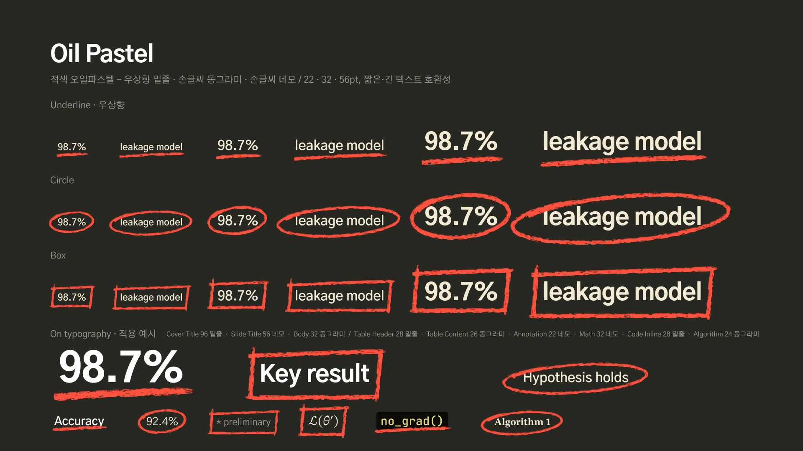
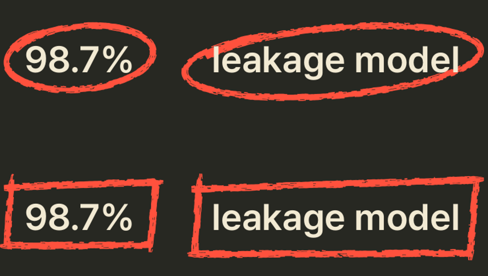
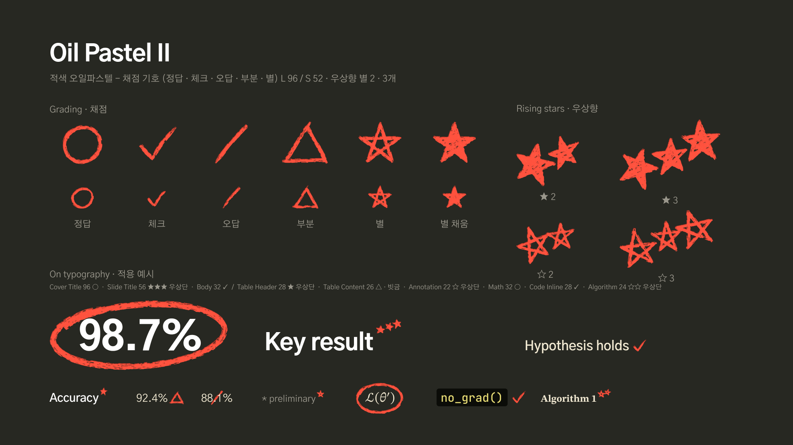
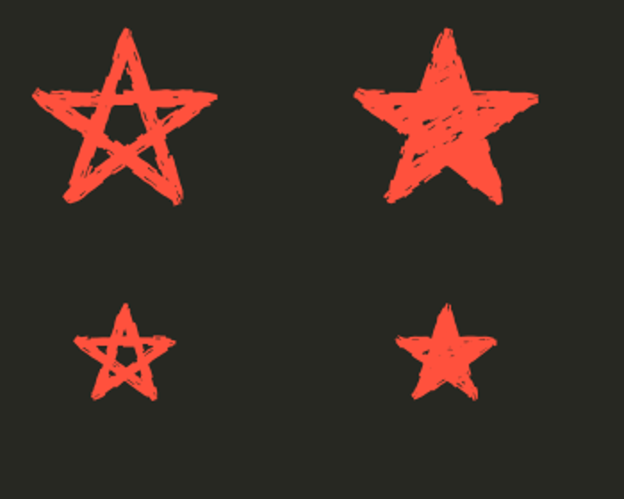
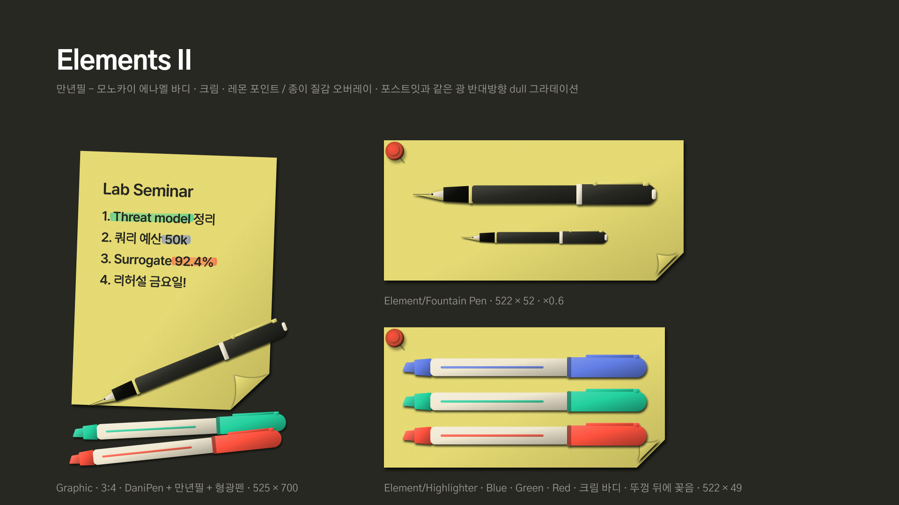
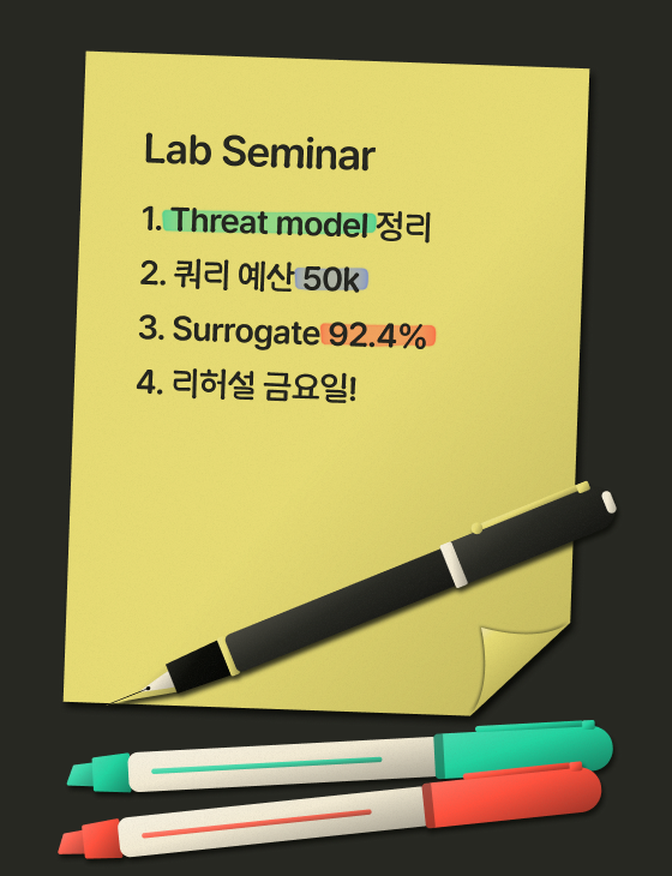
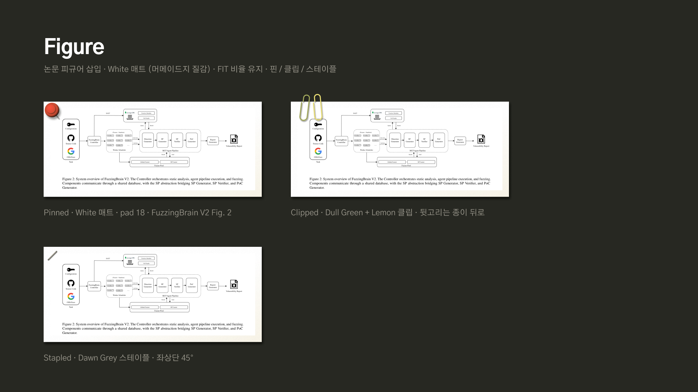
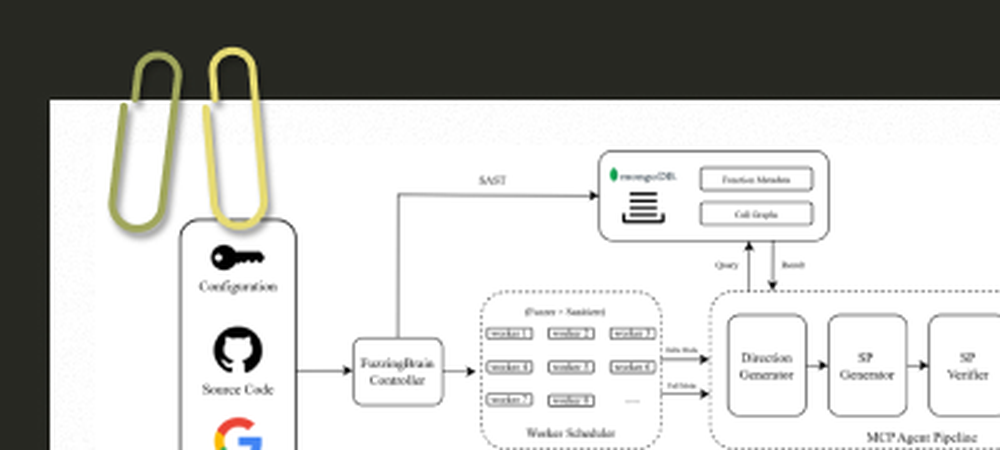
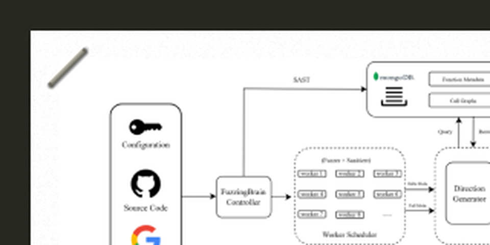

Highlighting Rules

형식마다 역할이 하나씩 있음. 한 번 읽은 뒤에는 색 하나만 따라가며 훑어도 흐름이 잡힘.

- <strong>Blue</strong> - 지키기로 한 규칙
- Orange - 꼬였거나 꼬일 뻔한 지점
- Green - 아직 정하지 않았거나 확인하지 않은 것
- Gray text - 날짜, 수치, 여담

<strong>TL;DR:</strong> 발표에 손으로 쓴 느낌을 더하는 에셋인 포스트잇, 오일파스텔, 만년필과 형광펜, 피규어 틀을 만듦. 모두 <strong>광택 없이 dull 그라데이션(2편)만 쓰고</strong>, 종이 오브젝트에는 같은 그림자를 씀.

## 포스트잇

포스트잇은 종이(Body)와 말린 모서리(Curl) 두 벡터로 이뤄짐 (슬라이드는 4편 Elements 이미지 참고).

- Body는 오른쪽 아래를 C만큼 잘라낸 다각형 `M 0 0 L W 0 L W H-C L W-C H L 0 H Z`임 (C는 말림 크기). 채움은 `Paper/Lemon` (좌상 Lemon → 0.55 Lemon → 우하 Dull Lemon), 효과는 `Paper/Body` (drop shadow r8 (3, 5) Monokai Dark 100% + noise 8%).
- Curl은 잘라낸 자리에 놓는 말린 면임. 채움은 `Paper/Lemon Flap` (Dull Lemon → Lemon → Cream), 효과는 `Paper/Flap` (그림자 r5 (2, 3) + 반대쪽 밝은 그림자 r3 (-1.5, -1.5) 40% + noise).
- 말림 크기는 L 92, S 50.
- 압정은 머리(`Pin/Cap`, Vivid Red → Dull Red radial), 받침(`Pin/Base`), 그림자 두 개로 이뤄지고, 바늘에는 layer blur 2를 줌.

### 간소한 노트

Lemon 3pt 테두리만 있는 사각형에, 포스트잇과 같은 크기(50)로 오른쪽 아래를 잘라낸 실루엣임. 말린 면은 그리지 않음. 테두리는 안쪽 정렬이라 바깥 크기가 포스트잇과 같음.

## 오일파스텔

<figure style="text-align: center;">
    
    <figcaption style="font-size: 0.9em; color: gray; margin-top: 5px;" markdown="span">Oil Pastel 슬라이드</figcaption>
</figure>

### 획 하나를 그리는 방법

오일파스텔로 그은 획은 종이 결에 걸려 군데군데 비어 있음. 이걸 흉내 내려고 획 하나를 가는 선(레인) 여러 개로 쪼개서 그린 뒤 합침.

1. 경로를 1.4px 간격으로 다시 샘플링함.
1. 획 너비를 레인 여러 개로 나눔 (max(7, 너비 / 1.15)개).
1. 레인마다 1D 노이즈로 종이 결에 걸려 비는 구간(grain skip)을 만들고, 가장자리 레인일수록 더 흔들리게 함.
1. 필압 프로파일을 줌: 시작은 뭉툭하게(blunt), 끝은 가늘게 풀리거나 뾰족하게 지나침.
1. 레인 윤곽을 `skia-pathops`로 union해서 path 하나로 만듦.

획 두께는 대상 글자 크기에 맞춤 (밑줄·동그라미·네모: 3 + 0.16 × size, 채점 기호: 2.6 + 0.075 × size). 색은 Vivid Red, 효과는 `Pastel/Vivid Red` (inner shadow r1.5 (0.6, 1.0) 55% + noise 28% + texture 1.2).

<figure style="text-align: center;">
    
    <figcaption style="font-size: 0.9em; color: gray; margin-top: 5px;" markdown="span">동그라미와 네모 확대</figcaption>
</figure>

### 모양 규칙

- 밑줄은 오른쪽으로 갈수록 올라감.
- 동그라미는 글자 박스의 네 모서리를 피해 가는 타원임.
- 네모는 모서리를 직각보다 살짝 뾰족하게 그리고, 변마다 기울기를 다르게 줌.
  - 좌상 → 우상: 살짝 오른쪽으로 올라감
  - 우상 → 우하: 살짝 왼쪽으로 내려옴
  - 우하 → 좌하: 거의 수평
  - 마지막 변은 시작점을 엇갈려 지나침
- 크기 호환성을 보려고 22 · 32 · 56pt, 짧은 텍스트와 긴 텍스트에 모두 적용해 봄.

타이포그래피 스타일마다 하나씩 적용한 예시도 둠.

| 스타일 | 표시 |
| --- | --- |
| Cover Title 96 | 밑줄 |
| Slide Title 56 | 네모 |
| Body 32 | 동그라미 |
| Table Header 28 | 밑줄 |
| Table Content 26 | 동그라미 |
| Annotation 22 | 네모 |
| Math 32 | 네모 |
| Code Inline 28 | 밑줄 |
| Algorithm 24 | 동그라미 |

### 채점 기호와 별

<figure style="text-align: center;">
    
    <figcaption style="font-size: 0.9em; color: gray; margin-top: 5px;" markdown="span">Oil Pastel II 슬라이드</figcaption>
</figure>

- 채점 기호는 정답(○) · 체크(✓) · 오답(⧸) · 부분(△) · 별, 크기는 L 96 / S 52.
- 별은 펜타그램 윤곽과, 별 모양으로 자른 낙서식 채움 두 가지임 (채움 줄 간격 0.88 × 획 두께).
- 우상향으로 올라가는 별 2개 · 3개는, 간격을 좁히고 별마다 크기 · 모양 · 회전을 불규칙하게 함 (간격 1.02-1.10배).
- 글자 오른쪽 위 대각선에 놓는 작은 별은 획을 더 가늘게 함 (1.4 + 0.09 × size). 처음에는 작은 크기에서 별끼리 뭉개졌음.

<figure style="text-align: center;">
    
    <figcaption style="font-size: 0.9em; color: gray; margin-top: 5px;" markdown="span">별 윤곽과 채움, L과 S</figcaption>
</figure>

## 만년필과 형광펜

<figure style="text-align: center;">
    
    <figcaption style="font-size: 0.9em; color: gray; margin-top: 5px;" markdown="span">Elements II 슬라이드</figcaption>
</figure>

### 만년필

처음 요청은 "너무 입체적이지 않은 금속-에나멜 바디, Monokai 몸통에 Cream · Lemon 포인트"였음.

1. 처음에는 포인트 광택을 넣었음.
1. 광택을 빼고, 포스트잇처럼 빛 반대 방향으로 떨어지는 dull 그라데이션을 부품마다 줌.
1. 그라데이션을 한 번 더 강하게 함.

| style | 값 |
| --- | --- |
| Pen/Enamel · Monokai | `#47473E` → `#272822`(0.42) → `#141411` |
| Pen/Enamel · Monokai Dark | `#272720` → `#0B0C08`(0.42) → `#040503` |
| Pen/Metal · Lemon | `#EBE290` → `#E6DB74`(0.42) → `#98914D` |
| Pen/Metal · Cream | `#F6F0E0` → `#F2EAD3`(0.42) → `#A9A494` |

밝은 쪽은 Cream이나 White를 섞고, 0.42에 기본색, 어두운 쪽은 0.4-0.7배임. 그룹에는 drop shadow r5 (2, 4) 80% + noise 두 장(Cream 10%, Monokai Dark 10%)을 걸어서 종이 질감을 얹음. 크기는 522 × 51.5, 0.6배 복사본도 둠.

### 형광펜 오브젝트

- 뚜껑을 열어 뒤에 꽂은 파랑 · 초록 · 빨강 형광펜 3자루, 몸통은 Cream.
- 만년필과 같은 방식으로 부품마다 dull 그라데이션을 줌. 뚜껑은 `Marker/Plastic · *`, 펜촉은 `Marker/Felt · *`.
- <strong>길이와 두께는 만년필에 맞춤</strong> (522 × 49).

### 3:4 그래픽

<figure style="text-align: center;">
    
    <figcaption style="font-size: 0.9em; color: gray; margin-top: 5px;" markdown="span">손글씨 메모 + 만년필 + 형광펜 3:4 그래픽</figcaption>
</figure>

레몬 종이에 DaniPen 메모와 형광펜 표시를 넣고, 만년필을 22°로, 형광펜 두 자루를 3° · 6°로 눕힘.

- 600 × 800으로 만든 뒤 `rescale()`로 줄임. 그림자 같은 효과도 같이 줄어듦.
- 처음엔 285 × 380으로 빈칸에 넣었는데 너무 작아서, 만년필을 포스트잇 위에 올린 예시를 지우고 525 × 700으로 키움.

## 피규어 삽입

<figure style="text-align: center;">
    
    <figcaption style="font-size: 0.9em; color: gray; margin-top: 5px;" markdown="span">Figure 슬라이드. 핀 / 클립 / 스테이플</figcaption>
</figure>

내 PC의 논문 폴더(`assets/figures`)에 있던 피규어 PNG를 가져와서, 논문 피규어를 슬라이드에 올리는 틀을 만듦.

- 논문 피규어는 대부분 흰 배경이라 피규어 뒤에 까는 종이(매트)도 흰색으로 함. `Paper/White` (White → 우하 Cream 55%)에 `Paper/Body` 그림자.
- 피규어는 `FIT`으로 넣고 여백 18. 캡션에 출처(논문명, Fig. 번호)를 적음.
- 처음에는 5종(Pinned, Taped, Polaroid, Sheet, Plain)을 만들었는데, 내가 보고 고른 건 Pinned 하나였음. 그 뒤 클립과 스테이플 버전을 추가함.

### 클립

<figure style="text-align: center;">
    
    <figcaption style="font-size: 0.9em; color: gray; margin-top: 5px;" markdown="span">Dull Green · Lemon 클립</figcaption>
</figure>

보통 철사 클립을 3pt 선으로 그리되, <strong>종이 뒤로 들어간 안쪽 고리는 그리지 않음</strong>.

- 클립 두 고리 사이에 종이가 끼어 있으므로, 앞에서 보이는 건 바깥 고리와 종이 위로 나온 윗부분뿐임.
- 그래서 바깥 고리 → 아래 U → 오른쪽 다리 → 위 U → 안쪽 다리를 종이 가장자리까지만 그리고 거기서 끝냄. 안쪽 다리의 끝점을 종이 위 모서리에 맞춰 놓으면 종이를 물고 있는 것처럼 보임.
- 색은 Dull Green과 Lemon, 각도는 -7° / +5°. 그림자는 `Clip` (r3 (1.5, 2.5) 45%).

### 스테이플

<figure style="text-align: center;">
    
    <figcaption style="font-size: 0.9em; color: gray; margin-top: 5px;" markdown="span">Dawn Grey 스테이플</figcaption>
</figure>

내가 "Dawn Grey로 펀치된 클립 집힌 걸 좌측상단에"라고 요청했는데, Claude는 이를 서류 집게(불독 클립)로 해석해서 만들었음. 내가 원한 건 호치키스 스테이플이라 불독 클립을 지우고 다시 만듦.

- 왼쪽 위 모서리를 가로지르는 45° 철심. 모서리에서 대각선으로 24px 안쪽에 중심을 둠.
- 철심 등 34 × 3.2는 `Metal/Dawn Grey` (위 밝음 → 아래 어두움. 둥근 철사처럼).
- 양 끝은 더 어둡게 해서 종이 안으로 꺾여 들어가는 것처럼 보이게 하고, 다리가 들어간 자리에는 흐린 눌림 자국을 둠.
- 그림자는 `Staple` (r1.5 (0.8, 1.2) 55%).

## 그림자 통일

<strong>종이 오브젝트의 그림자는 종이 가장자리 기준 오른쪽 아래 (3, 5), 흐림 8로 통일.</strong> 포스트잇, 피규어 매트는 `Paper/Body`를 그대로 쓰고, 두께 층이 있는 코드 블록은 그 층이 밀린 만큼 빼서 맞춤 (6편).

기울어진 만년필·형광펜의 그림자 방향이 종이와 정확히 맞는지는 아직 따로 확인하지 않았음.

발표 자동화 시리즈

1. [etc; 발표 자동화] Claude × Figma MCP로 랩세미나 템플릿 만들기
1. [etc; 발표 자동화] 키컬러, 타이포그래피, 이름 붙은 가이드
1. [etc; 발표 자동화] bottom-up tree와 그라데이션 간선
1. [etc; 발표 자동화] DaniPen 손글씨와 형광펜 밴드
1. [etc; 발표 자동화] 포스트잇, 오일파스텔, 필기구, 피규어 (이 글)
1. [etc; 발표 자동화] 코드 블록: 머메이드지, diff, 23px

