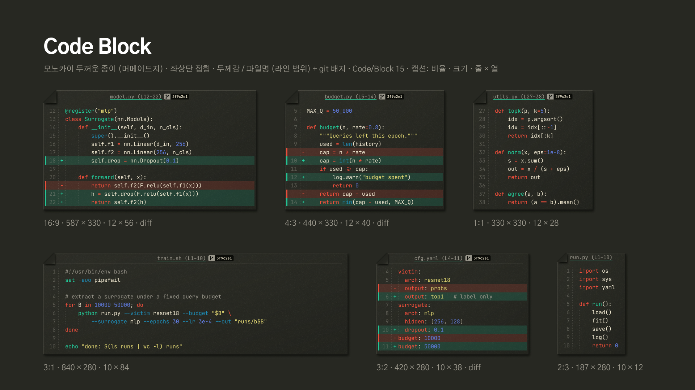
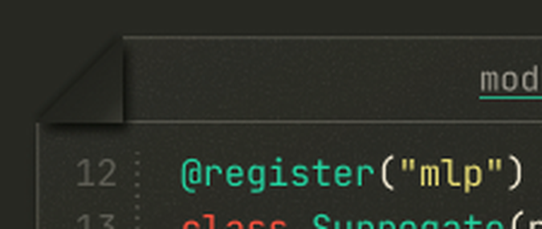
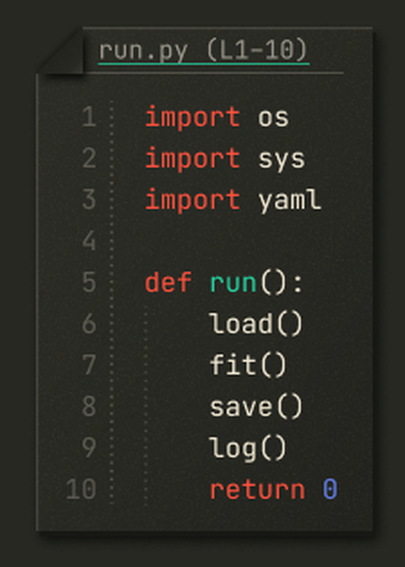
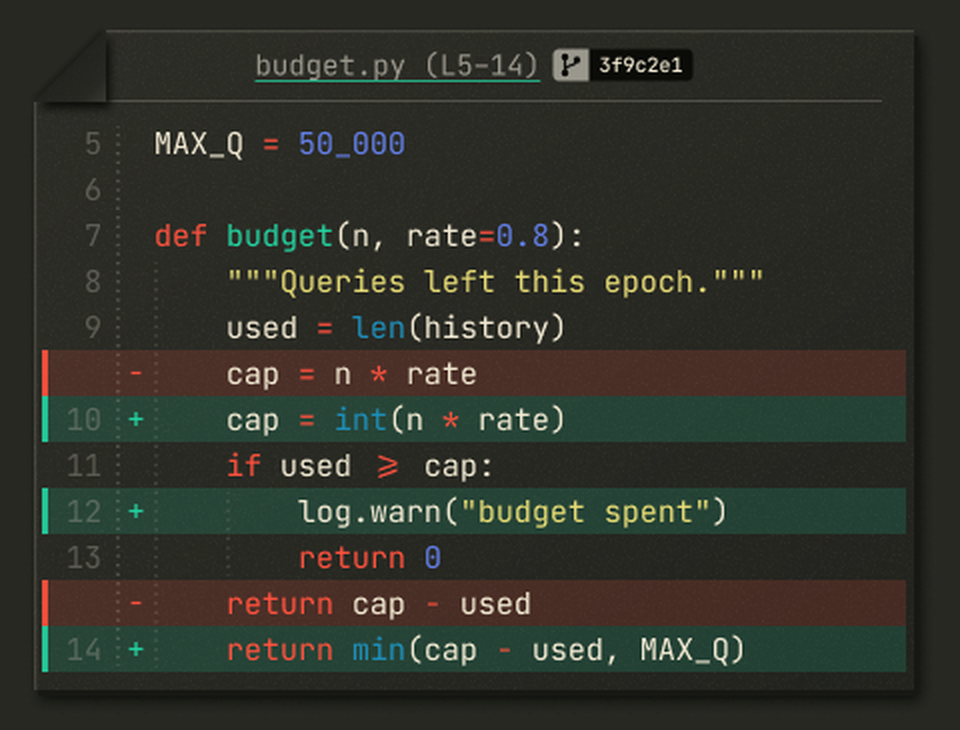
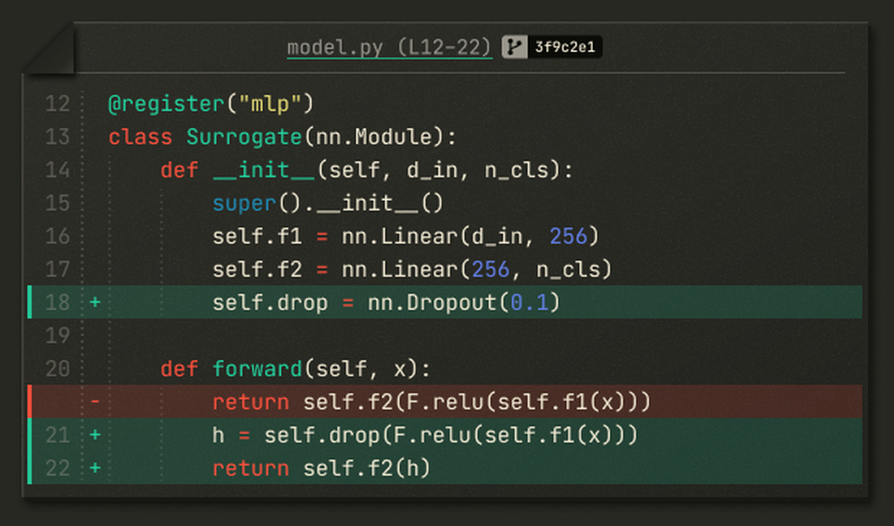

<details>
<summary markdown="span">Highlighting Rules</summary>
<div class="toggle-content" markdown="1">

형식마다 역할이 하나씩 있음. 한 번 읽은 뒤에는 색 하나만 따라가며 훑어도 흐름이 잡힘.

- <span class="highlight-blue"><strong>Blue</strong></span> - 지키기로 한 규칙
- <span class="highlight-orange">Orange</span> - 꼬였거나 꼬일 뻔한 지점
- <span class="highlight-green">Green</span> - 아직 정하지 않았거나 확인하지 않은 것
- <span class="text-gray">Gray text</span> - 날짜, 수치, 여담

</div>
</details>

<strong>TL;DR:</strong> 코드 블록을 왼쪽 위가 접힌 두꺼운 Monokai 종이로 만들고, 6가지 비율마다 같은 글꼴 크기(15)로 꽉 채움. 문법 색 · 들여쓰기 점선 · git 배지 · diff까지 넣었고, 마지막에 줄 간격이 22.5가 아니라 23으로 그려지는 버그를 잡음.

<figure style="text-align: center;">
    
    <figcaption style="font-size: 0.9em; color: gray; margin-top: 5px;" markdown="span">Code Block 슬라이드</figcaption>
</figure>

## 종이 카드

내 요청은 "모노카이, 왼쪽 위가 반듯하게 접힌 두께 있는 종이 질감 (머메이드지처럼), 문서처럼 상단 중앙에 파일명 (라인 또는 범위)"였음. 머메이드지는 표면에 잔결이 있는 두꺼운 종이임.

<figure style="text-align: center;">
    
    <figcaption style="font-size: 0.9em; color: gray; margin-top: 5px;" markdown="span">접힌 모서리 확대. 머리말 구분선이 접힌 삼각형의 아래 끝과 같은 높이에 있음</figcaption>
</figure>

카드 한 장은 아래에서부터 이렇게 쌓임.

| 레이어 | 내용 | style |
| --- | --- | --- |
| Thickness | 같은 모양을 (2.1, 3) 밀어서 종이 단면으로 보이게 | `Paper/Monokai Edge`  • `Paper/Edge · Thick` |
| Paper | 왼쪽 위를 잘라낸 본면 | `Paper/Monokai`  • `Paper/Surface · Thick` |
| Lit edge | 빛 받는 위 · 왼쪽 테두리 1.2px | Cream 14% |
| Header rule | 머리말 구분선 | Dawn Grey 35% |
| Filename · Git badge | 머리말 | 아래 참고 |
| Diff | 추가 · 삭제 줄 배경 | Vivid Green / Vivid Red |
| Line numbers · Gutter divider · Indent guides · Code | 본문 | `Code/Block` |
| Fold flap | 접힌 삼각형. 맨 위 | `Paper/Monokai Flap`  • `Paper/Flap` |

- 접힘 크기 f는 짧은 변의 0.11배로 하고, 26-40 사이로 제한함.
- 머메이드지 질감은 noise로 냄. 포스트잇의 어두운 noise는 Monokai 위에서 거의 안 보여서, Cream noise(6%, 입자 1.1)를 한 장 더 얹음.
- 그라데이션은 포스트잇과 같은 구조임. 처음엔 좌상 Cream 5% → 우하 × 0.72였는데, 내가 "그라데이션 좀 덜어줘"라고 해서 Cream 2.5% → × 0.86으로 약하게 함.
- <span class="highlight-orange">두께 층이 (2.1, 3) 밀려 있는데 그 층에 포스트잇 그림자 (3, 5)를 그대로 달아서, 종이 기준으로는 (5.1, 8)만큼 떨어진 더 큰 그림자가 됐음.</span> 두께 층 그림자를 (0.9, 2)로 줄여 포스트잇과 맞춤.

## 비율과 용량

| 비율 | 크기 | 접힘 | 줄 × 열 (15pt) |
| --- | --- | --- | --- |
| 16:9 | 587 × 330 | 36 | 12 × 56 |
| 4:3 | 440 × 330 | 36 | 12 × 40 |
| 1:1 | 330 × 330 | 36 | 12 × 28 |
| 3:1 | 840 × 280 | 31 | 10 × 84 |
| 3:2 | 420 × 280 | 31 | 10 × 38 |
| 2:3 | 187 × 280 | 26 | 10 × 12 |

처음엔 빈 블록만 만들었고, 내가 "일정 폰트 사이즈로 모두 채워봐"라고 해서 코드를 채움. 글꼴은 20 → 17 → 15로 두 번 줄임.

<span class="highlight-blue"><strong>모든 카드는 같은 글꼴 크기로, 들어가는 만큼 꽉 채움.</strong></span> 그래야 비율마다 몇 줄, 몇 자가 들어가는지 비교할 수 있음. 줄 수와 열 수는 이렇게 구함.

- 한 글자 폭 CW = 0.6 × 크기 <span class="text-gray">(JetBrains Mono의 글자 폭은 600/1000 em. 15pt면 9px)</span>
- 줄 수 = ⌊(H − f − 24) / 22.5⌋ <span class="text-gray">(위아래 최소 여백 12씩. 22.5는 계산한 값이고, 실제 줄 간격은 23이었음. 마지막 절 참고)</span>
- 코드 시작 x = 카드 x + 16 + 라인번호 자릿수 × CW + 26
- 열 수 = ⌊(카드 오른쪽 끝 − 16 − 코드 시작 x) / CW⌋

예시 코드는 이 열 수를 넘지 않게 따로 썼고, 스크립트가 줄 수와 최대 길이를 먼저 검사해서 하나라도 넘으면 그 카드는 건너뜀. 내용은 연구 주제에 맞춰 모델 추출 실험 코드처럼 보이게 함 (`model.py`, `budget.py`, `utils.py`, `train.sh`, `cfg.yaml`, `run.py`).

<figure style="text-align: center;">
    
    <figcaption style="font-size: 0.9em; color: gray; margin-top: 5px;" markdown="span">가장 좁은 2:3 카드. 12자까지만 들어감</figcaption>
</figure>

2:3 카드는 12자밖에 안 들어가서 `load()`, `fit()` 같은 짧은 줄만 넣음.

## 파일명과 git 배지

- <span class="highlight-blue"><strong>구분선은 접힌 삼각형의 아래쪽과 맞춤</strong></span> (y = f − 1). 왼쪽 끝은 삼각형 밑으로 들어가서, 접힌 선이 오른쪽으로 이어지는 것처럼 보임.
- 파일명은 `Code/Filename`(14). 구분선 위 칸의 가운데에 둠. 라인 범위는 카드에 실제로 보이는 줄과 일치시킴 (예: `model.py (L12–22)`).
- 파일명과 라인 범위 전체에 GitHub permalink를 걸고, 밑줄은 파일명에만 둠. 밑줄 색은 하이퍼링크 스타일과 같은 Vivid Green임.
- 배지는 [가지 아이콘 | 커밋 해시] 두 칸임. 왼쪽은 Dawn Grey 바탕에 Monokai Dark 가지 아이콘(점 3개 + 선 2개), 오른쪽은 Monokai Dark 바탕에 Cream 해시(`Code/Badge` 10). 해시에는 커밋 링크를 걸음.
- 파일명 + 배지를 한 덩어리로 가운데 정렬함. 폭이 모자라면 해시를 빼고 아이콘만, 그래도 모자라면 배지를 빼고 파일명만 둠 (2:3 카드).

```javascript
fn.setRangeHyperlink(0, label.length, { type: 'URL', value: `${REPO}/blob/${SHA}/${file}#L${start}-L${end}` });
fn.setRangeTextDecoration(0, file.length, 'UNDERLINE');
fn.setRangeTextDecorationColor(0, file.length, { value: { type: 'SOLID', color: NEON } });
```

<span class="highlight-green">저장소 주소는 지금 </span><span class="highlight-green">`github.com/user/repo`</span><span class="highlight-green"> 임시값임. 실제 발표에서는 논문 코드 저장소로 바꿔야 함.</span>

## 문법 색

Monokai 테마 느낌을 키컬러만으로 맞춤. 기본색은 Cream.

| 토큰 | 색 | 예 |
| --- | --- | --- |
| 키워드 · 연산자 · YAML 키 | Vivid Red | `def`, `return`, `=`, `victim:` |
| 함수 · 클래스 이름 · 데코레이터 · 셸 명령 | Vivid Green | `budget`, `@register`, `python` |
| 문자열 · YAML 값 | Lemon | `"cap"`, `resnet18` |
| 숫자 | Vivid Blue | `0.8`, `1e-8`, `50000` |
| 내장 함수 · 셸 옵션 | Teal | `len`, `int`, `--budget` |
| 주석 | Dawn Grey | `# label only` |

토큰은 언어별 정규식 하나로 나눔 (Python, shell, YAML). 글자 범위마다 `setRangeFillStyleIdAsync`로 색 style을 걸음.

```javascript
const re = /(#.*$)|("""[^]*?"""|"[^"]*"|'[^']*')|(@\w+)|(\b\d[\d_]*(?:\.\d+)?(?:e[+-]?\d+)?\b)|([A-Za-z_]\w*)|(>=|<=|==|!=|[=*\/+\-<>%])/g;
// 주석 | 문자열 | 데코레이터 | 숫자 | 식별자(def/class 다음이면 함수명) | 연산자
```

<span class="highlight-green">JetBrains Mono의 합자 때문에 </span><span class="highlight-green">`>=`</span><span class="highlight-green">가 </span><span class="highlight-green">`≥`</span><span class="highlight-green">, </span><span class="highlight-green">`==`</span><span class="highlight-green">가 한 묶음 기호로 보임. 끌지 말지는 아직 안 정함.</span>

## 들여쓰기 점선과 라인번호 구분선

- 라인번호는 오른쪽 정렬, Dawn Grey 45%. 번호 오른쪽 끝에 세로 점선을 둠.
- 들여쓰기 단계마다 세로 점선을 둠 <span class="text-gray">(단위: Python 4, shell 4, YAML 2)</span>. 빈 줄은 위아래 줄 중 작은 들여쓰기를 따라서, 함수 안의 빈 줄에서는 점선이 이어지고 함수 사이 빈 줄에서는 끊김.
- 점선은 길이 0.1, 간격 4.5인 dash에 둥근 끝(round cap)을 줘서 점처럼 보이게 함. 들여쓰기 점선은 30%, 구분선은 45%.

```javascript
v.strokeWeight = 1.5; v.strokeCap = 'ROUND'; v.dashPattern = [0.1, 4.5];
```

## diff

<figure style="text-align: center;">
    
    <figcaption style="font-size: 0.9em; color: gray; margin-top: 5px;" markdown="span">budget 카드의 diff. 빨간 줄은 지운 줄, 초록 줄은 추가한 줄</figcaption>
</figure>

내가 "같은 테마에서 diff highlight를 한다고 생각하고 red, green을 오버레이"해 달라고 해서 만든 버전임. `model.py`, `budget.py`, `cfg.yaml` 세 카드에만 넣고 나머지는 비교용으로 둠.

- 코드를 행마다 `[표시, 텍스트]`로 둠. 표시는 공백 / `+` / `-`.
- 추가 · 삭제 줄은 카드 폭 거의 전체에 Vivid Green / Vivid Red 16% 배경을 깔고, 왼쪽 끝에 3px 막대(90%)를 둠. 부호는 구분 점선과 코드 사이에 둠.
- 실제 diff처럼 지운 줄 바로 아래에 고친 줄이 오게 내용을 바꿈.
- <span class="highlight-blue"><strong>지운 줄은 줄번호를 비움. 머리말의 라인 범위는 새 파일 기준.</strong></span> 예: `budget.py`는 12행 중 2행이 지운 줄이라 `L5–14`.
- <span class="highlight-orange">들여쓰기가 없는 줄(cfg.yaml의 </span><span class="highlight-orange">`budget:`</span><span class="highlight-orange">)에서는 부호가 코드에 붙어 보여서</span> 모든 카드의 코드를 6px 오른쪽으로 옮김.

<figure style="text-align: center;">
    
    <figcaption style="font-size: 0.9em; color: gray; margin-top: 5px;" markdown="span">model 카드의 diff</figcaption>
</figure>

## 줄 간격 23px

내가 "배경이 라인번호에서 위아래로 같은 마진이 남게끔 들어와야지"라고 지적한 데서 시작함. <span class="highlight-orange">아래 줄로 갈수록 글자가 diff 배경보다 점점 아래로 처져 있었음.</span>

1. 원인 후보 1: 글자가 줄 상자 안에서 아래로 치우쳐 있다. 숫자 하나를 `flatten`해서 재보니 중심이 11.5로, 줄 상자 22.5의 거의 가운데였음. → 기각
1. 원인 후보 2: 줄 간격이 다르다. 두 줄짜리 텍스트를 만들어 높이를 재보니 46. 즉 <strong>줄당 23</strong>임. SVG로 내보내도 두 번째 줄은 첫 줄보다 정확히 23 아래였음. → 원인

15pt × 150% = 22.5인데 Figma는 줄 간격을 23으로 그림. diff 배경과 점선은 22.5 간격으로 놓여 있었으니 줄마다 0.5px씩, 12번째 줄에서는 5.5px 어긋남.

<span class="highlight-blue"><strong>줄 간격은 계산하지 말고 재서 씀: P = 텍스트 높이 / 줄 수.</strong></span> 라인번호 · 코드 · 점선 · diff 배경 · 부호를 전부 P = 23으로 다시 배치함. 부호는 글리프 중심이 숫자보다 0.5 낮아서 그만큼 올림.

```javascript
const n = ln.characters.split('\n').length;
const P = ln.height / n;                                // 23, not 22.5
const top = paper.y + f + (H - f - n * P) / 2;
for (const c of diff.children) {
  const row = Math.round((c.y - oldTop) / 22.5);
  if (c.name === 'Sign') c.y = top + row * P - 0.525;
  else { c.resize(c.width, P); c.y = top + row * P; }
}
```

<span class="highlight-green">다른 크기(17pt × 150% = 25.5 등)에서도 같은 식으로 반올림되는지는 아직 안 재봄.</span> 어느 쪽이든 재서 쓰면 상관없게 해 둠.

<details>
<summary markdown="span">발표 자동화 시리즈</summary>
<div class="toggle-content" markdown="1">

1. <span class="text-gray">[etc; 발표 자동화] Claude × Figma MCP로 랩세미나 템플릿 만들기</span>
1. <span class="text-gray">[etc; 발표 자동화] 키컬러, 타이포그래피, 이름 붙은 가이드</span>
1. <span class="text-gray">[etc; 발표 자동화] bottom-up tree와 그라데이션 간선</span>
1. <span class="text-gray">[etc; 발표 자동화] DaniPen 손글씨와 형광펜 밴드</span>
1. <span class="text-gray">[etc; 발표 자동화] 포스트잇, 오일파스텔, 필기구, 피규어</span>
1. <span class="text-gray">[etc; 발표 자동화] 코드 블록: 머메이드지, diff, 23px</span> (이 글)

</div>
</details>
