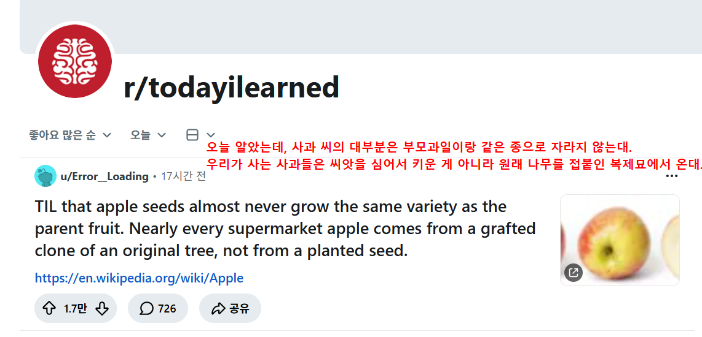

안녕하세요.  꾸준할거라 장담할 수 없는 매거진으로 찾아왔습니다.

빠르게 바뀌는 AI/보안 트렌드는 우릴 기다려주지 않습니다. 하지만 찐따 특) 부끄럽기 때문에 집 와서 클로드한테 물어보죠?<del>(초등학생도 이해할 수 있을정도로 정확하고 친절하게 설명해줘)</del>

<figure style="text-align: center;">
    
    <figcaption style="font-size: 0.9em; color: gray; margin-top: 5px;" markdown="span">누구보다도 제가 그렇습니다..</figcaption>
</figure>

그런 남에게 물어보기 멋쩍은 것들을 하나씩 포스팅해보려합니다. TIL은 요즘 젊은이들이 쓰는 Today I Learmed..(나 오늘 알았는데~)의 줄임말인 TIL입니다.

outdated 해져버린 제 모습을 단적으로 보여주는 좋은 줄임말이라고 느껴 채택했습니다.

앞으로 TIL 시리즈로 종종 찾아뵙겠습니다..
