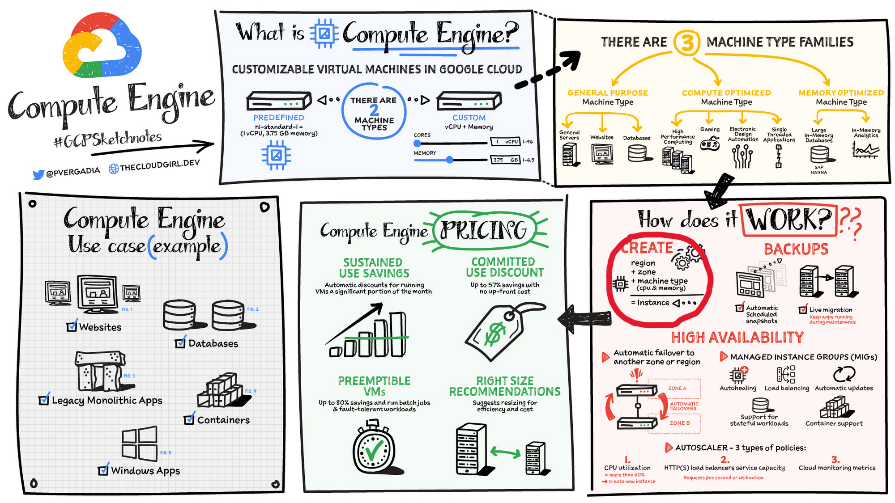

**▸ Before to start**
제어수단

## #0. terminology

**❓ 서버, 외부 요청을 기다리는 하드웨어+프로그램**

우리가 웹•앱에서 엔터를 치고, 마치 음식을 주문하는 것 처럼 버튼을 클릭하는 매번 요청을 보내는 것과 같다. 그럼 주방장(server)는 원하는 음식을 내오게 될 것이다.

- 하드웨어로써의 서버 := CPU + RAM + 저장장치 + 네트워크 카드 + OS
  - 우리 컴퓨터와 동일함(노트북, 모니터 등 입출력 장치가 없지만, 터미널은 있음)
- 서비스/프로그램으로서의 서버: nginx, MySQL, Apache 같은 프로그램
- ➡ 하드웨어 + 그 위에 돌아가고 있는 프로그램이 통칭하는 서버. 사실 프로그램 자체에 더 가까움
  - 웹서버 설치함 == nginx를 설치함
  - DB 서버 연결함 == MySQL 프로세스에 연결함

**❓ 서버를 띄운다는 것은 뭘까, AWS EC2 / GCP 가상 머신의 인스턴스를 생성(하드웨어 레이어)•인스턴스 위에서 소켓바인딩 및 루프 대기(소프트웨어 레이어)**

<figure style="text-align: center;">
    
    <figcaption style="font-size: 0.9em; color: gray; margin-top: 5px;"> [출처] (https://cloud.google.com/blog/topics/developers-practitioners/what-compute-engine-use-cases-security-pricing-and-more/?hl=en) </figcaption>
</figure>
인스턴스 생성이란 CPU+RAM+디스크==하드웨어로써의 서버를 하나 할당받는 것이다. 이 시점엔 **아무 프로세스도 실행되고 있지 않은** 빈 깡통 상태이다.  
이 깡통에서 flask run을 하면 소켓 바인딩 + while 루프 대기함으로써 요청을 받을 수 있다.
이 두가지를 생성하는 것을 각각 서버를 띄운다고 통칭한다.

**❓ 제어수단이란 뭘까, OS 레벨 - 파이프, 소켓, 메시지 큐 / 네트워크 레벨 - HTTP, RPC, gRPC**

프로세스 A가 가진 데이터나 기능을 프로세스 B가 쓰고 싶을 때 ➤ 즉, 프로세스끼리 통신하고 싶을 때 사용하는 것

- OS레벨의 제어수단을 통틀어 IPC

**❓ 웹 API란 뭘까, **

## #1. IPC (Inter-Process Communication)

1. Shared Memory
   1. 
2. Message passing

## #2. API (Application Programming Interface)

소프트웨어의 기능을 외부에서 호출할 수 있게 정의해둔 인터페이스 전체. ➡ SDK, COM, IPC를 포괄한다.
실무에서의 API는 HTTP 기반 웹 