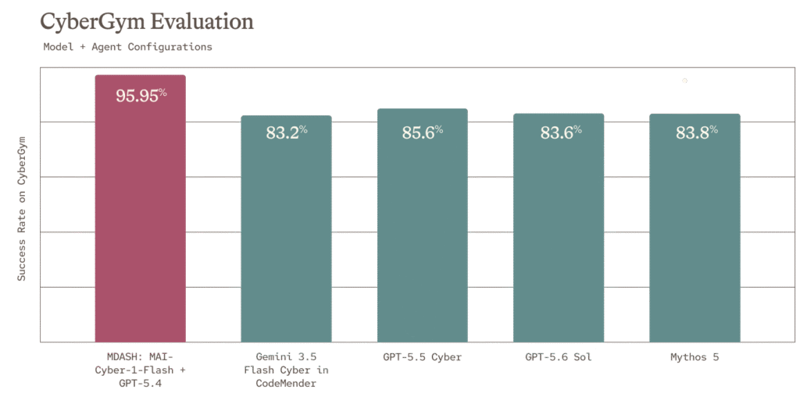
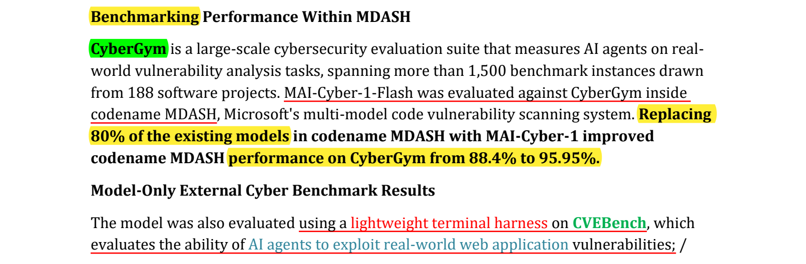
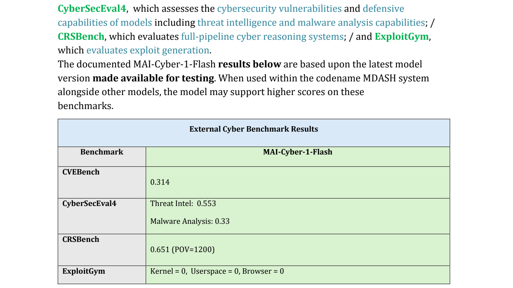

[paper #12] FuzzingBrain V2: A Multi-Agent LLM System for Automated Vulnerability
Discovery and Reproduction 

#### CyberGym

- Deepseek-V4-Flash, MAI-Cyber-1-Flash Model 등 경량화 모델 이용 하니스가 많아짐

<blockquote class="notion-quote" markdown="1">

<strong>This combination delivers a </strong><strong>50% cost saving</strong><strong>
 when compared against our best offering in MDASH today (GPT 5.4 + 5.4 mini + 5.3 codex).</strong>
</blockquote>

#### MAI-Cyber-1-Flash Model

- 해당 모델은 <strong>multi-agent vulnerability identification and remediation harness 목적</strong>
- MDASH 안 기존 모델의 <strong>80%</strong> 를 MAI-Cyber-1로 교체 → CyberGym <strong>88.4% → 95.95% (any-crash 기준, final submission 86.3%)</strong>

  <blockquote class="notion-quote" markdown="1">
  <em><strong>Any-crash: measures the ability of the agent to identify vulnerabilities that can crash the code under evaluation with an input that triggers any existing or 0-day vulnerability. Our 96% score is an any-crash score</strong></em>
  </blockquote>

  

  - [https://microsoft.ai/pdf/MAI-Cyber-1-Flash-Model-Card.pdf](https://microsoft.ai/pdf/MAI-Cyber-1-Flash-Model-Card.pdf)

  

  <figure style="text-align: center;">
      
      <figcaption style="font-size: 0.9em; color: gray; margin-top: 5px;" markdown="span">각각은 모델 단독 점수에 해당하고, 실제 쓰이는 형태 — MDASH안에서 다른 모델과 함께 썼을 때에는 더 높을 수 있음

  ExploitGym의 능력은 0임 → PoV를 입력으로 주고 시작하고, 넘친 바이트로 정확히 무엇을 덮어쓰지를 설계해야함. 보호기법에 따라 정보 유출 버그를 더 찾고, 연계해야할 수도 있음.
  커널이면 권한 상승. v8이면 힙 샌드박스 탈출까지 해야함</figcaption>
  </figure>

#### [3 lessons from frontier AI vulnerability research](https://www.microsoft.com/en-us/security/blog/2026/10/07/3-lessons-from-frontier-ai-vulnerability-research/) (by Taesoo Kim, 10.07.26)
