<strong>TL;DR</strong>: 앱 랜딩페이지(첫 실행 로딩 화면)를 Claude와 만든 과정 기록임. 키컬러를 정하고, 볼펜·형광펜 로고를 Monokai 배경용으로 옮긴 뒤, 오일파스텔·수채화 버전 로고를 새로 그려 로딩 페이지를 만들었음. 단계마다 <strong>프롬프트(원문, 보낸 순서대로) → 생성 방식 → 결과물·링크</strong> 순으로 정리함. 로고 원본과 공통 생성기는 [Devlog; rAsterink] Making the design assets 참고.

### 0. 최종 결과

<figure style="text-align: center;">
    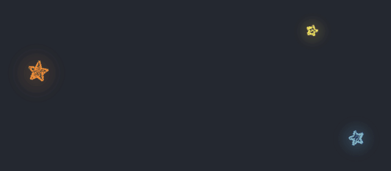
    <figcaption style="font-size: 0.9em; color: gray; margin-top: 5px;" markdown="span">로딩 페이지 - 레몬 선 → 흰 덧선 → 파란 수채화 순으로 써지고, 별 뒤 빛번짐이 울렁임 (12fps 캡처)</figcaption>
</figure>

- 로딩 페이지: [Claude Design 캔버스](https://claude.ai/artifact/QFLHaKJuQRiN2iVCctiWVW) (HTML 아트보드 1440×900, 실제 애니메이션은 여기서 재생)
- 로고 에셋 Figma: [키컬러](https://www.figma.com/design/E986G9oAkXI2OKZJ1QQgDE?node-id=39-483) / [다크](https://www.figma.com/design/E986G9oAkXI2OKZJ1QQgDE?node-id=36-544) / [단색](https://www.figma.com/design/E986G9oAkXI2OKZJ1QQgDE?node-id=36-786) / [오일파스텔 레몬](https://www.figma.com/design/E986G9oAkXI2OKZJ1QQgDE?node-id=39-540) / [흰 덧선](https://www.figma.com/design/E986G9oAkXI2OKZJ1QQgDE?node-id=40-482) / [수채화 그림자](https://www.figma.com/design/E986G9oAkXI2OKZJ1QQgDE?node-id=43-482)

### 1. 키컬러

프롬프트

1. 그럼 이제 앱의 랜딩페이지를 만들어볼건데, 우선 키컬러를 뽑아보자. 다크/라이트모드에 관계없이 항상 배경색은 모노카이색으로 고정할거고, 첫 로딩때 손글씨로 만든 로고의 단색 에셋을 쓰고 싶음. 키컬러를 뽑아서 다크모드용 에셋을 만들어
1. 키컬러 팔레트를 피그마에서 따로 빼줄래 → 중간에 멈춤 (키컬러 시트가 이미 별도 frame이라 따로 처리 안 함)
1. 배경은 약간 청색이 돌게 바꿔주고, 오일파스텔 에셋을 새로 만들자. 볼펜 말고 레몬색 오일파스텔로 선화만 해봐

#### 생성 방식

- 로고의 볼펜·형광펜·그림자 색에서 키컬러를 뽑아 Figma variable collection `rAsterink / color` (mode `Monokai`)로 만듦
- 배경은 다크/라이트 모드와 상관없이 Monokai로 고정
  - 처음 `#272822` → 3번 피드백으로 청색 기운 `#252830`으로 변경 (밝기는 그대로, 청색만 올림)
  - surface도 같은 톤 `#3B3F4A`로 맞춤. `ink/muted`는 올리브 톤 유지
- 대비는 `#252830` 기준 WCAG 비율

| variable | 값 | 대비 | 용도 |
| --- | --- | --- | --- |
| bg/monokai | #252830 | - | 배경 (고정) |
| bg/surface | #3B3F4A | 1.40 | 카드·올라온 면 |
| ink/primary | #F8F8F2 | 13.83 | 외곽선·본문 |
| ink/muted | #75715E | 3.00 | 주석·메타 (큰 글자만) |
| key/periwinkle | #A6BAE4 | 7.56 | 형광펜 채색 |
| key/violet | #A587E6 | 5.06 | rAster 그림자 |
| key/amber | #E8A33A | 6.83 | ink 그림자 |
| key/lemon | #FFF05A | 12.54 | 오일파스텔 선화 |
| key/lavender | #BCA5E3 | 6.76 | 메모 형광펜 |
| key/red | #EF5D6E | 4.53 | 적색 볼펜·강조 |

#### 결과물

<figure style="text-align: center;">
    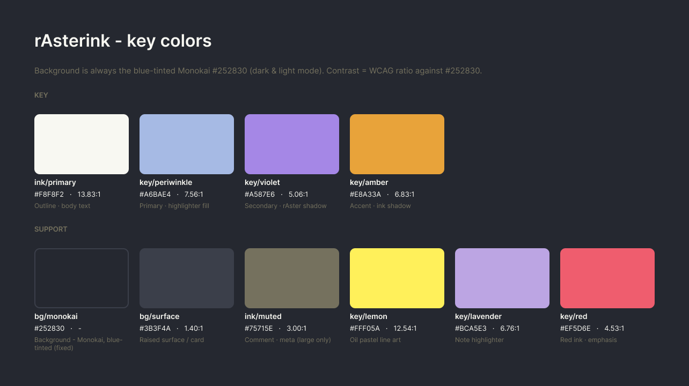
    <figcaption style="font-size: 0.9em; color: gray; margin-top: 5px;" markdown="span">rAsterink key colors (blue-tinted Monokai)</figcaption>
</figure>

- Figma: [key colors 시트](https://www.figma.com/design/E986G9oAkXI2OKZJ1QQgDE?node-id=39-483)

### 2. 다크모드·단색 로고 에셋

프롬프트

1. (1장 1번과 같음) … 첫 로딩때 손글씨로 만든 로고의 단색 에셋을 쓰고 싶음. 키컬러를 뽑아서 다크모드용 에셋을 만들어

#### 생성 방식

- `Logo/rAsterink` 컴포넌트를 복제해 Monokai 위에서 읽히도록 색과 blend mode를 다시 잡음. 색은 1장 variable에 연결
- 다크 (`Logo/rAsterink - Dark`)
  - 볼펜: `ink/primary` 0.95 - 흰 선
  - 형광펜: `key/periwinkle` NORMAL 0.8, 가장자리 `#7F95CC` 0.55, 고임 `#7E94CC`
  - 볼펜 번짐(halo): 밝은 종이에서 쓰던 `COLOR_BURN`을 `COLOR_DODGE`(회색 0.42, 0.5)로 뒤집음 - 어두운 배경에서는 번진 테두리가 어두워지는 대신 밝게 빛나야 해서
  - wet bleed: `COLOR_DODGE` 0.6
  - 그림자 펜: `key/violet` / `key/amber`, `SCREEN` 0.6
- 단색 (`Logo/rAsterink - Mono`, 첫 로딩용 후보): 흰색 하나로
  - 볼펜 100%, 형광펜 13% (가장자리 22%), 고임 0.45배, 그림자 펜 0.26, halo 0.1, wet bleed 숨김
- 배경 rect가 `bg/monokai`에 연결돼 있어서 1장의 배경 변경이 자동 반영됨
- 최종 로딩 페이지는 이 단색 대신 6장의 오일파스텔 로고를 씀

#### 결과물

<figure style="text-align: center;">
    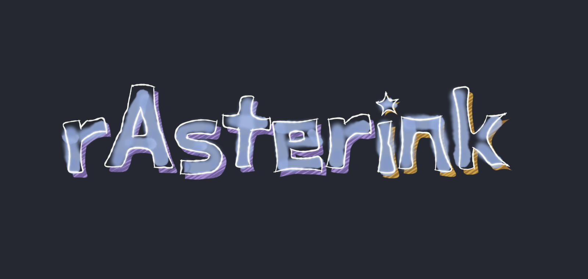
    <figcaption style="font-size: 0.9em; color: gray; margin-top: 5px;" markdown="span">Logo/rAsterink - Dark</figcaption>
</figure>

<figure style="text-align: center;">
    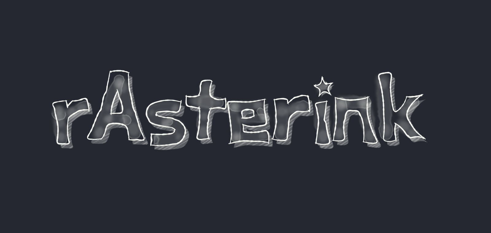
    <figcaption style="font-size: 0.9em; color: gray; margin-top: 5px;" markdown="span">Logo/rAsterink - Mono</figcaption>
</figure>

- Figma
  - [다크 stage](https://www.figma.com/design/E986G9oAkXI2OKZJ1QQgDE?node-id=36-544) / [다크 컴포넌트](https://www.figma.com/design/E986G9oAkXI2OKZJ1QQgDE?node-id=36-545)
  - [단색 stage](https://www.figma.com/design/E986G9oAkXI2OKZJ1QQgDE?node-id=36-786) / [단색 컴포넌트](https://www.figma.com/design/E986G9oAkXI2OKZJ1QQgDE?node-id=36-787)

### 3. 오일파스텔 선화 (레몬)

프롬프트

1. 배경은 약간 청색이 돌게 바꿔주고, 오일파스텔 에셋을 새로 만들자. 볼펜 말고 레몬색 오일파스텔로 선화만 해봐

#### 생성 방식

- 왁스 결과 종이 요철은 Figma 벡터로 표현이 안 돼서 Python 래스터 브러시를 새로 만듦 (`pastel.py`)
- 경로: 볼펜 선화와 같은 seed의 획 중심선(`scene.json`) → 로고 원본과 같은 획 순서·모양
- 브러시
  - 한 획 = 결 8가닥. 결마다 불투명도와 끊김 noise가 달라서 결 방향으로 긁힌 자국이 남음
  - 필압: 획 시작에서 눌렀다가 일정하게, 가장자리 결일수록 건조하게
  - 종이 요철: 3스케일 gaussian noise로 tooth map을 만들고, 튀어나온 곳에만 왁스가 묻게 threshold → 가장자리가 거칠게 끊김
  - 부스러기: 획을 따라 30px마다 14% 확률로 작은 덩어리
  - 색: 레몬 `#FFF05A` 기준, 하이라이트 결은 `#FFFAAF`, 요철 골은 `#EECD2C`
- 브러시 폭 8.5 (로고 1390 단위 기준), 2x 렌더링 2780×760 투명 PNG → Figma image fill

#### 결과물

<figure style="text-align: center;">
    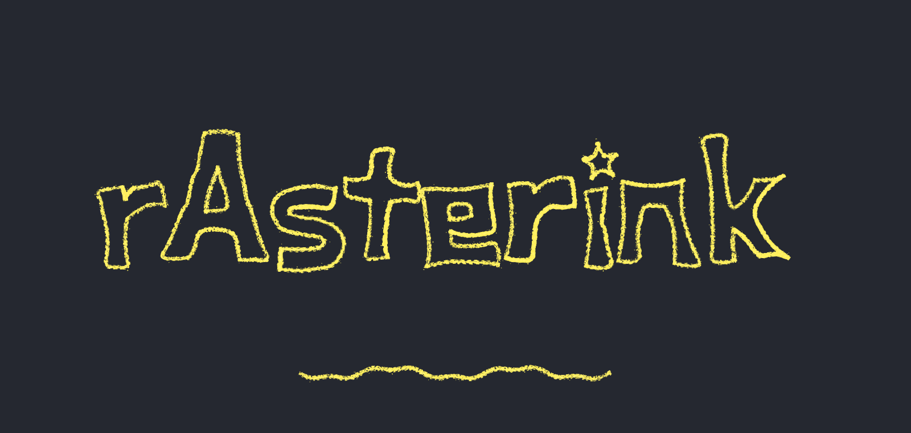
    <figcaption style="font-size: 0.9em; color: gray; margin-top: 5px;" markdown="span">oil pastel line art (lemon) + 브러시 견본</figcaption>
</figure>

- Figma: [oil pastel, lemon](https://www.figma.com/design/E986G9oAkXI2OKZJ1QQgDE?node-id=39-540)

### 4. 흰 오일파스텔 덧그리기

프롬프트

1. 그리고 그 선화위에 따라그리듯(살짝 엇나가게) 흰 오일파스텔로 한번 더 선화를 한다면 어떻게 일부 블렌딩 될까?
1. 원래 레몬선화가 그림자처럼 보이게끔 왼쪽 위로 흰 오일파스텔이 지나가게 해줘

#### 생성 방식

- 왁스 위에 왁스를 얹는 블렌딩 모델 (`pastel_white.py`)
  - 같은 종이: 레몬 왁스가 요철 골을 이미 메워서 그 위 흰색은 덜 끊기고 더 불투명
  - 결마다 섞임 정도가 다름: 세게 누른 결은 레몬을 비벼 크림색(`#FFF8C4`), 살짝 스친 결은 위에 얹히기만 함(scumble) → 결 방향 줄무늬
  - 끌림: 흰 스틱이 레몬을 지나며 노랑을 묻혀 가서, 겹침을 벗어난 직후는 연노랑 → 약 30px에 걸쳐 순백으로 돌아옴
- 1차: 획마다 좌우 아무 쪽으로 획 폭 0.15-0.4배 치우침 + 느린 흔들림
- 2차 (최종): 모든 획을 왼쪽 위로 x, y 각 획 폭 0.5배(획마다 ±15%) 이동
  - 레몬이 모든 획의 오른쪽 아래에만 남아서 빛이 왼쪽 위에서 오는 그림자처럼 보임. A·e 구멍 안쪽도 같은 방향
  - 좌우 흔들림은 0.13배로 줄여서 그림자 방향이 섞이지 않게 함
  - 획 끝을 짧게/길게 긋는 것, 긴 획 중간에 손을 뗐다 다시 긋는 것(35%)은 유지

#### 결과물

<figure style="text-align: center;">
    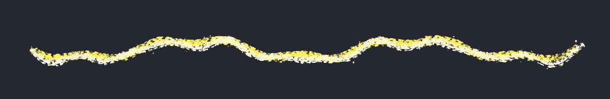
    <figcaption style="font-size: 0.9em; color: gray; margin-top: 5px;" markdown="span">1차 견본 - 위는 레몬, 가운데는 크림색, 아래는 순백</figcaption>
</figure>

<figure style="text-align: center;">
    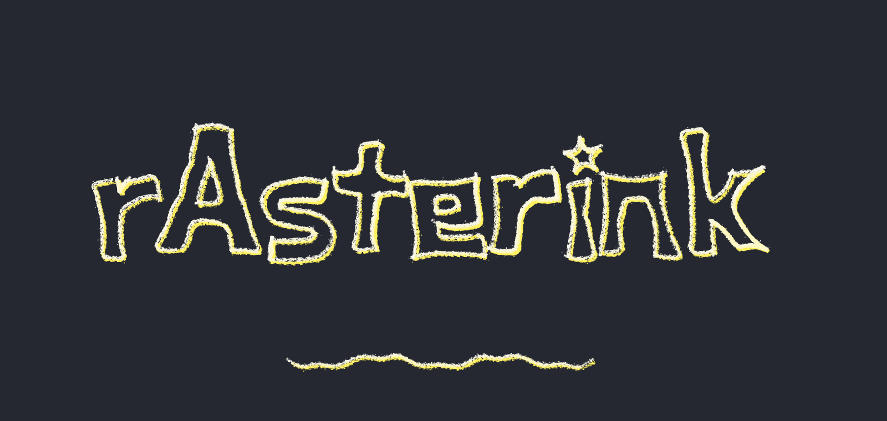
    <figcaption style="font-size: 0.9em; color: gray; margin-top: 5px;" markdown="span">2차 (최종) - 흰 선 왼쪽 위 이동, 레몬이 그림자로 남음</figcaption>
</figure>

<figure style="text-align: center;">
    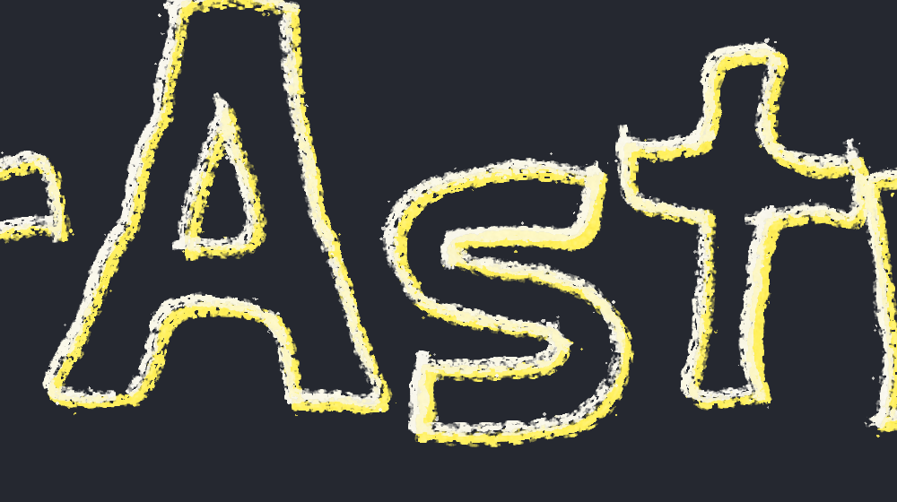
    <figcaption style="font-size: 0.9em; color: gray; margin-top: 5px;" markdown="span">2차 2x 확대</figcaption>
</figure>

- Figma: [white up-left, lemon shadow](https://www.figma.com/design/E986G9oAkXI2OKZJ1QQgDE?node-id=40-482) (1차 이미지는 2차로 교체됨)

### 5. 파란 수채화 그림자

프롬프트

1. 그리고 같은 레몬색으로 레터 안쪽이 아닌 우측 아래 그림자 위치 테두리만 채도높은 파란색 수채화(반투명)으로 칠해봐. 조금은 삐져나오고, 테두리에 물감이고이고, 획이 역행할땐 안쪽에 경계가 남고, 형광펜 처럼 획이 지나오는 방향에선 블렌드가 일어나지만 끝날땐 경계가 남는거야.
1. 지금보다 4배는 더 넓게 칠해봐 그리고 전체적으로 블러 + 오버레이 줘서 번지듯 빛나는거처럼 보이게 해봐 → 롤백 (Figma stage 삭제)

#### 생성 방식

- `watercolor.py`, 2x 래스터
- 칠할 영역: 원래 로고 그림자 위치 = 글자 면을 (12.1, 14.3) 옮긴 영역 - 글자 면. 글자 바깥은 오른쪽 아래, A·e 구멍은 왼쪽 위 가장자리에만 칠해짐
- 삐져나옴: 띠 경계 밖으로 1-5px 불규칙하게, 글자 안쪽으로는 그 절반 이하
- 붓질 방향 (형광펜과 같은 규칙)
  - 지나온 쪽: 강한 blur로 부드럽게 섞임
  - 멈춘 쪽: 약한 blur + 물감을 더 모아 또렷한 경계
  - 역행: 붓질의 38%는 끝에서 되돌아 다시 칠함 → 첫 붓질의 끝 경계가 안쪽에 선으로 남음
  - 같은 방향 이어 칠하기: 긴 변은 두 번에 나눠 칠하고, 물기 있는 상태에서 겹친 것처럼(wet-in-wet) 앞 획 끝 경계를 녹임
- 물감 고임
  - 칠한 영역 외곽을 따라 가는 고임선 (coffee ring)
  - wax resist: 오일파스텔 위에는 거의 안 묻고 파스텔 가장자리에 고임. 파스텔 위에 작은 물방울 자국만 드문드문
- 반투명: 면 불투명도 약 0.2-0.35, 고인 곳 최대 0.8. 색은 `#4696FF`(옅은 곳) → `#1252F5`(진한 곳). 입자가 종이 골에 가라앉게(granulation)
- 4배 + 글로 시도 (롤백)
  - 그림자 거리 4배 (48, 57). 단순 이동이 아니라 글자를 그 방향으로 밀어낸 extrusion 영역
  - 둥근 붓 자국이 원 모양으로 보여서 각 변을 그림자 방향으로 쓸어내리는 납작붓으로 바꿈
  - 밝은 파랑 `#78B9FF` 복사본에 Layer blur 40 + Overlay 2겹 (어두운 배경에서는 1겹이 거의 안 보임)

#### 결과물

<figure style="text-align: center;">
    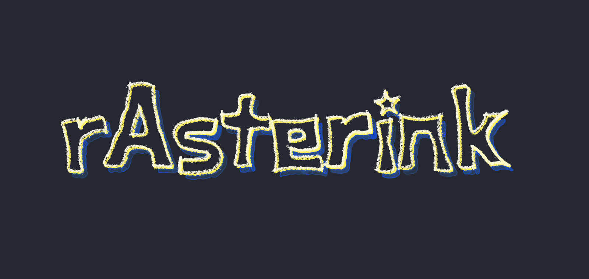
    <figcaption style="font-size: 0.9em; color: gray; margin-top: 5px;" markdown="span">oil pastel + blue watercolor shadow (최종)</figcaption>
</figure>

<figure style="text-align: center;">
    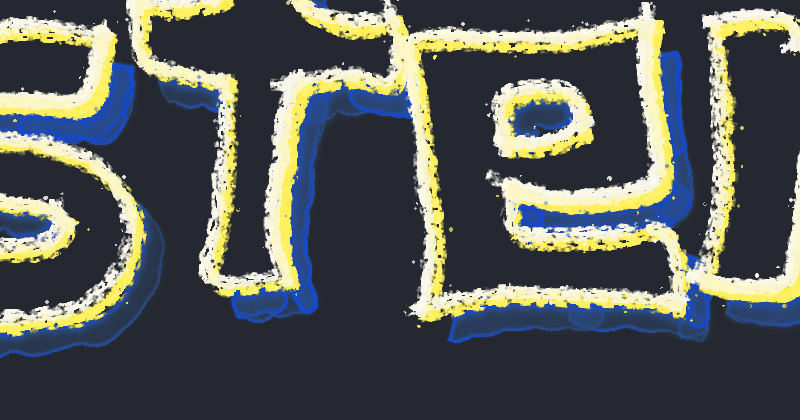
    <figcaption style="font-size: 0.9em; color: gray; margin-top: 5px;" markdown="span">원본 크기 확대 - 고임선, 역행 경계, wax resist</figcaption>
</figure>

<figure style="text-align: center;">
    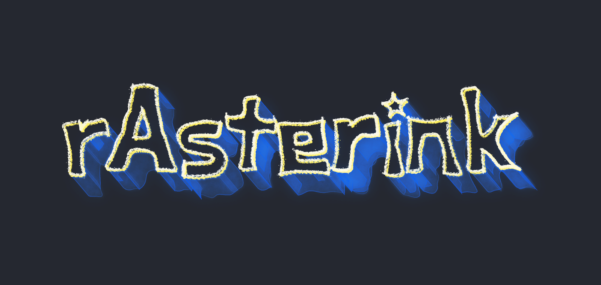
    <figcaption style="font-size: 0.9em; color: gray; margin-top: 5px;" markdown="span">4배 폭 + 블러 오버레이 시도 (롤백)</figcaption>
</figure>

- Figma: [oil pastel + blue watercolor shadow](https://www.figma.com/design/E986G9oAkXI2OKZJ1QQgDE?node-id=43-482) (수채화 레이어가 파스텔 아래 별도 레이어)

### 6. 로딩 페이지

프롬프트

1. 이건 롤백하고(내가 지움) 이거 주위에 오일파스텔로 그린 별(주황, 밝은파랑, 레몬)이 두세개 반짝이는 식으로 로딩페이지를 만들거야 ㄱㄱ
1. (캔버스 댓글) 커졌다 작아졌다 할 필요없음. 네온효과가 좀 구림
1. (캔버스 댓글) 이거 채색 왜 우글거리는거임? 돌아가는 효과없이 뒤에 빛번짐만 조금 울렁이면 될거같은데
1. (캔버스 댓글) 텍스트 엠블럼과 선화 및 채색 두께를 얼라인해야함
1. 가운데 엠블럼이 노란색 -&gt; 흰색 순으로 써지는 효과가 있었으면 좋겠고, 전체 중간 정렬, 엠블럼 크기를 지금의 0.6배로 줄여

#### 생성 방식

- 만든 곳: Claude Design 캔버스의 HTML 아트보드 (1440×900, 화면 크기에 맞춰 늘어남). 배경 `#252830`
- 별 (`stars.py`)
  - 3장과 같은 오일파스텔 브러시. 테두리는 한 붓(닫히는 지점을 살짝 지나침), 안쪽은 지그재그로 엉성하게 채색
  - 주황 `#FF963A` / 밝은 파랑 `#6ECAFF` / 레몬 `#FFF05A`
- 반짝임 변천
  - v1: 크기 0.6-1.1배 + 회전 + drop-shadow 빛번짐 + 선이 조금씩 다른 3프레임을 0.375초마다 교체(boil), 8fps로 끊기게
  - v2 (2번 댓글): 크기 변화와 네온 빛번짐 제거 → 깜빡임 + ±6° 흔들림만
  - v3 (3번 댓글, 최종): 3프레임 교체·회전·깜빡임 제거. 별은 한 장으로 고정하고, 뒤에 같은 색의 넓고 흐린 빛번짐(radial gradient + blur, 불투명도 0.3 이하)만 2.2-3.1초 주기로 천천히 퍼졌다 모였다 하며 살짝 흔들림
- 두께 맞춤 (4번 댓글, `stars_aligned.py`)
  - 로고 겹선(레몬+흰)의 실제 굵기를 재보니 중앙값 약 10 단위 (1390 단위 기준)
  - 별은 한 겹이라 브러시 폭 12 단위로 로고와 같은 배율에서 다시 그림 → 화면상 굵기가 크기마다 2.0-3.5px로 제각각이던 것이 모두 약 5.9px로 로고와 같아짐. 안쪽 채색도 같은 폭
- 써지는 효과 (5번, `write_on.py`)
  - 레이어 3장(레몬만 / 레몬+흰 / 수채화)을 SVG mask로 드러냄. mask = 획 중심선 path에 `stroke-dashoffset` 애니메이션 (`pathLength` 1)
  - 레몬 63획: 0.25-3.65초 (약 3300 단위/초). 볼펜 선화와 같은 획 순서·방향, i 위 별이 마지막
  - 흰 덧선 73획: 3.85-6.84초 (약 4200 단위/초, 레몬보다 빠름)
  - 수채화: 흰 선이 끝나면 0.9초 fade in
  - 마지막에 레몬+흰 원본 이미지로 바꿔서 mask 가장자리 오차를 없앰
  - 한 번만 재생. 동작 줄이기(prefers-reduced-motion)를 켠 기기에서는 완성 상태로 바로 표시
- 레이아웃: 엠블럼 820px → 492px (화면 폭 45.6% 상한). 별도 같은 비율로 줄여서 굵기 맞춤 유지. 엠블럼 + 별 3개를 합친 범위가 화면 정중앙에 오게 맞춤

#### 결과물

<figure style="text-align: center;">
    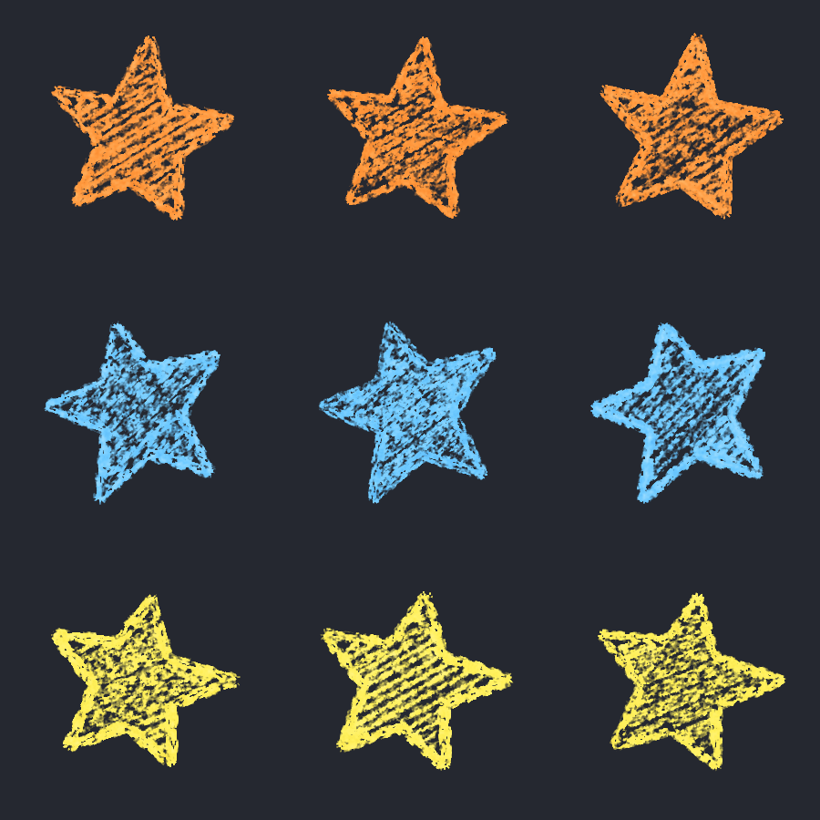
    <figcaption style="font-size: 0.9em; color: gray; margin-top: 5px;" markdown="span">별 v1 - 3색 × boil 3프레임 (v3에서는 1프레임만 씀)</figcaption>
</figure>

<figure style="text-align: center;">
    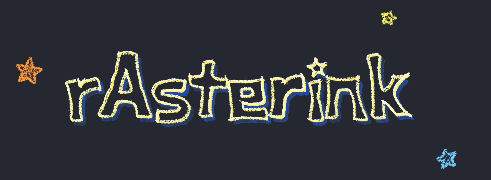
    <figcaption style="font-size: 0.9em; color: gray; margin-top: 5px;" markdown="span">두께 맞춘 별 - 로고 선과 같은 굵기</figcaption>
</figure>

<figure style="text-align: center;">
    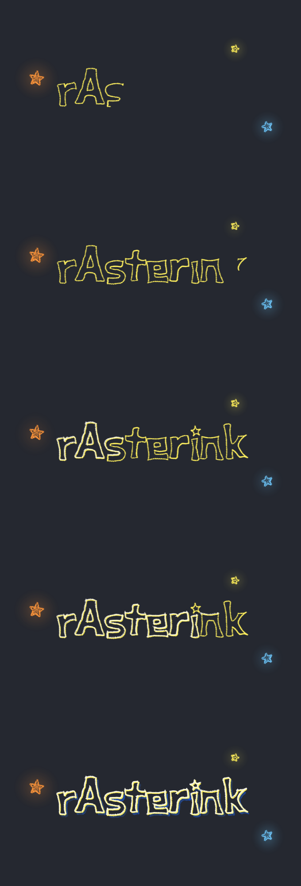
    <figcaption style="font-size: 0.9em; color: gray; margin-top: 5px;" markdown="span">써지는 순서 1.2s / 3.0s / 4.6s / 6.0s / 8.5s</figcaption>
</figure>

- [Claude Design 캔버스 - rAsterink Loading page](https://claude.ai/artifact/QFLHaKJuQRiN2iVCctiWVW)
- Figma: [Loading page (1440x900)](https://www.figma.com/design/E986G9oAkXI2OKZJ1QQgDE?node-id=48-482) - v1 배치 기준 정지 화면이라 최종 캔버스와 다름
