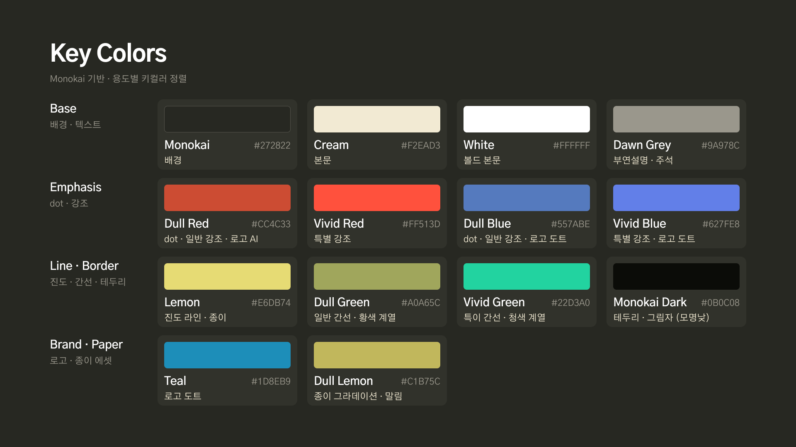
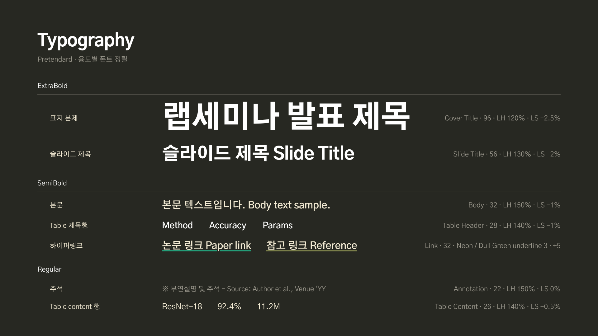
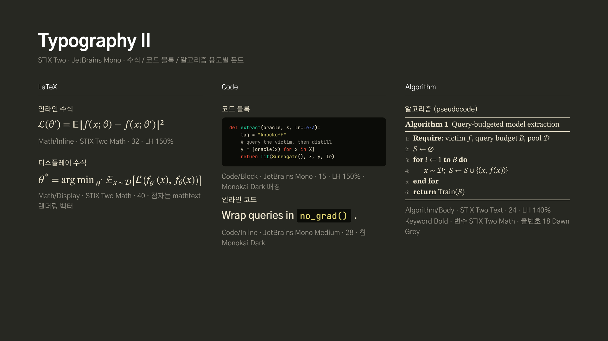
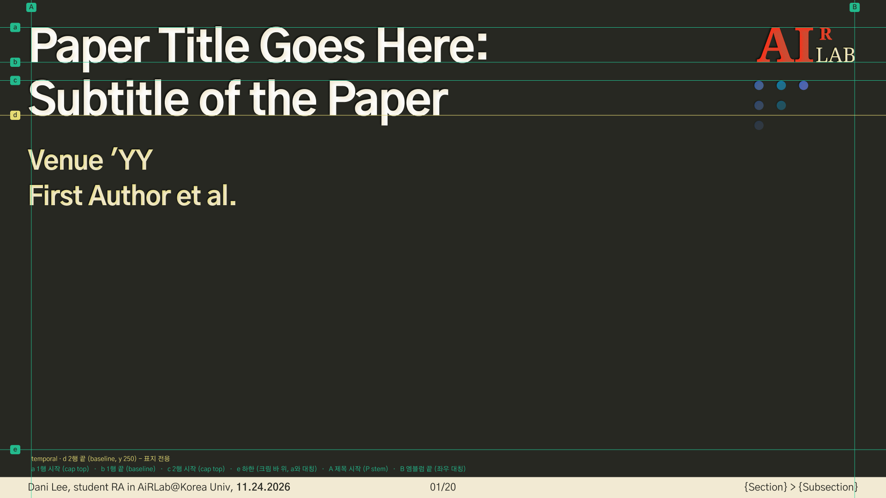
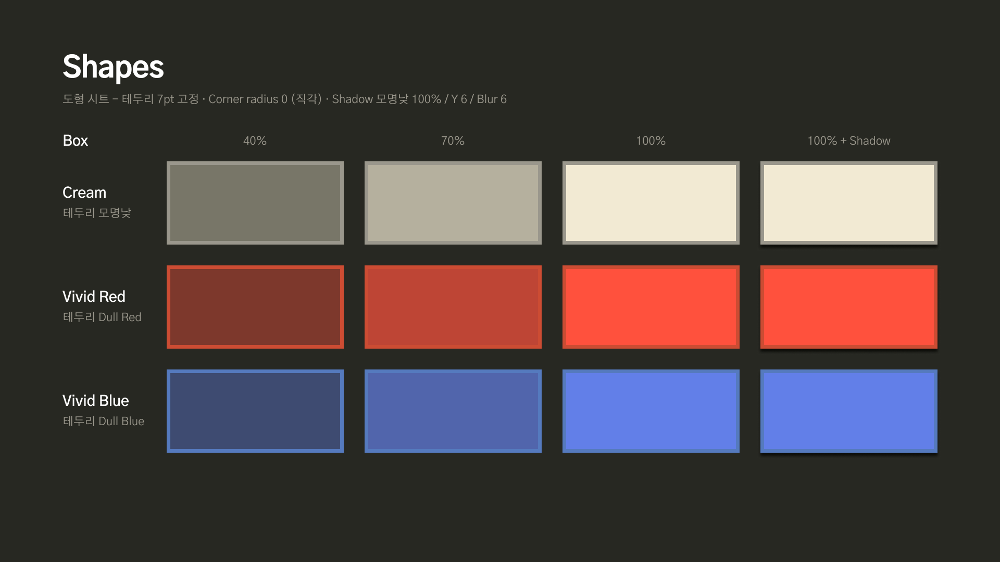
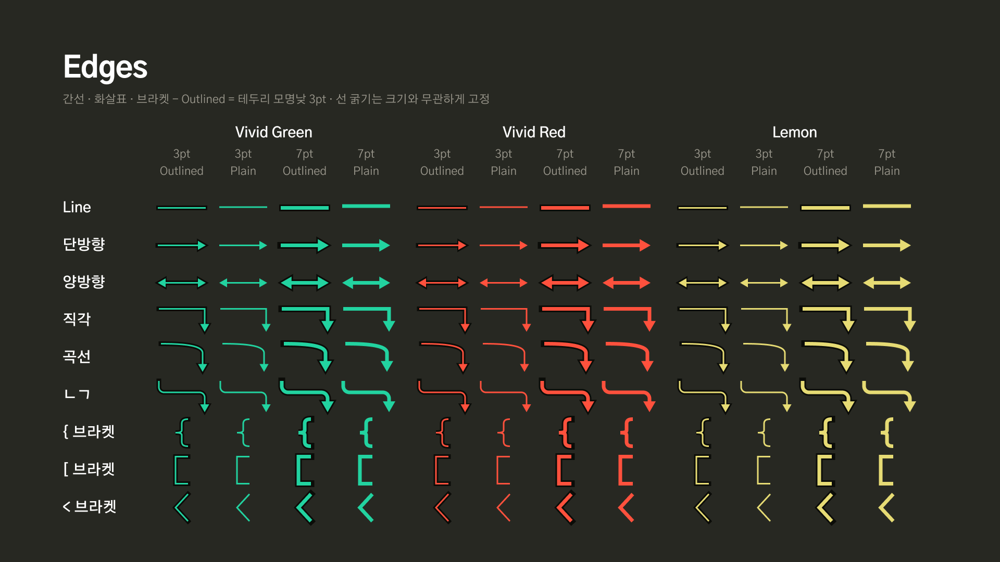

<details>
<summary markdown="span">Highlighting Rules</summary>
<div class="toggle-content" markdown="1">

형식마다 역할이 하나씩 있다. 한 번 읽은 뒤에는 색 하나만 따라가며 훑어도 흐름이 잡힌다.

- <span class="highlight-blue"><strong>Blue</strong></span> - 지키기로 한 규칙
- <span class="highlight-orange">Orange</span> - 꼬였거나 꼬일 뻔한 지점
- <span class="highlight-green">Green</span> - 아직 정하지 않았거나 확인하지 않은 것
- <span class="text-gray">Gray text</span> - 날짜, 수치, 여담

</div>
</details>

<strong>TL;DR:</strong> 색은 Monokai에서 출발한 키컬러 14개만 쓰고, 글꼴은 용도별 텍스트 스타일로 고정하고, 배치는 이름 붙은 가이드로 말한다. 3-6편의 엘리먼트도 모두 이 색, 글꼴, 가이드를 쓴다.

## 키컬러

<figure style="text-align: center;">
    
    <figcaption style="font-size: 0.9em; color: gray; margin-top: 5px;" markdown="span">Key Colors 슬라이드</figcaption>
</figure>

<span class="highlight-blue"><strong>이 14개 밖의 색은 쓰지 않는다.</strong></span> 섞은 색이 필요하면 따로 style로 등록하고 무엇을 섞었는지 적는다.

| 그룹 | 이름 | hex | 용도 |
| --- | --- | --- | --- |
| Base | Monokai | `#272822` | 배경 |
| Base | Cream | `#F2EAD3` | 본문 |
| Base | White | `#FFFFFF` | 볼드 본문 |
| Base | Dawn Grey | `#9A978C` | 부연설명 · 주석 |
| Emphasis | Dull Red | `#CC4C33` | dot · 일반 강조 · 로고 AI |
| Emphasis | Vivid Red | `#FF513D` | 특별 강조 |
| Emphasis | Dull Blue | `#557ABE` | dot · 일반 강조 · 로고 도트 |
| Emphasis | Vivid Blue | `#627FE8` | 특별 강조 · 로고 도트 |
| Line · Border | Lemon | `#E6DB74` | 진도 라인 · 종이 |
| Line · Border | Dull Green | `#A0A65C` | 일반 간선 · 황색 계열 |
| Line · Border | Vivid Green | `#22D3A0` | 특이 간선 · 청색 계열 |
| Line · Border | Monokai Dark | `#0B0C08` | 테두리 · 그림자 |
| Brand · Paper | Teal | `#1D8EB9` | 로고 도트 |
| Brand · Paper | Dull Lemon | `#C1B75C` | 종이 그라데이션 · 말림 |

투명도 변형은 `Alpha/*`로 따로 둔다: Cream 5 · 40 · 70, Vivid Red 40 · 70, Vivid Blue 40 · 70, Dawn Grey 40.

### 키컬러를 섞은 색

| style | 값 | 무엇을 섞었나 |
| --- | --- | --- |
| `Paper/Lemon` | `#E6DB74` → `#E6DB74`(0.55) → `#C1B75C` | Lemon에서 Dull Lemon으로 |
| `Paper/Monokai` | `#2C2D26` → `#272822`(0.55) → `#22221D` | Monokai에 Cream 2.5% / Monokai × 0.86 |
| `Paper/White` | `#FFFFFF` → `#FFFFFF`(0.55) → `#F8F3E7` | White에 Cream 55% |
| `Ink Mix/Teal Green` · `Rust` · `Ultramarine` | `#1E3F38` · `#48291F` · `#252A49` | 사인펜(Monokai)과 형광펜 색이 번진 색 |
| `Pen/Metal · Lemon` · `Cream` | `#EBE290` → `#E6DB74`(0.42) → `#98914D` 등 | 밝은 쪽은 Cream/White 섞음, 어두운 쪽은 0.4-0.7배 |
| `Metal/Dawn Grey` | `#C2BCAC` → `#9A978C`(0.45) → `#5F5E57` | Dawn Grey에 Cream 45% / × 0.62 |

종이·필기구 그라데이션은 전부 빛이 왼쪽 위에서 온다고 보고, 오른쪽 아래로 갈수록 어두워지게 만들었다. 이 시리즈에서는 이걸 dull 그라데이션이라고 부른다. 광택 하이라이트는 넣었다가 뺐다 (5편).

## 타이포그래피

<figure style="text-align: center;">
    
    <figcaption style="font-size: 0.9em; color: gray; margin-top: 5px;" markdown="span">Typography 슬라이드</figcaption>
</figure>

| style | 글꼴 | 크기 | 줄간격 | 자간 | 용도 |
| --- | --- | --- | --- | --- | --- |
| ExtraBold/Cover Title | Gothic A1 ExtraBold | 96 | 120% | -2.5% | 표지 본제 |
| ExtraBold/Slide Title | Gothic A1 ExtraBold | 56 | 130% | -2% | 슬라이드 제목 |
| SemiBold/Body | Gothic A1 SemiBold | 32 | 150% | -1% | 본문 |
| SemiBold/Table Header | Gothic A1 SemiBold | 28 | 140% | -1% | 표 제목행 |
| SemiBold/Link | Gothic A1 SemiBold | 32 | 150% | -1% | 하이퍼링크 (Vivid Green 밑줄) |
| SemiBold/Link Dull | Gothic A1 SemiBold | 32 | 150% | -1% | 하이퍼링크 (Dull Green 밑줄) |
| SemiBold/Annotation | Gothic A1 SemiBold | 22 | 150% | 0 | 주석 강조 |
| Regular/Annotation | Gothic A1 Regular | 22 | 150% | 0 | 주석 · 캡션 |
| Regular/Table Content | Gothic A1 Regular | 26 | 140% | -0.5% | 표 내용 |

<span class="highlight-orange">슬라이드 부제에는 "Pretendard"라고 적혀 있는데, 실제 텍스트 스타일은 Gothic A1로 잡혀 있다.</span> 어느 쪽으로 맞출지 아직 정하지 않았다.

하이퍼링크 스타일은 밑줄 색, 두께, 간격까지 텍스트 스타일에 넣었다 <span class="text-gray">(두께 3px, 글자와 간격 5px, skip ink)</span>. 그래서 글자에 스타일만 걸면 밑줄이 따라온다.

```javascript
st.textDecoration = 'UNDERLINE';
st.textDecorationColor = { value: { type: 'SOLID', color: NEON } };
st.textDecorationThickness = { value: 3, unit: 'PIXELS' };
st.textDecorationOffset = { value: 5, unit: 'PIXELS' };
st.textDecorationSkipInk = true;
```

### 수식 · 코드 · 알고리즘

<figure style="text-align: center;">
    
    <figcaption style="font-size: 0.9em; color: gray; margin-top: 5px;" markdown="span">Typography II 슬라이드</figcaption>
</figure>

| style | 글꼴 | 크기 | 비고 |
| --- | --- | --- | --- |
| Math/Inline | STIX Two Math | 32 | 본문 속 수식 |
| Math/Display | STIX Two Math | 40 | 첨자 배치는 matplotlib mathtext로 렌더한 벡터를 올린다 |
| Code/Block | JetBrains Mono | 15 | 처음 20 → 17 → 15로 줄였다 (6편) |
| Code/Inline | JetBrains Mono Medium | 28 | Monokai Dark 칩 위에 |
| Code/Filename | JetBrains Mono | 14 | 코드 블록 머리말 |
| Code/Badge | JetBrains Mono Medium | 10 | git 배지 해시 |
| Algorithm/Caption · Body · Keyword | STIX Two Text | 24 | 의사코드. 키워드는 Bold, 변수는 STIX Two Math |

<span class="highlight-orange">디스플레이 수식은 텍스트로는 첨자 위치를 못 맞춰서 벡터로 넣었다.</span> 처음 올렸을 때 SVG 배경이 크림색 사각형으로 같이 들어와서 그 레이어를 지웠다.

알고리즘 박스는 캡션이 가로 구분선을 넘쳐서 캡션을 줄이고, 왼쪽 끝을 x 1280에 맞췄다.

## 음각 효과

제목이나 로고처럼 "종이에 눌린" 느낌이 필요한 곳은 effect style로 처리한다. 왼쪽 위로 밝은 그림자, 오른쪽 아래로 안쪽 그림자를 주는 구조다.

| style | 구성 |
| --- | --- |
| Press/L · White | drop shadow r4 (-2, -2) + inner shadow r10 (5, 5) + noise 8% |
| Press/S · Red | drop shadow r3 (-1.5, -1.5) + inner shadow r6 (3, 3) + noise 12% |
| Press/XS · Cream | drop shadow r3 (-1.5, -1.5) + inner shadow r3 (1.5, 1.5) 70% + noise 10% |
| Press/Dot · Dull Blue · Teal · Vivid Blue | 로고 도트용 |

## 가이드 규칙

<figure style="text-align: center;">
    
    <figcaption style="font-size: 0.9em; color: gray; margin-top: 5px;" markdown="span">표지. 녹색 선이 영구 가이드다</figcaption>
</figure>

1편에 적었듯 frame guide는 내 화면에 안 보여서, 가이드를 잠긴 1px 사각형 레이어로 그리고 이름표를 붙였다. 규칙은 이렇게 정했다.

- 녹색(Vivid Green)은 영구 가이드다. 모든 슬라이드에 두고, 다른 요소를 배치할 공간을 잴 때 쓴다.
- 레몬색(Lemon)은 임시 가이드다. 그 슬라이드에서만 쓰고, 안 쓰게 되면 지운다.
- 이름이 소문자면 가로선, 대문자면 세로선이다.
- 임시 가이드를 한 쌍으로 쓸 때는 이름 뒤에 0 / 1을 붙인다. 예: `I0`, `I1`, `k0`, `k1`

| 이름 | 위치 | 기준 |
| --- | --- | --- |
| a | y 59.53 | 제목 1행 시작 (cap top) |
| b | y 135 | 제목 1행 끝 (baseline) |
| c | y 174.53 | 제목 2행 시작 (cap top) |
| d (임시, 표지 전용) | y 250 | 제목 2행 끝 (baseline) |
| e | y 975.11 | 하한. 크림 바 위, a와 위아래 대칭 |
| A | x 67.88 | 제목 시작 (P의 세로획) |
| B | x 1852.12 | 엠블럼 끝. A와 좌우 대칭 |

하단 크림 바는 두 번 줄였다 <span class="text-gray">(108 → 0.6배 64.8 → 0.7배 45.36)</span>. 줄일 때마다 하한 e를 다시 잡았다. 2번 슬라이드부터 쓰는 임시 가이드 (`i`, `j`, `k`, `I`-`M`)는 3편에서 다룬다.

## Shapes

<figure style="text-align: center;">
    
    <figcaption style="font-size: 0.9em; color: gray; margin-top: 5px;" markdown="span">Shapes 슬라이드</figcaption>
</figure>

- 박스는 Cream, Vivid Red, Vivid Blue 세 색마다 네 가지를 둔다: 채움 불투명도 40%, 70%, 100%, 그리고 100%에 그림자를 더한 것.
- 테두리는 7pt로 고정하고, 색은 채움 색의 "dull" 짝으로 맞춘다 <span class="text-gray">(Cream → Dawn Grey, Vivid Red → Dull Red, Vivid Blue → Dull Blue)</span>.
- 그림자는 `Shadow/Monokai Dark` <span class="text-gray">(아래 6, 흐림 6, 100%)</span>.
- 모서리는 원래 12였는데, <span class="text-gray">2026.11.24</span>에 2 · 3 · 7번 슬라이드의 둥근 모서리를 전부 직각으로 바꿨다.

## Edges

<figure style="text-align: center;">
    
    <figcaption style="font-size: 0.9em; color: gray; margin-top: 5px;" markdown="span">Edges 슬라이드</figcaption>
</figure>

- 색 3개 (Vivid Green, Vivid Red, Lemon) × 굵기 2개 (3pt, 7pt) × Outlined / Plain.
- Outlined는 Monokai Dark 3pt 테두리를 두른 버전이다. <span class="highlight-blue"><strong>선 굵기는 크기와 상관없이 고정한다.</strong></span>
- 행: Line, 단방향, 양방향, 직각, 곡선, `{` `[` `<` 브라켓, ㄴㄱ.
- 화살촉은 `ARROW_EQUILATERAL` stroke cap으로 넣는다. 꺾이는 화살표는 vertex마다 corner radius를 준다 <span class="text-gray">(ㄴㄱ 행은 r10 / r12. 행 간격은 72로 다시 맞췄다)</span>.

Edges 슬라이드의 꺾인 화살표는 둥근 채로 남아 있다. <span class="highlight-green">직각 통일 범위에 넣을지는 아직 안 정했다.</span>

<details>
<summary markdown="span">발표 자동화 시리즈</summary>
<div class="toggle-content" markdown="1">

1. <span class="text-gray">[etc; 발표 자동화] Claude × Figma MCP로 랩세미나 템플릿 만들기</span>
1. <span class="text-gray">[etc; 발표 자동화] 키컬러, 타이포그래피, 이름 붙은 가이드</span> (이 글)
1. <span class="text-gray">[etc; 발표 자동화] bottom-up tree와 그라데이션 간선</span>
1. <span class="text-gray">[etc; 발표 자동화] DaniPen 손글씨와 형광펜 밴드</span>
1. <span class="text-gray">[etc; 발표 자동화] 포스트잇, 오일파스텔, 필기구, 피규어</span>
1. <span class="text-gray">[etc; 발표 자동화] 코드 블록: 머메이드지, diff, 23px</span>

</div>
</details>
