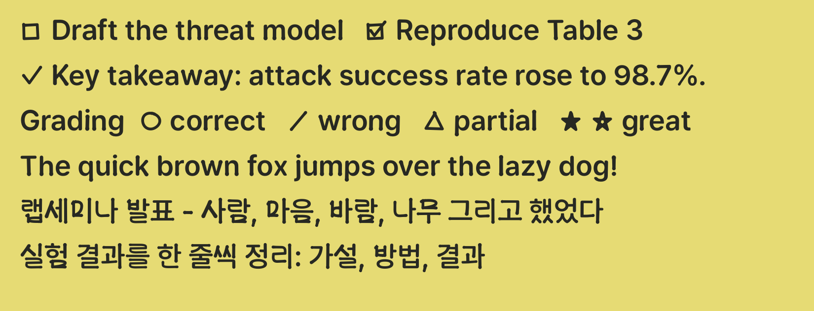
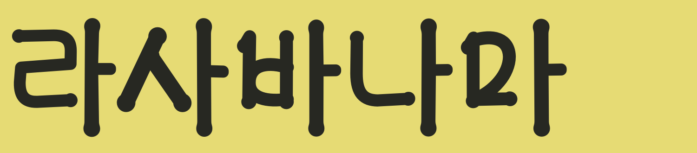
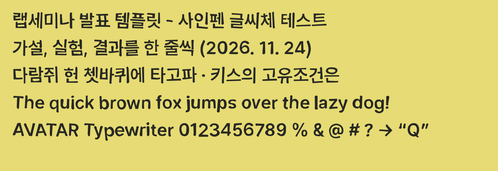
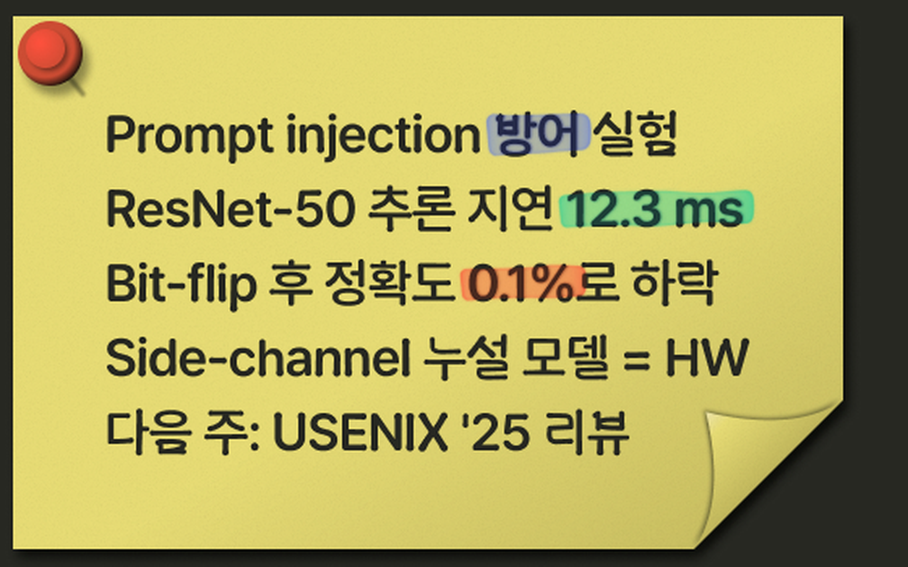
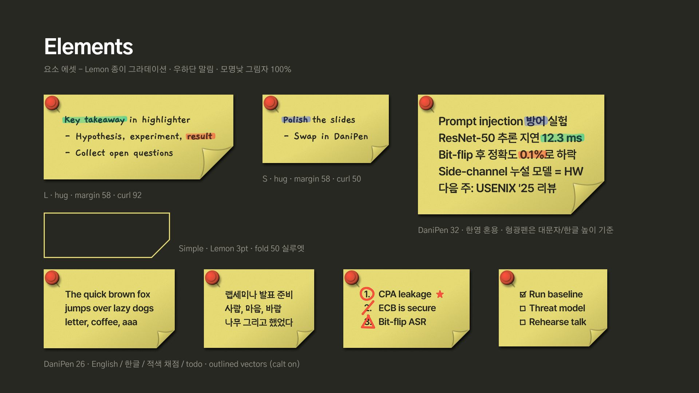

<details>
<summary markdown="span">Highlighting Rules</summary>
<div class="toggle-content" markdown="1">

형식마다 역할이 하나씩 있다. 한 번 읽은 뒤에는 색 하나만 따라가며 훑어도 흐름이 잡힌다.

- <span class="highlight-blue"><strong>Blue</strong></span> - 지키기로 한 규칙
- <span class="highlight-orange">Orange</span> - 꼬였거나 꼬일 뻔한 지점
- <span class="text-gray">Gray text</span> - 날짜, 수치, 여담

</div>
</details>

<strong>TL;DR:</strong> Pretendard SemiBold를 고쳐 손글씨 폰트 DaniPen을 만들었다. Figma가 이 폰트를 글꼴로 못 불러와서, HarfBuzz로 글자를 배치한 뒤 아웃라인을 SVG 벡터로 옮겨 썼다. 형광펜은 글자 높이(대문자나 한글 기준)에 맞춘 밴드를 Python으로 그렸다.

<figure style="text-align: center;">
    
    <figcaption style="font-size: 0.9em; color: gray; margin-top: 5px;" markdown="span">DaniPen 샘플</figcaption>
</figure>

## DaniPen

릴리스 폴더에는 세 파일이 있다.

- `DaniPen-SemiBold.otf` <span class="text-gray">(글리프 37,188개, 자모를 다시 그린 음절 4,791개, OTS(OpenType Sanitizer) 검사 통과)</span>
- `OFL.txt` - 수정 내역을 적은 SIL Open Font License
- `DaniPen-sample.png`

Pretendard에서 바꾼 것은 OFL.txt에 적어 둔 그대로다.

- 획 끝을 살짝 부풀린 둥근 끝으로
- 꺾이는 곳을 둥근 펜촉(round nib)으로 돌아가게
- 자모 ㄴ ㄹ ㅁ ㅂ ㅅ을 둥근 펜촉 뼈대로 다시 그렸다
- 손으로 그린 기호 ☐ ☑ ✓ ○ ⧸ △ ☆ ★
- seed를 고정한 약간의 불규칙성
- calt(앞뒤 글자에 따라 글리프를 바꾸는 기능)로 번갈아 나오는 대체 글리프 3종

<span class="highlight-blue"><strong>고친 폰트의 이름은 DaniPen으로 했다.</strong></span> OFL은 Reserved Font Name으로 지정된 이름을 수정본에 쓰지 못하게 해서, Pretendard라는 이름은 쓰지 않았다.

<figure style="text-align: center;">
    
    <figcaption style="font-size: 0.9em; color: gray; margin-top: 5px;" markdown="span">자모 확대. ㄹ ㅅ ㅂ ㄴ ㅁ이 둥근 펜촉으로 다시 그려졌다</figcaption>
</figure>

### 자모 교체 방식

Pretendard 음절 아웃라인은 대체로 자모 하나가 윤곽선 하나다. 그래서 윤곽선을 위치로 초성 / 중성 / 종성에 나눠 배정하고, <span class="highlight-blue"><strong>바꿀 자모의 윤곽선 구조(구멍 개수 등)가 예상과 맞을 때만</strong></span> 둥근 펜촉 뼈대로 교체했다.

<span class="highlight-orange">그런데도 "줄"이 "즐"처럼 보이는 글자가 나왔다.</span> 교체한 자모가 모음과 닿아 버린 것이다. 교체를 건너뛰는 규칙을 넣어서 막았다.

- 종성인데 위쪽 끝이 너무 높으면 건너뛴다 <span class="text-gray">(bbox ymax &gt; 720)</span>
- 초성인데 종성이 있고 아래로 너무 내려오면 건너뛴다 <span class="text-gray">(ymin &lt; 500)</span>
- 초성이 가로 모음(ㅗㅛㅜㅠㅡ)과 겹치면 건너뛴다
- 초성이나 중성 윤곽선이 비면 분류 자체를 포기한다

<figure style="text-align: center;">
    
    <figcaption style="font-size: 0.9em; color: gray; margin-top: 5px;" markdown="span">한영 혼용 테스트 문장</figcaption>
</figure>

## Figma에 넣기

<span class="highlight-orange">내가 만든 폰트는 Figma에서 글꼴로 불러올 수 없었다.</span> 그래서 글자를 벡터 아웃라인으로 바꿔 넣었다. 텍스트로 고칠 수는 없지만, 폰트가 설치되지 않은 컴퓨터에서도 그대로 보인다.

1. HarfBuzz(글자 모양과 위치를 정하는 shaping 엔진)로 문장을 배치했다. `calt`, `kern`, `liga`를 켜서 대체 글리프가 돌아가게 했다.
1. fontTools pen으로 글리프 윤곽을 그려서 SVG path로 바꿨다. 자간은 -0.02em.
1. 함수는 줄마다 path 하나와 글자별 x 범위(span)를 돌려준다. span은 형광펜 위치를 잡는 데 쓴다.
1. SVG를 `upload_assets`로 올리고, 벡터에 `Key/Monokai` 채움과 `Pen/Ink · Monokai` 효과를 붙였다 <span class="text-gray">(inner shadow r2 90% + layer blur 0.4. 사인펜 잉크가 종이에 스며든 느낌)</span>.

```python
def line(text, size, ox, base, track=-0.02, rel=None):
    glyphs, _ = shape(text)              # HarfBuzz: calt / kern / liga
    sc = size / UPM
    rec, spans, shift = RecordingPen(), {}, 0.0
    for name, gx, gy, cl, adv in glyphs:
        x0 = ox + (gx + shift) * sc
        gs[name].draw(TransformPen(rec, (sc, 0, 0, -sc, x0, base - gy * sc)))
        spans.setdefault(cl, [x0, x0 + adv * sc])[1] = x0 + adv * sc
        shift += track * UPM
    ...                                  # → path d, bbox, spans
```

## 형광펜 밴드

<figure style="text-align: center;">
    
    <figcaption style="font-size: 0.9em; color: gray; margin-top: 5px;" markdown="span">형광펜 밴드 모양. 시작은 둥근 사각, 끝은 둥근 캡, 오른쪽으로 갈수록 살짝 올라간다</figcaption>
</figure>

### 밴드 높이

<span class="highlight-blue"><strong>y, g처럼 기준선 아래로 내려가는 부분(descender)은 높이에 넣지 않는다.</strong></span> 영문은 대문자 높이, 한글은 한글 글자 높이를 기준으로 하고, 위아래를 6%씩 안쪽으로 들여서 밴드가 글자보다 조금 얇게 했다.

아래 표에는 Gaegu(Google Fonts의 한글 손글씨 폰트)도 같은 기준으로 잰 값을 같이 적었다.

| 폰트 | 기준 | 아래 끝 | 위 끝 (em) |
| --- | --- | --- | --- |
| DaniPen | 대문자 | -0.011 | 0.718 |
| DaniPen | 한글 | -0.084 | 0.794 |
| Gaegu | 대문자 | -0.027 | 0.548 |
| Gaegu | 한글 | -0.033 | 0.607 |

형광펜을 칠할 단어에 한글이 하나라도 있으면 한글 기준, 아니면 대문자 기준으로 고른다.

### 모양

아래에서 T는 밴드 두께, W는 밴드 길이다.

- 시작 쪽은 둥근 사각형에 가까운 모서리로 했다 <span class="text-gray">(반지름 0.20T, 끝이 0.06T 기운 chisel)</span>. <span class="highlight-orange">처음에는 시작이 뾰족해서 둥글게 다시 그렸다.</span>
- 끝은 superellipse 캡으로 닫았다 <span class="text-gray">(길이 0.36T, 지수 3.2)</span>. 처음보다 조금 덜 둥글게 바꿨다.
- 밴드는 오른쪽으로 갈수록 살짝 올라간다 <span class="text-gray">(올라가는 높이 min(0.022W, 0.22T))</span>.
- 가장자리는 저주파 노이즈로 흔들리게 했다. 흔들리는 폭은 위 끝 4.5%, 아래 끝 6%. 두께는 끝으로 갈수록 5% 줄어든다.
- 글자 양쪽으로 7px씩 더 칠했다.

```python
def place(x0, x1, kind, metrics, size, baseline, seed, pad=7):
    top, bot = band(kind, metrics, size, baseline)   # 글자 높이 - 6% 안쪽
    T = bot - top
    W = (x1 - x0) + 2 * pad
    rise = min(0.022 * W, 0.22 * T)
    d, w, h, mx, my = outline(W, T, rise, seed)
    y = (top + bot) / 2 - (T / 2 + rise / 2) + my     # 올라간 만큼 위아래로 나눠 가운데 정렬
    return dict(d=d, x=round(x0 - pad + mx, 2), y=round(y, 2), w=round(w, 2), h=round(h, 2))
```

### 색

- 채움은 `Highlighter/Vivid Blue · Green · Red`. 같은 색을 여러 스톱으로 둔 선형 그라데이션이고, 블렌드는 Multiply.
- 효과는 `Highlighter/Ink · *` <span class="text-gray">(바깥 번짐 drop shadow r3 22% + 안쪽 inner shadow r2.5 55% + layer blur 0.6)</span>.
- <span class="text-gray">Multiply 때문에 파란 형광펜은 레몬 종이 위에서 회색빛이 도는 초록으로 보인다. 실제 형광펜도 그렇게 섞인다.</span>

## 사인펜 × 형광펜 번짐

<figure style="text-align: center;">
    
    <figcaption style="font-size: 0.9em; color: gray; margin-top: 5px;" markdown="span">메모 확대. 형광펜과 겹친 글자가 청녹 · 적갈 · 군청으로 번진다</figcaption>
</figure>

수성 사인펜으로 쓴 글씨 위에 형광펜을 칠하면 잉크가 번진다. 이 번짐을 흉내 낸 레이어를 따로 뒀다.

- 형광펜 밴드 모양을 마스크로 쓰고, 그 안에서만 글자가 번지게 했다.
- 층은 세 개다: wash(15%) → halo(35%) → core. wash와 halo에는 layer blur를 걸었다.
- core 색은 사인펜(Monokai)과 형광펜 색을 섞은 `Ink Mix/*`: 초록 위는 Teal Green `#1E3F38`, 빨강 위는 Rust `#48291F`, 파랑 위는 Ultramarine `#252A49`.
- <span class="highlight-orange">처음에는 번짐이 강하고, 글자 색까지 형광펜 색에 가깝게 바뀌었다.</span> 사인펜 안쪽은 Monokai가 더 남게 core 색을 되돌리고, 번지는 정도도 덜어냈다.
- 번짐 레이어는 그룹 안 글자를 `clone()`해서 만들었다. 복제본 위치가 어긋난 문제와 맞춘 방법은 1편 삽질 기록 2번에 적었다.

## 메모 레이아웃

<figure style="text-align: center;">
    
    <figcaption style="font-size: 0.9em; color: gray; margin-top: 5px;" markdown="span">Elements 슬라이드</figcaption>
</figure>

- 압정은 모든 포스트잇에서 왼쪽 위 모서리로부터 같은 거리(3)에 뒀다 (포스트잇과 압정은 5편).
- 본문은 압정에서 대각선 아래로 일정한 거리에서 시작한다.
- <span class="highlight-blue"><strong>위 · 왼쪽 여백과 오른쪽 · 아래 여백을 같게 했다 (hug, 여백 58).</strong></span> 포스트잇 크기는 내용에 맞춰 줄어든다.
- 포스트잇 제목은 일단 전부 나중에 정하기로 하고 지웠다.
- 슬라이드 아래 줄은 영문 · 한글 · 채점 기호 · todo 테스트다. 채점 기호는 적색(`Pen/Ink · Vivid Red`)으로 썼다.

<details>
<summary markdown="span">발표 자동화 시리즈</summary>
<div class="toggle-content" markdown="1">

1. <span class="text-gray">[etc; 발표 자동화] Claude × Figma MCP로 랩세미나 템플릿 만들기</span>
1. <span class="text-gray">[etc; 발표 자동화] 키컬러, 타이포그래피, 이름 붙은 가이드</span>
1. <span class="text-gray">[etc; 발표 자동화] bottom-up tree와 그라데이션 간선</span>
1. <span class="text-gray">[etc; 발표 자동화] DaniPen 손글씨와 형광펜 밴드</span> (이 글)
1. <span class="text-gray">[etc; 발표 자동화] 포스트잇, 오일파스텔, 필기구, 피규어</span>
1. <span class="text-gray">[etc; 발표 자동화] 코드 블록: 머메이드지, diff, 23px</span>

</div>
</details>
